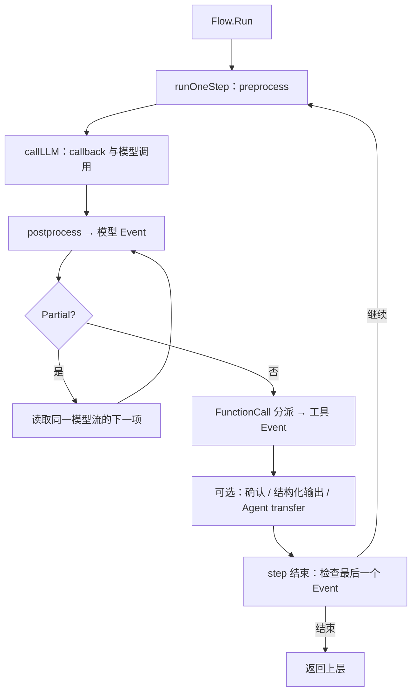
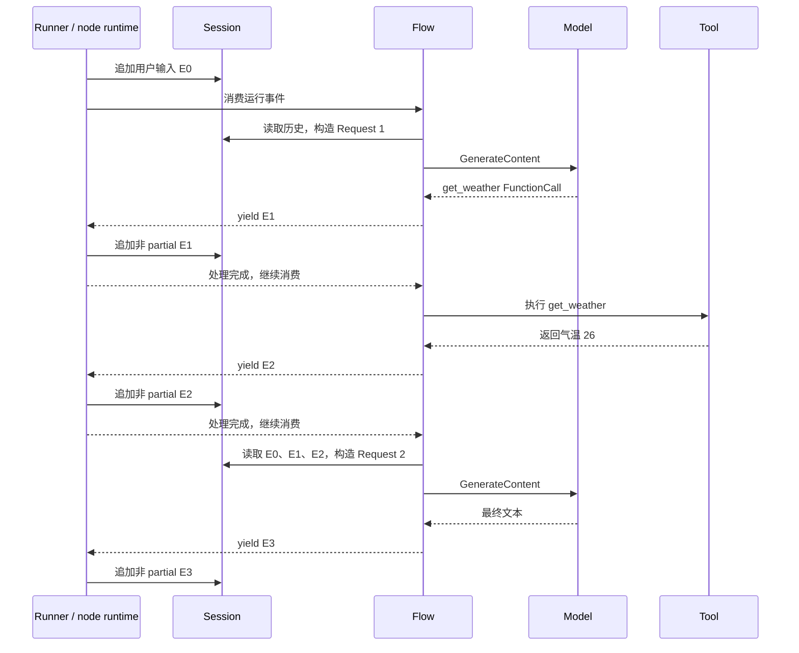

# ADK-Go 源码阅读笔记 · Flow：一次 LLM Agent 回合是怎样跑完的

> **源码版本：[ADK-Go v2.4.0](https://github.com/google/adk-go/tree/v2.4.0)**，commit `4e57df40cbd35f055ba654b03ffb0e509fdd754a`。以下“当前实现”均指这个版本。
>
> [返回源码阅读合集](/blog/adk/) · 配套阅读：[Runner](/blog/adk-runner/)、[Context](/blog/adk-context/)、[Tool](/blog/adk-tool/)、[Plugin](/blog/adk-plugin/)。相关模块的阅读顺序见合集。

用户问“杭州天气怎么样”，模型返回 `get_weather(city="Hangzhou")`。到这里，天气查询还没有执行，用户也还没有得到答案。程序还必须找到工具、执行代码、把结果交回模型，并判断是否还要继续调用模型。

**Flow 就是把这些阶段接起来的内部控制层。** 它让一次模型调用成为可以反复“请求 → 执行 → 反馈”的 Agent 运行过程。理解它，关键是同时追踪控制流和数据：下一步由谁触发，上一轮结果又通过什么对象进入下一步。

本文回答三个问题：

1. 谁创建 Flow，它依赖哪些接口和数据？
2. 一条模型 FunctionCall 如何变成工具结果，再进入下一次模型请求？
3. Flow 与 Runner、Model、Tool 之间的职责边界在哪里？

主线先看普通 `Run` 的一次工具调用闭环；SSE、确认、transfer 和 Live 放到第四节展开。本文不是 Workflow scheduler 或 Session 数据库实现的完整说明。

**阅读准备。** 只需要了解 Go 的接口、指针、map，以及大语言模型的 Function Calling：模型输出函数名和参数，实际函数由应用执行。如果不熟悉 `iter.Seq2`，第三节会结合代码解释；无需先掌握 ADK 的全部模块。

先约定几个容易混用的词：

| 术语 | 本文中的含义 | 天气例子中的数量 |
| --- | --- | --- |
| Session | 持续保存多次交互的会话及其历史、状态 | 1 个，可以继续提问 |
| Invocation | 一次执行上下文所关联的运行；恢复路径可能沿用原 invocation ID | 普通无暂停路径为 1 次 |
| Flow step | 一次 `runOneStep`：准备请求、消费模型响应、处理工具及后续动作 | 通常 2 步 |
| 模型调用 | 真正进入 `GenerateContent`；BeforeModel 可使它被跳过 | 本例 2 次 |
| Event | 一条向上返回的运行记录，可能承载文本、函数调用、结果或控制信息 | 主线为用户输入、调用、结果、答案 4 条；外层还可能有控制事件 |
| Partial / final | Partial 表示响应尚未聚合完成；`IsFinalResponse()` 是事件的结束判定方法 | 不是“每条 Event 都是一轮模型调用” |

第一次阅读可先读第一至第三节，再看第五至第七节；第四节用于沿具体问题深入。文中标为“源码摘录”的代码对应固定 tag；省略外围代码会明确说明。“伪代码”“示意数据”和教学示例不冒充源码原文。

## 一、源码入口与阅读地图

`Flow` 位于 `internal`，不是应用直接导入的公开入口。建议先读它的创建者，再读主循环，最后沿分支进入各 processor。

| 阅读顺序 | 文件 / 符号 | 要回答的问题 |
| --- | --- | --- |
| 1. 公开配置与创建者 | `agent/llmagent/llmagent.go`：`Config`、`llmAgent.run` | 模型、工具和 callback 如何装进 Flow？ |
| 2. 核心循环 | `internal/llminternal/base_flow.go`：`Run`、`runOneStep` | 一次 step 如何执行，何时再跑一步？ |
| 3. 请求拼装 | `basic_processor.go`、`instruction_processor.go`、`contents_processor.go` | Agent 配置与 Session 历史如何变成 request？ |
| 4. 执行分支 | `tools_processor.go`、`request_confirmation_processor.go`、`agent_transfer.go`、`outputschema_processor.go` | 工具、确认、委派和最终结果如何衔接？ |
| 5. 压缩与流式 | `compaction_processor.go`、`stream_aggregator.go` | 哪些路径不是简单的一问一答？ |
| 6. 下层与上层边界 | `model/llm.go`、`model/gemini/gemini.go`、`runner/runner.go`、`runner/run_node.go` | 谁调用模型、谁聚合 chunk、谁持久化事件？ |

`Runner` 负责把 Session、Context、Agent 和事件流接起来；`llminternal.Flow` 则负责一个 LLM Agent 内部的循环：准备请求、调用模型、处理模型响应、执行工具、把结果变成事件，然后决定是否继续下一轮。

可以先把它抽象成：



上图只画正常控制主干：没有 FunctionCall 就没有工具事件；模型流也可能直接结束，任一阶段的错误或消费者停止都会提前返回。partial 分支读取同一条流，**不是重新发起模型请求**。详细分支以下面的源码拆解为准。

其中最重要的边界是：普通模型和工具事件由 Flow 产生，再交给 Runner 追加到 Session。不过这不是绝对的“不写库”：Flow 的尾部保留压缩处理器会通过 Context 中的 compaction runtime 直接追加摘要，后文会单独区分。

## 二、接口定义与核心数据结构

### 1. `model.LLM` 只负责模型调用

`model.LLM` 的职责是接收已经准备好的 `model.LLMRequest`，返回 `model.LLMResponse`。接口本身不负责 Session 历史、Agent transfer 或工具 callback 的完整生命周期。

下面保留 `model/llm.go` 的接口定义和原始注释：

```go
// LLM provides the access to the underlying LLM.
type LLM interface {
    Name() string
    GenerateContent(ctx context.Context, req *LLMRequest, stream bool) iter.Seq2[*LLMResponse, error]
}

// LLMRequest is the raw LLM request.
type LLMRequest struct {
    Model    string
    Contents []*genai.Content
    Config   *genai.GenerateContentConfig

    Tools map[string]any `json:"-"`
}
```

`Contents` 和 `Config` 参与模型请求；`Tools` 是本地执行表，带 `json:"-"`，不能与 `Config.Tools` 中发给模型的声明混为一谈。

把一次天气请求按字段摊开，会更容易理解这两个“Tools”。下面是示意数据，不是完整 JSON 请求：

```text
LLMRequest
├─ Model: "某个模型名称"
├─ Config.SystemInstruction: "根据天气查询结果回答用户"
├─ Config.Tools: get_weather 的名称、描述和 city 参数 schema
├─ Contents: [user: "杭州天气怎么样？"]
└─ Tools["get_weather"]: 当前进程中的 Go 工具对象
```

`Config.Tools` 让模型知道“可以请求什么”；`req.Tools` 让 Flow 知道“请求来了以后执行谁”。模型服务不会获得 Go 函数指针，也不会替应用调用本地 handler。只改工具声明而没有本地实现，可能得到一个无法分派的调用。

对应源码：[模型接口与请求结构](https://github.com/google/adk-go/blob/v2.4.0/model/llm.go#L27-L41)。

### 2. `Flow` 负责 LLM Agent 内部控制流

`llmagent.llmAgent.run` 会为当前 Agent 创建一个 `llminternal.Flow`：

```go
f := &llminternal.Flow{
    Model:                 a.model,
    RequestProcessors:     llminternal.DefaultRequestProcessors,
    ResponseProcessors:    llminternal.DefaultResponseProcessors,
    BeforeModelCallbacks:  a.beforeModelCallbacks,
    AfterModelCallbacks:   a.afterModelCallbacks,
    OnModelErrorCallbacks: a.onModelErrorCallbacks,
    BeforeToolCallbacks:   a.beforeToolCallbacks,
    AfterToolCallbacks:    a.afterToolCallbacks,
    OnToolErrorCallbacks:  a.onToolErrorCallbacks,
}
```

上面是 [llmAgent.run 的源码摘录](https://github.com/google/adk-go/blob/v2.4.0/agent/llmagent/llmagent.go#L450-L473)。它先把当前 Agent 写入派生的 InvocationContext，再创建 Flow，最后消费 `f.Run(ctx)`。这解释了两个生命周期问题：**同一个 Flow 的多个 step 复用 `f.Tools`，但新一次 `llmAgent.run` 会创建新的 Flow**；它不是整个应用共用的全局循环对象。

Flow 通过 `InvocationContext.Session()` 读取历史；工具通过派生的 ToolContext 写 `Actions()`，Flow 再把动作装入事件。`InvocationContext` 本身没有 `Actions()` 方法。普通模型/工具事件的追加工作由 Runner 完成；compaction processor 是直接追加摘要的特殊路径。

### 3. Flow 的事件是“向上的返回值”

Flow 通过 Go 的 `iter.Seq2[*session.Event, error]` 逐个 yield：

- 模型响应事件；
- 工具响应事件；
- HITL confirmation event；
- 结构化输出转换后的最终模型事件；
- Agent transfer 后续 Agent 产生的事件。

Runner 收到这些事件后，再执行 Plugin 的 `OnEvent`、持久化和对外 yield。

#### `Author`、`Role` 和调用 ID 分别表达什么

Event 是 ADK 的运行记录，`Content` 是模型协议中的消息，两层字段不能混读：

```text
session.Event
├─ ID / InvocationID / Author / Branch / IsolationScope
├─ LLMResponse
│  ├─ Partial / TurnComplete / ErrorCode ...
│  └─ Content
│     ├─ Role: "user" 或 "model"
│     └─ Parts: Text / FunctionCall / FunctionResponse ...
└─ Actions: StateDelta / TransferToAgent / SkipSummarization ...
```

| 内容 | `Event.Author` | `Content.Role` | 含义 |
| --- | --- | --- | --- |
| 人类输入 | `user` | `user` | 用户说了什么 |
| 模型要求调用工具 | 当前 Agent 名，如 `weather_agent` | `model` | 这个 Agent 的模型提出执行请求 |
| 工具执行结果 | 当前 Agent 名，如 `weather_agent` | `user` | 应用把外部执行结果反馈给模型 |
| 最终文本回答 | 当前 Agent 名 | `model` | 这个 Agent 生成了回答 |

因此 **`Role == "user"` 不代表这条消息一定由人类写出**。工具结果和合成的继续提示也使用 user role。`Event.ID` 标识事件，`FunctionCall.ID` 标识一次调用；后者会复制到对应的 `FunctionResponse.ID`，用于配对。两个同名工具调用仍可能有不同的调用 ID。

字段依据：[Event](https://github.com/google/adk-go/blob/v2.4.0/session/session.go#L76-L149)、[工具结果事件构造](https://github.com/google/adk-go/blob/v2.4.0/internal/llminternal/base_flow.go#L1292-L1332)。

### 4. `Flow` 结构体与默认管线

`Flow` 本身保存模型、工具集合、processor 函数列表和 callback 列表。下面保留实际字段类型，不把匿名函数类型改写成并不存在的导出类型：

```go
// Flow is a base implementation of the agent flow.
type Flow struct {
    Model model.LLM

    Tools                 []tool.Tool
    RequestProcessors     []func(ctx agent.InvocationContext, req *model.LLMRequest, f *Flow) iter.Seq2[*session.Event, error]
    ResponseProcessors    []func(ctx agent.InvocationContext, req *model.LLMRequest, resp *model.LLMResponse) error
    BeforeModelCallbacks  []BeforeModelCallback
    AfterModelCallbacks   []AfterModelCallback
    OnModelErrorCallbacks []OnModelErrorCallback
    BeforeToolCallbacks   []BeforeToolCallback
    AfterToolCallbacks    []AfterToolCallback
    OnToolErrorCallbacks  []OnToolErrorCallback
}
```

这里的 processor 与 callback 要分开理解：

| 类型 | 作用 | 来源 |
| --- | --- | --- |
| Request Processor | 按固定顺序构造或修改 `LLMRequest` | ADK 默认流程 |
| Response Processor | 修改 `LLMResponse` | ADK 默认流程 |
| Model Callback | 拦截模型调用前后和模型错误 | Agent / Plugin |
| Tool Callback | 拦截工具调用前后和工具错误 | Agent / Plugin |

当前默认 request processors 的顺序是：

```text
basicRequestProcessor
  → toolProcessor
  → authPreprocessor
  → RequestConfirmationRequestProcessor
  → instructionsRequestProcessor
  → identityRequestProcessor
  → CompactionRequestProcessor
  → ContentsRequestProcessor
  → nlPlanningRequestProcessor
  → codeExecutionRequestProcessor
  → outputSchemaRequestProcessor
  → AgentTransferRequestProcessor
  → removeDisplayNameIfExists
```

这份列表里有几个名称看起来功能很完整，但当前 Go 实现仍是空壳：

- `authPreprocessor`：当前是 TODO no-op；
- `nlPlanningRequestProcessor`：当前是 TODO no-op；
- `codeExecutionRequestProcessor`：当前是 TODO no-op；
- 对应的 NL planning / code execution response processor 也仍是 no-op。

因此源码里的“默认管线”不等于每个 processor 都已经具备 Python 版本的完整行为。阅读 Flow 时必须以当前函数体为准，不能仅凭 processor 名称推断它已经完成了某项能力。

默认 response processors 当前只有两个；下方省略函数签名，仅示意列表内容：

```go
[]func(...){
    nlPlanningResponseProcessor,
    codeExecutionResponseProcessor,
}
```

但它们目前都返回 nil，没有实际修改响应。

### 5. 关键对象由谁创建、修改和消费

| 对象 | 创建者 / 来源 | 修改者 | 消费者 |
| --- | --- | --- | --- |
| `Flow` | `llmAgent.run` | 预处理阶段初始化 `Tools` | 当前 Agent 的运行循环 |
| `InvocationContext` | Runner 及 Agent 派生路径 | 派生 Context、结束标志 | processor、模型和工具执行路径 |
| `LLMRequest` | 每次 `runOneStep` | processor、工具预处理、BeforeModel | `model.LLM`；本地 `Tools` 表供分派使用 |
| `LLMResponse` | Model adapter 或恢复 callback | AfterModel、response processor | 事件构造与 FunctionCall 分派 |
| `session.Event` | Flow / 工具事件构造函数 | 上层 Plugin 可改写 | Runner 持久化与调用方消费 |
| `EventActions` | 工具 Context 等路径 | Tool、callback；并行结果合并 | Runner / Session / workflow 的后续处理 |

抓住这张表，就能区分“同一个对象继续被修改”与“数据被包装为下一个阶段的对象”。

## 三、主执行路径：调用栈、数据流与事件流

先看一个正常例子：用户询问天气，模型调用一次 `get_weather`，工具返回结果，模型再输出普通文本。这里假设没有 callback 返回替代结果、人工确认或 transfer。

**调用栈：谁调用谁。** LlmAgent root 在 v2.4.0 中还会经过 Runner 的 node runtime；下面省略中间 workflow 调度帧，只保留与 Flow 相关的层次：

```text
Runner / node runtime
  → LlmAgent 执行
    → llmAgent.run：创建 Flow
      → Flow.Run
        → runOneStep
          → preprocess
          → callLLM → GenerateContent
          → postprocess → finalizeModelResponseEvent
          → handleFunctionCalls → callTool → Tool.Run
```

**数据流：对象如何转换。**

```text
Agent 配置 + Session.Events + InvocationContext
  → LLMRequest（Contents / Config / 本地 Tools 表）
  → LLMResponse（文本或 FunctionCall）
  → 模型 Event
  → FunctionCall.Args → Tool.Run → result map
  → FunctionResponse Event
  → Session 历史 → 下一 step 的 LLMRequest
```

**事件流：消费者按什么顺序看到记录。**

| 阶段 | 事件 / 数据 | 谁处理 |
| --- | --- | --- |
| 输入 | 用户 Event | Runner 先追加到 Session，不是 Flow 生成 |
| Step 1 模型结果 | model-role FunctionCall Event | Flow yield，Runner 执行事件管线 |
| Step 1 工具结果 | user-role FunctionResponse Event | Flow yield，Runner 追加非 partial 事件 |
| Step 结束 | 最后事件含 FunctionResponse，通常不是 final | `Flow.Run` 继续下一 step |
| Step 2 | 新 request 读到先前 call / response；模型输出文本 Event | Flow yield，外层判断 final 后结束 |

这不是“先执行完所有工具、最后统一落库”。模型事件先交给上层，随后才执行工具。如果上层此时停止消费，后面的工具阶段就可能根本不会发生。

### 从四条记录看清两次模型请求

假设 Session 原本为空，当前 Agent 叫 `weather_agent`，工具返回杭州气温 26°C。下面省略 metadata、状态和 node 控制事件，只展示本例的内容记录：

```text
E0  Author=user           Role=user
    Text="杭州天气怎么样？"

E1  Author=weather_agent  Role=model
    FunctionCall{ID: "weather-1", Name: "get_weather",
                 Args: {"city": "Hangzhou"}}

E2  Author=weather_agent  Role=user
    FunctionResponse{ID: "weather-1", Name: "get_weather",
                     Response: {"city": "Hangzhou", "temperature": 26}}

E3  Author=weather_agent  Role=model
    Text="杭州当前气温为 26°C。"
```

对应的两个请求并不相同：

| 时刻 | `req.Contents` 的主要内容 | 模型还能获得什么 |
| --- | --- | --- |
| Step 1 调用前 | `[E0.Content]` | SystemInstruction、工具名称与参数 schema |
| Step 1 执行后 | Session 已追加 E1、E2 | 此时没有立即在原 request 上追加结果 |
| Step 2 调用前 | `[E0.Content, E1.Content, E2.Content]` | 重新构造的 config、instruction 和工具声明 |
| Step 2 执行后 | Session 再追加 E3 | Flow 可以结束，Session 留给下一次交互 |

表格描述本例经过 Contents processor 后的等价内容；复杂历史还会过滤、转换和重排。这里最值得注意的是：**第二步创建新的 `LLMRequest`，从已更新的 Session 重建 Contents，而不是让第一次 `GenerateContent` 自己恢复执行。** 模型是看到 E2 后才有依据生成 E3。

### `yield` 如何把 Flow 与 Session 接成闭环

`iter.Seq2[A, B]` 可以理解为“接受一个 `yield(A, B) bool` 回调的函数”。`yield` 返回 true 表示消费者愿意继续，返回 false 表示停止。它不是自动启动的 goroutine，也不自带缓冲队列。

直接嵌套 iterator 时，生产者调用 `yield`，会等外层消费代码返回后才往下走。LlmAgent 经 Runner 的 node runtime 执行时还有 goroutine，但 scheduler 对非 partial event 增加了 **processed 握手**：上层处理完成后才放行生产者。两条路径都需要读调用方，不能仅从 Flow 的签名推断持久化时机。

下面是本例的逻辑时序，合并了中间 Agent wrapper / scheduler 的转发层：



事件追加前还有 Plugin `OnEvent`，追加后再向调用方 yield；图中省略这两步，只突出历史闭环。对应源码是 [Runner 节点事件消费](https://github.com/google/adk-go/blob/v2.4.0/runner/run_node.go#L196-L245) 与 [scheduler 的非 partial 等待](https://github.com/google/adk-go/blob/v2.4.0/workflow/scheduler.go#L470-L489)、[上层消费后的释放](https://github.com/google/adk-go/blob/v2.4.0/workflow/scheduler.go#L586-L600)。

这也解释了一个排障现象：若日志里已经有 FunctionCall event，却没有工具 handler 日志，除了分派错误，还应检查消费者是否提前退出，或上层是否在事件追加时失败。

下面再拆开支撑这个闭环的两个循环。

### 1. 外层循环：`Flow.Run`

`Flow.Run` 调用时只返回一个 `iter.Seq2` 迭代函数；调用方开始 range 后，`runOneStep` 才被推进执行。

外层循环的逻辑可以简化成下面的伪代码，保留判断顺序，省略日志；对应 [Flow.Run](https://github.com/google/adk-go/blob/v2.4.0/internal/llminternal/base_flow.go#L122-L169)：

```go
func (f *Flow) Run(ctx agent.InvocationContext) iter.Seq2[*session.Event, error] {
    return func(yield func(*session.Event, error) bool) {
        thoughtOnlyTurns := 0

        for {
            var lastEvent *session.Event
            for event, err := range f.runOneStep(ctx) {
                if err != nil {
                    yield(nil, err)
                    return
                }
                if !yield(event, nil) {
                    return
                }
                lastEvent = event
            }

            if lastEvent == nil {
                return
            }
            if lastEvent.IsFinalResponse() {
                if !isThoughtOnlyTurn(lastEvent) {
                    return
                }
                thoughtOnlyTurns++
                if thoughtOnlyTurns >= maxConsecutiveThoughtOnlyTurns {
                    return
                }
            } else {
                thoughtOnlyTurns = 0
            }

            if lastEvent.LLMResponse.Partial {
                return
            }
        }
    }
}
```

源码还定义了 `maxConsecutiveThoughtOnlyTurns = 10`；这是安全阈值而不是可配置参数。上面的伪代码省略了达到阈值时的日志。

#### 1.1 什么时候停止

外层是在**当前 step 的 iterator 结束之后**检查 `lastEvent`，不是看到任何一个 final event 就立即退出。因此一个带长任务 ID 的模型事件后面若还有工具响应，真正决定是否继续的是本 step 最后的事件。

`session.Event.IsFinalResponse()` 是一个**有优先级的判断**，不能把下面的条件理解为“任意一条都算普通 final”：

```text
if Actions.Compaction != nil:
    false                         // 压缩记录不是对话答案
else if Actions.SkipSummarization || len(LongRunningToolIDs) > 0:
    true                          // 两个提前结束条件
else:
    无 FunctionCall
    AND 无 FunctionResponse
    AND 非 Partial
    AND 无尾部 code execution result
```

源码：[session.Event.IsFinalResponse](https://github.com/google/adk-go/blob/v2.4.0/session/session.go#L218-L230)。外层 `Flow.Run` 还会额外调用 `isThoughtOnlyTurn`，因此“final event”与“Flow 必然结束”不是同一个判断：

- `Actions.SkipSummarization` 或长任务 ID 会让事件直接 final；
- 普通 final 要同时满足四个 AND 条件；
- compaction event 即使看起来满足普通条件，也明确不是 final；
- thought-only event 可能是 final，但 Flow 会再调用模型，最多容忍连续 10 个 thought-only turn；
- 这 10 次是“连续只思考”的安全阈值，不是普通工具循环的 MaxSteps。只要出现一个非 final turn，计数就归零。

所以 final 不一定表示“用户看到了普通文本回答”。它也可能表示：

- 工具请求了人工确认；
- 工具是长任务；
- 工具设置了 `SkipSummarization`；
- 模型只返回了 thought。

#### 1.2 Thought-only 的保护

如果一个完整模型事件中的所有 parts 都是 `Thought`，Flow 不会立刻结束，而是再调用模型，希望模型继续产出可见答案。

连续 thought-only 最多 10 次；第一次 thought-only 之后最多再调用 9 次，达到阈值时保留最后一个 thinking event 并记录日志。这个值是源码中的固定安全阈值，不是配置项。它防止“模型一直思考但永远不输出答案”导致无限模型调用和历史膨胀。

#### 1.3 Partial 收尾不会自动重试

如果最后的事件没有被前面的特殊 final 分支提前结束，却仍是 partial，Flow 会记录 warning 并结束当前 Flow，而不是把同一请求重新发给模型。源码把它视为流生产者没有发出最终聚合事件，而不是一个应该盲目重试的普通 final 判断失败。

### 2. 内层循环：`runOneStep`

一次 `runOneStep` 的准确顺序是：

```text
1. 检查 Model 是否存在
2. 创建 LLMRequest{Model: f.Model.Name()}
3. preprocess
   ├─ 默认 RequestProcessors
   ├─ toolPreprocess
   └─ toolsetPreprocess
4. 如果 Context 已结束，停止
5. 创建本轮 stateDelta / artifactDelta
6. callLLM
7. 对每个模型响应执行 postprocess
8. Content == nil 且 ErrorCode 为空且未 Interrupted 的响应跳过
9. finalizeModelResponseEvent 并 yield
10. partial 响应不执行工具
11. 非 partial 响应执行 handleFunctionCalls
12. yield FunctionResponse
13. yield confirmation event（如果有）
14. 处理 set_model_response
15. 如果 TransferToAgent 非空，运行下一个 Agent
```

几个顺序尤其重要：

- 模型响应 event 会先 yield，工具响应 event 后 yield；
- partial 模型响应会 yield，但不执行 FunctionCall；
- confirmation event 在已完成的工具响应之后 yield；
- Agent transfer 发生在当前工具响应处理之后，而不是在模型刚返回 FunctionCall 时立即跳转。

#### 源码中决定顺序的几行

下段摘自 [runOneStep](https://github.com/google/adk-go/blob/v2.4.0/internal/llminternal/base_flow.go#L671-L690)，保留原始注释：

```go
// Build the event and yield.
modelResponseEvent := f.finalizeModelResponseEvent(ctx, resp, tools, stateDelta)
if !yield(modelResponseEvent, nil) {
    return
}
// TODO: generate and yield an auth event if needed.

if resp.Partial {
    continue
}
// Handle function calls.

ev, err := f.handleFunctionCalls(ctx, tools, resp.LLMResponse, nil, nil)
if err != nil {
    yield(nil, err)
    return
}
if ev == nil {
    // nothing to yield/process.
    continue
}
```

顺着这段代码读，可以得到三个有直接依据的结论：

1. `yield(modelResponseEvent)` 在 `handleFunctionCalls` 之前，因此“记录模型打算做什么”先于工具执行。
2. `resp.Partial` 使用 `continue`，只读取**本次模型流**的下一项；不会因为某个 chunk 已包含函数名就执行工具。
3. `ev == nil` 不一定是错误，可能没有 FunctionCall，也可能工具延迟返回结果。此时继续读当前模型流。

工具结果存在时，后续代码依次 yield 工具结果、确认请求、结构化结果；若没有 transfer，便 `return` 结束**本 step**。外层 `Flow.Run` 再决定是否创建新 step。这是 [723–725 行](https://github.com/google/adk-go/blob/v2.4.0/internal/llminternal/base_flow.go#L723-L725) 的 `return`，不是结束整个用户交互的统一开关。

### 3. 可运行验证：不用真实模型，也能观察完整闭环

下面的完整示例使用公开 API 创建 LlmAgent、FunctionTool 和 InMemory Runner，只用确定性的 `mockModel` 替代远端模型：第一次输出函数调用，第二次必须在 request 中找到工具结果，否则返回错误。

这能验证 Flow 与 Runner 的协作，而不依赖模型是否“听话”。示例的气温是固定测试数据，不是真实天气。该 tag 的 `go.mod` 要求 **Go 1.26.6 或更新版本**；模块路径带 `/v2`。

在一个新的空目录中初始化模块，将下方程序保存为 `main.go`，再执行：

```bash
go mod init example.com/adk-flow-demo
go get google.golang.org/adk/v2@v2.4.0
go mod tidy
go run .
```

首次获取 Go 依赖需要联网；程序运行不需要 API Key，也不调用模型服务。

```go
package main

import (
	"context"
	"encoding/json"
	"fmt"
	"iter"
	"log"

	"google.golang.org/adk/v2/agent"
	"google.golang.org/adk/v2/agent/llmagent"
	"google.golang.org/adk/v2/model"
	"google.golang.org/adk/v2/runner"
	"google.golang.org/adk/v2/tool"
	"google.golang.org/adk/v2/tool/functiontool"
	"google.golang.org/genai"
)

type weatherInput struct {
	City string `json:"city"`
}

type weatherOutput struct {
	City        string `json:"city"`
	Temperature int    `json:"temperature"`
}

type mockModel struct {
	calls int
}

func (*mockModel) Name() string { return "offline-demo" }

func (m *mockModel) GenerateContent(_ context.Context, req *model.LLMRequest, stream bool) iter.Seq2[*model.LLMResponse, error] {
	return func(yield func(*model.LLMResponse, error) bool) {
		m.calls++
		fmt.Printf("MODEL #%d stream=%t\n", m.calls, stream)
		switch m.calls {
		case 1:
			yield(&model.LLMResponse{Content: &genai.Content{
				Role: "model",
				Parts: []*genai.Part{{FunctionCall: &genai.FunctionCall{
					ID: "weather-1", Name: "get_weather",
					Args: map[string]any{"city": "Hangzhou"},
				}}},
			}}, nil)
		case 2:
			found := false
			for _, content := range req.Contents {
				for _, part := range content.Parts {
					if fr := part.FunctionResponse; fr != nil && fr.Name == "get_weather" {
						found = true
						fmt.Printf("MODEL #2 sees FunctionResponse: %s\n", asJSON(fr.Response))
					}
				}
			}
			if !found {
				yield(nil, fmt.Errorf("second model request is missing get_weather FunctionResponse"))
				return
			}
			yield(&model.LLMResponse{
				Content: genai.NewContentFromText("杭州当前气温为 26°C。", "model"),
			}, nil)
		default:
			yield(nil, fmt.Errorf("unexpected model call #%d", m.calls))
		}
	}
}

func asJSON(value any) string {
	b, err := json.Marshal(value)
	if err != nil {
		panic(err)
	}
	return string(b)
}

func main() {
	weather, err := functiontool.New(functiontool.Config{
		Name: "get_weather", Description: "Returns the current temperature for a city.",
	}, func(_ agent.Context, input weatherInput) (weatherOutput, error) {
		fmt.Printf("TOOL get_weather city=%s\n", input.City)
		return weatherOutput{City: input.City, Temperature: 26}, nil
	})
	if err != nil {
		log.Fatal(err)
	}
	m := &mockModel{}
	a, err := llmagent.New(llmagent.Config{
		Name: "weather_agent", Model: m,
		Instruction: "Use get_weather to answer weather questions.",
		Tools:       []tool.Tool{weather},
	})
	if err != nil {
		log.Fatal(err)
	}
	r, err := runner.NewInMemory("flow_demo", a)
	if err != nil {
		log.Fatal(err)
	}
	for event, err := range r.Run(context.Background(), "user-1", "session-1",
		genai.NewContentFromText("杭州现在多少度？", "user"), agent.RunConfig{}) {
		if err != nil {
			log.Fatal(err)
		}
		if event.Content == nil {
			continue // Node control events may have no model content.
		}
		fmt.Printf("EVENT author=%s role=%s partial=%t final=%t\n",
			event.Author, event.Content.Role, event.Partial, event.IsFinalResponse())
		for _, part := range event.Content.Parts {
			if fc := part.FunctionCall; fc != nil {
				fmt.Printf("  FunctionCall name=%s id=%s args=%s\n", fc.Name, fc.ID, asJSON(fc.Args))
			}
			if fr := part.FunctionResponse; fr != nil {
				fmt.Printf("  FunctionResponse name=%s id=%s response=%s\n", fr.Name, fr.ID, asJSON(fr.Response))
			}
			if part.Text != "" {
				fmt.Printf("  Text: %s\n", part.Text)
			}
		}
	}
	fmt.Printf("GenerateContent calls=%d\n", m.calls)
}
```

程序输出如下；示例只打印有 `Content` 的事件，省略 node 控制事件。Runner 默认不会把已经保存的用户输入作为本例的输出事件再 yield 一遍：

```text
MODEL #1 stream=false
EVENT author=weather_agent role=model partial=false final=false
  FunctionCall name=get_weather id=weather-1 args={"city":"Hangzhou"}
TOOL get_weather city=Hangzhou
EVENT author=weather_agent role=user partial=false final=false
  FunctionResponse name=get_weather id=weather-1 response={"city":"Hangzhou","temperature":26}
MODEL #2 stream=false
MODEL #2 sees FunctionResponse: {"city":"Hangzhou","temperature":26}
EVENT author=weather_agent role=model partial=false final=true
  Text: 杭州当前气温为 26°C。
GenerateContent calls=2
```

这段输出可以反过来核对前面的源码：

1. 第一条 FunctionCall event 先出现，随后才打印 `TOOL get_weather`，对应“先 yield、再执行工具”。
2. 工具结果的 `Author` 仍是 `weather_agent`，`Role` 却是 `user`。
3. 第二次 `GenerateContent` 明确读到了 FunctionResponse，说明历史闭环已经形成。
4. 工具结果 `final=false`，最终文本 `final=true`，所以总共调用模型两次。

示例覆盖普通非流式主线，不涉及真实模型的响应质量、SSE 网络中断、Live 重连和持久化失败。

## 四、关键细节与分支

### 1. Request Processor：从空 Request 到可发送 Request

`runOneStep` 创建的初始请求只有模型名：

```go
req := &model.LLMRequest{
    Model: f.Model.Name(),
}
```

Request processor 通过 `iter.Seq2[*session.Event, error]` 执行，因此除了修改 request，还可以在模型调用前产生 event。

下面用局部类型别名表示字段中的函数签名，方便讨论；v2.4.0 没有导出这个名字：

```go
type requestProcessor = func(
    ctx agent.InvocationContext,
    req *model.LLMRequest,
    f *Flow,
) iter.Seq2[*session.Event, error]
```

当前实际管线如下。注意 iterator 转发的实现边界：`preprocess` 的 processor-event 分支当前调用 `yield(ev, nil)` 后没有检查返回值；不过外层 `runOneStep` 的消费循环会在自己的 `yield` 返回 false 时停止。若自定义 processor 在消费者停止后仍继续产事件，可能违反 Go range-over-func 契约；不能仅凭签名就断言所有层都正确传播了提前停止。

可把前面较长的 processor 列表按“最终写入哪里”分组：

| 处理阶段 | 主要输入 | 对 request / 运行的影响 |
| --- | --- | --- |
| basic | Agent 的 generation config | 初始化 `req.Config`，按规则设置 schema |
| tool collection | Agent.Tools / Toolsets | 初始化当前 Flow 的 `f.Tools` |
| confirmation | 历史中的确认决定 | 可能先执行原工具并 yield 结果 |
| instruction / identity | 配置、State、当前 Agent | 追加 `Config.SystemInstruction` |
| compaction → contents | Session 历史 | 先形成可用摘要，再生成 `req.Contents` |
| output schema / transfer | Agent 配置与 Agent tree | 加入内部工具及相关指令 |
| tool / toolset preprocess | 工具实现 | 为本次请求注册声明、执行对象或作其他修改 |

这些步骤复用同一个 `req` 指针；顺序就是数据依赖。`BeforeModel` 处看到的是经过上述步骤处理后的请求，不是最初只有模型名的空对象。源码：[默认顺序](https://github.com/google/adk-go/blob/v2.4.0/internal/llminternal/base_flow.go#L80-L105)、[preprocess](https://github.com/google/adk-go/blob/v2.4.0/internal/llminternal/base_flow.go#L749-L772)。

#### 1.1 `basicRequestProcessor`

从当前 LLM Agent state 复制 `GenerateContentConfig`：

```go
req.Config = clone(state.GenerateContentConfig)
if req.Config == nil {
    req.Config = &genai.GenerateContentConfig{}
}
```

`clone` 递归复制 struct、pointer、slice 和 map，避免直接复用配置对象。但它不是任意对象图都安全的通用深拷贝：interface 值在当前 `deepCopy` 中走直接赋值，遇到未导出的 struct 字段会 panic。不能据此认为所有嵌在 `any` 里的 map 都已经独立。

当 Agent 配置了 `OutputSchema`、声明模式不是 task，且 `needOutputSchemaProcessor` 返回 false 时，`basicRequestProcessor` 会直接设置：

```go
req.Config.ResponseSchema = state.OutputSchema
req.Config.ResponseMIMEType = "application/json"
```

如果满足后文列出的 Gemini fallback 条件，则留给 `outputSchemaRequestProcessor` 处理。这里不是通过任意模型的能力接口询问“是否支持 schema”，而是使用 ADK 自己的模型名称与 backend 判定；不在 fallback 范围内，不代表 provider 一定支持配置中的所有组合。

#### 1.2 `toolProcessor`

如果 Flow 尚未初始化 tools，它会：

- 收集 Agent 显式配置的 `Tools`；
- 对每个 `Toolset` 调用 `Tools(ReadonlyContext)`；
- 合并成 `f.Tools`。

`toolProcessor` 只展开工具集合，不等于已经将每个工具的声明打进 request。初始化后 `f.Tools != nil` 会让后续 step 跳过集合展开，所以动态 Toolset 不保证每次模型调用都重新枚举。

默认 request processors 全部结束后，`toolPreprocess` 才要求每个 tool 实现内部 `RequestProcessor`，并调用它。普通 FunctionTool 通常通过 `PackTool` 完成：

```text
Tool.ProcessRequest
  ├─ req.Tools[name] = implementation
  └─ req.Config.Tools += declaration
```

Tool 具体的双重注册逻辑见《Tool》一文。

#### 1.3 `RequestConfirmationRequestProcessor`

它处理上一轮工具确认产生的用户 FunctionResponse：

- 扫描 Session 历史；
- 检查最近一条 user event；若没有 FunctionResponse 就停止扫描，不越过新的用户文本去找旧批准；
- 提取原始 FunctionCall；
- 防止同一 confirmation ID 对应不同原始调用；
- 重新进入 `handleFunctionCalls`；
- 把 `ToolConfirmation` 注入 ToolContext。

这个 processor 发生在真正调用模型之前，因此确认后的原始调用会先被重新分派，工具根据 `Confirmed` 执行或拒绝。它不是“只恢复批准结果”，拒绝也走这条通路。预处理 yield 出工具事件后，`runOneStep` 仍会继续预处理并检查 `ctx.Ended()`；不能仅因为 processor 产出了一个事件，就认为本轮必然不再调用模型。

#### 1.4 `instructionsRequestProcessor`

先追加 root Agent 的 global instruction，再追加当前 Agent 的 instruction。

Instruction 有两种来源：

```go
GlobalInstructionProvider func(agent.ReadonlyContext) (string, error)
InstructionProvider       func(agent.ReadonlyContext) (string, error)
```

如果使用静态字符串，ADK 会执行 `InjectSessionState`，解析：

- `{key}`；
- `{app:key}`；
- `{user:key}`；
- `{temp:key}`；
- `{artifact.file_name}`；
- `{key?}` 可选占位符。

Artifact 占位符读取 `Load` 返回的 `Part.Text`，不是自动理解任意二进制文件。普通状态占位符从 Session State 读取。合法可选占位符在读取失败时替换为空字符串；但 Artifact Service 根本没有配置时，即使带 `?` 仍然报错。Provider 返回的字符串直接追加，不会再执行一次静态占位符替换。

#### 1.5 `identityRequestProcessor`

它向 system instruction 追加当前 Agent 的内部名称和可选描述，例如 `You are an agent. Your internal name is "researcher".`。这是实际的 prompt 文本，不是隐式 metadata。有效 mode 为 `single_turn` 时，它会跳过这段身份说明。

#### 1.6 `CompactionRequestProcessor`

这是尾部保留型 compaction 的入口。它在 `ContentsRequestProcessor` 之前执行，原因是摘要必须在本次 contents 拼装前进入 Session，否则本轮 request 看不到摘要。

它的特点是：

- 在一次 invocation 内触发；
- 根据 token threshold 判断；
- 以 `EventRetentionSize` 为尾部保留目标，同时保护当前输入、工具配对等边界；
- 直接 append summary；
- 当前实现不会经过 Plugin `OnEvent`；
- 失败时记录并继续当前 invocation，不把优化失败升级成用户回合失败。

这里的“保留 N 个 event”不是对历史做机械切片。候选窗口还受 Branch、IsolationScope、已压缩区间、同 timestamp 事件组和完整工具交换约束；最终可能留下更多原始事件。旧摘要也可能进入新摘要，形成滚动压缩。

`TokenThreshold` 同样是触发参考，不是模型上下文长度的硬保证。实现优先使用最近的 `PromptTokenCount`，再估算之后新增内容；没有该统计时才估算全部相关内容。估算按文本和函数调用/结果 JSON 的字符数除以 4，不计 system instruction、工具声明和非文本负载。达到阈值后，还必须存在可压缩的合法窗口。

源码：[processor 的条件与追加](https://github.com/google/adk-go/blob/v2.4.0/internal/llminternal/compaction_processor.go#L61-L200)、[token 估算与窗口选择](https://github.com/google/adk-go/blob/v2.4.0/internal/compactioninternal/tail_retention.go#L236-L491)。

#### 1.7 `ContentsRequestProcessor`

它把 Session event 历史转成 `req.Contents`，是整个请求管线中最复杂的 processor。下一节单独讲。

#### 1.8 `outputSchemaRequestProcessor`

当 Agent 有 `OutputSchema`、声明模式不是 task、显式配置了 `Tools` 或 `Toolsets`，并且 Gemini 判定函数认为需要 fallback 时，ADK 会注入一个内部工具：

```text
set_model_response
```

并追加 instruction：最终回答必须调用这个工具。工具响应返回后，`runOneStep` 从 `FunctionResponse` 中提取 JSON，再生成一条普通 model-role event。

Task mode 不走这个 fallback；task mode 使用 `finish_task` 工具携带结构化结果。

完整判定可以按下表理解，顺序以源码条件为准：

| 配置 / 模型 | 此版本采取的路径 |
| --- | --- |
| 没有 `OutputSchema` | 不启用这套结构化输出机制 |
| 声明为 task | 跳过这两处 schema 注入；由 task 的 `finish_task` 表达结果 |
| 非 task，未显式配置 Tools / Toolsets | 直接设置 `ResponseSchema` / JSON MIME type |
| 非 task，有工具，Vertex AI Gemini 2.0+ | 判为支持组合，直接设置 schema |
| 非 task，有工具，其他被识别为 Gemini 的模型 | 使用 `set_model_response` fallback |
| 非 task，非 Gemini 模型 | 不自动套用 Gemini fallback；直接设置 schema，实际支持情况由 adapter / provider 决定 |

依据：[needOutputSchemaProcessor](https://github.com/google/adk-go/blob/v2.4.0/internal/llminternal/outputschema_processor.go#L98-L110)、[Gemini 判定](https://github.com/google/adk-go/blob/v2.4.0/internal/llminternal/googlellm/variant.go#L76-L105)。表中是 **v2.4.0 的代码判断**，不是对各模型服务当前能力的实时声明。

#### 1.9 `AgentTransferRequestProcessor`

它根据当前 Agent、父 Agent 和子 Agent 关系动态构造 `transfer_to_agent` 工具，并把可转移 Agent 名称放进 enum。

普通 chat 路径还会追加 transfer instruction，告诉模型哪些 Agent 适合接管当前问题。有效模式为 task / single_turn 时，这段 instruction 被省略；这与是否仍加入工具声明是不同的判断。

#### 1.10 `removeDisplayNameIfExists`

只对 Gemini API（非 Vertex）变体清理 `req.Contents` 中 `InlineData.DisplayName` 和 `FileData.DisplayName`。这一步在工具预处理之前，不是能兜住所有后续 request 修改的通用最终校验器。

### 2. 内容拼装：Session 历史不是直接复制给模型

`ContentsRequestProcessor` 的目标不是简单执行：

```go
for _, event := range session.Events() {
    req.Contents = append(req.Contents, event.Content)
}
```

它要同时处理：

- Agent branch；
- IsolationScope；
- 当前回合与全量历史；
- compaction summary；
- 其他 Agent 的回复；
- transcription；
- FunctionCall / FunctionResponse 配对；
- 空 part 和内部 FunctionCall ID；
- 模型要求的 user / model 交替。

#### 2.1 `IncludeContents`

普通模式下，`IncludeContents` 默认使用完整相关历史：

```text
IncludeContentsDefault → buildContentsDefault
IncludeContentsNone    → 当前 turn context only
```

`single_turn` placement 也可能让 Agent 只看当前 turn，除非显式配置 `IncludeContentsDefault`。

其中“声明为 single_turn”与“本次执行通过 placement 绑定为 single_turn”并不相同：前者仍可影响 nudge，后者才参与隐式隐藏历史。显式 `IncludeContentsDefault` 可以覆盖 placement 的隐藏策略。

当前 turn 的起点通常是最近一条：

- `Author == "user"`；或
- 来自其他 Agent 的 event。

然后从这个起点开始保留当前 turn 内的工具调用和响应。

起点查找也受 Branch 和 IsolationScope 限制。若完全找不到符合条件的起点，当前实现会回退完整相关历史，而不是返回空 contents。因此 `IncludeContentsNone` 表达的是这套“当前 turn”策略，不能据此推断所有异常输入都严格只保留某一条消息。源码：[buildContentsCurrentTurnContextOnly](https://github.com/google/adk-go/blob/v2.4.0/internal/llminternal/contents_processor.go#L677-L700)。

#### 2.2 Branch 过滤

Branch 不是简单的字符串相等：

- invocation branch 或 event branch 为空：可见；
- 完全相等：可见；
- invocation branch 以 `eventBranch + "."` 开头：可见。

例如：

```text
当前 branch: agent_1.agent_2
可见:       "", "agent_1", "agent_1.agent_2"
不可见:     "agent_0", "agent_1.agent_20"
```

这是为了让子 branch 继承父 branch 的历史，但不让兄弟 branch 互相看到。

#### 2.3 IsolationScope 是严格相等

与 Branch 不同，IsolationScope 只接受精确匹配：

```text
当前 scope == event scope → 保留
当前 scope != event scope → 丢弃
```

空 scope 只看空 scope，scoped Agent 看不到 unscoped 父事件。

但是 task / single-turn Agent 的任务 FunctionCall 通常位于父 Agent 的 unscoped event 中。为了避免 scoped Agent 从一开始就失去任务描述，`buildTaskInputUserContent` 会重新扫描原始事件，用 FunctionCall args 合成首个 user content。

构造 scoped single-turn 的初始任务输入时，还会追加：

```text
Important: You will not receive any user replies or clarifications. Complete the task using only the information provided above.
```

这要求 IsolationScope 非空，且能取得匹配 FunctionCall 的非空 args，或使用 `ctx.UserContent()` 作为输入；不是每次直接运行 `single_turn` Agent 都无条件追加。源码：[任务输入注入位置](https://github.com/google/adk-go/blob/v2.4.0/internal/llminternal/contents_processor.go#L250-L260)、[buildTaskInputUserContent](https://github.com/google/adk-go/blob/v2.4.0/internal/llminternal/contents_processor.go#L789-L853)。

#### 2.4 其他 Agent 的回复转成 user context

当前 Agent 看到其他 Agent 的 event 时，不能原样把它当成自己的 model response。`ConvertForeignEvent` 会转换为 user-role content：

```text
For context:
[researcher] said: ...
[researcher] called tool `search` with parameters: ...
[researcher] `search` tool returned result: ...
```

这样模型知道内容来自另一个 Agent，而不会把它误认为是自己的上一轮 assistant 输出。

#### 2.5 Confirmation 和 credential 事件被排除

包含以下 function 名的 event 不直接进入普通模型历史：

- `adk_request_credential`；
- `adk_request_confirmation`。

它们是应用和框架之间的交互协议，而不是应该原样暴露给模型的对话内容。

输入和输出 transcription 也会参与拼装：没有普通 Content 的转录事件会被合并成文本 part，input 对应 user role，output 对应 model role。它们不是只能在实时 UI 里显示的旁路数据。

#### 2.6 Compaction summary 的应用

如果本次 Run 没有启用 compaction，历史中的 `Actions.Compaction` 会被忽略。这是一个重要安全边界：不能因为 Session 中存在一条手工写入的 compaction record，就让一个没有启用 compaction 的应用删除 prompt 历史。

启用 compaction 后，`compactioninternal.Apply` 会把 summary 代表的旧 event 替换成摘要内容。

#### 2.7 FunctionCall / FunctionResponse 重排

长任务、并发工具和延迟响应会导致：

```text
FunctionCall
用户消息
其他 Agent event
FunctionResponse
```

但模型协议通常要求 call 和 response 成对相邻。Contents processor 会：

1. 删除没有对应 FunctionCall 的 orphan response；
2. 把最新 FunctionResponse 配回对应的 FunctionCall；
3. 扫描整个历史，修复旧的 call/response 对；
4. 合并同一 FunctionCall 的多个 response event；
5. 最新响应修复阶段保留不相关的工具交换，但可能跳过 call 与最新 response 之间的普通文本事件；
6. 必要时把最新响应对应的 pair 移到历史尾部。

这里修改的是**本次 prompt 的视图**，不是从 Session 中删除原始历史。孤儿响应清理发生在重排之前：明确带 ID、且在 `allEvents` 找不到 call 的 response part 会被移除并记录 warning；剩余历史如果仍无法配对或 response ID 混入了不属于匹配 call event 的一组，重排才可能返回错误。两者不能概括成“找不到 call 就一律报错”。

#### 2.8 最后的规范化

拼装结束前还会：

- 删除空 part；
- 过滤 nil part 和所有字段都为零值的 part（不等于校验所有畸形 FunctionCall）；
- 移除内部 client FunctionCall ID；
- 如果最后一条 content 不是 user，则追加合成 user nudge：

```text
Continue processing previous requests as instructed. Exit or provide a summary if no more outputs are needed.
```

这是一个让模型继续工作的合成用户回合，并不是对整段历史做严格 user/model 交替校验。

### 3. `callLLM`：模型边界的 callback 和错误恢复

`callLLM` 的顺序是：

```text
Plugin.BeforeModel
  ↓ 没有 response/error
Agent.BeforeModelCallbacks
  ↓ 没有 response/error
GenerateContent
  ├─ error → Plugin.OnModelError → Agent.OnModelError
  └─ response → PopulateClientFunctionCallID
                     ↓
                Plugin.AfterModel
                     ↓
                Agent.AfterModel
```

箭头表示**上一层返回 nil response 和 nil error 时，才调用下一层**。Plugin 的 Before / After / Error hook 若返回非 nil response 或 error，会截断该类 hook 的后续 Agent callback；Agent callback 列表也在第一个非 nil 返回处结束。它不是每次都完整执行所有 Plugin 和 Agent callback。依据：[callLLM](https://github.com/google/adk-go/blob/v2.4.0/internal/llminternal/base_flow.go#L815-L899)、[After / Error 调度](https://github.com/google/adk-go/blob/v2.4.0/internal/llminternal/base_flow.go#L958-L999)。

#### 3.1 BeforeModel 可以修改 request

下面是 `llmagent.Config` 中的 callback 配置片段：

```go
BeforeModelCallbacks: []llmagent.BeforeModelCallback{
    func(ctx agent.Context, req *model.LLMRequest) (*model.LLMResponse, error) {
        if req.Config == nil {
            req.Config = &genai.GenerateContentConfig{}
        }
        req.Config.MaxOutputTokens = 1024
        // 修改 request 后返回 nil, nil，继续调用模型。
        return nil, nil
    },
},
```

它可以实现：

- 增加 instruction；
- 修改 tools；
- 添加 labels；
- 改 generation config；
- request 缓存查找前的规范化。

#### 3.2 BeforeModel 可以直接伪造 response

如果返回非 nil `*model.LLMResponse`，`callLLM` 会立即 yield 并 return：既跳过真正的 model call，也跳过本函数内部的 `OnModelError` / `AfterModel`。但外层 `runOneStep` 仍会做 response postprocess、生成事件和处理 FunctionCall。

这适合：

- LLM 录制回放；
- response cache；
- 测试替身；
- 策略拒绝。

#### 3.3 `OnModelError` 是恢复入口

模型调用产生 error 时，`OnModelErrorCallback` 可以返回 replacement response。若返回 nil、nil，原 error 继续向上；若返回 error，则使用新的 error。

#### 3.4 每个 streaming response 都会经过 AfterModel

`generateContent` 可能产生多个 response。Flow 对每个 response 执行 `runAfterModelCallbacks`，所以 AfterModel callback 必须能处理：

- partial response；
- final response；
- 经 `OnModelError` 恢复出来的 response。

未恢复的模型 Go error 会在 AfterModel 之前返回；BeforeModel 返回替代 response 后不再经过 AfterModel。响应中的 `ErrorCode` / `ErrorMessage` 又与 iterator 返回的 Go error 不同，不能混为一个错误入口。

### 4. 模型响应如何变成 Event

`finalizeModelResponseEvent` 做几件事：

```go
utils.PopulateClientFunctionCallID(ctx, resp.Content)

ev := session.NewEvent(ctx, ctx.InvocationID())
ev.Author = ctx.Agent().Name()
ev.Branch = ctx.Branch()
ev.LLMResponse = *resp.LLMResponse
ev.Actions.StateDelta = stateDelta
ev.LongRunningToolIDs = findLongRunningFunctionCallIDs(resp.Content, tools)
```

它不会在这里执行工具；它先把模型 response 原样包装为 event 并 yield。

这样上层 Runner 可以先观察和持久化模型 FunctionCall event，再继续处理工具结果。

`LongRunningToolIDs` 来自模型响应里对应工具的 `IsLongRunning()`，影响事件终态判断，也被 node wrapper 用作暂停信号。但 Flow 的外层仍以整个 step 的最后一个 event 为准；长任务返回非 nil 中间结果时也可以产生 FunctionResponse。

Event 向上经过 LlmAgent 时，还有一个容易漏看的步骤：`maybeSaveOutputToState`。配置 `OutputKey` 后，本 Agent 的 final event 若包含非 thought 的文本，会把拼接后的文本写入 `event.Actions.StateDelta[OutputKey]`。即使配置了 `OutputSchema`，这里存的仍是字符串，并没有自动反序列化成 Go 对象。状态最终如何保存，仍取决于上层消费与 Session Service。

对应源码：[finalizeModelResponseEvent](https://github.com/google/adk-go/blob/v2.4.0/internal/llminternal/base_flow.go#L1026-L1042)、[maybeSaveOutputToState](https://github.com/google/adk-go/blob/v2.4.0/agent/llmagent/llmagent.go#L522-L559)。上面的 event 构造片段省略了 trace event ID 赋值，是关键语句摘录，不是完整函数。

模型回调的事件字段赋值还有一个限制：`runOneStep` 为模型 callback 创建了 `stateDelta` 和 `artifactDelta`，当前 `finalizeModelResponseEvent` 却只接收并赋值 `stateDelta`。因此不能仅凭 callback 的 Artifact adapter 会记录版本，就断言这些版本在此路径已写入模型事件；当前代码没有把这个局部 `artifactDelta` 赋给事件字段。

### 5. 工具执行：FunctionCall 之后发生什么

非 partial 模型响应才进入 `handleFunctionCalls`。

```text
收集 FunctionCall
  │
  ├─ 每个 call 创建 ToolContext
  ├─ 默认通过 task runner 并发执行
  ├─ 找不到工具 → tool error response
  ├─ StreamingFunctionTool → Live 后台流 / 普通模式聚合
  └─ FunctionTool → callTool
          │
          ▼
合并所有 FunctionResponse event
          │
          ▼
yield FunctionResponse event
          │
          ▼
yield confirmation event（如果存在）
```

#### 5.1 普通工具 callback 顺序

```text
Plugin.BeforeTool
  → Agent.BeforeTool
  → Tool.Run
  → Plugin.OnToolError / Agent.OnToolError（如果有错误）
  → Plugin.AfterTool
  → Agent.AfterTool
```

这条链的每一步也取决于返回值：

| 返回位置 | 非 nil result / error 的影响 |
| --- | --- |
| Plugin.BeforeTool | 跳过 Agent.BeforeTool 和 `Tool.Run` |
| Agent.BeforeTool | 跳过列表剩余 callback 和 `Tool.Run` |
| BeforeTool 或 Tool.Run 产生 error | 尝试 OnToolError；没有恢复则保留 error |
| Plugin.AfterTool | 返回结果或 error 时跳过 Agent.AfterTool |
| AfterTool 产生新 error | 不再回头调用 OnToolError，最终转换成工具错误结果 |

**BeforeTool 提供替代结果后仍会经过 AfterTool；BeforeModel 提供替代响应后却跳过 AfterModel。** 两者名字相似，但必须分别读分支。源码：[callTool](https://github.com/google/adk-go/blob/v2.4.0/internal/llminternal/base_flow.go#L1374-L1418)。

`BeforeToolCallback` 的返回值语义是“直接提供工具结果”，不是新参数。若要修改参数并继续执行，应该原地修改 `args` 后返回 `(nil, nil)`：

```go
BeforeToolCallbacks: []llmagent.BeforeToolCallback{
    func(ctx agent.Context, t tool.Tool, args map[string]any) (map[string]any, error) {
        if t.Name() == "get_weather" && args["city"] == "杭州" {
            args["city"] = "Hangzhou"
        }
        return nil, nil
    },
},
```

#### 5.2 多个工具调用默认并发

Flow 使用 `platform.RunTasks` 执行多个 FunctionCall。结果会按 FunctionCall 顺序合并，但外部副作用的真实完成顺序不保证。

例如模型按顺序请求 A、B，B 先完成，最终合并的 response parts 仍按 A、B 排列，因为每个任务写入 `fnResponseEvents[i]`，合并时再按切片顺序读取。默认 task runner 并发运行并等待所有任务完成；调用方可以通过 `platform.WithTaskRunner` 改变调度方式。源码：[任务创建](https://github.com/google/adk-go/blob/v2.4.0/internal/llminternal/base_flow.go#L1174-L1191)、[任务完成与合并](https://github.com/google/adk-go/blob/v2.4.0/internal/llminternal/base_flow.go#L1352-L1356)、[默认 task runner](https://github.com/google/adk-go/blob/v2.4.0/platform/exec.go#L22-L95)。

因此工具必须考虑：

- 幂等键；
- 并发访问；
- state key 冲突；
- 同时写同一 artifact；
- callback 的共享状态保护。

#### 5.3 合并 EventActions

并发工具的 actions 合并规则：

| 字段 | 规则 |
| --- | --- |
| `SkipSummarization` | 任意 true 即 true |
| `Escalate` | 任意 true 即 true |
| `TransferToAgent` | 非空值覆盖前值 |
| `StateDelta` | 递归 deep merge |
| `RequestedToolConfirmations` | map 合并 |
| `ArtifactDelta` | 同一 key 取更高版本 |

存在工具响应时，Flow 最后 yield 一个合并后的 Role=user FunctionResponse event；若所有调用都延迟响应且返回 nil，则没有这条合并事件。

StateDelta 只有双方的值都是 `map[string]any` 时才递归；其他冲突由后面的 FunctionCall 结果覆盖。假设 A 写 `{"city":"Hangzhou","prefs":{"unit":"C"}}`，B 写 `{"city":"Shanghai","prefs":{"language":"zh"}}`，合并后 `city` 是 `Shanghai`，`prefs` 同时包含 `unit` 和 `language`。这个“后面”指调用排列顺序，与 B 是否更早完成无关。

这只是事件 delta 的合并规则，不会撤销 A 已经执行的外部操作。实现见 [mergeEventActions / deepMergeMap](https://github.com/google/adk-go/blob/v2.4.0/internal/llminternal/base_flow.go#L1502-L1563)。

#### 5.4 工具错误通常变成 response

`callTool` 不会把普通 handler error 直接当成 Flow error，而是最终转换成：

```json
{"error": "tool failed"}
```

真正会终止 Flow 的通常是：

- request processor error；
- 模型 callback 返回的未恢复 error（普通工具 callback 的 error 通常同样被 `callTool` 转成结果）；
- response processor error；
- transfer target 找不到；
- Flow 自身无法构造合法事件。

所以“工具报错但模型继续回答”可能正是预期协议：模型下一次看到 `FunctionResponse.Response.error`，可以解释错误或选择其他工具。反过来，这也不等于自动重试成功；是否再尝试取决于后续模型输出及应用策略。

#### 5.5 长任务、延迟响应与流式工具不是同一种能力

| 工具路径 | 实际执行方式 | 是否立即生成 FunctionResponse |
| --- | --- | --- |
| 普通 FunctionTool | 通过 `callTool` 在当前 task 中调用 handler | 通常会；普通 nil 结果也可进入结果事件 |
| `IsLongRunning()` 为 true | 仍调用同一套普通 handler；标记本身不会自动启动后台作业 | nil 结果时跳过；非 nil 中间结果仍可生成 |
| `ResponseDeferrer` | 由工具/外层协议安排后续结果 | `DefersResponse()` 为 true 且结果为 nil 时跳过 |
| 普通 Run 中的 StreamingFunctionTool | 消费 `RunStream` 并拼接字符串 | 流结束后生成聚合结果 |
| Live 中的 StreamingFunctionTool | 启动后台 goroutine，持续向 live session 发送文本内容 | 当前分派先返回 pending 状态，后续 chunk 另行发送 |

`handleFunctionCalls` 的流式工具分支直接调用 `RunStream`，不经过普通 `callTool` 的 callback 链。相关源码：[工具类型分派](https://github.com/google/adk-go/blob/v2.4.0/internal/llminternal/base_flow.go#L1213-L1285)。

### 6. HITL confirmation 与 structured output

#### 6.1 Confirmation event 的顺序

工具请求确认后，`handleFunctionCalls` 可能先得到一个带 `RequestedToolConfirmations` 的 FunctionResponse event。`runOneStep` 的顺序是：

```text
yield FunctionResponse event
yield adk_request_confirmation event
```

这样 UI 即使收到 confirmation 后马上暂停，也不会丢掉本轮已经完成的工具结果。

收到确认决定后的执行中，`RequestConfirmationRequestProcessor` 会从历史重新分派原 FunctionCall，再次进入 `handleFunctionCalls`；批准和拒绝都会进入这条处理路径。

确认流程有**两个不同的调用 ID**。以下 ID 是便于阅读的示例值：

```text
1. 模型：get_weather(id=call-1, args={city:"Hangzhou"})
2. 工具：请求确认，先返回 call-1 对应的 confirmation-required 结果与 actions
3. 框架：adk_request_confirmation(id=confirm-1)
         args.originalFunctionCall = 原始 call-1
         LongRunningToolIDs = [confirm-1]
4. 用户侧：FunctionResponse(name=adk_request_confirmation,
                          id=confirm-1, response={confirmed:true})
5. 恢复预处理：找到 confirm-1 → 取回 call-1 → 注入 ToolConfirmation
6. 原工具：执行或拒绝 → 返回 FunctionResponse(id=call-1)
```

用户响应的是 `confirm-1`，恢复后的业务结果对应的是 `call-1`。混用两个 ID 会使恢复处理器找不到正确关系。确认事件的 `LongRunningToolIDs` 放的是确认请求 ID，因此会命中 `IsFinalResponse()` 的特殊结束条件，外层 runtime 可以据此暂停。

标准 FunctionTool 的第 2 步会返回 `ErrConfirmationRequired`，由 `callTool` 转为带 `error` 的 FunctionResponse，同时 actions 携带确认请求和 `SkipSummarization`；它不是固定的 `{"status":"pending"}` 业务响应。

对标准 FunctionTool，`Confirmed=false` 会返回确认拒绝错误，不进入业务 handler。恢复处理器还校验请求所属 Agent、同一确认 ID 是否绑定不同原调用，并跳过已有对应恢复结果的调用。这些检查帮助避免错误重放，但不能替代业务副作用的幂等设计。

确认不是让原 goroutine 一直阻塞等用户回答，而是通过事件记录关联后续恢复；node runtime 可沿用原 invocation ID 恢复运行，不能机械地把它当作完全无关的新 invocation。源码：[生成确认事件](https://github.com/google/adk-go/blob/v2.4.0/internal/llminternal/functions.go#L47-L94)、[确认匹配与恢复](https://github.com/google/adk-go/blob/v2.4.0/internal/llminternal/request_confirmation_processor.go#L111-L255)、[标准工具的拒绝分支](https://github.com/google/adk-go/blob/v2.4.0/tool/functiontool/function.go#L202-L227)。

#### 6.2 Structured output 的 fallback

满足前文的 Gemini fallback 条件时：

```text
注入 set_model_response tool
  → 模型调用其他工具
  → 模型调用 set_model_response
  → Tool Response
  → retrieveStructuredModelResponse
  → createFinalModelResponseEvent
```

`set_model_response` 的 FunctionResponse 会先作为工具事件 yield，随后其 response map 被序列化成一条新的 model-role 文本事件。当前 `retrieveStructuredModelResponse` 按函数名提取 response，并不重新验证“这是不是业务成功”：若工具校验失败已经被转换成 `{"error": ...}`，这一提取阶段本身也不会把它排除。不能把“形成 final model event”等同于“结构化结果一定合法”。

### 7. Agent transfer：也是一个工具调用

`transfer_to_agent` 由 `AgentTransferRequestProcessor` 动态注入。模型调用它以后，工具的 `Run` 会设置：

```go
ctx.Actions().TransferToAgent = agentName
```

`runOneStep` 处理完工具 response 后检查这个字段：

```go
if ev.Actions.TransferToAgent == "" {
    return
}

nextAgent := f.agentToRun(ctx, ev.Actions.TransferToAgent)
```

`agentToRun` 不会在整棵 Agent tree 中任意搜索，而是使用当前 Agent 的合法 transfer targets。目标可能包括：

- 当前 Agent 的可转移子 Agent；
- 允许向上转移的父 Agent；
- 满足条件的 peer Agent。

子 Agent 和 peer 的候选集合会排除声明为 task / single_turn 的 LLM Agent；parent 分支主要检查父节点是否为 LLM Agent，以及是否禁止向父级转移，没有同样的 mode 过滤。不要把局部条件泛化为整棵树统一的可达规则。源码：[transfer targets](https://github.com/google/adk-go/blob/v2.4.0/internal/llminternal/agent_transfer.go#L188-L238)。

找到目标后：

- 如果目标实现了 `RunNode`，用 `RunNode(agent.Promote(ctx), nil)`；
- 否则调用 `nextAgent.Run(ctx)`；
- 把目标 Agent 产生的事件继续 forward 给上层。

所以一次 Flow 不一定只运行一个 Agent；它可以在同一个 invocation 中把事件流接到下一个 Agent。

### 8. 流式响应聚合

流式场景同时存在两类输出：

1. 给 UI 的即时 partial event；
2. 给工具执行、Session 历史和下一轮 prompt 的完整 final response。

这里的 aggregator 由 `model/gemini/gemini.go` 的 `generateStream` 调用，不是 Flow 直接消费 raw GenAI chunk。准确分层是：

```text
GenAI stream → Gemini adapter + aggregator → LLMResponse → Flow → Event
```

`streamingResponseAggregator` 维护：

```go
type streamingResponseAggregator struct {
    usageMetadata     *genai.GenerateContentResponseUsageMetadata
    groundingMetadata *genai.GroundingMetadata
    citationMetadata  *genai.CitationMetadata
    response          *model.LLMResponse

    currentThoughtSignature []byte
    sequence                []*genai.Part
    currentTextBuffer       string
    currentTextIsThought    bool
    finishReason            genai.FinishReason

    currentFunctionName             string
    currentFunctionID               string
    currentFunctionArgs             map[string]any
    currentFunctionThoughtSignature []byte
}
```

#### 8.1 文本和 thought 分开缓存

如果相邻 chunk 的 `Thought` 标记变化，aggregator 先 flush 当前 text buffer，再开始另一个 part。这样不会把 thought 和用户可见文本混成同一 part。

#### 8.2 FunctionCall 的渐进参数

Streaming FunctionCall 可能通过 `PartialArgs` 携带 JSON path：

```text
$.location.city = "To"
$.location.city = "kyo"
```

aggregator 会沿点分隔 path 写入 `currentFunctionArgs`，字符串值按 path 追加。流式参数分支只有 `WillContinue` 明确为 true 才继续等待；false 或 nil 都会进入 flush。它只有一组 `currentFunction*` 缓冲字段，不是按 call ID 分桶的并发解析器，也不是支持任意数组索引的完整 JSONPath 引擎。

#### 8.3 `ProcessResponse` 与 `Close`

`ProcessResponse` 会：

- 把 raw GenAI response 转成 `model.LLMResponse`；
- 标记 partial；
- 更新聚合状态；
- yield 当前 partial response。

`Close` 会 flush：

- 剩余文本；
- 尚未完成的 FunctionCall；
- usage metadata；
- grounding / citation metadata；
- finish reason。

最终聚合 response 不再标记 `Partial`，供 Flow 后续判断和工具执行。

以普通文本流为例，UI 可能先看到 `Partial=true, Text="杭州"`，随后看到 `Partial=true, Text="26°C"`，最后收到包含完整文本的非 partial response。**最后一条是聚合结果，不是另一个可以直接继续拼接的增量片段。** 消费者要根据 Partial 和自身展示策略区分两者，避免把全文重复显示；Runner 只追加非 partial 事件，也避免把每个文本增量都当成完整历史。

但 final aggregate 不是任何错误情况下都必然出现。Gemini adapter 的流正常结束时才调用 `aggregator.Close()`；如果底层流返回 Go error，会直接 yield error 并返回。该错误未被 callback 恢复时，Flow 沿错误路径退出；只有“正常耗尽、最后仍为 partial”的情况才进入前述 partial 收尾 warning。源码：[generateStream](https://github.com/google/adk-go/blob/v2.4.0/model/gemini/gemini.go#L141-L159)。

### 9. `RunLive`：另一条执行路径

`Flow.RunLive` 不走普通的“每轮调用 GenerateContent”循环，而是：

1. 要求 Model 实现 `Client() *genai.Client`；
2. 要求 RunConfig 中存在 Live 配置；
3. 预处理一次 request；
4. 建立 Gemini Live connection；
5. 通过 input / output channel 双向传输；
6. 连接错误满足条件时使用 session resumption handle 重连；
7. FunctionCall 到达时仍复用 `handleFunctionCalls`；
8. streaming tool 在后台运行，并通过 `liveSession.Send` 推送 chunk。

`RunLive` 没有调用普通 `callLLM` / `postprocess`，不能因为它也在 Flow 内，就推断 model Before/After/Error callbacks 会逐 turn 照常触发。普通 FunctionTool 仍可通过 `callTool` 进入工具 callback 链；StreamingFunctionTool 直接走 `RunStream` 分支，不经过这套普通工具 callback 链。

Live 还有几个和普通 SSE 不同的点：

- 不重复拼每个 turn 的完整历史；
- Runner 不启用 compaction；
- 支持 audio input/output transcription；
- 保存 audio blob 时由 `AudioCacheManager` 负责缓存和 flush；
- transcription 尚未完成时，Runner 可能暂存工具 call/response，确保对外事件顺序合理。

连接可恢复不等于所有错误都可恢复。对已经建立连接后的收发错误，源码只对 EOF、broken pipe、connection reset、1008、GoAway 等特定情况尝试重连；首次或再次 `Connect` 失败都会直接终止。已有 resumption handle 才会填入恢复配置，但没有 handle 也可能进入重新连接循环。因此“连上了新连接”和“成功续接原会话”不是同一个保证。

另外，`RunLive` 返回时已经启动后台 goroutine；普通 `Flow.Run` 调用时只返回迭代函数，range 这个迭代函数后才开始推进执行。源码：[连接与恢复条件](https://github.com/google/adk-go/blob/v2.4.0/internal/llminternal/base_flow.go#L314-L430)、[收发错误后的重连决策](https://github.com/google/adk-go/blob/v2.4.0/internal/llminternal/base_flow.go#L578-L605)。

### 10. 错误、取消与“为什么没有下一步”

排查 Flow 时，先区分三种不同信号：iterator 的 Go error、响应对象中的错误字段、正常结束条件。它们可能产生完全不同的外部表现。

| 观察到的情况 | 源码中的主要处理 | 排查重点 |
| --- | --- | --- |
| request processor 返回 error | 模型调用前结束当前路径 | instruction 占位符、工具预处理、历史配对 |
| 模型 iterator 返回 Go error | OnModelError 可恢复；未恢复则向上返回 error | adapter 与恢复 callback |
| `LLMResponse.ErrorCode` 非空 | 即使没有 Content 也不按空响应跳过 | 与 Go error 分开处理，查看模型错误 metadata |
| 普通工具或工具 callback 返回 error | 通常转为 FunctionResponse 中的 `error` | 模型是否读到错误、是否又请求其他工具 |
| 最后仍是 partial，且未被特殊 final 分支提前结束 | 结束并记录缺少最终聚合的 warning | 模型/下游流是否产生完整收尾 |
| `ctx.Ended()` 为 true | 预处理之后停止 | 哪条 Context 路径设置了结束标志 |
| 消费者 `break` | `yield` 返回 false，主路径提前返回 | 谁停止了消费；不代表任务成功完成 |
| Go Context 被取消 | 依赖模型、工具和下层 IO 观察 `Done()` / error | 不会强制杀死忽略取消的 handler，也不回滚已发生的副作用 |

`ctx.Ended()`、`context.Context` 的取消，以及消费者拒绝继续接收，是三个不同机制。对有副作用的工具，暂停、重试和提前退出后的处理仍需要结合工具幂等性与 Runner 的恢复协议，不能只根据最后有没有一条文本判断成功。

## 五、重新梳理：运行时架构与边界

读完分支后，Flow 不再只是一个很长的 `base_flow.go`，而是连接四个阶段的控制层：

```text
请求构造
  Agent 配置、指令、历史、工具声明
        ↓
模型交互
  BeforeModel → Model adapter → AfterModel
        ↓
执行反馈
  响应事件 → FunctionCall 分派 → 工具结果事件
        ↓
下一步决策
  继续请求 / 最终结束 / 确认等待 / Agent transfer
        │
        └─ 继续时重新进入请求构造
```

普通事件从每个执行阶段向上返回，Runner 的追加结果又通过 Session 历史影响下一轮请求。**“事件向上流动、历史向下提供上下文”是这个循环闭合的关键。**

| 边界 | 负责什么 | 不应该误认为 |
| --- | --- | --- |
| Runner / node runtime | 装配运行上下文、消费事件、持久化和恢复 | 每一步模型工具循环都写在 Runner 内 |
| Flow | 拼装请求、模型回调、工具分派和 step 控制 | 独立数据库事务管理器 |
| Model adapter | 与具体模型服务交互，按实现聚合流 | 通用 Agent / workflow 调度器 |
| Tool | 参数对应的能力执行、结果和动作 | 自动保证跨工具副作用顺序或 exactly-once |
| Session / Service | 为执行提供历史，按服务实现追加事件与状态 | 模型专用 prompt 格式已经准备好 |

有两个例外必须画在概念边界之外：

- **尾部保留压缩**由 request processor 借助 runtime 直接追加摘要，不经过普通 Flow event yield；
- **Live**使用持久连接和独立收发循环，不能套用普通 `callLLM` 每 step 重建请求的模型。

因此“Flow 产事件、Runner 落库”是主线，而不是可以覆盖所有旁路的绝对定律。

## 六、这个模块解决了什么问题

### 1. 从一次模型调用到可继续执行的 Agent

`GenerateContent` 只会给出模型响应。响应里出现 `FunctionCall`，并不意味着业务代码已经执行。Flow 补齐了“声明工具 → 识别调用 → 运行工具 → 反馈结果 → 再请求模型”的协议闭环。

### 2. 没有 Flow，哪些工作会重复

如果只有 Model 和 Tool，每个 LlmAgent 都要自行处理历史拼装、callback 顺序、调用 ID、并发结果合并、流式 partial、确认和停止条件。这些是跨业务的执行协议，放在 Flow 中可以复用；具体业务仍由 instruction、Tool 和 Agent 配置表达。

这是从代码职责划分得到的架构解释，不代表所有 processor 都已经实现：NL planning、auth 等 no-op 依然是这个版本的真实边界。

### 3. 设计代价与使用限制

- **顺序耦合**：processor 不是随意排列的插件列表；先压缩还是先拼历史，会改变当次 request。
- **事件可见性依赖消费者**：直接使用 Agent 而不消费、追加其事件，不能期待自动得到 Runner 同样的历史闭环。
- **中间态不等于业务完成**：partial、thought-only、FunctionResponse 和长任务标记各有不同语义。
- **副作用不自动回滚**：并发工具、Artifact 写入或上层追加失败，不构成跨服务事务。
- **版本边界必须显式**：Live callback 路径、模型 callback 的 delta 如何写入事件等实现细节，应按 v2.4.0 的真实调用方判断，不从接口名字推断。

## 七、重点结论与常见误解

### 必须记住

- **普通 Flow 事件交由 Runner 落库；尾部保留 processor 直接追加摘要，是需要单独识别的例外。**
- **`Flow.Run` 是外层多 step 循环，`runOneStep` 是一次 request/response/tool step。**
- **Request processor 顺序有依赖，尤其 compaction 必须在 contents 前。**
- **默认 processor 列表中仍有多个 TODO no-op，不能按名称推断功能已完成。**
- **Contents 不是历史直拷贝，而是 Branch、IsolationScope、foreign event、compaction、tool pair 的规范化结果。**
- **BeforeModel 返回替代 response 后会跳过模型调用；BeforeTool 返回替代结果后会跳过 Tool.Run，但仍会进入 AfterTool；要改参数则原地修改 args 并返回 nil。**
- **多个工具调用默认并发，FunctionResponse 最后合并。**
- **模型响应 event 会先于工具响应 event yield。**
- **confirmation、structured output 和 Agent transfer 都通过 EventActions / FunctionResponse 接回同一条 Flow。**
- **流式响应必须同时服务 UI 的 partial 和执行链的 final aggregate。**

### 常见误解

| 误解 | v2.4.0 的实际边界 |
| --- | --- |
| 看到 `Partial` 中有 FunctionCall 就执行工具 | 普通 `runOneStep` 只对非 partial 响应分派工具 |
| BeforeModel 返回缓存结果后，AfterModel 仍会补跑 | `callLLM` 在 BeforeModel 返回替代 response 的分支直接返回 |
| BeforeTool 返回 map 是替换参数 | 非 nil map 是替代工具结果；继续执行要修改 args 后返回 nil |
| 最后一个事件不是普通文本就一定继续 | 确认、长任务、SkipSummarization 等可能结束；thought-only 又有额外保护 |
| Toolset 每 step 都重新枚举 | `f.Tools` 初始化后通常复用；每 step 请求预处理是另一个阶段 |
| 有接口或 processor 名字就代表能力完整 | 仍需检查函数体、wrapper 和调用方，包括 no-op 与旁路 |

### 源码阅读检查清单

1. 从 `llmAgent.run` 找到 Flow 的创建，而不是只看 `Flow` 定义。
2. 从 `runOneStep` 追踪 request 的构造、修改和消费。
3. 区分模型 chunk、完整响应、事件和持久化历史。
4. 在每次 callback 返回处检查是否跳过了后续阶段。
5. 在 `handleFunctionCalls` 中区分普通、流式、确认和长任务。
6. 回到 Runner 检查 yield 后发生了什么，再解释下一 step 为什么能读到结果。

## 八、相关源码与进一步阅读

以下链接全部固定到 **v2.4.0**；短期更新 main 不会改变本文的阅读基准。

| 主题 | 文件 |
| --- | --- |
| Flow 主循环 | [`internal/llminternal/base_flow.go`](https://github.com/google/adk-go/blob/v2.4.0/internal/llminternal/base_flow.go) |
| 内容拼装 | [`internal/llminternal/contents_processor.go`](https://github.com/google/adk-go/blob/v2.4.0/internal/llminternal/contents_processor.go) |
| 基础请求配置 | [`internal/llminternal/basic_processor.go`](https://github.com/google/adk-go/blob/v2.4.0/internal/llminternal/basic_processor.go) |
| Instruction 注入 | [`internal/llminternal/instruction_processor.go`](https://github.com/google/adk-go/blob/v2.4.0/internal/llminternal/instruction_processor.go) |
| 工具展开 | [`internal/llminternal/tools_processor.go`](https://github.com/google/adk-go/blob/v2.4.0/internal/llminternal/tools_processor.go) |
| 确认恢复 | [`internal/llminternal/request_confirmation_processor.go`](https://github.com/google/adk-go/blob/v2.4.0/internal/llminternal/request_confirmation_processor.go) |
| Compaction processor | [`internal/llminternal/compaction_processor.go`](https://github.com/google/adk-go/blob/v2.4.0/internal/llminternal/compaction_processor.go) |
| Output schema | [`internal/llminternal/outputschema_processor.go`](https://github.com/google/adk-go/blob/v2.4.0/internal/llminternal/outputschema_processor.go) |
| Agent transfer | [`internal/llminternal/agent_transfer.go`](https://github.com/google/adk-go/blob/v2.4.0/internal/llminternal/agent_transfer.go) |
| Streaming aggregator | [`internal/llminternal/stream_aggregator.go`](https://github.com/google/adk-go/blob/v2.4.0/internal/llminternal/stream_aggregator.go) |
| LLM Agent 组装 Flow | [`agent/llmagent/llmagent.go`](https://github.com/google/adk-go/blob/v2.4.0/agent/llmagent/llmagent.go) |
| 模型接口 | [`model/llm.go`](https://github.com/google/adk-go/blob/v2.4.0/model/llm.go) |
| Gemini adapter | [`model/gemini/gemini.go`](https://github.com/google/adk-go/blob/v2.4.0/model/gemini/gemini.go) |
| Session Event | [`session/session.go`](https://github.com/google/adk-go/blob/v2.4.0/session/session.go) |
| Runner 消费事件 | [`runner/runner.go`](https://github.com/google/adk-go/blob/v2.4.0/runner/runner.go) / [`run_node.go`](https://github.com/google/adk-go/blob/v2.4.0/runner/run_node.go) |

下面的源码测试可以配合具体分支阅读：

| 行为 | 测试入口 | 可以观察的问题 |
| --- | --- | --- |
| 工具 callback | [TestCallTool](https://github.com/google/adk-go/blob/v2.4.0/internal/llminternal/base_flow_test.go#L113-L436) | 替代结果、错误恢复和 AfterTool 如何衔接 |
| thought-only 终止 | [TestRun_ThoughtOnlyTurnsTerminate](https://github.com/google/adk-go/blob/v2.4.0/internal/llminternal/base_flow_test.go#L943-L996) | 为什么第 10 次只思考后停止 |
| partial 收尾 | [TestFlowRunPartialLastEvent](https://github.com/google/adk-go/blob/v2.4.0/internal/llminternal/base_flow_test.go#L1075-L1205) | 没有完整聚合时为什么不自动重调模型 |
| partial 工具调用 | [TestPartialFunctionCallsNotExecutedInNoneStreamingMode](https://github.com/google/adk-go/blob/v2.4.0/internal/llminternal/stream_aggregator_test.go#L939-L1002) | 非流式配置下也必须遵守 Partial 标记 |
| 确认恢复顺序 | [TestRequestConfirmationResumeOrderIsStable](https://github.com/google/adk-go/blob/v2.4.0/internal/llminternal/request_confirmation_processor_test.go#L317-L437) | 多个已确认调用如何保持合并顺序 |

继续阅读：[ADK 源码阅读合集](/blog/adk/) · [Runner](/blog/adk-runner/) · [Tool](/blog/adk-tool/)。
