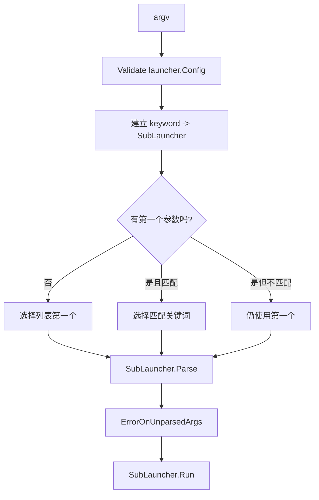
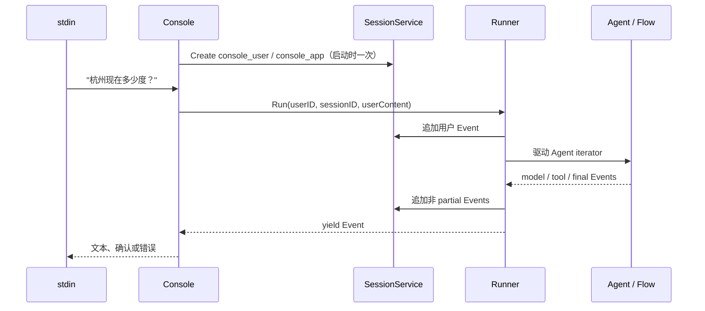

# ADK-Go 源码阅读笔记 · Launcher：从命令行到 Runner

> **源码版本：[ADK-Go v2.4.0](https://github.com/google/adk-go/tree/v2.4.0)**，commit `4e57df40cbd35f055ba654b03ffb0e509fdd754a`。
>
> [系列目录](/blog/adk/) · 前置阅读：[Quickstart](/blog/adk-quickstart/) · 后续阅读：[Runner](/blog/adk-runner/)、[Flow](/blog/adk-flow/)。

Launcher 是 ADK 应用的进程入口层。它处理命令行参数、校验进程级配置、选择运行方式，并把同一份 AgentLoader、SessionService、Plugin 和鉴权配置交给 console 或 web 子入口。

它不负责模型推理，也不负责工具执行。Launcher 选择怎么进入应用，Runner 才驱动一次 Agent 运行。

## 一、源码入口与阅读地图

| 层次 | 文件 / 符号 | 作用 |
| --- | --- | --- |
| 顶层契约 | [`cmd/launcher/launcher.go`](https://github.com/google/adk-go/blob/v2.4.0/cmd/launcher/launcher.go#L34-L116) | Launcher、SubLauncher、Config |
| 选择器 | [`cmd/launcher/universal/universal.go`](https://github.com/google/adk-go/blob/v2.4.0/cmd/launcher/universal/universal.go#L34-L101) | 按第一个关键词选择入口 |
| 预设组合 | [`cmd/launcher/full/full.go`](https://github.com/google/adk-go/blob/v2.4.0/cmd/launcher/full/full.go#L30-L33) | console + 全部 web 子入口 |
| 生产组合 | [`cmd/launcher/prod/prod.go`](https://github.com/google/adk-go/blob/v2.4.0/cmd/launcher/prod/prod.go#L22-L31) | REST API + A2A |
| 终端运行 | [`cmd/launcher/console/console.go`](https://github.com/google/adk-go/blob/v2.4.0/cmd/launcher/console/console.go#L71-L121) | Session、Runner、stdin 循环 |
| HTTP 运行 | [`cmd/launcher/web/web.go`](https://github.com/google/adk-go/blob/v2.4.0/cmd/launcher/web/web.go#L174-L274) | router、sublauncher、HTTP server |
| REST 挂载 | [`cmd/launcher/web/api/api.go`](https://github.com/google/adk-go/blob/v2.4.0/cmd/launcher/web/api/api.go#L250-L315) | 创建 `adkrest.Server` 并挂到 path prefix |

整体关系可以先压缩成一张图：

```text
main
  |
  +-- launcher.Config
  |      AgentLoader / Session / Artifact / Memory / Plugin / Auth / Compaction
  |
  +-- full.NewLauncher()
          |
          v
      universal Launcher
          |
          +-- no keyword -> first sublauncher -> console
          +-- "web" -> web Launcher
                            |
                            +-- "api"    -> REST handlers
                            +-- "webui"  -> embedded SPA
                            +-- "a2a"    -> JSON-RPC executor
                            +-- triggers -> Pub/Sub / Eventarc
```

## 二、核心接口与数据结构

### 1. 两层 Launcher 契约

源码中的顶层接口是：

```go
type Launcher interface {
    Execute(ctx context.Context, config *Config, args []string) error
    CommandLineSyntax() string
}

type SubLauncher interface {
    Keyword() string
    Parse(args []string) ([]string, error)
    CommandLineSyntax() string
    SimpleDescription() string
    Run(ctx context.Context, config *Config) error
}
```

`Launcher` 能被程序直接调用；console 和 web 实现通用的 `launcher.SubLauncher`，由 universal 选择并调用 `Run`。HTTP 内部的 api、webui、a2a 等则实现另一个独立接口 `web.Sublauncher`：它没有 `Run`，而是通过 `SetupSubrouters` 注册路由、通过 `UserMessage` 输出入口地址。

```text
universal
  └─ launcher.SubLauncher：console / web
       └─ web.Sublauncher：api / webui / a2a / triggers
            SetupSubrouters(router, config)
```

两层接口名称相近，但职责和方法集合不同，不能把 api 子入口直接当成 universal 的 `SubLauncher`。

### 2. `launcher.Config` 是进程级装配单

```text
Config
├─ AgentLoader       root / named agents
├─ SessionService    conversation history + state
├─ ArtifactService   files / blobs
├─ MemoryService     cross-session retrieval
├─ PluginConfig      global lifecycle hooks
├─ Authenticator     inbound identity
├─ Authorizer        user/payload authorization
├─ Compaction        session summarization policy
└─ TelemetryOptions  tracing / logging export
```

[Config](https://github.com/google/adk-go/blob/v2.4.0/cmd/launcher/launcher.go#L78-L116) 不是一条请求的参数。一个 Launcher 进程可以处理很多请求，它们共享这份装配配置；请求级的 Session ID、User ID 和 RunConfig 会在 Runner 层出现。

`Execute` 先调用 `Config.Validate()` 校验 compaction 配置，再让子入口解析自己的参数；`Validate` 本身不负责参数解析。这样配置错误可以在 server 开始监听前暴露。如果只把校验留到每请求创建 Runner，进程可能能启动但每个请求都失败。

### 3. 预设组合不是执行策略

```go
// full.NewLauncher
universal.NewLauncher(
    console.NewLauncher(),
    web.NewLauncher(webui.NewLauncher(), a2a.NewLauncher(), pubsub.NewLauncher(), eventarc.NewLauncher(), api.NewLauncher()),
)

// prod.NewLauncher
universal.NewLauncher(
    web.NewLauncher(api.NewLauncher(), a2a.NewLauncher()),
)
```

`full` 提供候选入口；`prod` 去掉 console 与 ADK Web UI。候选存在不等于全部启动，web 子入口仍需要在命令行中被选择。

## 三、主执行路径：参数、服务与事件流

### 1. Universal 如何选子入口

`universal.parse` 先把每个 `Keyword()` 建成 map，拒绝重复关键词；随后默认选择列表第一个元素。没有参数时直接解析第一个子入口；第一个参数若匹配关键词，就把关键词移除后交给对应子入口；若不匹配，则仍交给第一个子入口处理。



列表顺序因此是行为的一部分。`full` 把 console 放在 web 前面，所以无参数默认进入 console。不要把候选列表理解成无序注册表。

### 2. Console 路径：一次 Session，多次 Run

console 的一次性步骤：

```text
console.Run
  -> signal.NotifyContext
  -> 初始化 telemetry
  -> 缺少 SessionService ? InMemoryService : 使用传入实现
  -> Create(app="console_app", user="console_user")
  -> AgentLoader.RootAgent()
  -> runner.New(...)
  -> 循环读取 stdin
       -> user Content
       -> runner.Run(...)
       -> 消费 Event / 显示文本 / 处理 HITL
```

[console.Run](https://github.com/google/adk-go/blob/v2.4.0/cmd/launcher/console/console.go#L71-L121) 在输入循环外创建 Session 和 Runner，因此一行输入不会新建一条会话。下一次 `Run` 复用同一个 Session ID，历史由 Runner 和 Flow 重新拼装。



默认流式模式还取决于 stdout 是否为字符设备；显式 `--streaming_mode=none|sse` 会覆盖这个自动选择。终端与管道运行可能进入不同 streaming mode。

### 3. Web 路径：一个 server，多组路由

`web.Run` 先为缺失的 Session、Artifact、Memory service 补内存实现，再创建基础 router，挂 `/health`，检查 active sublauncher，按声明顺序调用每个 `SetupSubrouters`，最后启动 `http.Server`。

```text
web.Run
  -> applyServiceDefaults
  -> BuildBaseRouter + /health
  -> activeSublaunchers?
       no  -> error
       yes -> each SetupSubrouters(router, config)
  -> ListenAndServe
  -> ctx.Done -> Shutdown(timeout)
```

| 关键词 | 子包 | 主要职责 |
| --- | --- | --- |
| `api` | `web/api` | REST API；默认 `/api`，可配置 prefix、CORS、SSE timeout |
| `webui` | `web/webui` | embed 的 SPA；无扩展名未知路径回退 index |
| `a2a` | `web/a2a` | A2A JSON-RPC executor |
| `pubsub` | `web/triggers/pubsub` | 云事件转换为 Agent 请求 |
| `eventarc` | `web/triggers/eventarc` | 云事件入口 |

API 通过 `http.StripPrefix` 把挂载路径之后的请求交给 REST handler；额外处理 trailing slash，避免嵌套 prefix 下重定向丢失 `/api` 或 POST 被浏览器改成 GET。WebUI 的 `api_server_address` 是浏览器看到的 REST 地址，不是 server 内部的 Go 地址。

## 四、关键细节与分支

### 1. Console 与 REST 的 Session 差异

| 入口 | 缺少 SessionService | Session 产生方式 |
| --- | --- | --- |
| console | 自动 InMemoryService | `Run` 前主动 Create |
| web | 自动补 Session / Artifact / Memory 的内存实现 | 具体 API 端点决定是否创建或要求已存在 |
| 自定义 Runner | 由 `runner.Config` 决定 | `NewInMemory` 或显式 service / Create |

因此 console 可以直接启动后输入；REST API 是否能立即接受任意 Session ID，要看具体 server endpoint 的创建语义。不要把 console 的自动 Create 推广给所有入口。

### 2. 参数层次和关键词位置

```text
adk-demo web --port=8081 \
  api --webui_address=http://localhost:8081 \
  webui --api_server_address=http://localhost:8081/api
```

`--port` 属于 web；`--webui_address` 属于 api；`--api_server_address` 属于 webui。每个 SubLauncher 只解析交给自己的参数，关键词位置决定哪个 parser 接收 flag。

### 3. WebUI SPA 回退与静态文件边界

WebUI 嵌入 `distr/*`。有文件扩展名且不存在的资源返回 404；无扩展名未知路径回退 `index.html`，支持刷新深链接。没有 index 的目录不暴露目录列表，避免泄漏 embedded bundle 的文件布局。

### 4. Auth、CORS 和健康检查不是一回事

- `Authenticator` 给 REST 端点认证请求；
- `Authorizer` 检查调用者与 payload user 的关系；
- `webui_address` 只用于生成 CORS origin；
- `/health` 只表示 web server 已启动，不代表模型、Session 或 Agent 健康。

未配置 Authenticator / Authorizer 时使用 no-op 语义。选择 `prod.NewLauncher` 只改变入口组合，不会自动补齐应用的身份与授权策略。

HTTP 200 的 `/health` 不等于一次 Agent 请求能成功。

### 5. 优雅关闭

web 监听 Context。收到取消后用 `shutdown-timeout` 调用 `http.Server.Shutdown`，等待活动请求结束；console 则用自己的 timeout 关闭 telemetry，并让输入循环停止。已经发生的工具副作用不会因为 server shutdown 自动回滚。

## 五、重新梳理：运行时架构与边界

| 边界 | 负责什么 | 不负责什么 |
| --- | --- | --- |
| Launcher | 参数、配置、入口、server 生命周期 | 模型推理、工具执行、事件历史规则 |
| Console / Web | 传输与交互层 | Agent 智能、跨服务事务 |
| Runner | Session、Context、Agent、Event 消费与持久化 | 具体 provider 协议转换 |
| Agent / Flow | 指令、模型工具循环、Agent transfer | HTTP listener、命令行解析 |
| Session / Artifact / Memory | 各自的数据服务语义 | 自动替代其他服务 |

Launcher 可以替换。已有 HTTP、队列或桌面程序可以跳过它，直接构造 Runner；使用 Launcher 的价值是复用已有入口和参数层，而不是获得额外模型能力。

## 六、这个模块解决了什么问题

它把“如何启动和暴露一个 ADK 应用”从 Agent 逻辑中分离出来：同一个 root Agent 可以被 console、REST、A2A 或 Web UI 使用。代价是配置作用域变成进程级，参数解析有层级，入口之间的 Session 默认行为也不完全相同。

当应用需要每个租户不同服务、不同 compaction 或不同认证策略时，应该明确这些配置挂在哪个进程、哪个 server 或哪个请求上下文，而不是只看 main 函数里的一份 Config。

## 七、重点结论与常见误解

| 容易产生的理解 | v2.4.0 实际行为 |
| --- | --- |
| full 会同时启动 console、REST、WebUI、A2A | full 只是提供候选子入口，web 子入口仍需激活 |
| `web` 不带子关键词会启动默认服务 | web 没有 active sublauncher 时返回错误 |
| console 每次输入新建 Session | 启动时创建一次，多个 Run 复用该会话 |
| REST 一定像 console 一样自动创建 Session | 具体 API 端点的 Session 语义不同 |
| `/health` 表示 Agent 健康 | 只表示 web server health |
| Launcher 执行模型和工具 | Runner / Agent / Flow 才处理运行主线 |
| 选中 webui 就必然能请求 API | 浏览器的 backend 地址和 API CORS / Session / auth 仍需匹配 |

argv → Launcher → SubLauncher → Runner → Event 是入口链，不是完整 Agent 内部循环。

## 八、相关源码与进一步阅读

- [launcher.go](https://github.com/google/adk-go/blob/v2.4.0/cmd/launcher/launcher.go)：接口、Config、Validate。
- [universal.go](https://github.com/google/adk-go/blob/v2.4.0/cmd/launcher/universal/universal.go)：关键词选择与默认顺序。
- [full.go / prod.go](https://github.com/google/adk-go/blob/v2.4.0/cmd/launcher/full/full.go) / [prod.go](https://github.com/google/adk-go/blob/v2.4.0/cmd/launcher/prod/prod.go)：预设组合。
- [console.go](https://github.com/google/adk-go/blob/v2.4.0/cmd/launcher/console/console.go)：Session 与 stdin 循环。
- [web.go](https://github.com/google/adk-go/blob/v2.4.0/cmd/launcher/web/web.go)：HTTP server、默认服务与关闭。
- [api.go](https://github.com/google/adk-go/blob/v2.4.0/cmd/launcher/web/api/api.go)：REST 挂载、CORS、prefix。

继续阅读：[Runner](/blog/adk-runner/) → [Flow](/blog/adk-flow/) → [Tool](/blog/adk-tool/)。
