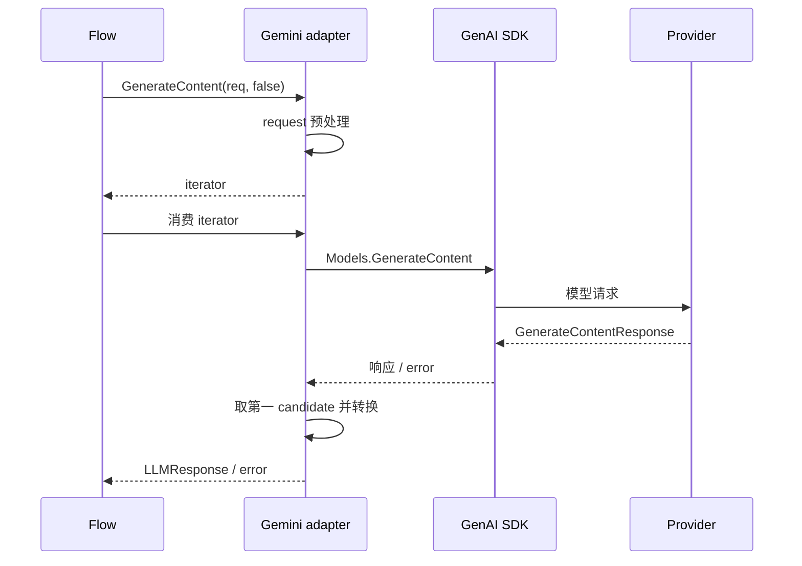
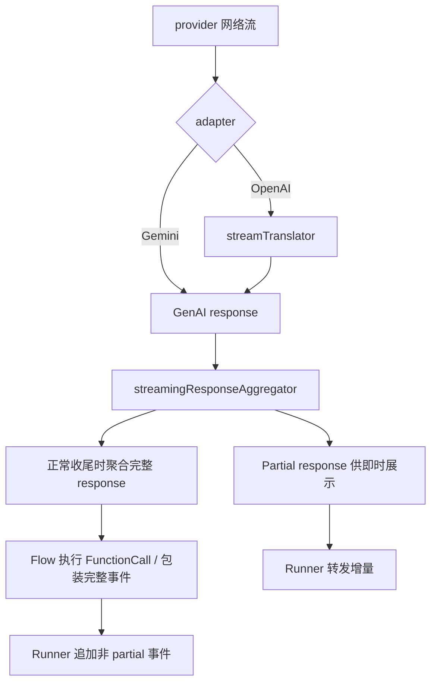

# ADK-Go 源码阅读笔记 · Model：统一接口怎样连接不同模型服务

> **源码版本：[ADK-Go v2.4.0](https://github.com/google/adk-go/tree/v2.4.0)**，commit `4e57df40cbd35f055ba654b03ffb0e509fdd754a`。
>
> [系列目录](/blog/adk/) · 配套阅读：[Quickstart](/blog/adk-quickstart/)、[Flow](/blog/adk-flow/)、[Tool](/blog/adk-tool/)。

Flow 已经准备好用户消息、历史、指令和工具声明，下一步要把请求交给模型服务。Gemini 和 OpenAI 的请求字段、角色、函数调用与流式事件并不相同；Model 层把这些差异放在适配器中处理，向上提供统一的 `LLMRequest → LLMResponse` 接口。

实现了同一个 LLM 接口，不代表所有模型支持相同的配置和工具。这篇文章围绕一次天气函数调用，说明统一数据怎样跨过 provider 边界，以及信息在转换中如何被保留或拒绝。

## 一、源码入口与阅读地图

```text
model/
├─ llm.go                  LLM / LLMRequest / LLMResponse
├─ registry.go             模型名正则 -> Factory
├─ gemini/gemini.go         GenAI SDK 适配器
├─ openaimodel/
│  ├─ openai.go             Responses API 调用与流式收尾
│  ├─ request.go            请求、消息、配置转换
│  ├─ tools.go              函数声明与 tool choice
│  ├─ response.go           返回内容、usage、结束原因
│  └─ stream.go             Responses 事件 -> GenAI 中间结构
└─ apigee/apigee.go         配置代理后委托 Gemini adapter
```

| 入口 / 文件 | 阅读时要回答的问题 |
| --- | --- |
| [model/llm.go](https://github.com/google/adk-go/blob/v2.4.0/model/llm.go#L25-L68) | 上层到底传什么、收到什么 |
| [Flow.callLLM](https://github.com/google/adk-go/blob/v2.4.0/internal/llminternal/base_flow.go#L815-L899) | 哪些 callback 返回后不再调用模型 |
| [gemini.GenerateContent](https://github.com/google/adk-go/blob/v2.4.0/model/gemini/gemini.go#L87-L159) | 普通调用和流式调用如何选择 |
| [buildOpenAIParams](https://github.com/google/adk-go/blob/v2.4.0/model/openaimodel/request.go#L36-L86) | 通用请求如何转换成 Responses 参数 |
| [streamTranslator](https://github.com/google/adk-go/blob/v2.4.0/model/openaimodel/stream.go) | provider 的 delta 事件怎样转成通用 part |
| [streamingResponseAggregator](https://github.com/google/adk-go/blob/v2.4.0/internal/llminternal/stream_aggregator.go) | 增量和完整响应怎样共存 |
| [model.Register / NewLLM](https://github.com/google/adk-go/blob/v2.4.0/model/registry.go) | 字符串名称怎样解析成实例 |

## 二、核心接口与数据结构

### 1. 两个方法的公共契约

下面是接口与请求结构的源码摘录：

```go
// LLM provides the access to the underlying LLM.
type LLM interface {
    Name() string
    GenerateContent(ctx context.Context, req *LLMRequest, stream bool) iter.Seq2[*LLMResponse, error]
}

// LLMRequest is the raw LLM request.
type LLMRequest struct {
    Model    string
    Contents []*genai.Content
    Config   *genai.GenerateContentConfig

    Tools map[string]any `json:"-"`
}
```

`Name()` 提供实例的名字，Flow 用它初始化 `req.Model`。Gemini 和 OpenAI adapter 实际发送时都优先使用非空的 `req.Model`，因此 BeforeModel 可以修改同一适配器要请求的模型名。

这并不更换 SDK client、认证或 backend。把 Gemini 实例的 `req.Model` 改成一个 OpenAI 模型名，不会自动变成 OpenAI 请求。依据：[Gemini.modelName](https://github.com/google/adk-go/blob/v2.4.0/model/gemini/gemini.go#L117-L125)、[OpenAI 参数初始化](https://github.com/google/adk-go/blob/v2.4.0/model/openaimodel/request.go#L36-L47)。

### 2. 两份工具信息各自服务谁

```text
LLMRequest
├─ Config.Tools
│    get_weather 名称 / 描述 / 参数 schema
│    -> provider 看见的能力声明
├─ Contents
│    user 问题 / model FunctionCall / user FunctionResponse
│    -> provider 看见的消息与历史
└─ Tools["get_weather"]
     Go 工具对象
     -> Flow 的本地执行表，不序列化给 provider
```

模型得到的是函数协议，不是进程中的 Go 函数对象。`toolutils.PackTool` 为普通 FunctionTool 同时准备两份信息，Model adapter 主要处理 `Config.Tools`，工具执行交回 Flow。

### 3. 响应是一条数据记录，不只是文本

下面是 `LLMResponse` 的字段节选，省略引用、logprobs 和部分 metadata：

```go
type LLMResponse struct {
    Content             *genai.Content
    UsageMetadata       *genai.GenerateContentResponseUsageMetadata
    CustomMetadata      map[string]any
    ModelVersion        string
    Partial             bool
    TurnComplete        bool
    Interrupted         bool
    ErrorCode           string
    ErrorMessage        string
    FinishReason        genai.FinishReason
}
```

| 字段 | 作用 | 不能混同为 |
| --- | --- | --- |
| Content | 文本、FunctionCall、媒体等 parts | 一定可直接展示的字符串 |
| Partial | 当前响应是否仍是增量 | 一个新的 Agent step |
| TurnComplete | 模型 turn 的完成信号 | `session.Event.IsFinalResponse()` 的全部条件 |
| FinishReason | 停止、长度限制、过滤等原因 | 必然是成功完成 |
| ErrorCode / ErrorMessage | 响应层面的失败信息 | iterator 第二项 Go error |
| UsageMetadata | provider 提供的 token 等统计 | 本地一定可准确重算的值 |
| CustomMetadata | 适配器保留的额外信息 | 所有对外协议一定完整透传 |

## 三、主执行路径：请求转换与响应返回

### 1. Flow 与 Model 的分界

```text
Flow
  processors -> req
  BeforeModel callbacks
       |
       +-- 提供替代 response -> 不调用 Model
       |
       v
  Model.GenerateContent(req, stream)
       |
       v
  provider 请求 / 响应转换
       |
       v
  LLMResponse / Go error
       |
       v
Flow
  OnModelError（适用时） / AfterModel
  -> session.Event
  -> FunctionCall 分派
```

回调与事件包装属于 Flow。Model 的 adapter 专注于一次模型请求；它没有完整的 Session 或 Agent tree 控制职责。摘要器也是 `model.LLM` 的直接调用方，见 [LLMSummarizer.SummarizeEvents](https://github.com/google/adk-go/blob/v2.4.0/session/compaction/llm_summarizer.go#L207-L245)，所以不能把 Flow 的所有 callback 当成每次模型调用必经的全局 middleware。

### 2. Gemini：接近原生的数据形状

`gemini.NewModel` 复制 `ClientConfig` 和可选的 `http.Client` 结构，再建立 GenAI client 与 header interceptor。这里是结构级复制，不是任意对象图的深拷贝；例如 Transport 对象可以仍被共享。

`GenerateContent` 的关键语句摘录如下，省略 header 初始化：

```go
m.maybeAppendUserContent(req)

if stream {
    return m.generateStream(ctx, req)
}

return func(yield func(*model.LLMResponse, error) bool) {
    resp, err := m.generate(ctx, req)
    yield(resp, err)
}
```

源码：[初始化](https://github.com/google/adk-go/blob/v2.4.0/model/gemini/gemini.go#L49-L80)、[GenerateContent](https://github.com/google/adk-go/blob/v2.4.0/model/gemini/gemini.go#L87-L109)。

有一个时间边界很重要：SDK 网络调用在 iterator 消费时发生，但 `GenerateContent` 被调用时已经可能修改 `req`，例如补 user nudge、Config 和 HTTP headers。因此不要共享同一份可变 request 给并发调用，方法返回迭代函数之前，仍可能先修改请求对象。

### 3. 普通 Gemini 请求



`generate` 对 SDK error 包装后返回；没有 candidate 时返回 `empty response`；正常情况经 `Genai2LLMResponse` 转换。源码：[generate](https://github.com/google/adk-go/blob/v2.4.0/model/gemini/gemini.go#L127-L138)。统一响应主要表达第一 candidate，并不是多候选结果列表。

### 4. OpenAI：同一份历史如何换成另一种协议

`openaimodel` 使用 **Responses API**，不是把 GenAI 请求直接提交到 Chat Completions。以同一个天气调用为例，下面是对象示意，不是完整请求 JSON：

```text
ADK / GenAI                            OpenAI Responses
-----------------------------------------------------------------
user Text "杭州天气？"                 user message / input_text
model Text "我来查一下"                assistant output message / output_text
FunctionCall
  ID = weather-1                       function_call.call_id = weather-1
  Name = get_weather                   name = get_weather
  Args = {city: Hangzhou}               arguments = JSON 字符串
FunctionResponse
  ID = weather-1                       function_call_output.call_id = weather-1
  Response = {temperature: 26}          output = JSON 字符串
Config.SystemInstruction               instructions
Config.Tools.FunctionDeclarations      tools[type=function]
```

`model` 历史不能作为 assistant 的 `input_text` 发出；转换器使用 output message。函数调用和结果也是独立 input items，需要保持调用 ID 配对。依据：[convertContents](https://github.com/google/adk-go/blob/v2.4.0/model/openaimodel/request.go#L88-L160)、[callTracker](https://github.com/google/adk-go/blob/v2.4.0/model/openaimodel/request.go#L240-L309)。

## 四、关键细节与分支

### 1. SSE 同时提供增量与聚合结果



普通文本的示意输出：

```text
response 1: Partial=true   Text="杭州"
response 2: Partial=true   Text="当前气温为 26°C。"
response 3: Partial=false  Text="杭州当前气温为 26°C。"
```

完整聚合结果不能再当作一个普通增量直接追加到已经显示的文本后面。否则 UI 会出现重复答案。

聚合器保留 part 顺序，把 Thought 与普通文本分别累积，处理函数调用的渐进参数与 thought signature，并保留 usage、grounding、citation 和结束原因。它不是简单的 `strings.Join(allChunks)`。

### 2. 流中断时，不保证有最后一条完整响应

Gemini 的 `generateStream` 在 SDK stream 返回 error 时直接 yield error 并返回，跳过 `Close()`。消费者提前停止也会直接返回。只有正常消费结束才尝试得到最终聚合结果。

OpenAI 还需要判断 terminal event：`response.completed`、`response.incomplete` 与只有 `response.created` 的流不是同一种收尾。完整 terminal payload 可能补上没有作为 delta 到达的内容或函数调用；未知结束原因不会自动标成 STOP。

源码：[Gemini 流结束](https://github.com/google/adk-go/blob/v2.4.0/model/gemini/gemini.go#L141-L159)、[OpenAI stream 与 terminal 处理](https://github.com/google/adk-go/blob/v2.4.0/model/openaimodel/openai.go#L128-L254)、[finalizeStreamResponse](https://github.com/google/adk-go/blob/v2.4.0/model/openaimodel/openai.go#L608-L630)。

### 3. 调用 ID 为什么不能靠工具名替代

OpenAI request converter 对缺失的 FunctionCall.ID 生成 `adk-openai-call-N`，把它加入待配对队列。FunctionResponse 有显式 ID 时，必须能从队列找到并消费；没有 ID 时，使用最早的 pending ID，队列为空则报错。

```text
FunctionCall #1: get_weather(Hangzhou), id=A
FunctionCall #2: get_weather(Shanghai), id=B

FunctionResponse id=B -> 配回上海调用
FunctionResponse id=A -> 配回杭州调用

仅凭 name=get_weather -> 无法区分两个调用
```

工具名称说明调用什么，调用 ID 说明结果属于哪一次执行。缺 ID 的 FIFO 补配是一种兼容路径，不是对任意乱序结果的可靠推断。

### 4. 配置翻译：支持、拒绝与忽略

`GenerateContentConfig` 采用 GenAI 的数据结构，OpenAI adapter 必须逐项决定怎样处理。

| 类别 | 例子 | 当前处理 |
| --- | --- | --- |
| 可映射 | Temperature、TopP、MaxOutputTokens | 翻译成 Responses 字段 |
| 指令与结构化输出 | SystemInstruction、JSON MIME / schema | 映射 instructions 与 text format |
| 工具 | FunctionDeclarations、ToolConfig | 映射 function tools / tool choice |
| 推理与统计 | ThinkingConfig、ServiceTier、logprobs | 受映射表和取值限制 |
| 不能直接映射 | TopK、StopSequences、多个 candidate、Labels、SafetySettings 等 | 返回具名错误 |
| 传输超时 | HTTPOptions.Timeout | 对整个调用/流施加 Context deadline |
| 跨后端 headers | HTTPOptions.Headers | 有意忽略，不直接带到 OpenAI |

这是 adapter 的实现范围，不是关于模型厂商所有能力的声明。字段存在、JSON 可以编码，并不能证明当前 adapter 支持它。源码：[配置转换](https://github.com/google/adk-go/blob/v2.4.0/model/openaimodel/request.go#L315-L402)、[header 与 timeout 规则](https://github.com/google/adk-go/blob/v2.4.0/model/openaimodel/request.go#L416-L464)。

超时覆盖重试与整个流，也包括消费者处理 `range` body 的时间。收到首个字节不表示超时计时已经停止。

### 5. 只支持函数工具的边界

OpenAI adapter 的 `ensureFunctionToolOnly` 拒绝 GoogleSearch、Maps、Retrieval、CodeExecution 等非函数工具结构；没有函数声明也会报错。把 Quickstart 的模型直接替换成 OpenAI、却保留 `geminitool.GoogleSearch{}`，不会自动得到等价的 OpenAI 搜索工具。

模型接口兼容不等于工具协议兼容。相关源码：[convertTools](https://github.com/google/adk-go/blob/v2.4.0/model/openaimodel/tools.go#L28-L65)。

### 6. Go error、ErrorCode、FinishReason

| 信号 | 例子 | Flow / 调用方应如何理解 |
| --- | --- | --- |
| iterator 返回 Go error | 网络错误、配置转换失败、无法解析函数参数 | 调用失败；普通 Flow 可尝试 OnModelError |
| LLMResponse.ErrorCode | 没有可读输出且被过滤或异常截断 | 有响应对象，但它携带失败语义 |
| FinishReason=MAX_TOKENS | 输出被长度限制截断 | 可能已有内容，不能直接当作完整业务答案 |
| CustomMetadata | OpenAI 的额外结束说明 | 是否保留到最终客户端取决于传输层 |

OpenAI `attachFinishSignal` 只进一步处理 `FinishReasonSafety` 和 `FinishReasonOther`：已有内容时，通过 FinishReason 和 `openai_finish_message` metadata 保留原因；无可读内容时写 ErrorCode / ErrorMessage。`MAX_TOKENS` 和 `STOP` 在该函数直接返回，不因内容为空就自动生成这些错误字段。这个 metadata 可留在进程内和 Session 中，但当前 REST 的逐字段事件映射不会完整透传它。源码：[结束信号](https://github.com/google/adk-go/blob/v2.4.0/model/openaimodel/openai.go#L632-L684)。

### 7. Apigee：代理配置与委托

```text
apigee.NewModel("apigee/...")
  -> parseModelName
  -> ProxyURL / API version / backend / headers
  -> genai.ClientConfig
  -> gemini.NewModel
  -> apigeeModel{delegate, name}

GenerateContent(req)
  -> delegate.GenerateContent(req)   # 原样转交 request
```

[Apigee 实现](https://github.com/google/adk-go/blob/v2.4.0/model/apigee/apigee.go#L84-L132)主要负责配置代理访问再委托 Gemini adapter，并没有再造一套通用响应协议。构造阶段解析代理模型名，与执行时重写 `req.Model` 是不同动作；当前委托函数原样传入 request，不能假设它每次都会自动去掉 `apigee/` 前缀。

同样，实现 `LLM` 不代表 wrapper 自动暴露底层所有附加能力。Flow 的 Live 路径会断言 `Client() *genai.Client`，需要单独检查具体 adapter / wrapper 是否提供该方法。

### 8. Registry：按名字构造，要求唯一匹配

`model.Register(pattern, factory)` 把正则与构造函数登记到进程级 registry；`NewLLM(ctx, name)` 扫描所有注册项，只接受一个匹配。

```text
注册表：pattern -> Factory

NewLLM("gemini-example")
  +-- 0 个匹配 -> 未找到错误
  +-- 1 个匹配 -> 释放读锁，再调用 Factory
  +-- 2+ 个匹配 -> 歧义错误；不按注册顺序选第一个
```

注册重复的 pattern 或非法正则会 panic；匹配使用 `MatchString`，需要全名匹配时用 `^` / `$`。SDK provider 不会因为 import 了某个包就自动注册；应用需要显式登记 factory，或者直接使用 `gemini.NewModel` / `openaimodel.NewModel`。

配置片段：

```go
model.Register("(?i)^gemini-.*$", func(ctx context.Context, name string) (model.LLM, error) {
    return gemini.NewModel(ctx, name, nil)
})
```

源码：[registry.go](https://github.com/google/adk-go/blob/v2.4.0/model/registry.go#L31-L124)。这个 registry 选择构造方式，不是跨 provider 的请求故障转移或自动重试服务。

## 五、重新梳理：运行时架构与边界

| 层次 | 输入 | 输出 | 负责的转换 |
| --- | --- | --- | --- |
| Flow request processors | Agent 配置与 Session | LLMRequest | 指令、可见历史、工具声明 |
| Model adapter | LLMRequest | provider 请求 | 名称、角色、函数调用、配置 |
| SDK / provider | 网络请求 | 原生响应或 stream | 远端模型服务协议 |
| adapter / aggregator | 原生响应 | LLMResponse | part、usage、错误、完整聚合 |
| Flow | LLMResponse | Event / 工具执行 | 回调、动作与循环 |
| Runner | Event | Session 与调用方输出 | 追加非 partial、对外协议入口 |

Model 层不保存对话历史，也不执行普通 FunctionTool。它返回 FunctionCall，Flow 才能将它解释为本地调用。模型名路由、HTTP 代理与 Agent transfer 也分别属于不同边界。

## 六、这个模块解决了什么问题

### 1. 让上层用同一种请求与响应协作

Flow 可以面向 `LLM` 编写循环，不必分别处理每个 provider 的 SDK 类型。模型测试替身也可以实现这两个方法，用确定性的响应验证上层执行逻辑。

### 2. 把不可忽略的协议差异留在适配器中

角色映射、函数参数 JSON、调用 ID、流式 terminal 和结束原因都影响正确性。它们需要明确转换或报错，不能只做字段名称替换。

### 3. 公共结构的代价

以 GenAI 类型作为共同请求表示，使 Gemini 路径较直接，也让其他 adapter 承担字段映射与兼容限制。切换模型时应检查工具、多模态、schema、错误和流式语义，而不是只改一个名称。

## 七、重点结论与常见误解

- LLMRequest 进入 adapter，LLMResponse 返回 Flow；Event 在更上层形成。
- 模型返回 FunctionCall 不代表工具已执行。
- Partial 服务于增量展示，完整响应服务于后续执行与历史。
- 相同 interface 下的 provider 能力、附加接口和错误边界仍可能不同。

| 常见误解 | 实际行为 |
| --- | --- |
| req.Model 改了就自动切换 backend | 只改变当前 adapter 的模型名称参数 |
| 发给模型的是 req.Tools 中的 Go 对象 | provider 收到的是 Config.Tools 声明 |
| 最后一个 chunk 一定就是 final aggregate | 正常完成、错误与消费者停止走不同分支 |
| OpenAI-compatible 地址都能使用该 adapter | 端点需要支持这里使用的 Responses API 形状 |
| 工具名足以匹配调用结果 | 同名并发调用还需要 call ID |
| registry 多项匹配时按注册顺序挑选 | 返回歧义错误 |
| LLM 接口意味着 Live 支持 | Live 还依赖额外 client 能力 |

用天气示例检查理解：将 `get_weather` 的参数从 map 转成 JSON 字符串的是 adapter；真正查询天气的 handler 属于 Tool；把结果加入下一次请求的是 Flow 的历史构造路径。

## 八、相关源码与进一步阅读

| 源码 / 测试 | 关注点 |
| --- | --- |
| [llm.go](https://github.com/google/adk-go/blob/v2.4.0/model/llm.go) | 请求和响应契约 |
| [gemini.go](https://github.com/google/adk-go/blob/v2.4.0/model/gemini/gemini.go) / [gemini_test.go](https://github.com/google/adk-go/blob/v2.4.0/model/gemini/gemini_test.go) | request model override、配置复制、headers、流式 |
| [openaimodel/request.go](https://github.com/google/adk-go/blob/v2.4.0/model/openaimodel/request.go) | 角色、ID、schema、参数支持范围 |
| [openaimodel/openai.go](https://github.com/google/adk-go/blob/v2.4.0/model/openaimodel/openai.go) / [openai_test.go](https://github.com/google/adk-go/blob/v2.4.0/model/openaimodel/openai_test.go) | terminal、增量、完整响应、错误 |
| [stream_aggregator.go](https://github.com/google/adk-go/blob/v2.4.0/internal/llminternal/stream_aggregator.go) | 内容聚合与 part 顺序 |
| [registry_test.go](https://github.com/google/adk-go/blob/v2.4.0/model/registry_test.go) | 单匹配、歧义、重复注册与并发 |
| [apigee.go](https://github.com/google/adk-go/blob/v2.4.0/model/apigee/apigee.go) | 代理配置与委托 |

继续阅读：[Flow](/blog/adk-flow/) → [Tool](/blog/adk-tool/)；回到应用入口：[Quickstart](/blog/adk-quickstart/)。
