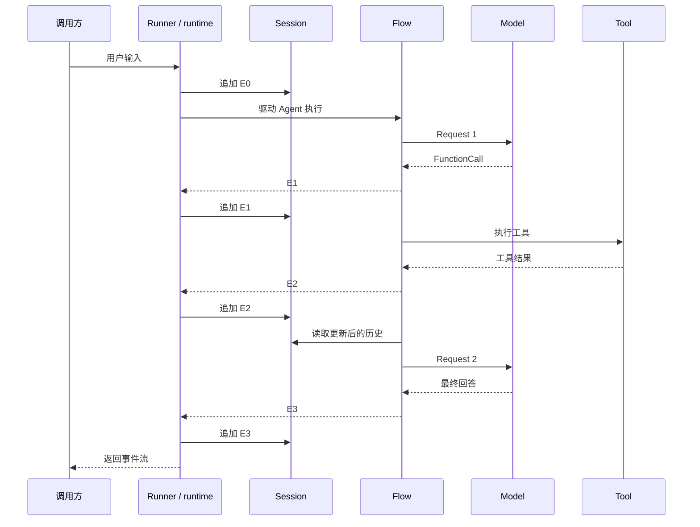
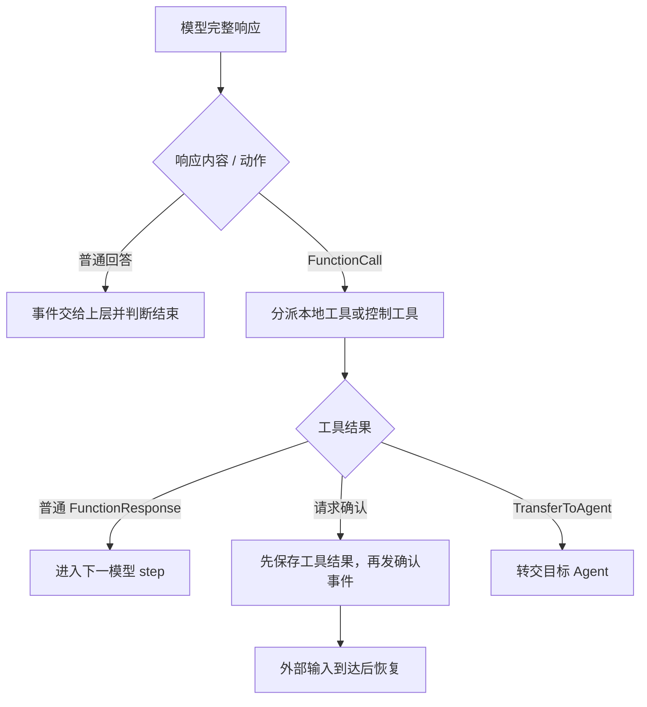

# ADK-Go 源码阅读笔记 · Overview：从一次请求看懂整个框架

> **源码版本：[ADK-Go v2.4.0](https://github.com/google/adk-go/tree/v2.4.0)**，commit `4e57df40cbd35f055ba654b03ffb0e509fdd754a`。
>
> [系列目录](/blog/adk/) · 下一篇：[Quickstart](/blog/adk-quickstart/) · 执行主线：[Runner](/blog/adk-runner/)、[Flow](/blog/adk-flow/)。

用户问“杭州现在多少度”，模型输出一个 `get_weather` 调用，工具返回 `26°C`，模型再组织成自然语言回答。这里至少发生了两次模型请求、一次工具执行和多次事件追加。

ADK-Go 把这些工作分给不同组件：Agent 描述行为，Runner 驱动执行，Flow 连接模型和工具，服务保存历史与状态。一次模型响应只是 Agent 运行过程中的一步。

这篇总览围绕三个问题展开：

1. 从程序入口到模型、工具和数据库，中间有哪些边界？
2. 一次输入怎样变成事件，工具结果又怎样进入下一次模型请求？
3. 接口抽象提供了什么，又有哪些必须结合具体实现理解的限制？

## 一、源码入口与阅读地图

ADK-Go 是用 Go 代码构建 Agent 应用的框架。应用通过构造函数组合 Agent、Model、Tool、服务和运行入口，不需要先把整个应用写成一份声明式工作流。

| 阅读层次 | 文件 / 入口 | 解决的问题 |
| --- | --- | --- |
| 应用示例 | [`examples/quickstart/main.go`](https://github.com/google/adk-go/blob/v2.4.0/examples/quickstart/main.go) | 最小应用怎样装配 |
| 启动入口 | [`cmd/launcher/launcher.go`](https://github.com/google/adk-go/blob/v2.4.0/cmd/launcher/launcher.go) | console / web 如何共用应用配置 |
| Agent 契约 | [`agent/agent.go`](https://github.com/google/adk-go/blob/v2.4.0/agent/agent.go#L35-L76) | 什么对象可以被执行 |
| 请求驱动 | [`runner/runner.go`](https://github.com/google/adk-go/blob/v2.4.0/runner/runner.go#L536-L610) | 一次输入如何进入运行时 |
| 模型工具循环 | [`internal/llminternal/base_flow.go`](https://github.com/google/adk-go/blob/v2.4.0/internal/llminternal/base_flow.go#L612-L745) | 模型提出调用后由谁执行 |
| 会话记录 | [`session/session.go`](https://github.com/google/adk-go/blob/v2.4.0/session/session.go) | 历史、状态和事件如何表达 |
| 图调度 | [`workflow/scheduler.go`](https://github.com/google/adk-go/blob/v2.4.0/workflow/scheduler.go) | 节点、事件和恢复如何协调 |

先把模块放在同一张结构图上：

```text
Application
  |
  +-- Launcher / HTTP handler / 自定义入口
  |          |
  |          v
  |        Runner <------ SessionService
  |          | <--------- ArtifactService / MemoryService
  |          v
  |   InvocationContext：绑定本次执行所需的对象
  |          |
  |          v
  |       Agent / node runtime
  |          |
  |          +-- LlmAgent --> Flow --> Model
  |          |                |         |
  |          |                +<- Tool <-+ FunctionCall
  |          |
  |          +-- 自定义 Agent / Workflow / 远程 Agent
  |
  +-- Plugin：在已接入的生命周期边界观察或改变行为
```

Model 适配器与 Tool 的业务实现可以替换，运行层仍围绕请求、响应和事件协作。但是模型共用接口并不意味着所有 provider 支持相同工具、多模态或流式能力。

## 二、核心接口与数据结构

### 1. `Agent` 定义可执行单元

下面是 [Agent 接口](https://github.com/google/adk-go/blob/v2.4.0/agent/agent.go#L35-L53) 的源码摘录：

```go
type Agent interface {
    Name() string
    Description() string
    Run(InvocationContext) iter.Seq2[*session.Event, error]
    SubAgents() []Agent
    FindAgent(name string) Agent
    FindSubAgent(name string) Agent

    internal() *agent
}
```

六个导出方法描述身份、运行和 Agent tree；未导出的 `internal()` 使外部包不能只声明一个同名方法就独立满足接口。自定义执行逻辑应通过 `agent.New(agent.Config{Run: ...})` 进入，LLM Agent 则通过 `llmagent.New` 创建。

Agent 是受构造协议约束的接口，不是任意结构体都能直接实现的插件口。

### 2. `Model` 输出响应，`Tool` 执行能力

[模型接口](https://github.com/google/adk-go/blob/v2.4.0/model/llm.go#L25-L38)只有两个方法：

```go
type LLM interface {
    Name() string
    GenerateContent(ctx context.Context, req *LLMRequest, stream bool) iter.Seq2[*LLMResponse, error]
}
```

`GenerateContent` 返回 `LLMResponse`，不是 `session.Event`。Flow 还要把它包装成事件，并解释 FunctionCall。Model 自己不负责 Session、工具 callback 和完整的 Agent 回合。

Tool 也不能仅凭接口名理解为“一段本地 Go 函数”。普通 FunctionTool 有本地 handler，Gemini 的 GoogleSearch 则通过 request 声明启用 provider 内置工具。两类执行位置不同，见 [GoogleSearch 的实现](https://github.com/google/adk-go/blob/v2.4.0/tool/geminitool/google_search.go#L26-L47)。

### 3. 执行单位与生命周期

| 概念 | 表达什么 | 生命周期或用途 |
| --- | --- | --- |
| Session | 某个 app / user 下的会话及历史、状态 | 可跨多次用户输入 |
| Invocation | 一次运行关联的执行标识和上下文 | 恢复场景可以沿用已有 invocation ID |
| Flow step | 一次请求拼装、模型响应消费及工具处理 | 一次 invocation 可有多个 step |
| Event | 文本、调用、工具结果、状态变化或控制记录 | 可向上返回并进入 Session |
| Context | 当前 Agent、Session、服务、配置、取消等访问入口 | 随运行路径派生 |
| StateDelta | 本条事件携带的状态变更 | 由服务追加事件时应用，不能等同于完整 State |
| Artifact | 文本、图片或文件等可版本化数据 | 通过 ArtifactService 保存、加载 |
| Memory | 从已写入记忆的会话中检索相关内容 | 与当前 Session 历史不同 |

天气例子的对象关系：

```text
Session S1
  |
  +-- invocation I1："杭州现在多少度？"
  |      +-- step 1：模型要求调用工具 -> 工具返回 26
  |      +-- step 2：模型输出 "杭州当前气温为 26°C。"
  |
  +-- 后续输入："适合跑步吗？"
         +-- 新运行读取可见历史；如何回答还取决于指令和工具
```

`Event.Author` 标记哪一个 Agent 产出了记录，`Content.Role` 服务于模型消息协议。工具结果通常 `Author=weather_agent`，却使用 `Role=user` 反馈给模型。user role 不等于人类作者。

## 三、主执行路径：调用栈、数据流与事件流

### 1. 正常请求的调用关系

下面以 root 为普通 chat LlmAgent、没有人工确认，且 callback 不返回替代结果为例。v2.4.0 的 Runner 会让这种 root 经过 node runtime；不能把所有请求都画成直接调用 `rootAgent.Run`。

```text
入口收到 user Content
  -> Runner.Run
      -> getOrCreateSession
      -> 判断 root Agent 类型与模式
      -> LlmAgent root：runNode / workflow runtime
          -> LlmAgent 的执行包装
              -> llmAgent.run
                  -> Flow.Run
                      -> preprocess
                      -> Model.GenerateContent
                      -> FunctionCall 分派 / Tool.Run
      -> 处理事件、追加非 partial 事件、向调用方 yield
```

依据：[Runner 的 LlmAgent 分支](https://github.com/google/adk-go/blob/v2.4.0/runner/runner.go#L565-L610)、[LlmAgent 创建 Flow](https://github.com/google/adk-go/blob/v2.4.0/agent/llmagent/llmagent.go#L450-L473)。非 LlmAgent 的传统 Agent 路径和完整 Workflow 调度各有自己的包装，详见对应篇章。

### 2. 两次模型请求的内容有什么不同

| 阶段 | 主要内容 | 由谁产生 |
| --- | --- | --- |
| 用户输入 E0 | `杭州现在多少度？` | 入口构造，Runner 追加 |
| 第一次模型请求 | 指令、工具声明、E0 | Flow 请求处理器 |
| 模型事件 E1 | `get_weather(city="Hangzhou")` | 模型响应经 Flow 包装 |
| 工具事件 E2 | `{city:"Hangzhou", temperature:26}` | 本地工具执行，Flow 包装 |
| 第二次模型请求 | 指令、工具声明、E0 + E1 + E2 的可见内容 | Flow 重新从 Session 拼装 |
| 最终事件 E3 | `杭州当前气温为 26°C。` | 第二次模型响应 |



图中省略了 Agent wrapper、Plugin hook 和各条事件向 UI 的转发，只突出历史如何闭合。工具结果先变成事件，再经 Session 进入下一次请求，不是模型在远端自动知道本地函数执行了什么。

### 3. iterator 如何承载控制权

普通 `Runner.Run` / `Flow.Run` 返回 `iter.Seq2`。创建 iterator 与消费它是两件事，主要运行逻辑在消费时推进：

```go
// 使用示意：r、ctx、消息和各 ID 已由应用准备好。
for event, err := range r.Run(ctx, userID, sessionID, message, agent.RunConfig{}) {
    if err != nil {
        return err
    }
    consume(event)
}
```

这里 `consume` 是应用自定义逻辑，不是 ADK API。iterator 生产者调用 `yield(event, err)`，消费者返回 false 时生产者应停止，后面的工具或模型阶段可能不会执行。

直接嵌套 iterator 时，消费逻辑同步返回后生产者继续；node runtime 还通过非 partial 事件的 processed 握手等待上层处理完成。Runner 的通常顺序是 `Plugin.OnEvent → AppendEvent → 对外 yield`。因此“事件先保存，下一步才读到新历史”有真实的执行顺序支撑，见 [run_node.go](https://github.com/google/adk-go/blob/v2.4.0/runner/run_node.go#L196-L245)。

## 四、关键细节与分支

### 1. 普通文本、工具调用与暂停信号



这是分支概览，真正停止依据是 Flow 当前 step 的最后事件及其后续判断。`IsFinalResponse()` 可能因 `SkipSummarization` 或长任务 ID 为 true；thought-only 又有额外保护。它并不等于“人类一定已经看到满意答案”。

### 2. 流式增量不等于完整历史

```text
模型网络流：chunk 1 -> chunk 2 -> chunk 3 -> 正常结束
                  |        |        |
Adapter：      partial  partial  partial  -> 聚合 response
                  |        |        |           |
UI：           即时展示增量                    收尾
Session：                                     保存非 partial
```

流式场景需要同时满足展示与执行：UI 想尽早显示文本，工具分派需要完整参数，Session 需要可用于下一次请求的完整内容。Model adapter 负责自己的转换/聚合，Flow 对普通路径中的 partial 不执行工具。

流出错不一定产生最后的 aggregate，Live 双向连接也不是把普通 SSE 的 `stream` 参数打开就能得到，见 [Model](/blog/adk-model/) 与 [Flow](/blog/adk-flow/)。

### 3. Plugin 与 Agent callback 是不同作用范围

Agent callback 配在具体 Agent 上，Plugin 由 Runner 装配并在接入的运行边界参与处理。它们可以修改请求、提供替代结果或处理错误，但每一种 hook 的返回语义需要分别理解。

BeforeModel 返回替代 response 后跳过 AfterModel；BeforeTool 返回替代结果后仍会进入 AfterTool。Live 也不完整复用普通模型 callback 链。把所有 hook 画成必经的前后包围框，会漏掉这些分支。

### 4. 三种保存能力不能互相替代

| 能力 | 保存或检索什么 | 什么时候使用 |
| --- | --- | --- |
| Session | 原始运行记录、会话状态 | 同一会话后续请求的上下文 |
| Artifact | 文件与版本 | 工具或 Agent 需要保存、引用外部内容 |
| Memory | 已写入记忆的会话内容 | 从跨会话记录中按查询检索 |

给 Runner 配置 MemoryService 不代表所有 Session 自动归档，也不代表搜索结果自动进入每次 prompt。写入、检索、使用结果需要有实际调用方。同样，拿到 ArtifactService 不代表所有二进制输入都会自动保存，相关行为还受调用和配置控制。

### 5. Flow 循环与 Workflow 调度

```text
Flow：同一个 LLM Agent 内
  request -> model -> tool result -> next request

Workflow：多个 node 之间
  node A output -> route / input mapping -> node B
                  |
                  +-> interrupt -> resume
```

一个 Workflow node 可以包含 LlmAgent，所以二者可以嵌套。`SubAgents` 所描述的 Agent tree、模型发起的 transfer，以及 Workflow 的显式图与路由，也不能混为一个对象。

### 6. 错误和副作用

普通工具错误常被转换成 `FunctionResponse.Response.error`，模型仍可能继续；模型调用的未恢复 Go error 则会向上返回。Session 追加失败不等于工具副作用被回滚，消费者提前停止也不等于执行成功。

**必须区分业务副作用、内存状态和持久化事件。** 它们跨越不同接口，框架不会自动提供覆盖模型服务、数据库和外部工具的统一事务。

## 五、重新梳理：运行时架构与边界

| 模块 | 主要输入 | 主要输出 / 动作 | 深入阅读 |
| --- | --- | --- | --- |
| Launcher | 配置、命令行参数 | 选择 console/web，装配入口 | [Launcher](/blog/adk-launcher/) |
| Runner | 用户消息、Session ID、RunConfig | 驱动运行、处理并保存事件 | [Runner](/blog/adk-runner/) |
| Agent | 指令、工具、子 Agent 或自定义 Run | 执行行为与事件 | [Agent](/blog/adk-agent/) |
| Flow | 当前 Agent 和 Context | 请求、模型/工具事件、下一步决策 | [Flow](/blog/adk-flow/) |
| Model | LLMRequest | LLMResponse 流 | [Model](/blog/adk-model/) |
| Tool | 函数参数与 Context | 结果、动作或延迟响应 | [Tool](/blog/adk-tool/) |
| Context | 本次运行绑定的对象 | 受当前能力约束的访问入口 | [Context](/blog/adk-context/) |
| Session | 事件与 StateDelta | 历史与状态 | [Session / Event](/blog/adk-session-event/) |
| Plugin | 生命周期参数 | 观察、修改或返回替代结果 | [Plugin](/blog/adk-plugin/) |
| Workflow | 节点、路由与恢复输入 | 节点执行与控制事件 | [Workflow](/blog/adk-workflow/) |

普通模型/工具事件的主线是 Flow 产生、Runner 追加；尾部保留 compaction 借助 request processor 直接追加摘要，是需要单独理解的旁路。模型也会被摘要器直接调用，不只有 Flow 一个消费者。

## 六、这个框架解决了什么问题

### 1. 把不完整的模型协议接成运行过程

模型能提出调用，但应用仍需要处理工具声明、参数、结果、历史与结束条件。ADK 把这些反复出现的协议工作集中在 Flow、Runner 和服务边界，使业务代码主要表达指令与能力。

### 2. 统一事件，支持不同执行方式

很多运行组件使用相同的 Event 流表达输出，方便逐条转发、保存、观察和组合；模型层保留自己的 LLMResponse，HTTP 层还要转换为对外协议。统一的是运行记录，不能理解成每一层的接口签名完全一致。

### 3. 组合带来的代价

- 同一概念可能经过多个 wrapper，需要追踪真正执行的方法，而不只读接口。
- request processor 与 callback 有顺序依赖，交换位置会改变行为。
- 服务实现的复制、并发、事务和持久性不同，不能把内存实现当通用契约。
- provider 的功能差异仍存在，公共模型接口不会抹平所有配置差异。

## 七、重点结论与常见误解

- 事件向上返回，历史向下提供上下文，两者把连续模型请求连接起来。
- Agent 描述行为；Runner 驱动运行；Flow 处理 LLM Agent 内部的模型与工具循环。
- 一个 Session 可以经历多个 invocation，一个 invocation 可以有多个 step 和大量 Event。
- 框架中的完成、暂停、partial 和业务成功是不同信号。

| 常见理解 | 实际边界 |
| --- | --- |
| Model 返回 FunctionCall，工具就执行完了 | 仍需 Flow 本地分派，或由 provider 内置工具路径处理 |
| 所有 root 都直接 `Agent.Run` | LlmAgent root 会经过 node runtime |
| 配置了 MemoryService 就自动拥有长期记忆 | 还需要写入、检索以及结果使用路径 |
| 所有 Run 都在调用时立即执行 | 普通 Runner/Flow 先返回迭代函数，range 后才推进；Live 有不同的启动与连接生命周期 |
| 事件 final 就是整个工作流完成 | 节点、Agent 和 invocation 的结束边界不同 |
| 多 Agent 就等于 Workflow | Agent tree、transfer、工具包装和图调度各有语义 |

用天气例子检查理解：第二次模型调用为什么知道 26°C？因为工具结果经事件追加进入 Session，再由请求处理器拼成模型输入；不是因为模型与工具共享了一块 Go 内存。

## 八、相关源码与进一步阅读

| 源码 | 关注点 |
| --- | --- |
| [quickstart/main.go](https://github.com/google/adk-go/blob/v2.4.0/examples/quickstart/main.go) | Model → Agent → Loader → Launcher |
| [agent.go](https://github.com/google/adk-go/blob/v2.4.0/agent/agent.go) | Agent 接口、构造与回调 |
| [runner.go](https://github.com/google/adk-go/blob/v2.4.0/runner/runner.go) / [run_node.go](https://github.com/google/adk-go/blob/v2.4.0/runner/run_node.go) | 执行入口与事件消费 |
| [base_flow.go](https://github.com/google/adk-go/blob/v2.4.0/internal/llminternal/base_flow.go) | 模型与工具循环 |
| [session.go](https://github.com/google/adk-go/blob/v2.4.0/session/session.go) | Event、State、Session |
| [scheduler.go](https://github.com/google/adk-go/blob/v2.4.0/workflow/scheduler.go) | 节点事件、调度和恢复 |

从应用代码开始：[Quickstart](/blog/adk-quickstart/)；从一次执行开始：[Runner](/blog/adk-runner/) → [Flow](/blog/adk-flow/)；从数据保存开始：[Session / Event](/blog/adk-session-event/)。
