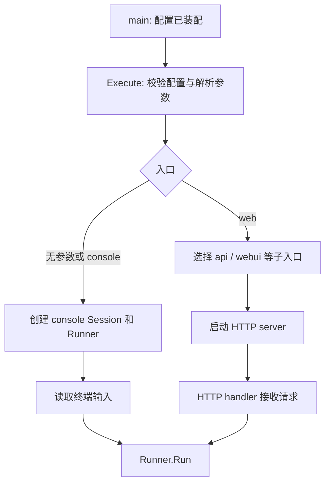
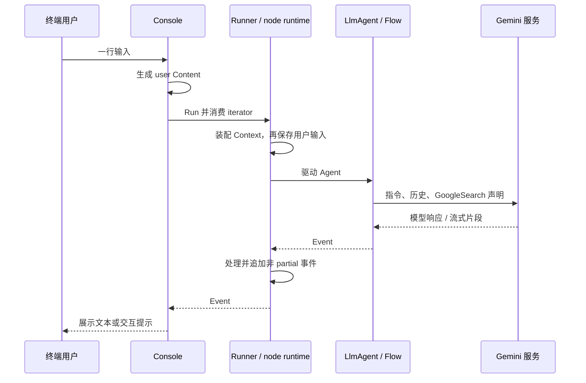

# ADK-Go 源码阅读笔记 · Quickstart：一个 main 函数怎样启动 Agent 应用

> **源码版本：[ADK-Go v2.4.0](https://github.com/google/adk-go/tree/v2.4.0)**，commit `4e57df40cbd35f055ba654b03ffb0e509fdd754a`。
>
> [系列目录](/blog/adk/) · 前置阅读：[Overview](/blog/adk-overview/) · 后续阅读：[Launcher](/blog/adk-launcher/)、[Model](/blog/adk-model/)、[Agent](/blog/adk-agent/)。

一个能回答天气问题的程序，为什么既要创建 Model，又要创建 Agent，还要经过 Loader 和 Launcher？因为这几个对象回答的是不同问题：调用哪个模型、如何组织行为、如何找到应用入口、用户通过什么界面交互。

官方 Quickstart 把这条装配链放在一个 `main` 中。先看它的结构，再跟踪用户输入到达以后发生的事情，就能把配置代码与运行代码分开。

## 一、源码入口与阅读地图

| 文件 / 符号 | 在这个例子中的职责 |
| --- | --- |
| [examples/quickstart/main.go](https://github.com/google/adk-go/blob/v2.4.0/examples/quickstart/main.go#L18-L65) | 创建模型、Agent、Loader 与 Launcher |
| [gemini.NewModel](https://github.com/google/adk-go/blob/v2.4.0/model/gemini/gemini.go#L49-L80) | 创建 Gemini SDK client 和模型适配器 |
| [llmagent.New](https://github.com/google/adk-go/blob/v2.4.0/agent/llmagent/llmagent.go#L39-L137) | 把配置装配为 LlmAgent |
| [agent.NewSingleLoader](https://github.com/google/adk-go/blob/v2.4.0/agent/loader.go#L50-L76) | 用一个 Agent 提供加载入口 |
| [full.NewLauncher](https://github.com/google/adk-go/blob/v2.4.0/cmd/launcher/full/full.go#L30-L33) | 提供 console 与 web 两类启动方式 |
| [console.Run](https://github.com/google/adk-go/blob/v2.4.0/cmd/launcher/console/console.go#L71-L121) | 创建 Session 和 Runner，进入输入循环 |

```text
构造阶段
  genai.ClientConfig
       |
       v
  gemini.NewModel -> llmagent.New -> NewSingleLoader
                                         |
                                         v
                                  launcher.Config
                                         |
运行阶段                                 v
  os.Args[1:] ----------------> Launcher.Execute
                                    |
                           console 或 web 入口
                                    |
                             Runner / Agent
```

创建了 Agent 对象，还不代表模型已经生成过一次回答。模型请求通常要等到入口收到输入并消费运行事件时才发生。

## 二、核心接口与数据结构

### 1. 完整程序

以下为官方 Quickstart 的可运行主体，包含原有 imports 与 `main`，仅省略文件头注释：

```go
package main

import (
	"context"
	"log"
	"os"

	"google.golang.org/genai"

	"google.golang.org/adk/v2/agent"
	"google.golang.org/adk/v2/agent/llmagent"
	"google.golang.org/adk/v2/cmd/launcher"
	"google.golang.org/adk/v2/cmd/launcher/full"
	"google.golang.org/adk/v2/model/gemini"
	"google.golang.org/adk/v2/tool"
	"google.golang.org/adk/v2/tool/geminitool"
)

func main() {
	ctx := context.Background()

	model, err := gemini.NewModel(ctx, "gemini-flash-latest", &genai.ClientConfig{
		APIKey: os.Getenv("GOOGLE_API_KEY"),
	})
	if err != nil {
		log.Fatalf("Failed to create model: %v", err)
	}

	a, err := llmagent.New(llmagent.Config{
		Name:        "weather_time_agent",
		Model:       model,
		Description: "Agent to answer questions about the time and weather in a city.",
		Instruction: "Your SOLE purpose is to answer questions about the current time and weather in a specific city. You MUST refuse to answer any questions unrelated to time or weather.",
		Tools: []tool.Tool{
			geminitool.GoogleSearch{},
		},
	})
	if err != nil {
		log.Fatalf("Failed to create agent: %v", err)
	}

	config := &launcher.Config{
		AgentLoader: agent.NewSingleLoader(a),
	}

	l := full.NewLauncher()
	if err = l.Execute(ctx, config, os.Args[1:]); err != nil {
		log.Fatalf("Run failed: %v\n\n%s", err, l.CommandLineSyntax())
	}
}
```

这个例子调用真实 Gemini 服务，模型名 `gemini-flash-latest` 是示例使用的别名。固定 ADK 版本不会固定这个远端别名将来指向的模型；实际可用性与返回内容取决于服务和账号配置。

### 2. 每个配置字段改变什么

| 对象 / 字段 | 示例值 | 实际用途 |
| --- | --- | --- |
| ClientConfig.APIKey | `GOOGLE_API_KEY` 环境变量 | 传给模型 client 的访问配置 |
| 模型名 | `gemini-flash-latest` | 模型请求默认名称 |
| Agent.Name | `weather_time_agent` | Agent 身份与 Loader 查找名称 |
| Description | 天气与时间能力描述 | 描述能力，供相关协作路径使用 |
| Instruction | 只处理天气与时间问题 | 作为模型指令的一部分 |
| Tools | `geminitool.GoogleSearch{}` | 启用 Gemini 内置搜索能力 |
| AgentLoader | `agent.NewSingleLoader(a)` | 提供 root 及按名查找入口 |

Instruction 中的 `MUST refuse` 是给模型的提示，不是 Go 代码中的强制访问控制。要求模型拒绝无关问题，不等于框架已经用程序规则拦截了这些请求。

### 3. 一个容易误解的工具：GoogleSearch

这个示例没有定义本地 `get_weather` 函数。`GoogleSearch.ProcessRequest` 向请求配置加入：

```go
// 源码摘录：tool/geminitool/google_search.go。
return setTool(req, &genai.Tool{
    GoogleSearch: &genai.GoogleSearch{},
})
```

[源码注释](https://github.com/google/adk-go/blob/v2.4.0/tool/geminitool/google_search.go#L26-L47)明确说明搜索在模型服务内部进行，不要求本地代码执行。因此这个 Quickstart 与 [Flow 的离线天气示例](/blog/adk-flow/)有不同的工具链路：

```text
本篇 GoogleSearch
  应用声明搜索能力 -> Gemini 服务内部搜索 -> 模型响应

本地 FunctionTool
  应用声明函数 -> 模型返回 FunctionCall
              -> Flow 调用 Go handler
              -> FunctionResponse -> 下一次模型请求
```

两者都可以出现在 Tools 中，但执行位置不同。

## 三、主执行路径：调用栈、数据流与事件流

### 1. 从 `Execute` 选择入口

`full.NewLauncher` 构造如下组合，下面是等价的结构示意：

```text
universal
  +-- console                  # 列表第一项，默认入口
  +-- web
       +-- webui
       +-- a2a
       +-- pubsub
       +-- eventarc
       +-- api
```

`os.Args[1:]` 去掉程序路径，只把用户提供的参数交给 Launcher。没有参数时，universal 选择列表第一项 console；显式给 `web` 时，继续解析 web 的参数与子入口。



“full 包含 webui”表示它可以被选择，不表示每次执行都会启动全部服务。只写 `web` 而不选择任何子入口，会报没有 active sublaunchers。

### 2. console 在循环外创建什么

[console.Run](https://github.com/google/adk-go/blob/v2.4.0/cmd/launcher/console/console.go#L71-L121)先做一次性装配：

1. 建立处理中断信号的 Context 和 telemetry。
2. 缺少 SessionService 时使用 InMemoryService。
3. 用 `console_app` / `console_user` 创建一条 Session。
4. 从 `AgentLoader.RootAgent()` 取 Agent，创建 Runner。
5. 进入读输入、运行、输出的循环。

```text
console 进程
  SessionService --------+
                         |
  Session S1             |  多次输入复用这一会话
  Runner R1              |
     |                   |
     +-- 输入 #1 -> Run -> 追加事件
     +-- 输入 #2 -> Run -> 读取前面历史、再追加
     +-- 输入 #3 -> Run -> ...
```

这里不是每输入一行就创建一条新 Session。也不是因为复用了同一个 Model 对象，模型就自动有记忆；历史由 Session 与请求处理器连接。

### 3. 一行文本如何进入 Agent

例如用户输入“杭州现在多少度？”，console 会去掉行尾换行，构造 user-role 的 `genai.Content`，然后消费 `r.Run`。



上图把 Agent wrapper 与 Flow 合并表示，并没有假设 GoogleSearch 必定被调用。模型是否使用搜索、如何组织回答，仍由实际请求和模型行为决定。

### 4. `Event` 不是单纯的字符串

console 需要从 `event.Content.Parts` 取文本，也要处理没有 Content 而带 `Output` 的节点结果，以及人工确认等交互信号。流式时还要区分增量和聚合结果，避免重复打印全文。

Runner 返回的是运行事件，终端展示只是这些事件的一种解释方式。Web UI、日志系统和自定义应用可以用不同方式呈现相同运行记录。

## 四、关键细节与分支

### 1. 创建并运行示例

Go 版本需要满足该 tag 的 `go.mod`：**Go 1.26.6 或更新版本**。在空目录保存上面的 `main.go`，执行：

```bash
go mod init example.com/adk-quickstart
go get google.golang.org/adk/v2@v2.4.0
go mod tidy
go build -o adk-demo .
```

运行前由终端环境提供 `GOOGLE_API_KEY`。构建不调用模型，实际问答需要有效的模型配置与网络连接。

```bash
# 默认 console
./adk-demo

# 明确使用非流式 / SSE 模型响应
./adk-demo console --streaming_mode=none
./adk-demo console --streaming_mode=sse

# 启动 REST API 与 Web UI
./adk-demo web api webui
```

默认 Web UI 位于 `http://localhost:8080/ui/`，REST API 位于 `/api`。更换端口时，UI 的 backend 地址也需要对应：

```bash
./adk-demo web --port=8081 api --webui_address=http://localhost:8081 webui --api_server_address=http://localhost:8081/api
```

这些是各层各自拥有的参数，位置也有意义：web 的 `--port` 放在下一级 `api` / `webui` 关键词之前。完整参数解析见 [Launcher](/blog/adk-launcher/)。

### 2. 默认流式模式为什么会变化

未显式设置 `streaming_mode` 时，console 检查 stdout 是否为字符设备：交互终端通常选择 SSE，重定向/管道通常选择 none。显式配置则优先使用指定值。源码：[默认模式选择](https://github.com/google/adk-go/blob/v2.4.0/cmd/launcher/console/console.go#L145-L155)。

这解释了同一程序在终端和重定向输出时表现不同的原因。它不是模型自行决定是否流式，也不保证每个自定义 adapter 都正确遵守 `stream`。

### 3. 谁提供默认服务

| 入口 | 缺省服务行为 | 会话如何产生 |
| --- | --- | --- |
| console | 本地补 SessionService；其他服务按配置传给 Runner | 启动交互循环前主动 Create |
| web | 对缺少的 Session / Artifact / Memory 服务补内存实现 | 由对应 API/协议路径处理，不是每次 Run 自动创建 |
| 自定义 Runner | 由 `runner.Config` 决定；`NewInMemory` 是便利入口 | 受显式 Create 或 AutoCreateSession 影响 |

内存实现适合本地体验，进程退出会失去相应数据。Web 页面能正常打开，也不能证明 Session 已存在，更不能证明远端模型可用。

### 4. 人工确认不是普通聊天文本

console 会收集 `RequestedInput` 和工具确认信号，将下一段用户输入解释为对应问题的回答；收齐多个提示后，组装 FunctionResponse 再送回 Runner。

```text
工具 / node 请求确认
  -> Event 中的确认 / interrupt 信息
  -> console 提示用户
  -> 用户输入答案
  -> 按对应 ID 构造 FunctionResponse
  -> Runner 恢复等待中的执行
```

“yes”本身没有恢复含义，关键是它被绑定到了哪一个调用或 interrupt ID。普通问题、工具确认与 Workflow 输入的转换细节见 `console/hitl.go` 和 [Tool](/blog/adk-tool/)、[Workflow](/blog/adk-workflow/)。

### 5. 从失败现象定位层次

| 现象 | 首先看哪一层 |
| --- | --- |
| `Failed to create model` | 模型 client 初始化与访问配置 |
| `Failed to create agent` | LlmAgent 配置与组合限制 |
| `cannot parse ... arguments` | Launcher 关键词、参数层次与值 |
| `no active sublaunchers` | `web` 后是否显式选择 api/webui 等 |
| UI 打开但无法聊天 | API 地址、Session 创建、AgentLoader、实际请求错误 |
| 工具没有本地 handler 日志 | 是否使用了 GoogleSearch 这类 provider 内置工具 |
| 进程重启后历史消失 | 是否仍在使用 InMemoryService |

启动成功、页面可达、模型调用成功、业务答案正确是四种不同结果。

## 五、重新梳理：运行时架构与边界

```text
Model          知道怎样访问模型服务
  ^
  |
LlmAgent       持有 Model、Instruction、Tools
  ^
  |
AgentLoader    让入口取得 root 或按名称取得 Agent
  ^
  |
Launcher       决定用户从 console 还是 web 进入
  |
  v
Runner         把消息、会话、上下文、Agent 和事件流接起来
```

Launcher 不是使用 ADK 的必选依赖。嵌入已有 HTTP 服务、队列消费者或桌面程序时，可以自行创建 Runner 并消费事件。Quickstart 使用 full Launcher，是为了用相同 Agent 配置体验多个现成入口。

## 六、这个示例解决了什么问题

它展示了一个应用最小的装配链，同时把交互入口交给现成 Launcher。代码短，是因为 Session、Runner、事件展示和 HTTP handler 的大量工作已封装在后面；这些工作并没有消失。

这份示例仍有明确边界：

- GoogleSearch 演示的是内置搜索，不是自定义业务函数的实现方式。
- instruction 约束模型行为，但不替代程序级权限和输入校验。
- 模型调用是非确定性的，不能期待每次得到固定的文本或调用次数。
- 内存服务不提供跨进程持久化。
- `context.Background()` 本身不会收到操作系统信号；console 另有中断处理，web 的优雅关闭需要应用提供可取消的 Context。

## 七、重点结论与常见误解

| 问题 | 答案 |
| --- | --- |
| `llmagent.New` 是否已经向模型提问？ | 它装配 Agent；实际生成由后续运行触发 |
| Description 与 Instruction 是否等价？ | 前者描述能力，后者进入指令构造路径 |
| Tools 中有 GoogleSearch 是否一定执行本地函数？ | 搜索是 provider 内置能力 |
| full 是否自动启动所有子服务？ | 它提供候选入口，web 子服务仍需按参数激活 |
| console 下一次输入为什么能看到之前内容？ | 同一 Session 的历史经 Flow 重新构造请求 |
| 接入自己的服务是否必须用 Launcher？ | 可以直接创建 Runner，自行适配入口与事件消费 |

Model → Agent → Loader → Launcher 是构造关系，用户输入 → Runner → Flow 才是运行主线。

若希望先观察确定性的模型—工具闭环，可以阅读 [Flow 的离线示例](/blog/adk-flow/)；其中用本地 mock model 固定响应，不需要真实模型凭据。

## 八、相关源码与进一步阅读

- [官方 Quickstart](https://github.com/google/adk-go/blob/v2.4.0/examples/quickstart/main.go)：完整入口。
- [GoogleSearch](https://github.com/google/adk-go/blob/v2.4.0/tool/geminitool/google_search.go)：内置工具声明。
- [AgentLoader](https://github.com/google/adk-go/blob/v2.4.0/agent/loader.go)：root 与按名加载。
- [console.go](https://github.com/google/adk-go/blob/v2.4.0/cmd/launcher/console/console.go) / [hitl.go](https://github.com/google/adk-go/blob/v2.4.0/cmd/launcher/console/hitl.go)：会话、输入循环与人工交互。
- [web.go](https://github.com/google/adk-go/blob/v2.4.0/cmd/launcher/web/web.go)：服务默认值、路由装配和服务器生命周期。

继续追踪：[Launcher](/blog/adk-launcher/) → [Runner](/blog/adk-runner/) → [Flow](/blog/adk-flow/)。
