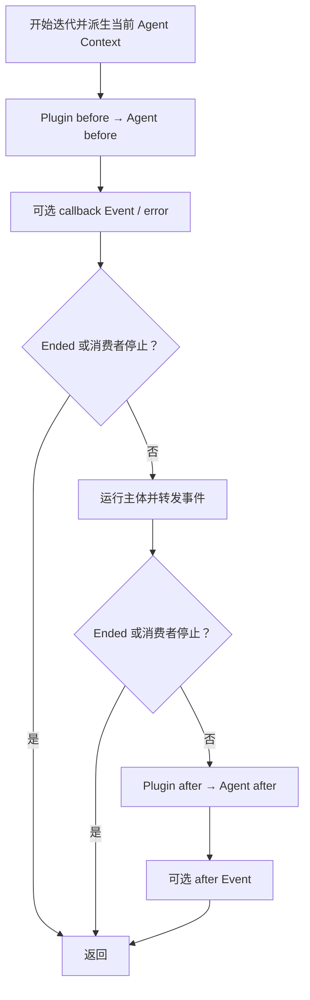
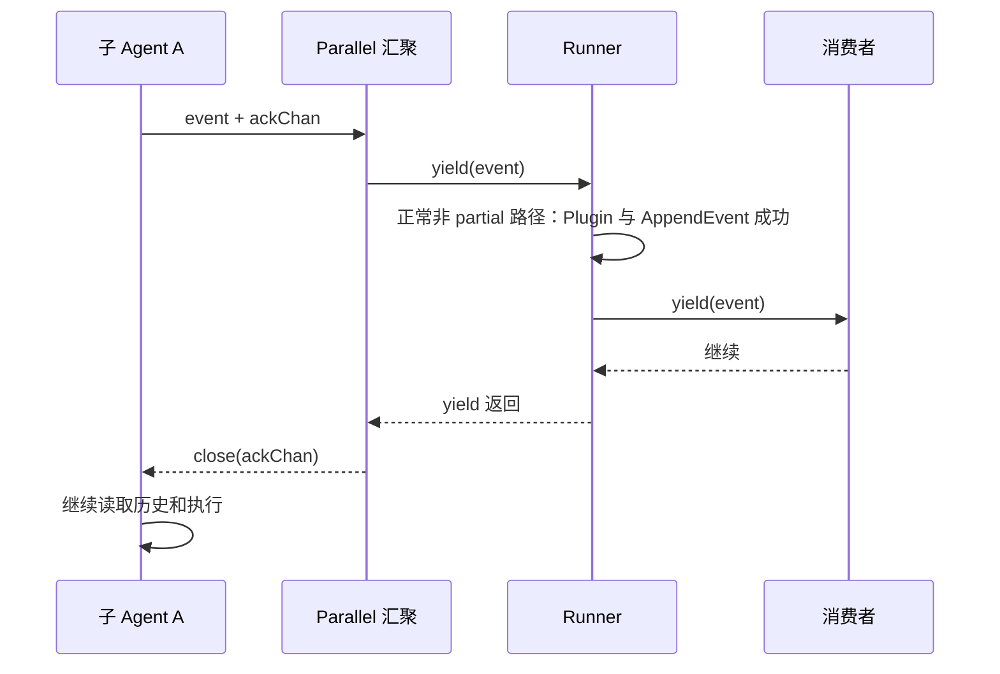

# ADK-Go 源码阅读笔记 · Agent：统一事件流与不同执行策略

> **源码基准：[ADK-Go v2.4.0](https://github.com/google/adk-go/tree/v2.4.0)**，commit `4e57df40cbd35f055ba654b03ffb0e509fdd754a`。本文的“当前实现”均指这个版本。
>
> 范围：base Agent 的普通 Run、LlmAgent 的 Flow 创建过程、顺序 / 循环 / 并行 Agent，以及 Remote 和节点入口的边界。
>
> [返回 ADK 源码阅读合集](/blog/adk/) · 配套阅读：[Runner](/blog/adk-runner/)、[Flow](/blog/adk-flow/)、[Context](/blog/adk-context/)、[Workflow](/blog/adk-workflow/)、[Plugin](/blog/adk-plugin/)。

用户问“杭州天气怎么样”，模型要求调用 `get_weather(city="Hangzhou")`，工具返回气温，模型再生成答案。这几次操作属于同一个 Agent call，却包含两次模型调用和多条事件。

Agent 模块解决的是：**把不同执行策略统一成“接收上下文、逐条产生事件”的对象，让 Runner 和父 Agent 可以用相同方式驱动它们。** 模型回合由 Flow 实现，顺序与并行由组合 Agent 实现，共同的回调和事件骨架则放在 base Agent。

本文回答三个问题：

1. Agent 的接口为何只有几个方法，却不能由应用直接从零实现？
2. before → 主体 → after 的真实顺序是什么，错误和内容如何改变后续步骤？
3. LlmAgent、Sequential、Loop、Parallel、Remote 怎样接入这套协议，又有哪些不同边界？

### 阅读前先分清这些词

| 术语 | 准确含义 | 天气例子 |
| --- | --- | --- |
| Agent 对象 | 保存名称、配置、子 Agent 和执行函数的对象 | `weather_agent` 可以被多次运行 |
| Agent call | 一次 `Agent.Run` 的实际迭代过程 | 读取天气并回答 |
| Invocation | Runner 组织的一次执行；恢复可沿用 ID | 可包含多个 Agent call |
| Flow step | 准备请求、一次模型调用及其工具处理 | 查询 step + 总结 step |
| Event | ADK 运行记录，承载 Content、Actions、身份等 | 调用、工具结果、答案 |
| Ended | 当前上下文关联的提前停止标志 | 不是 Go 的 Done 通道 |

主线假设回调都返回 nil、没有 transfer、非流式输出，工具成功返回 `{"temperature":26}`。理解正常路径后，再改变这些条件。

## 一、源码入口与阅读地图

| 阅读顺序 | 文件 / 符号 | 需要回答的问题 |
| --- | --- | --- |
| 1 | `agent/agent.go`：`Agent`、`Config`、`New` | 框架怎样定义和创建 Agent？ |
| 2 | 同文件：`Run`、`runBeforeAgentCallbacks`、`runAfterAgentCallbacks` | 共享生命周期怎样执行？ |
| 3 | `agent/llmagent/llmagent.go`：`New`、`run` | 模型配置怎样接到 Flow？ |
| 4 | `agent/workflowagents/*/agent.go` | 顺序、循环、并行分别控制哪层迭代？ |
| 5 | `runner/runner.go`、`runner/agent_node.go` | 谁驱动 Agent、保存结果、桥接节点？ |
| 6 | `agent/agent_test.go` | callback、Ended 和子树查找的预期行为是什么？ |

```text
应用
 ├─ agent.New(Config{Run: 自定义函数})
 ├─ llmagent.New
 ├─ sequentialagent.New / loopagent.New / parallelagent.New
 └─ remoteagent.NewA2A
             │ 专用构造器内部复用
             ▼
        base agent
        ├─ 名称、描述、子 Agent
        ├─ before / after callbacks
        └─ run: 当前种类的执行策略
             │
             ▼
      iter.Seq2[*session.Event, error]
             │
      Runner 或父 Agent 消费
```

这些对象共享接口，但不意味着所有入口相同。特别是 **LlmAgent 作为 Runner root 时会先进入节点运行时**，再由节点包装驱动 Agent；非 LLM root 的普通 Run 则直接进入 rootAgent.Run。入口判定见 [runner.go#L566-L631](https://github.com/google/adk-go/blob/v2.4.0/runner/runner.go#L566-L631)，完整恢复流程见 [Runner](/blog/adk-runner/)。

## 二、核心接口与数据结构

### 1. 六个公开方法和一个构造约束

以下是 [Agent 接口的源码摘录](https://github.com/google/adk-go/blob/v2.4.0/agent/agent.go#L35-L53)：

```go
type Agent interface {
    Name() string
    Description() string
    Run(InvocationContext) iter.Seq2[*session.Event, error]
    SubAgents() []Agent
    FindAgent(name string) Agent
    FindSubAgent(name string) Agent

    internal() *agent
}
```

`Name` 是身份；`Description` 供上层理解能力，也参与 LLM 的委派描述；`Run` 是执行入口；其余三个方法描述和查询子树。`FindAgent` 先比较自己，再深度优先搜索后代；`FindSubAgent` 不匹配自身，按 SubAgents 的顺序搜索。见 [agent.go#L218-L232](https://github.com/google/adk-go/blob/v2.4.0/agent/agent.go#L218-L232)。

未导出的 `internal()` 使外部包无法从零实现这个接口。源码注释建议当前使用 `agent.New` 创建自定义 Agent。外部类型可以嵌入已有 Agent 做包装，但那仍然依赖一个已由框架构造的 Agent；不能把“无法从零实现”误解成“无法包装扩展”。

### 2. Config 把变化点收敛到 Run 函数

以下为 [Config 的删节摘录](https://github.com/google/adk-go/blob/v2.4.0/agent/agent.go#L77-L108)，只保留字段：

```go
type Config struct {
    Name        string
    Description string
    SubAgents   []Agent

    BeforeAgentCallbacks []BeforeAgentCallback
    Run                  func(InvocationContext) iter.Seq2[*session.Event, error]
    AfterAgentCallbacks  []AfterAgentCallback
}
```

`agent.New` 把它们装进未导出的 `*agent`，并设置内部类型为 custom。构造时的重复检查使用 `map[Agent]bool`：检查的是**同一个 Agent 对象是否重复出现在直接子列表中**，不是把名字当 key，也不是遍历整棵树验证所有名称。不能仅从 Config 的名称约束注释推断构造器已经逐项执行验证。见 [agent.go#L55-L75](https://github.com/google/adk-go/blob/v2.4.0/agent/agent.go#L55-L75)。

### 3. Run 返回的函数何时执行，对象存在多久

base `Run` 返回一个函数，直到消费者 range 时才进入函数体。Agent 主体可能进一步创建 Flow、模型请求或 goroutine；具体创建时机由主体实现决定。

| 对象 | 创建 / 保存者 | 谁修改 | 谁消费 |
| --- | --- | --- | --- |
| Agent 配置 | 应用构造 Agent 时 | 构造器及其配置处理 | 各次 Run |
| InvocationContext | Runner；Agent 派生副本 | Agent 替换当前 Agent 与追踪 Context | callback、主体、Flow |
| callback actions | before / after 每阶段各创建一个 | 同阶段 callbacks 通过 State 等能力写入 | callback Event |
| Flow | 每次 `llmAgent.run` | processors、model/tool callback | LlmAgent 转发它的事件 |
| Event | callback、主体、Flow 或子 Agent | 作者补全、OutputKey、Plugin 等 | 父 Agent、Runner、Session Service、应用 |

Agent 不是会话状态的唯一存放处。Session 状态随 Context 进入运行；但**自定义 Run、callback 和工具依然可以捕获共享可变对象**，接口不自动使它们线程安全，不能仅因框架可复用 Agent 就断言任意用户实现可以并发复用。

### 4. RunConfig 描述本次调用的运行选项

以下为 [run_config.go#L29-L35](https://github.com/google/adk-go/blob/v2.4.0/agent/run_config.go#L29-L35) 的字段摘录：

```go
type RunConfig struct {
    StreamingMode             StreamingMode
    SaveInputBlobsAsArtifacts bool
}
```

`StreamingMode` 的公开常量是 none 和 sse；Flow 据此决定模型响应是否流式返回，RemoteAgent 据此选择 A2A 调用方式。`SaveInputBlobsAsArtifacts` 则由 Runner 处理输入 blob，不是 Agent 主体自行保存文件。Live 另用 LiveRunConfig；不能从这里两个字段推断普通 Run 已包含双向实时配置。

## 三、主执行路径：调用栈、对象变化与事件流

### 1. base Run 真正统一了什么

[agent.go#L163-L212](https://github.com/google/adk-go/blob/v2.4.0/agent/agent.go#L163-L212) 的顺序如下。这是**控制流伪代码**，省略 telemetry 的具体类型：

```text
开始迭代
  → 开 agent span，包装 yield，defer 结束 span
  → 派生 nodeCtx：Agent = 当前 base agent，Context = spanCtx
  → before callbacks
       有 event 或 err → yield；消费者停止则 return
  → nodeCtx.Ended() ? return
  → range a.run(nodeCtx)
       event.Author 为空时补全
       yield(event, err)；消费者停止则 return
  → nodeCtx.Ended() ? return
  → after callbacks
       有 event 或 err → yield
```

`EndInvocation` 的两个检查点都在外层阶段边界。base Run 没有在主体的每次 yield 后重新检查 Ended，也没有通用的 `ctx.Err()` 检查或 panic recover。主体想及时停止，需要遵守自己的 Context / iterator 协议。



### 2. 为什么要重新绑定 Agent

Runner 的上下文可能指向根 Agent，而一个子 Agent 需要让 `ctx.Agent()` 表示自己。base Run 通过 `PromoteWithDelta` 把当前 Agent 和追踪 Context 放进派生上下文，保留 Session、InvocationID 等环境。

LlmAgent 又在自身 `run` 开头把 Agent 重新绑定为完整的 `*llmAgent`。这不是多余赋值：base 层认识的是 `*agent`，而 Flow 的内部能力断言需要完整 LLM Agent 状态。见 [llmagent.go#L450-L464](https://github.com/google/adk-go/blob/v2.4.0/agent/llmagent/llmagent.go#L450-L464)。

```text
root InvocationContext
  Agent = root
  Session ───────────────────────────────────────────┐
                                                     │ 共享会话句柄
base Run 派生 nodeCtx                                 │
  Agent = weather_agent 的 base *agent                │
  InvocationID = e-1                                 │
                                                     │
llmAgent.run 再派生                                  │
  Agent = 完整 *llmAgent（带 Model / Tools / Mode）     │
  Session ───────────────────────────────────────────┘
```

### 3. 天气结果沿哪条链返回

以下是**对象快照示意**，仅展示主线事件，不包括 node 控制事件、callback delta 或 SSE partial：

```text
E1: Author=weather_agent, Role=model
    FunctionCall: id=call-1, name=get_weather, args={city: Hangzhou}

E2: Author=weather_agent, Role=user
    FunctionResponse: id=call-1, name=get_weather, response={temperature: 26}

E3: Author=weather_agent, Role=model
    Text: 杭州当前 26°C……
```

第二次模型请求的历史中，比第一次多了 E1 和 E2。关键闭环是同步 iterator：

```text
Flow yield(E1)
  └─ LlmAgent → base Agent → Runner
                              ├─ OnEvent
                              ├─ AppendEvent(E1)
                              └─ caller yield(E1)
                                  │ 继续消费
Flow 从 yield 返回 ◄───────────────┘
  → 执行工具 → yield(E2) → 保存
  → 下一 step 从 Session 构造请求 → 模型读到工具结果
```

普通持久化发生在上层消费事件期间，生产者恢复后才能继续下一步。直接调用 Agent.Run 而不提供等效事件消费和 Session 更新逻辑，不能自动获得 Runner 的完整工具历史闭环。Runner 的正常顺序见 [runner.go#L748-L775](https://github.com/google/adk-go/blob/v2.4.0/runner/runner.go#L748-L775)。

### 4. Author 只在缺失时补齐

主体事件的 Author 为空时，base Agent 用以下规则：

- Content 存在且 Role 是 user：Author = user；
- 其他情况：Author = 当前 Agent 名。

已有 Author 完全保留。见 [agent.go#L194-L201](https://github.com/google/adk-go/blob/v2.4.0/agent/agent.go#L194-L201) 与 [getAuthorForEvent](https://github.com/google/adk-go/blob/v2.4.0/agent/agent.go#L234-L240)。

因此自定义 Agent 生成 user-role 工具结果时，应明确填写真正的 Agent Author；否则 base 的默认规则会把它标为 user。Flow 的工具 Event 已设置 Agent Author，所以天气例子 E2 不会被改成人类作者。

### 5. 谁决定“已经结束”

| 层级 | 判断 | 含义 |
| --- | --- | --- |
| base Agent | Ended、yield=false、主体 iterator 结束 | 当前 Agent 的生命周期是否继续 |
| LLM Flow | 最后事件 final、Ended、空结果等 | 是否再执行一个模型 step |
| LoopAgent | Escalate 或迭代次数耗尽 | 是否再跑一轮子 Agent |
| ParallelAgent | 所有子任务结束、错误、消费者停止 | 并发汇聚是否结束 |
| Runner | 输入、存储和消费分支 | 当前应用调用是否还能继续 |

base Agent 不调用 `IsFinalResponse()` 来截断所有子事件。一个 final 文本后仍可能有 after callback 或节点控制事件；消费方若在文本后立刻 break，会主动跳过还未发生的阶段。

## 四、关键细节与分支

### 4.1 before 返回内容、状态或错误，是三种不同结果

[before 实现](https://github.com/google/adk-go/blob/v2.4.0/agent/agent.go#L257-L312) 先建立 actions 和 callback Context，再运行 Plugin before，最后按列表运行 Agent callbacks。

| callback 结果 | 框架动作 | 后续主体 |
| --- | --- | --- |
| 非 nil Content | 建 callback Event，复制 actions，设置 EndInvocation | 跳过，after 也跳过 |
| nil Content、nil error，但 StateDelta 非空 | 建只含 delta 的 Event | 消费者继续就运行 |
| nil Content、nil error，StateDelta 为空 | 不产生 callback Event | 继续 |
| error | 返回包装后的 Go error | 取决于消费者是否停止；没有自动 EndInvocation |

例如 before 写 `last_city=Hangzhou` 并返回 nil，事件先被 Runner 保存，再进入天气工具。若 before 返回缓存答案，则主体一次模型请求也不会发起。

Config 注释把 callback error 描述成跳过运行，但当前 base Run 的 error 路径只 yield 错误，并未自动设置结束标志或 return。消费者若对错误选择 continue，且 Context 未结束，主体仍可运行。错误策略必须结合调用方阅读，不能从注释推出 fail-fast。

### 4.2 after 产生的是新事件，不是重写之前的答案

[after 实现](https://github.com/google/adk-go/blob/v2.4.0/agent/agent.go#L316-L374) 同样 Plugin 优先、第一个非 nil Content 胜出。它产生一条新的 Event，不能撤回已产出的天气答案。

源码保留了关键解释：

```go
// Deliberately not ending the invocation here, which matches the Python
// ADK. Ended reports whether the invocation should stop early, and nothing
// reads it after this point: running the after-agent callbacks is the last
// step of the agent's Run loop.
```

完整注释还说明该标志局限于当前 Agent 派生 Context，不会传播回父级。若只是想修改模型答案，应看 AfterModel；Agent after 更接近整个 Agent call 的结束阶段。

before / after 都只有 **Content 非 nil 或 StateDelta 非空** 才创建成功事件。不能假设单独写 ArtifactDelta、Escalate 等字段就一定产生 callback Event。普通 callback wrapper 也不提供 Actions 的有效写入口；详见 [Context](/blog/adk-context/)。

### 4.3 LlmAgent：组合 base，再创建 Flow

构造器把 `Run: a.run` 注入 base agent，并嵌入返回对象；同时记录 LLM 配置、AgentType 和 task 工具。见 [llmagent.go#L70-L136](https://github.com/google/adk-go/blob/v2.4.0/agent/llmagent/llmagent.go#L70-L136)。

每次 `llmAgent.run` 创建新的 Flow，挂入：

- Model；
- 默认 request / response processors；
- before / after / on-error model callbacks；
- before / after / on-error tool callbacks。

Flow 每个事件经过 `maybeSaveOutputToState` 后转发。它处理的是事件的 StateDelta，后续再由 Runner 和 Session Service 应用，不应描述成 LlmAgent 直接提交数据库。具体 OutputKey 对 final、作者、结构化输出的判断见 [llmagent.go#L520-L562](https://github.com/google/adk-go/blob/v2.4.0/agent/llmagent/llmagent.go#L520-L562)。

OutputKey 只处理本 Agent 作者的 final Event，拼接非 Thought 的非空 Text，并写入 `Event.Actions.StateDelta[OutputKey]`。当前这里不会把 OutputSchema 对应的文本 JSON 解码成 Go 对象；代码仍保留相关 TODO，schema 非 nil 时仅额外跳过纯空白输出。

`installTaskTools` 还根据声明的模式添加工具：task Agent 自身获得 finish_task；single_turn 子 Agent 作为 single-turn tool 加到父 Agent；task 子 Agent 加成 task tool；未声明模式的子 Agent 按 chat 处理，通过 transfer_to_agent 到达，而不是自动加成普通工具。见 [llmagent.go#L139-L181](https://github.com/google/adk-go/blob/v2.4.0/agent/llmagent/llmagent.go#L139-L181)。

天气例子的两次模型调用发生在 Flow，base Agent before/after 则包住整个 Agent call，不是每个 step 各执行一次。processor 中某些功能当前仍是 TODO no-op，不能因默认列表有 planner / code execution 名称就声称它们已实现，详见 [Flow](/blog/adk-flow/)。

### 4.4 Sequential 与 Loop：组合的是事件流

Sequential 的普通 Run 逐个 range 子 Agent；没有额外汇总文本，也没有看到 final Event 就跳过其余子 Agent。其 error 项只是向上 yield，消费者继续时可继续后面的子流。见 [sequentialagent#L80-L91](https://github.com/google/adk-go/blob/v2.4.0/agent/workflowagents/sequentialagent/agent.go#L80-L91)。

Loop 则反复按顺序遍历子 Agent：

```text
第 1 轮: fetch_weather → review_weather
第 2 轮: fetch_weather → review_weather
...
退出：
  A. 当前子 Agent 流已结束，并且它曾发出 Escalate=true
  B. 一整轮结束后 MaxIterations 计数耗尽
  C. 消费者停止
```

Escalate 并非一看到就立刻切断当前子 Agent；源码先记录 shouldExit，待当前子 Agent 流结束后 return。`MaxIterations=0` 不限制轮数。见 [loopagent#L75-L105](https://github.com/google/adk-go/blob/v2.4.0/agent/workflowagents/loopagent/agent.go#L75-L105)。

顺序、循环、并行构造器都拒绝自定义 Config.Run，因为它们自身拥有调度策略；应用通过子 Agent 和 callbacks 扩展行为。

### 4.5 Parallel：独立 Branch，共享 Session，逐事件 ack

Parallel 为子 Agent 生成不同 Branch，例如 `weather.sources_a` 和 `weather.sources_b`；它们仍持有同一 Session。Branch 用来选择可见历史，不会把 session.State 自动分成互不影响的副本。

其实现启动 errgroup 子任务，将事件送进 channel。每个子任务为每个成功事件创建 ackChan，发送后等待上层处理结束；父迭代器从 yield 返回后关闭 ack。



这张图展示正常的非 partial 事件成功追加路径。ack 的直接含义是**父迭代器调用的上层 yield 已经返回**，不是“持久化成功”。在这个正常路径中，上层处理包括 AppendEvent；partial 事件不会调用 AppendEvent，OnEvent 返回 error 而消费者继续时也会跳过追加，但上层 yield 仍会返回，父迭代器仍会关闭 ack。见 [parallelagent#L130-L139](https://github.com/google/adk-go/blob/v2.4.0/agent/workflowagents/parallelagent/agent.go#L130-L139) 和 [runner.go#L748-L774](https://github.com/google/adk-go/blob/v2.4.0/runner/runner.go#L748-L774)。

消费者停止时，父迭代器 cancel 子任务、关闭 doneChan、drain 结果，直到 errgroup 收尾并关闭 channel。如果子 Agent 的 teardown 自己阻塞，Parallel 的返回也会阻塞。一个子任务 error 会由 errgroup 取消其他任务；它和 Sequential 的简单 error 转发策略不同。见 [parallelagent#L68-L173](https://github.com/google/adk-go/blob/v2.4.0/agent/workflowagents/parallelagent/agent.go#L68-L173)。

### 4.6 Remote、Live、节点 Mode 是三条额外边界

RemoteAgent 把本地输入转换成 A2A 请求，运行 BeforeA2ARequest callbacks，再按流式配置选择 SendMessage / SendStreamingMessage，转换返回事件。Agent Card 网络接口校验以**配置的来源 origin** 为锚点；远端提供的 TransferToAgent 默认清除，必须显式开启才接受。见 [origin 校验](https://github.com/google/adk-go/blob/v2.4.0/agent/remoteagent/v2/a2a_agent.go#L120-L159)、[transfer 配置](https://github.com/google/adk-go/blob/v2.4.0/agent/remoteagent/v2/a2a_agent.go#L285-L299) 和 [run](https://github.com/google/adk-go/blob/v2.4.0/agent/remoteagent/v2/a2a_agent.go#L368-L496)。

RunLive 不属于 Agent 基础接口。支持它的具体 Agent 额外实现 capability，Runner 使用类型断言选择；不能从实现 Agent 推出一定支持双向音视频。Sequential 的 Live 路径还会维护 active session 并安排子 Agent 交棒，和普通 Run 的简单列表循环分开实现。

节点入口 `RunLLMAgentAsNode` 按最终绑定的 chat、single_turn、task Mode 分派。Mode 属于节点放置与执行协议；task 的委派、finish_task、HITL 恢复不能仅靠直接 range LlmAgent.Run 获得全部语义。见 [节点包装入口](https://github.com/google/adk-go/blob/v2.4.0/agent/llmagent/llm_agent_wrapper.go#L76-L126) 和 [Workflow](/blog/adk-workflow/)。

### 4.7 错误、取消与恢复

| 情况 | base Agent 的行为 | 需要哪层补齐 |
| --- | --- | --- |
| callback error | 向上 yield；before error 不自动设置 Ended | 消费者决定是否停止 |
| 主体 error | 原样转发；主体是否继续由实现决定 | Flow / workflow / Runner |
| EndInvocation | 阶段边界检查 bool | 主体内部也应遵守停止检查 |
| Go context 取消 | Context 的 Done / Err 可被下层观察 | 模型、工具、外部 I/O 主动检查 |
| 消费者 break | yield=false，返回并执行 defer | 并行路径还需取消和等待子任务 |
| HITL 暂停 | 基础接口本身没有持久恢复算法 | Runner 节点、workflow、确认 processor |

结束标志不关闭 Go Done 通道，也不能强制中断正在进行的网络请求。派生 invocation Context 按值复制 bool；当前子 Agent 的结束标志不是整个父子树共享的广播取消信号。

## 五、重新梳理：运行时架构与边界

| 模块 | 输入与产出 | 负责 | 交给其他模块 |
| --- | --- | --- | --- |
| Runner | 用户输入 → 可见 Event 流 | Session、服务、Plugin、持久化、恢复入口 | Agent 的具体策略 |
| base Agent | InvocationContext → Event 流 | callbacks、Agent 重绑、缺失 Author 补全 | 模型循环和组合调度 |
| LlmAgent | Agent 配置 → Flow 事件 | 把 Model / Tool callbacks 传给 Flow、处理 OutputKey | Flow step |
| Sequential / Loop / Parallel | 子 Agent 列表 → 汇聚事件 | 顺序、次数、分支、并发握手 | 子 Agent 业务 |
| Flow | 当前 Context → 模型 / 工具事件 | 请求构造、模型、工具、transfer | 存储与 UI |
| RemoteAgent | 本地历史 → A2A 事件 | 协议转换、远端调用 | 远端内部推理 |

天气例子穿过这些边界时，base Agent 看见的是“主体产生了三条事件”；Flow 才知道第一条需要调用天气工具，Runner 才决定第三条已成功追加并可以交给 UI。

普通规则是 Agent 产出、Runner 持久化；Flow 尾部保留压缩等旁路可直接通过注入服务写入，不应把普通路径扩展成所有内部行为的定律。

## 六、这个模块解决了什么问题

### 1. 用相同协议组合不同策略

若只有模型 SDK 和天气函数，应用仍要实现回调、当前 Agent 身份、子树查找、工具多步循环、顺序与并发输出，以及停止消费的传播。统一 Agent 接口让这些策略可以递归嵌套，不要求 Runner 为每种业务维护一套输出协议。

### 2. 设计代价

| 选择 | 收益 | 代价与使用条件 |
| --- | --- | --- |
| 统一经构造器创建 | 初始化内部状态和各类 Agent 所需配置 | 不能任意从零实现 Agent 接口 |
| Run 函数字段 + 组合 | base 生命周期可复用 | 必须分辨主体和外层 callbacks 的停止策略 |
| 逐条转发 iterator 的结果 | 消费者处理当前事件后，生产者才继续 | 每层都需遵守 yield=false，错误不会自动统一 |
| Branch 历史过滤 | 并行 Agent 不互看兄弟历史 | Session State 和外部副作用仍可能共享 |
| Parallel 等待 teardown | 避免后台任务越过 Run 生命周期 | 错误的清理逻辑可能拖住返回 |
| 回调返回新 Event | 可以提供缓存、策略与审计数据 | after 无法撤回已经保存或显示的答案 |

这些是从实现可以直接观察的取舍；它们不构成任意用户回调、Session 后端或远端服务的事务保证。

## 七、重点结论与常见误解

### 必须记住

- **Agent 提供统一事件协议，具体策略由主体提供。**
- **一次 Agent call 可以包含多个 LLM step；before/after 通常包住整个 call。**
- **返回内容后跳过主体、产生错误、设置 Ended、取消和停止消费，分别由不同条件触发。**
- **并行 Branch 隔离历史可见性；ack 确认上层 yield 已返回，不是持久化成功确认，也不提供状态事务。**

| 常见误解 | 当前实现 | 对应章节 |
| --- | --- | --- |
| Agent 接口能被外部类型随意实现 | 未导出方法要求从框架构造器接入 | 第二节 |
| callback error 一定跳过主体 | before error 先 yield，上层继续则可能进入主体 | 4.1 |
| after 用返回值替换之前的最终答案 | 它追加新 Event | 4.2 |
| final Event 意味着所有外层代码都跑完 | after / node 收尾可能仍未执行 | 第三节 |
| Escalate 立即杀掉当前 Loop 子 Agent | 当前子流耗尽后再退出 Loop | 4.4 |
| Parallel 可以无等待地提前返回 | 会取消、drain、等子任务收尾 | 4.5 |

### 用天气例子检查自己

1. before 返回缓存天气时调用模型几次？**零次**，主体和 after 都被跳过。
2. before 只写 `last_city` 时呢？**先发 delta Event，再进入模型流程**。
3. Sequential 里天气 Agent 输出 final 后，下一 Agent 会运行吗？**消费者继续，且子流结束后会运行**；父 Sequential 不靠 final 判定停止。
4. Parallel 的两个来源写同一个状态 key 是否被 Branch 自动隔离？**没有**；Branch 控制 prompt 历史选择，不是 State 命名空间。

## 八、相关源码与进一步阅读

| 主题 | 固定源码 / 文章 |
| --- | --- |
| 接口、构造、运行 | [agent.go#L35-L212](https://github.com/google/adk-go/blob/v2.4.0/agent/agent.go#L35-L212) |
| callback 与框架字段过滤 | [agent.go#L242-L374](https://github.com/google/adk-go/blob/v2.4.0/agent/agent.go#L242-L374) |
| Agent callbacks 测试 | [TestAgentCallbacks](https://github.com/google/adk-go/blob/v2.4.0/agent/agent_test.go#L30-L153) |
| EndInvocation 测试 | [agent_test.go#L155-L260](https://github.com/google/adk-go/blob/v2.4.0/agent/agent_test.go#L155-L260) |
| LlmAgent → Flow | [llmagent.go#L450-L474](https://github.com/google/adk-go/blob/v2.4.0/agent/llmagent/llmagent.go#L450-L474) |
| 并行汇聚与 ack | [parallelagent#L68-L173](https://github.com/google/adk-go/blob/v2.4.0/agent/workflowagents/parallelagent/agent.go#L68-L173) |
| 执行配置 | [run_config.go](https://github.com/google/adk-go/blob/v2.4.0/agent/run_config.go) |
| 配套阅读 | [Runner](/blog/adk-runner/)、[Flow](/blog/adk-flow/)、[Context](/blog/adk-context/)、[Workflow](/blog/adk-workflow/) |
