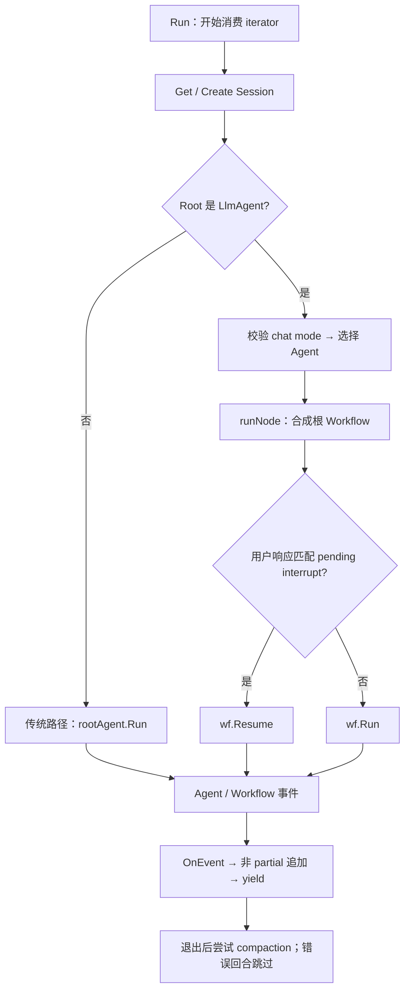
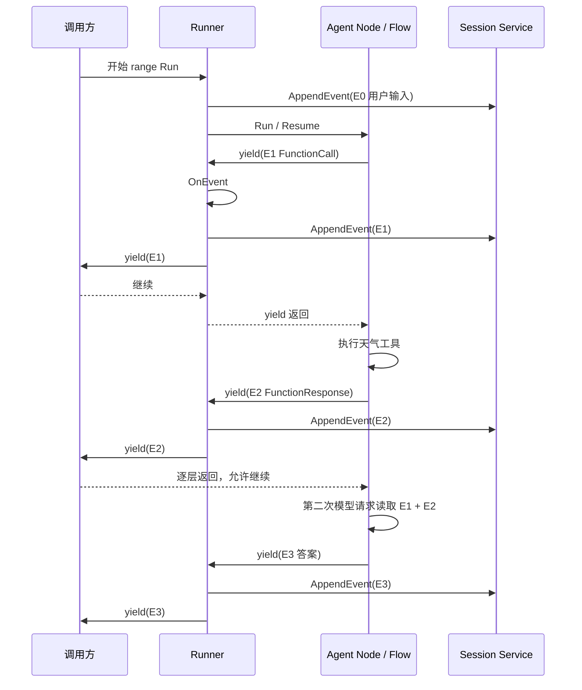

# ADK-Go 源码阅读笔记 · Runner：一次输入的执行、持久化与恢复

> **源码基准：[ADK-Go v2.4.0](https://github.com/google/adk-go/tree/v2.4.0)**，commit `4e57df40cbd35f055ba654b03ffb0e509fdd754a`。本文的“当前实现”均指这个版本。
>
> 范围：普通 Run 的两条执行路径、消息与 Plugin、HITL、Live 和 Context Compaction。模型与工具内部循环见 Flow，数据库内部存储见 Session 配套文章。
>
> [返回 ADK 源码阅读合集](/blog/adk/) · 配套阅读：[Agent](/blog/adk-agent/)、[Flow](/blog/adk-flow/)、[Context](/blog/adk-context/)、[Plugin](/blog/adk-plugin/)、[Workflow](/blog/adk-workflow/)、[Session Event](/blog/adk-session-event/)。

用户问“杭州天气怎么样”，Agent 可以调用工具并产出答案，但应用还需要决定：这条输入属于哪个会话、由哪个 Agent 接着回答、工具结果何时保存、用户确认回来后从哪里继续，以及前端断开后还执行哪些收尾。

**Runner 把输入、运行环境、事件持久化和恢复入口接成一条调用链。** 它不直接实现模型推理，却决定 Agent 产生的记录怎样进入 Session、怎样经过 Plugin、怎样交到调用方。

本文回答三个问题：

1. Runner 为一次输入创建哪些对象，它们被谁读取和修改？
2. 用户消息、模型 FunctionCall、工具结果、最终答案如何按序保存并流出？
3. 错误、提前停止、长任务恢复、Live 和压缩分别改变哪一段协议？

### 阅读前先分清这些词

| 术语 | 本文中的含义 | 易混淆之处 |
| --- | --- | --- |
| Runner | 长期持有 root Agent、服务、Plugin 和配置的运行器 | 不是每次模型调用都新建 |
| Session | App + User + SessionID 关联的历史与状态 | 一个 Session 可以有多次 invocation |
| Invocation | 一次执行关联的逻辑 ID | 暂停和恢复可能共用 ID |
| 普通 Run | 返回一个迭代函数，range 时才执行 | 非 LLM root 与 LLM root 内部路径不同 |
| Node runtime | LLM root 的合成 workflow / 节点运行路径 | 不代表所有 root 都进入它 |
| Partial | 流式过程中尚未形成完整记录的响应 | final 判断和 partial 标志不是同一件事 |
| AppendEvent | 服务收到一条待记录事件 | 不等于跨工具、artifact、数据库的原子事务 |

### 贯穿示例

主线使用 `AppName=weather_app`、`userID=user-1`、`sessionID=session-1`，root 为 chat 模式 `weather_agent`。输入是“杭州天气怎么样”，模型先请求 `get_weather(city="Hangzhou")`，工具返回 `temperature=26`，第二次模型调用生成中文回答。

先假设 Session 已存在、没有 Plugin 改写、没有压缩、非 SSE、工具同步成功。第四节再改变一个条件，观察原链条哪一处转弯。代码片段在各小节标明是摘录还是示意；流程图省略不影响该分支的 telemetry 等细节。

## 一、源码入口与阅读地图

| 顺序 | 文件 / 符号 | 需要回答的问题 |
| --- | --- | --- |
| 1 | `runner/runner.go`：Config、New、Run | 依赖如何装配，根 Agent 如何分流？ |
| 2 | 同文件：appendMessageToSession | Plugin、blob、StateDelta 怎样进入用户 Event？ |
| 3 | `runner/run_node.go`：runNode | LLM root 怎样变成 START → node？ |
| 4 | `runner/agent_node.go` | Agent 事件怎样转成 node 输出和等待状态？ |
| 5 | `runner/run_node.go`：resolveInvocationID、buildResumeResponses | ID 关联和真正允许 Resume 有何区别？ |
| 6 | `runner/runner.go`：RunLive、compactAfterInvocation | 长连接、收尾压缩为什么需要特殊规则？ |
| 7 | runner tests | 用户事件顺序、StateDelta、长任务恢复如何固定预期？ |

```text
应用开始 range Runner.Run
      │
      ├─ Get / Create Session
      ├─ 选执行入口、装配 Context 和服务
      ├─ 用户输入 → OnUserMessage → AppendEvent
      └─ BeforeRun
            │
       ┌────┴─────────────────┐
       ▼                      ▼
非 LLM root               LLM root
rootAgent.Run             START → Agent Node
       │                      └─ Run / Resume
       └──────────┬───────────┘
                  ▼
      事件 → OnEvent → 非 partial AppendEvent → caller yield
                  │
                  ▼
      AfterRun / 可选 compaction 收尾
```

主线规则是 Agent / Workflow 产事件，Runner 负责普通事件的 Plugin、持久化和对外转发。用户输入、BeforeRun 早退、Live Send、尾部保留摘要存在各自的追加旁路，不能从主线推出“每个写入都经过 OnEvent”。

## 二、核心接口与数据结构

### 1. Runner 的配置和内部状态

源码：[runner/runner.go](https://github.com/google/adk-go/blob/v2.4.0/runner/runner.go#L47-L239)。

以下为 Config 的**源码摘录**，保留与压缩边界有关的原始注释：

```go
// Config is used to create a [Runner].
type Config struct {
    AppName string
    // Root agent which starts the execution.
    Agent          agent.Agent
    SessionService session.Service

    // optional
    ArtifactService artifact.Service
    // optional
    MemoryService memory.Service
    // optional
    PluginConfig PluginConfig
    // optional
    AutoCreateSession bool

    // Compaction enables context compaction for the sessions this
    // runner drives, replacing older events with summaries. Nil, the default,
    // disables compaction.
    //
    // The sliding window reduces prompt size by a constant factor rather than
    // bounding it. Only tail retention bounds growth, and it only fires when
    // more events accumulate between sliding-window compactions than
    // EventRetentionSize holds back, so a short interval with a large retention
    // size leaves it idle. See [compaction.Config].
    //
    // When the config names no Summarizer, the runner installs a
    // [compaction.LLMSummarizer] over the root agent's model, which then has to
    // be an LLM agent.
    //
    // optional
    Compaction *compaction.Config
}
```

保留上面的源码注释，是因为它说明了两个容易遗漏的限制：滑动窗口并不提供固定长度的历史上限；没有显式 Summarizer 时，默认实现依赖 root Agent 的模型。

Runner 内部字段的**删节摘录**如下，省略字段注释：

```go
type Runner struct {
    appName           string
    rootAgent         agent.Agent
    sessionService    session.Service
    artifactService   artifact.Service
    memoryService     memory.Service
    parents           parentmap.Map
    pluginManager     *plugininternal.PluginManager
    autoCreateSession bool
    compactionConfig  *compaction.Config
}
```

#### 1. `SessionService` 是唯一必需服务

`runner.New` 会拒绝：

- `cfg.Agent == nil`；
- `cfg.SessionService == nil`。

Artifact、Memory、Plugin 和 Compaction 都可以不配置。它们为空时，Runner 仍然可以运行基本 Agent。

#### 2. `parentmap` 在构造阶段计算

`parentmap.New(cfg.Agent)` 会预先建立 Agent tree 的父子关系。它不是每次 transfer 时临时搜索整棵树，而是被放进 Context，供：

- Agent transfer target 计算；
- Flow 找下一个 Agent；
- 子 Agent 的 branch / parent 逻辑。

父表构造会拒绝同一个 Agent 对象有多个父节点、树内同名 Agent，以及子节点再次使用根名称等情况；见 [parentmap/map.go#L26-L54](https://github.com/google/adk-go/blob/v2.4.0/internal/agent/parentmap/map.go#L26-L54)。这些检查失败时，Runner.New 返回错误。

#### 3. `NewInMemory` 适合本地开发和测试

```go
r, err := runner.NewInMemory("demo", rootAgent)
```

它自动装配：

- `session.InMemoryService()`；
- `artifact.InMemoryService()`；
- `memory.InMemoryService()`；
- `AutoCreateSession: true`。

这不是生产持久化配置的替代品；生产环境应显式注入自己的 Service。

公开运行入口是 `Run` 和 `RunLive`，没有 `RunWithConfig`。单次执行配置通过 `agent.RunConfig` / `agent.LiveRunConfig` 和 `RunOption` 传入，而不是另建一个不存在的运行方法。

### 2. Run 的公共契约：开始 range 后才执行

源码：[runner/runner.go](https://github.com/google/adk-go/blob/v2.4.0/runner/runner.go#L533-L564)。以下为公开签名，换行排版；后面的消费循环是应用侧示意。

```go
func (r *Runner) Run(
    ctx context.Context,
    userID string,
    sessionID string,
    msg *genai.Content,
    cfg agent.RunConfig,
    opts ...RunOption,
) iter.Seq2[*session.Event, error]
```

调用 `r.Run(...)` 时，Runner 只返回一个 iterator。Session 读取、用户消息写入、Agent 执行和事件持久化，都会在调用方开始 range 之后才发生：

```go
for event, err := range r.Run(
    ctx,
    "user-1",
    "session-1",
    genai.NewContentFromText("你好", genai.RoleUser),
    agent.RunConfig{},
) {
    if err != nil {
        // 处理本次流中的错误
        continue
    }
    // 消费 event
}
```

这有几个直接后果：

- 不 range，什么都不会执行；
- 调用方 `break` 后，生产端必须停止继续 yield；
- partial event 可以已经被 yield，但普通 Run 不会将它持久化；
- compaction 放在 defer 中的路径，即使调用方提前 break，也可能继续执行收尾逻辑。

#### `yield` 返回 false 表示消费者停止

生产者调用 `yield` 时，要等消费者处理当前事件并返回，才能继续后面的代码。返回 false 表示消费者已经结束迭代，生产者不得再次调用它。这是 Go iterator 的契约，也需要每一层转发代码正确传递。

```text
yield(event, nil) == false
        │
        ├─ 停止当前 Agent / Workflow stream
        ├─ 不再调用 yield
        └─ defer 仍可能执行收尾逻辑
```

因此调用方如果只想拿到最终事件就 break，必须同时考虑：

- 是否还有未消费的事件；
- 是否依赖 drain 完整 iterator 才能看到错误；
- compaction 错误可能在 defer 中只能被 Runner 日志记录，而不能再通过已经停止的 yield 返回。

### 3. 单次调用的 RunOption

源码：[runner/runner.go](https://github.com/google/adk-go/blob/v2.4.0/runner/runner.go#L88-L110)。

当前公开的两个 RunOption 如下。`RunLive` 虽然接收并解析 `opts`，后续却没有使用这两个值，不能仅凭参数签名推断它们在 Live 中生效。

#### `WithStateDelta`

```go
runner.WithStateDelta(map[string]any{
    "source": "api",
})
```

普通 / node 路径在存在用户消息时，把 delta 附加到用户 Event 的 `Actions.StateDelta`。

#### `WithYieldUserMessage`

```go
runner.WithYieldUserMessage()
```

让 node path 在 Agent / Workflow event 之前 yield 用户 Event。用户 Event 无论 option 是否存在，都会先写入 Session。

它不是“是否把用户消息写入历史”的开关，而是“是否把已写入的用户事件暴露给本次 iterator”的开关。


### 4. 对象由谁创建、修改和消费

| 对象 / 字段 | 创建者与生命周期 | 修改者 | 消费者 | 天气例子 |
| --- | --- | --- | --- | --- |
| Runner | 应用初始化时创建，可复用 | 构造阶段配置 | 多次 Run / RunLive | weather_app |
| storedSession | 每次 Get / Create 返回 | AppendEvent / State 视图 | Agent、workflow、compactor | session-1 |
| InvocationContext | 每次运行或恢复装配 | Agent 与节点派生 | Flow、工具、callback | e-1 |
| 用户 Content | 调用方 | OnUserMessage 可替换；blob 路径原地替换 Parts | 用户 Event / Context | 杭州天气 |
| 用户 Event | appendMessageToSession | StateDelta、IsolationScope 填入 | Session Service；可选 yield | E0 |
| Agent Event | Agent / workflow | MessageAsOutput 处理、OnEvent | Session Service、UI | E1/E2/E3 |
| Compaction runtime | Runner 为当前 invocation 装配 Context 时创建 | 中途压缩标记 AlreadyCompacted | processor 与后置收尾共享 | 主线未启用 |

同一个 Runner 不等于同一个 Context；同一个 Session 也不保证每次 Get 得到同一对象。后置压缩重新读取 Session，正是因为旧句柄可能看不到并发追加。

## 三、主执行路径：调用栈、数据流与事件流

### 1. 获取 Session

源码：[runner/runner.go](https://github.com/google/adk-go/blob/v2.4.0/runner/runner.go#L510-L531)。

每次 `Run` / `RunLive` 首先调用：

```go
storedSession, err := r.getOrCreateSession(ctx, userID, sessionID)
```

流程是：

```text
SessionService.Get
  ├─ 成功 → 使用已有 Session
  └─ 失败
       ├─ AutoCreateSession=false → 返回原错误
       └─ AutoCreateSession=true
             └─ SessionService.Create
```

自动创建时使用 Runner 的 `AppName`、调用方的 `userID` 和 `sessionID`。

这意味着 `AutoCreateSession` 不是“Get 失败都忽略”，而是“Get 失败后尝试 Create”。如果 Create 也失败，错误照样返回。

### 2. 根 Agent 决定执行入口

源码：[runner/runner.go](https://github.com/google/adk-go/blob/v2.4.0/runner/runner.go#L566-L638)。

Runner 的一个关键分叉是：



图中省略了两条路径各自的 Context 装配、用户消息追加及 BeforeRun 早退；后文再展开。

#### 1. 为什么 LlmAgent 走 node runtime

LlmAgent 需要与 ADK 的 workflow / HITL 状态机对齐。Runner 会把 Agent 包成一个只有一条边的合成 Workflow：

```text
START ─────▶ agent node
```

这个 node：

- 转发 Agent 产生的 events；
- 观察 `LongRunningToolIDs`；
- 遇到未解决的长任务时返回 `workflow.ErrNodeInterrupted`；
- 下一次用户 FunctionResponse 到来时通过 `wf.Resume`；
- LlmAgent resume 时使用 `RerunOnResume`。

#### 2. 非 LlmAgent 走传统路径

非 LlmAgent 的 `rootAgent.Run(ctx)` 直接产生 event。Runner 负责：

```text
rootAgent.Run
  → OnEvent
  → AppendEvent（非 partial）
  → yield
```

#### 3. 两条路径共享的部分

无论哪条路径，都共享以下概念：

- Session；
- InvocationContext；
- Artifact / Memory adapter；
- PluginManager；
- OnEvent；
- 非 partial Event 持久化；
- compaction 收尾。

但 node path 额外拥有 workflow `RunState`、NodeWaiting 和 Resume 能力。

### 3. 装配 InvocationContext

源码：[runner/runner.go](https://github.com/google/adk-go/blob/v2.4.0/runner/runner.go#L666-L696)、[runner/run_node.go](https://github.com/google/adk-go/blob/v2.4.0/runner/run_node.go#L267-L314)。

传统路径会创建：

```go
ic := icontext.NewInvocationContext(ctx, icontext.InvocationContextParams{
    Artifacts:    artifacts,
    Memory:       memoryImpl,
    Session:      storedSession,
    Agent:        r.rootAgent,
    UserContent:  msg,
    RunConfig:    &cfg,
    InvocationID: resolveInvocationID(storedSession, msg),
})
```

然后包装成普通 `agent.Context`：

```go
ctx := agent.NewContext(ic)
```

#### Context 中实际放入的依赖

| 依赖 | 来源 | 作用 |
| --- | --- | --- |
| Session | `SessionService.Get/Create` | 历史、状态、用户和 App 信息 |
| Artifacts | `ArtifactService` adapter | 文件和二进制资源 |
| Memory | `MemoryService` adapter | 跨 Session 记忆搜索和写入 |
| Parent map | Runner 构造时计算 | Agent tree transfer |
| RunConfig | 当前调用参数 | 普通 Run 的 StreamingMode / 输入 blob 选项；Live 另用 LiveRunConfig |
| PluginManager | Runner 构造时创建 | 全局 lifecycle hooks |
| Compaction runtime | Runner 当前配置 | prompt 压缩和策略状态 |

Artifact / Memory service 为 nil 时，底层 adapter 也为 nil，不会隐式创建服务。直接调用 `ctx.Artifacts().Save` 前要检查 nil；不能假定对 nil 接口调用会自动返回一个友好的错误。某些封装方法（例如 `SearchMemory`）会显式检查服务是否配置。

另外，注入 Memory Service 不等于每轮自动写入长期记忆；Runner 的普通执行路径没有自动调用 `AddSession`。记忆写入时机仍由应用或 Agent 决定。

### 4. 先把用户输入写入 Session

源码：[runner/runner.go](https://github.com/google/adk-go/blob/v2.4.0/runner/runner.go#L1058-L1147)。

`appendMessageToSession` 是 Runner 写入用户输入的统一入口。

执行顺序：

```text
msg
 │
 ├─ Plugin.OnUserMessageCallback
 │      └─ 可返回替代 msg
 │
 ├─ 保存 inline blob 为 Artifact（可选）
 │      └─ 将原 blob part 替换成文本占位符
 │
 ├─ 创建 Event{Author:"user"}
 │
 ├─ 应用 RunOption 的 stateDelta
 │
 ├─ 继承 active task isolation scope（必要时）
 │
 └─ SessionService.AppendEvent
```

#### 1. Plugin 可以替换用户消息

如果 `OnUserMessageCallback` 返回新的 Content，Runner 会：

- 用替代 Content 继续；
- 更新 Context 的 `UserContent`；
- 把替代内容写入 Session。

因此 Plugin 不只是收到一份旁观数据，它可以改变模型后续看到的用户输入。

#### 2. 输入 blob 可以自动保存为 Artifact

当 Artifact adapter 非 nil，且 `RunConfig.SaveInputBlobsAsArtifacts` 为 true，Runner 遍历用户消息中的 InlineData：

```text
InlineData
  → ArtifactService.Save("artifact_<invocationID>_<index>")
  → 原 part 替换为 "Uploaded file: ..."
```

之后模型历史看到的是文本占位符，而真实二进制内容由 Artifact Service 管理。这里会原地替换 `msg.Parts[i]`，不是先深拷贝；调用方复用同一 Content 指针时也能观察到变化。未配置 Artifact Service 时则跳过保存，保留原始输入。

#### 3. 用户 Event 的 state delta

`runner.WithStateDelta` 会把指定 map 放到用户 Event 的 `Actions.StateDelta`，再由 Runner 交给 SessionService.AppendEvent。Service 按 key 的 app / user / session 作用域和 `temp:` 规则应用状态，不保证把整个 delta 原样保存到后端。例如 database service 先更新所持 Session，再用移除临时 key 的事件副本保存。见 [runner.go#L1095-L1111](https://github.com/google/adk-go/blob/v2.4.0/runner/runner.go#L1095-L1111)、[database/service.go#L380-L388](https://github.com/google/adk-go/blob/v2.4.0/session/database/service.go#L380-L388)。`msg == nil` 时函数直接返回，不创建用户 Event，因此这个 option 也没有独立的写入入口。

#### 4. IsolationScope 的继承

如果新用户 Event 没有 isolation scope，Runner 会倒序寻找尚未被成功 `finish_task` FunctionResponse 关闭的最近 scope，并把它写到用户 Event 上。当前实现修改的是 **Event 字段**，不是同时把 InvocationContext 的 scope 改成该值；后续节点派生仍负责自己的 Context scope。

### 5. 普通 Agent 路径的控制顺序

源码：[runner/runner.go](https://github.com/google/adk-go/blob/v2.4.0/runner/runner.go#L533-L788)。

```text
Runner.Run（开始 range 后）
  │
  ├─ invocationFailed = false
  ├─ 应用 RunOptions
  ├─ Get / Create Session
  ├─ 判断 root 是否 LlmAgent
  │    └─ 是：交给 runNode 并返回
  │
  ├─ 将 parentmap / RunConfig / Plugin / Compaction 放入 ctx
  ├─ 注册 compactOnce defer
  ├─ 创建 Artifact / Memory adapter
  ├─ 创建 InvocationContext
  ├─ appendMessageToSession
  ├─ defer AfterRun
  ├─ BeforeRun
  │    └─ early exit 时写 event 并 return
  ├─ range rootAgent.Run
  │    ├─ error → yield error
  │    ├─ nil event → 构造错误
  │    ├─ MessageAsOutput → 清理 Output 字段副本
  │    ├─ OnEvent
  │    ├─ non-partial → AppendEvent
  │    └─ yield event
  └─ drain 完成后显式 compactOnce
```

#### 错误并不总是立刻终止 range

Agent stream yield error 时，Runner 会：

```go
if err != nil {
    if !yield(event, err) {
        return
    }
    continue
}
```

所以调用方可以收到一个 error 后继续消费后续 event。是否终止由调用方的 yield 返回值和生产端后续逻辑决定。

#### `invocationFailed` 防止错误回合被摘要

Runner 包装了 yield：

```go
invocationFailed := false
emit := yield
yield = func(ev *session.Event, err error) bool {
    if err != nil {
        invocationFailed = true
    }
    return emit(ev, err)
}
```

`compactOnce` 检查这个 flag。一个已经向 iterator 报告 Go error 的 invocation 不被视为“完整回合”，否则可能把一个有问题的问题和半截回答永久压缩成摘要。这个 flag 不分析 event 内容里的 `{"error": ...}` 或模型 `ErrorCode`，也不自动把“消费者提前 break”识别为失败；它不是完整的业务成功检测器。

### 6. 对每条事件执行什么

源码：[runner/runner.go](https://github.com/google/adk-go/blob/v2.4.0/runner/runner.go#L725-L775)、[runner/run_node.go](https://github.com/google/adk-go/blob/v2.4.0/runner/run_node.go#L196-L246)。

普通 / node path 可以概括为：

```text
收到 event
  │
  ├─ 传统路径：nil event → error；node 路径没有同样的显式防护
  ├─ 非 partial 且 MessageAsOutput 有 Content → 清理 Output 副本
  ├─ Plugin.OnEvent
  ├─ partial? → 不 AppendEvent
  └─ non-partial → AppendEvent
                  ↓
                yield
```

这带来一个重要顺序：

```text
Plugin 改写
    先于
Session 持久化
    先于
调用方收到 event
```

调用方收到的是 OnEvent 处理后的事件。普通非 partial 路径中，Runner 等 AppendEvent 返回成功后才向调用方交出该事件；partial 路径跳过追加。这个输出对象不保证与以后从后端读回的记录逐字段相同。例如 database service 会把剔除 `temp:` key 的副本写入数据库，Runner 持有的原事件仍可包含这些临时字段；数据库的 JSON 编码和解码也可能改变 `any` 字段中值的 Go 具体类型。见 [database/session.go#L156-L180](https://github.com/google/adk-go/blob/v2.4.0/session/database/session.go#L156-L180) 和 [Session Database](/blog/adk-session-database/)。

#### StateDelta 不是 Runner 直接写 State

Agent、Tool 和 callback 通过 `Event.Actions.StateDelta` 表达状态变化。Runner 负责追加 Event；Session Service / Session 实现再按照事件动作应用状态。

这种设计让 state mutation 与事件审计保持关联：可以通过 Event 找到是谁、在哪个 invocation、哪个 branch 写入了状态。但 callback 的 `State().Set` 可以先改变当前 Session handle 并记录 delta；AppendEvent 失败不意味着先前内存变化、Artifact 保存或工具外部副作用会被自动回滚。Runner 不是跨服务事务管理器。


### 7. 把天气主线按对象摊开

以下是**对象快照示意**，仅列会话消息；节点路径还可能产生独立控制事件。

```text
E0  Author=user           InvocationID=e-1
    Role=user            Text="杭州天气怎么样"
    Actions.StateDelta={}                 ← 先保存，默认不对外 yield

E1  Author=weather_agent InvocationID=e-1
    Role=model           FunctionCall{id=call-1, name=get_weather, city=Hangzhou}

E2  Author=weather_agent InvocationID=e-1
    Role=user            FunctionResponse{id=call-1, temperature=26}

E3  Author=weather_agent InvocationID=e-1
    Role=model           Text="杭州当前 26°C……"
```

Runner 不把 E2 的 `Role=user` 当成人类身份；事件作者由 Agent/Flow 提供。模型协议中的 role 和 ADK 中的 Author 表达不同层次。

| 时刻 | Session 的普通消息历史 | 调用方看到什么 | 生产端为什么能继续 |
| --- | --- | --- | --- |
| T0 | E0 | 默认无用户 Event | 输入追加成功后才运行节点 |
| T1 | E0 + E1 | E1：工具调用 | 保存完成并且调用方继续后，yield 返回 Flow |
| T2 | E0 + E1 + E2 | E2：工具结果 | 下一 step 从 Session 读到调用及其响应 |
| T3 | E0 + E1 + E2 + E3 | E3：文本答案 | 仍可继续节点 / callback 收尾 |
| T4 | 可能还有控制事件或摘要 | 收尾事件、或单独压缩 error | 完整 drain 才能看到后续可 yield 项 |

普通非 partial Agent Event 先 AppendEvent 成功，再 yield 给应用。相反，工具自身的外部副作用可能早在产出 E2 前就发生；AppendEvent 失败不会撤销它。



第二次模型请求之所以多出工具结果，依靠的是 **Flow yield → Runner 保存 → Flow 继续读取 Session** 这一闭环；Runner 并不自己把工具 JSON 填入模型请求。具体构造在 [Flow](/blog/adk-flow/)。

## 四、关键细节与分支

### 4.1 历史如何影响下一个 Agent

源码：[runner/runner.go](https://github.com/google/adk-go/blob/v2.4.0/runner/runner.go#L1151-L1225)、[runner/runner.go](https://github.com/google/adk-go/blob/v2.4.0/runner/runner.go#L566-L631)。

先限定适用范围：`findAgentToRun` 用于 LlmAgent root 的部分 node 路径和 `RunLive`；**非 LlmAgent root 的传统路径直接调用 `r.rootAgent.Run`**，并不先执行这个历史选取器。

#### 1. 普通规则：从最近事件反推

`findAgentToRun` 主要看两类信息：

##### 用户 FunctionResponse 对应的原始 FunctionCall

如果当前输入是一个用户发送的 FunctionResponse，Runner 会按 response ID 回查 Session 历史里的 FunctionCall，找到当时发起调用的 Agent：

```text
用户回复 FunctionResponse
        │
        ▼
按 response.ID 查历史 FunctionCall
        │
        ▼
找到 event.Author
        │
        ▼
rootAgent.FindAgent(author)
```

这是 HITL / 长任务恢复的关键。实现只使用**第一条** FunctionResponse 的 ID，并假定一条用户输入里的多个响应来自同一个 Agent。匹配后直接返回该 Agent，不再执行下面的父链 transfer 检查；这与从最近普通事件选 Agent 是不同分支。

##### 最近的非 user event

如果 FunctionResponse 没有成功定位到现存 Agent，或当前输入不是 FunctionResponse，Runner 会从 Session 尾部倒序查找非 user event：

- 根据 `event.Author` 找 Agent；
- 目标 Agent 必须存在于当前 Agent tree；
- 目标 Agent 及其父链必须允许跨树 transfer；
- 找不到合适目标才回退到 root Agent。

#### 2. `DisallowTransferToParent` 会影响恢复

`isTransferableAcrossAgentTree` 会沿当前 Agent 到 root 的父链检查：

```go
if llminternal.Reveal(llmAgent).DisallowTransferToParent {
    return false
}
```

此外，父链上的每个 Agent 都必须实现内部 LLM Agent 接口，遇到非 LLM Agent 也会返回 false。这个函数本身没有显式检查 mode，不能把它概括成完整的 mode 校验器；mode 限制在 root 检查及其他 transfer / placement 路径中处理。

#### 3. LlmAgent root 有额外限制

如果 root 是 LlmAgent，Runner 先将未声明的 mode 解析为 chat，再检查最终 mode 必须是 `chat`：

```text
root LlmAgent
  ├─ ModeChat → 进入 node runtime
  └─ 其他 mode → 返回错误
```

Task / single-turn Agent 可以作为子 Agent 或 workflow node，但不能直接作为 Runner 的 root chat coordinator。

如果 root chat Agent 有 task-mode 子 Agent，Runner 会让 coordinator wrapper 负责 delegation，不让旧的 `findAgentToRun` 在 resume 时绕过 coordinator。

### 4.2 Plugin 的顺序与早退

源码：[runner/runner.go](https://github.com/google/adk-go/blob/v2.4.0/runner/runner.go#L697-L775)、[runner/runner.go](https://github.com/google/adk-go/blob/v2.4.0/runner/runner.go#L449-L483)、[runner/run_node.go](https://github.com/google/adk-go/blob/v2.4.0/runner/run_node.go#L145-L177)。

普通路径的简化顺序：

```text
appendMessageToSession
  └─ OnUserMessage

BeforeRun
  └─ 可提前结束

rootAgent.Run
  └─ Agent / Model / Tool callbacks

每个 event
  └─ OnEvent
  └─ AppendEvent
  └─ yield

AfterRun
  └─ defer 调用，不产生 event
```

用户消息追加直接调用 `OnUserMessage → AppendEvent`，不经过常规 `OnEvent`；BeforeRun 早退分支也直接 append。`AfterRun` 的 defer 在用户消息成功追加后才注册，因此输入处理阶段失败并不保证触发 AfterRun。

#### BeforeRun 的实际行为要按路径区分

公开 callback 注释说返回 Content 可以让 Runner 跳过 Agent 执行，但当前实现对这份 Content 的处理因入口而不同：

- 传统 `Run` 路径收到 `earlyExitResult` 后，创建的 early-exit event 实际使用原始 `msg`；
- `runNode` 路径也把原始 `msg` 放进 event；
- `RunLive` 路径则把 `earlyExitResult` 放进 model event。

因此在普通 / node 路径中，不能简单把 `BeforeRunCallback` 的返回 content 当成稳定的最终回答接口。若需要通过 callback 产生一条明确的 Agent 输出，`BeforeAgentCallback` 的行为更直接：它会把 callback content 写入新 event。

#### OnEvent 是持久化前的最后一个改写点

```text
Agent / Workflow event
        │
        ▼
Plugin.OnEventCallback
        │
        ├─ 返回 nil → 保留原 event
        ├─ 返回新 event → 用新 event
        └─ 返回 error → 当前 event 不落库，向流报告 error
        │
        ▼
非 partial 才 AppendEvent
        │
        ▼
yield 给调用方
```

OnEvent 不是“只改 UI”。返回的新 event 会继续被持久化。

#### Compaction record 有特殊保护

Runner 会在调用 Plugin 前保存原始 `event.Actions.Compaction`，调用完成后通过 `fromPlugin` 恢复这个由框架决定的 record。

原因是 compaction record 决定后续 prompt 要跳过哪些历史；Plugin 不应该通过替换 event 伪造一个摘要覆盖范围。

这是普通事件管线的保护。后置 compaction summary 使用自己的 `OnEvent + SanitizeSummary` 路径，不调用 `fromPlugin`；不能把两种处理描述成同一条代码路径。

### 4.3 LLM 根的 Node Runtime

源码：[runner/run_node.go](https://github.com/google/adk-go/blob/v2.4.0/runner/run_node.go#L95-L258)、[runner/agent_node.go](https://github.com/google/adk-go/blob/v2.4.0/runner/agent_node.go#L34-L198)。

`runNode` 做的不是简单调用 `agent.Run`，而是：

```text
newAgentNode(agent)
        │
        ▼
workflow.New(
    START → agent node,
    workflow.WithRootWrapper(),
)
        │
        ▼
ReconstructRunState(session)
        │
        ├─ 有已回答 interrupt → wf.Resume
        └─ 否则              → wf.Run
```

#### 1. `newAgentNode`

Node 配置：

```go
workflow.NodeConfig{
    EmitsOwnSpan: true,
    RerunOnResume: &rerunOnResume, // LlmAgent
}
```

LlmAgent 自己已经产生 Agent span，因此 scheduler 不重复增加 node span。

#### 2. Node body 如何判断 resume

`answeredInterrupts` 检查当前用户消息里的 FunctionResponse ID 是否对应 Session 历史中的 `LongRunningToolIDs`。

- 没有匹配 response：新激活，向 Agent 传入原始 input；
- 有匹配 response：resume，避免再次把原始文本重复喂给模型。

Generic Agent 会把只包含已解决 interrupt 的 FunctionResponse 重新构造成 `UserContent`；LlmAgent 则交给自己的 node wrapper 选择 mode-aware 行为。

#### 3. `LongRunningToolIDs` 变成 NodeWaiting

Agent event 带有 `LongRunningToolIDs` 时，node body 标记 paused，最后返回：

```go
workflow.ErrNodeInterrupted
```

Workflow scheduler 将节点状态记录为 waiting，控制事件随 Runner 的持久化管线进入历史。下一次匹配响应到来后，再重建状态并 Resume。这里的 node body 用 `paused` 布尔值记录是否见过长任务 ID，并没有在同一个 body 中根据后续响应重新清除此标记。

合成 workflow 使用稳定名称 `appName + "/" + agent.Name()`，并传入 `WithRootWrapper()`，避免额外把合成的根 workflow 前缀加到事件路径上。修改 Agent 名称和拓扑可能影响旧历史的恢复，部署升级时需要考虑兼容性。

#### 4. `WithYieldUserMessage`

Node path 支持：

```go
runner.WithYieldUserMessage()
```

它让用户 Event 在 Agent / Workflow events 之前被 yield 给调用方。用户 Event 无论如何都会先追加到 Session；这个 option 只改变“是否对外流出”。传统 Agent path 当前不使用这个 option。

### 4.4 HITL：从暂停到再次执行

源码：[runner/run_node.go](https://github.com/google/adk-go/blob/v2.4.0/runner/run_node.go#L316-L468)。

Runner 的 HITL resume 不依赖一个单独的“暂停对象”存在内存里，而是从 Session 事件和 workflow state 重建。

`resolveInvocationID` 会：

1. 从当前用户 Content 中提取 FunctionResponse；
2. 按 response ID 回查 Session 中的原始 FunctionCall event；
3. 复用原始 event 的 `InvocationID`。

这样暂停和恢复可以共享同一个 invocation ID，便于：

- workflow state 作用域；
- compaction invocation 边界；
- 日志和 telemetry 关联；
- Agent transfer / branch 追踪。

如果当前输入是普通文本，或者找不到对应 FunctionCall，Runner 会让 InvocationContext 生成新的 invocation ID。

但 复用 InvocationID 不等于已经满足 Resume 条件。`resolveInvocationID` 会匹配任何有相同 ID 的历史 FunctionCall；随后 `buildResumeResponses` 还会筛选：

- `RunState` 中 waiting 节点的 interrupt IDs；
- 历史里尚未有匹配 FunctionResponse 的 `LongRunningToolIDs`。

只有输入响应命中这些 pending IDs，才进入 `wf.Resume`，否则仍走 `wf.Run`。response payload 支持 `{"response": v}`、`{"payload": v}` 或原始 map；`response` 为字符串时尝试 JSON 解码，之后交由 Workflow 校验。

还要留意实际顺序：用户响应已经 append 到 Session，才执行状态重建与 pending 检查，所以历史扫描不能脱离这一时序理解。

下面沿用同一个天气 Agent，但把查询改成需要外部结果的长任务。这里的 ID 是**示意值**：

```text
首次调用（invocation=e-1）
  model FunctionCall: id=call-long-1
  Agent Event: LongRunningToolIDs=[call-long-1]
      → Agent node 返回 ErrNodeInterrupted
      → workflow 记录 NodeWaiting / interrupts
      → Runner 追加控制事件，结束这次流

稍后调用 Runner.Run
  user FunctionResponse: id=call-long-1, response={temperature:26}
      → 历史 FunctionCall 命中：复用 InvocationID=e-1
      → 先追加这条用户 Event
      → ReconstructRunState(e-1)
      → pending 集合命中：wf.Resume
      → LLM 节点 RerunOnResume，重新进入包装器
      → 从保存的调用 / 用户响应继续生成答案
```

在这条关联链中，Event.ID 标识一条记录，FunctionCall.ID 配对具体调用，InvocationID 关联整次逻辑运行，InterruptID 匹配节点等待点。它们可能通过适配逻辑使用相同字符串，但承担的职责不同。

确认工具还有“确认请求 ID → 原工具调用 ID”的额外映射，由 Flow 的确认处理器重建 ToolConfirmation；Runner 只完成入口关联和节点恢复，不替工具判断业务批准条件。见 [Context](/blog/adk-context/) 与 [Tool](/blog/adk-tool/)。

框架的关联检查也不能替代应用对用户身份、审批权限和业务幂等性的校验。

### 4.5 Live：先建立长连接，再消费事件

源码：[runner/runner.go](https://github.com/google/adk-go/blob/v2.4.0/runner/runner.go#L802-L1056)。

```go
func (r *Runner) RunLive(
    ctx context.Context,
    userID string,
    sessionID string,
    cfg agent.LiveRunConfig,
    opts ...RunOption,
) (agent.LiveSession, iter.Seq2[*session.Event, error], error)
```

与普通 `Run` 不同，`RunLive` 在函数调用期间就会获取 Session、执行 BeforeRun 并启动下层 live session，不必等调用方 range 返回的 events。因此创建失败直接从第三个返回值得到；运行期间错误再从 iterator 得到。

RunLive 的流程：

```text
Get / Create Session
  │
  ▼
findAgentToRun(session, nil)
  │
  ▼
要求目标 Agent 实现 RunLive
  │
  ▼
装配 parentmap / bidi RunConfig / Plugin
  │
  ▼
创建 InvocationContext（UserContent=nil）
  │
  ▼
BeforeRun
  │
  ▼
agent.RunLive
  │
  ▼
Runner 包装 inner event iterator
```

#### 1. Live 不启用 Compaction

源码明确没有把 compaction runtime 放入 Live Context。原因是 Live 是持久连接，模型不会每个 turn 重新发送完整 Session history；把旧事件换成摘要不能达到普通 Run 的 prompt 缩减目的。

#### 2. 用户输入的持久化入口不同

`runnerLiveSession.Send` 在成功发送到下层 Live session 后，会把非 FunctionResponse 的 Content 写入 Session：

- 普通文本输入会落库；
- 只要 Content 中有任意一个 FunctionResponse part，整个 Content 就跳过这里的用户事件追加，并非仅删除那个 part。

Live 初始 `UserContent` 为 nil，所以它不会走普通 Run 的一次性 `appendMessageToSession` 语义。`Send` 这条路径也不调用 `OnUserMessage` / `OnEvent`，输入脱敏插件不能假定自己覆盖了所有 Live 用户消息。

顺序是**先发送、后落库**：若下层发送成功但 AppendEvent 失败，模型可能已经收到输入；调用方不能因为 `Send` 返回 error 就认定可以安全重发。

#### 3. Live event 的持久化规则

Runner wrapper 对 inner event 做：

1. Plugin `OnEvent`；
2. transcription / tool event 排序缓冲；
3. 普通分支仅对非 partial 且没有 inline data 的事件 AppendEvent；
4. yield 给调用方。

Partial live event 主要用于实时 UI。但这不是整个函数统一的过滤器：非 partial transcription 分支会直接 append 当前 event，再直接 append 缓冲的工具 events，不重复执行普通分支的 partial / inline-data 检查。阅读这段代码时要保留分支差异。

#### 4. transcription 与工具事件排序

如果正在收到 input/output transcription，工具 call/response 可能先到。Runner 会先暂存工具 event，等 transcription 的完整非 partial event 到达后，再按顺序落库和 yield，避免外部消费者看到反直觉的顺序。当前 wrapper 没有在循环结束后补一次 buffer flush；如果完整 transcription 没有到来，不能保证缓存事件最终都会交给调用方。

正常 Live 的 AfterRun 注册在 events iterator 内；仅创建 session 而不消费事件，不会执行这个 defer。BeforeRun 早退返回的单事件 iterator 也没有同样的 AfterRun 包装。

### 4.6 Compaction：中途优化与后置收尾

源码：[runner/runner.go](https://github.com/google/adk-go/blob/v2.4.0/runner/runner.go#L153-L203)、[runner/runner.go](https://github.com/google/adk-go/blob/v2.4.0/runner/runner.go#L249-L447)、[internal/llminternal/compaction_processor.go](https://github.com/google/adk-go/blob/v2.4.0/internal/llminternal/compaction_processor.go#L32-L181)。

Runner 支持两种 compaction：

| 策略 | 触发点 | 作用 |
| --- | --- | --- |
| Sliding window | invocation 完成后 | 按多个完整 invocation 摘要 |
| Tail retention | invocation 内、模型调用前 | token 超阈值时保留最近 events，摘要更老历史 |

#### 1. 配置校验

`Compaction == nil` 表示关闭。

非 nil 但没有启用任何策略会被拒绝。相关约束包括：

- 负数配置非法；
- `OverlapSize > 0` 但 `CompactionInterval == 0` 非法；
- `TokenThreshold > 0` 但 `EventRetentionSize == 0` 非法；
- 只设置 `EventRetentionSize` 而没有 `TokenThreshold` 非法。

如果没有显式提供 `Summarizer`，Runner 会从 root LlmAgent 的 model 创建默认 `LLMSummarizer`。因此非 LLM root 若启用 compaction，必须自己提供 Summarizer。

默认 summarizer 有 60 秒 timeout，并继承 root LlmAgent 的生成配置（例如安全设置和输出上限）。显式提供自己的 Summarizer 后，应自行决定超时策略。

`OverlapSize` 保留重叠上下文，`EventRetentionSize` 按 event 数量保留尾部，不是按 token 数硬切割。单个超大 event、摘要持续增长或策略触发条件不满足时，都不能保证 prompt 永远低于模型上下文上限。

#### 2. Tail retention：模型调用前运行

`CompactionRequestProcessor` 位于 `ContentsRequestProcessor` 之前：

```text
检查 token threshold
  │
  ├─ 未超阈值 → 继续
  └─ 超阈值
       ├─ 对旧 events 生成 summary
       ├─ 保留最近 EventRetentionSize 个 raw events
       ├─ 重新读取 Session 检查竞争写入
       ├─ Append summary
       └─ 标记本次 runtime AlreadyCompacted
```

它是一次“优化”，不是用户业务结果。正常返回的摘要、reload 或 append 错误会记录日志并继续以未压缩历史调用模型；但 processor 本身没有包住任意 panic 的 recover，不能把“返回 error 时降级”扩展成“任何失败都无害”。

尾部保留 summary 直接通过 Session Service append，当前不会进入 Plugin `OnEvent`。

#### 3. Sliding window：invocation 完成后运行

传统路径和 node path 都通过 `compactOnce` 调用 `compactAfterInvocation`：

```text
invocation 完成
  │
  ▼
确认本次没有 tail retention
  │
  ▼
重新读取 Session
  │
  ▼
SlidingWindow 选择完整 invocation
  │
  ▼
调用 Summarizer
  │
  ▼
检查竞争写入
  │
  ▼
Plugin.OnEvent(summary)
  │
  ▼
再次检查竞争写入
  │
  ▼
Append summary
  │
  ▼
必要时 Repair compaction record
```

Sliding window summary 不 yield 给调用方；它是 prompt bookkeeping，不是对话回答。

#### 4. 为什么要重新读取 Session

Runner 开始 invocation 时拿到的 `storedSession` 可能是旧快照。并发 invocation 或子 Agent 可能在 summarizer 运行期间追加 event。

如果直接基于旧快照生成 summary，summary record 可能宣称覆盖了没有被 summarizer 看见的新 event；之后 prompt assembly 会把这些 event 丢掉，形成历史丢失。

因此源码会：

- summarizer 前 reload；
- summarizer 后 reload 检查 range race；
- plugin 改写 summary 后再次检查；
- append 后做 repair，修复 append 窗口内落入的 straggler event。

#### 5. Compaction 错误何时对外可见

如果调用方完整 drain 普通 Run iterator，`compactOnce()` 的显式调用可以 yield `compaction.ErrCompaction`。

但是如果调用方在 final event 后提前 break，defer 中的 compaction 仍可能执行，而此时已经不能再调用 yield；Runner 会记录日志，调用方看不到这个错误。

更准确的说法是：**后置 compaction 失败不会回滚已经产出、已追加的本轮回答**；但完整消费流的调用方仍可能收到单独的 compaction error，不能把它当成绝无错误的运行。中途 token 压缩失败则可能使随后模型请求因上下文过大而失败。

此外，后置压缩在 Context 已取消时直接跳过，并将 summarizer panic 转成 `ErrCompaction`。append 后的 repair 失败只记录日志，即使 drain 完整流也不会作为该次返回错误。Session Service 接口没有“按版本条件追加”的能力，因此 race check + repair 是防护措施，不是原子事务保证。

收尾顺序也有区别：正常 drain 时显式 compaction 在函数返回前执行，随后才执行 AfterRun；提前退出时按 defer 的后进先出顺序，通常先 AfterRun，再运行 deferred compaction。


### 4.7 错误、取消、提前停止的统一对照

| 发生位置 | 对调用方的表现 | Runner 后续 | 已执行部分 |
| --- | --- | --- | --- |
| Session Get / Create | yield error | 普通 Run 返回 | Agent 尚未运行 |
| 输入 Plugin / artifact / user append | yield error | 返回，AfterRun 通常尚未注册 | 已保存 artifact 不回滚 |
| rootAgent stream error | yield 原 event/error | 消费者继续则继续 range | 该错误项不走普通 append |
| node event stream error | yield nil/error | 消费者继续则继续 range | node body 内部可能已结束 |
| OnEvent error | yield nil/error | 跳过当前事件，消费者继续则处理下一项 | 当前事件不由此管线落库 |
| 普通 / node AppendEvent error | yield 包装 error | 立即返回 | 工具和前序事件不回滚 |
| consumer break | yield=false | 结束迭代并执行 defer | 不允许再次 yield |
| Go Context 已取消 | 下层 I/O / workflow 可观察取消 | Runner 没有一个包办全部分支的强制中断器 | 后置压缩直接跳过 |
| 后置 compaction error | drain 时可 yield；早停时只记日志 | 不回滚答案 | 已追加事件保留 |

普通 error 管线见 [runner.go#L725-L775](https://github.com/google/adk-go/blob/v2.4.0/runner/runner.go#L725-L775)，node 管线见 [run_node.go#L198-L246](https://github.com/google/adk-go/blob/v2.4.0/runner/run_node.go#L198-L246)。

没有一个全局规则保证“所有错误都立即停止”。尤其是 OnEvent 拒绝某条工具记录后，如果应用选择继续消费，生产者可能继续下一 step；后续历史缺少被拒绝事件，行为会和正常天气闭环不同。需要终止时，调用方应明确退出 iterator，并取消关联 Context，让支持取消的外部 I/O 收尾。

另一方面，`IsFinalResponse()` 只是事件层判断，不等于 Runner 的所有回调、节点收尾和压缩已经完成。提前 break 是应用主动停止消费，不会被 invocationFailed 自动算作 error；未取消时 deferred compaction 仍可能执行。

## 五、重新梳理：运行时架构与边界

| 边界 | 接收 / 产出 | Runner 负责 | 交给别的模块 |
| --- | --- | --- | --- |
| 输入 | Content → user Event | Plugin 输入处理、blob 选项、StateDelta | 用户身份授权与业务验证 |
| 执行 | Session + root → 事件 | 选择普通 / 节点入口、Context 装配 | 模型请求与工具业务 |
| 事件 | Agent Event → 已追加 Event | OnEvent、非 partial 追加、外部 yield | Service 的后端存储保证 |
| 恢复 | FunctionResponse → Run / Resume | 关联 invocation、重建等待集合 | workflow 调度和工具幂等 |
| Live | Send + iterator | 双向会话包装、历史排序 | 底层模型连接和媒体协议 |
| 压缩 | 历史 → summary record | 配置、后置摘要、竞争检查 | Summarizer 内容质量 |

天气主线中，模型请求和天气函数都在 Agent/Flow 内。Runner 只看到它们产生的事件；但这些事件是否成功保存，决定下一 step 和下一次用户输入能否读到完整历史。

OnEvent 不是所有 Session 写入的唯一入口：

| 写入种类 | OnUserMessage | OnEvent | 对外 yield |
| --- | --- | --- | --- |
| 普通用户输入 | 是 | 否 | 仅 node path 的 WithYieldUserMessage |
| 普通 Agent / workflow Event | 否 | 是 | 是 |
| BeforeRun 早退 Event | 否（前面的原输入已处理） | 否 | 是 |
| Live.Send 用户输入 | 否 | 否 | Send 本身不 yield |
| 后置 sliding summary | 否 | 是，特殊 sanitize 路径 | 否 |
| 中途 tail-retention summary | 否 | 否 | 否 |
| append 后 compaction repair | 否 | 否 | 否 |

这些差异决定 Plugin 的覆盖范围，也决定“UI 没看到”是否能推出“Session 没写入”：摘要和用户事件都能反驳这个推论。


## 六、这个模块解决了什么问题

### 1. 让会话执行有统一入口

只有 Agent.Run 时，应用还要自行获取会话、绑定服务、追加用户输入、按序消费事件、处理 Plugin，以及让暂停记录在下一次调用中可被识别。Runner 集中实现这些操作，使调用方主要面对 Content 输入与事件 iterator。

### 2. 把恢复依据放在历史里

长任务暂停时保存 FunctionCall、LongRunningToolIDs 和节点等待事件，恢复时重建 RunState。这样恢复不依赖原进程中的 Go 函数栈，但前提是 Session 后端真的持久化、历史未被破坏、Agent 名称和拓扑兼容。

### 3. 设计代价与使用条件

| 当前选择 | 得到什么 | 要承担什么 |
| --- | --- | --- |
| Run 返回迭代函数 | 开始 range 才执行，每次 yield 等消费者处理完再继续 | 不消费就不执行；提前 break 可能丢失后续错误 |
| 保存后再 yield 普通事件 | 应用看到成功事件前已有追加确认 | 存储延迟会成为输出延迟 |
| OnEvent 可替换事件 | 内容处理和审计集中在持久化前 | 拒绝事件后继续运行可能造成历史缺项 |
| LLM root 包成 workflow | 复用节点等待、恢复、动态委派 | 控制事件和 Mode 规则增加阅读层次 |
| 历史重建恢复 | 可跨进程继续执行 | 不是外部副作用 exactly-once 保证 |
| Live 先 Send 后保存 | 输入先抵达长连接 | 保存失败后不能直接假设重发安全 |
| 压缩在运行前后两处执行 | 同时控制长回合与多轮历史 | Plugin 覆盖、错误可见性和竞争处理不同 |
| 竞争检查 + repair | 降低摘要覆盖未读历史的风险 | 接口没有条件追加，不能宣称原子事务 |

Runner 把执行记录组织得更完整，但并不消除存储失败、重复业务调用或共享状态的竞争。应用要根据业务选择错误后停止还是继续，并让有副作用的工具具备合适的幂等键。

## 七、重点结论与常见误解

**必须记住：先分执行入口，再跟踪事件；先分 ID 关联，再判断恢复；先分普通持久化，再看 Live 和压缩旁路。**

### 误解一：调用 `Run` 就已经开始执行

调用 `Run` 得到一个迭代函数，开始 range 后才执行 Session 读取、输入保存和 Agent 运行。

### 误解二：Runner 直接调用模型

错误。Runner 调 Agent；LlmAgent 内部创建 Flow，Flow 再调用 Model。

### 误解三：所有 root Agent 都走同一条路径

错误。LlmAgent root 进入合成 Workflow node；非 LlmAgent root 走传统 `Agent.Run`。

### 误解四：partial event 会写入 Session

普通 Run 和 node path 中，partial event 不 AppendEvent。Live path 也有额外的 inline data 和 transcription 排序规则。

### 误解五：BeforeRun 返回 content 一定成为普通 Run 的输出

当前普通 / node 路径的 early-exit event 使用原始用户 msg；Live 路径才使用 earlyExitResult。不要仅凭 callback 注释推断三条路径行为完全一致。

### 误解六：HITL 恢复依赖内存中的暂停对象

Runner 从 Session 历史、FunctionResponse ID 和 Workflow RunState 恢复。跨进程恢复要求使用持久化 Session Service、保留恢复需要的事件，并维持兼容的 Agent 名称与拓扑；`NewInMemory` 不满足这些持久化前提。重跑还需要工具业务自行保证幂等，并不提供外部副作用 exactly-once 保证。

### 误解七：Compaction summary 是普通回答事件

不是。summary 写入 Session 供后续 prompt 使用，但不会 yield 给用户。

### 误解八：启用 compaction 后每个策略都会运行

不一定。Tail retention 运行后会标记 runtime 已压缩，invocation 结束时 sliding window 会跳过，避免同一回合重复摘要。

### 误解九：Plugin 会看到所有 compaction summary

当前不是。Sliding-window summary 经过 `OnEvent`，tail-retention summary 在 invocation 内直接 append，不经过 Plugin pipeline。


### 用天气例子检查自己是否理解

1. 调用 Run 后没有 range，天气工具会执行吗？**不会**；普通 Run 的 Session 操作也还没开始。
2. 默认能从 iterator 收到 E0 用户消息吗？**不能**；node path 加 WithYieldUserMessage 才对外流出，但无论如何先保存。
3. 工具完成后 AppendEvent(E2) 失败，天气服务已产生的副作用会回滚吗？**不会**。
4. 收到 E3 文本就 break，是否一定能看到压缩错误？**不能**；defer 不能再 yield，只能日志记录。
5. 任意 FunctionResponse 命中历史 call ID 就会 Resume 吗？**不一定**；复用 InvocationID 和匹配 pending interrupt 是两道不同判断。

## 八、相关源码与进一步阅读

| 主题 | 固定源码 / 测试 |
| --- | --- |
| 构造与默认服务 | [runner.go#L47-L219](https://github.com/google/adk-go/blob/v2.4.0/runner/runner.go#L47-L219) |
| 普通 Run 与根节点分流 | [runner.go#L533-L788](https://github.com/google/adk-go/blob/v2.4.0/runner/runner.go#L533-L788) |
| Node 执行与恢复 | [run_node.go#L66-L258](https://github.com/google/adk-go/blob/v2.4.0/runner/run_node.go#L66-L258) |
| Agent node | [agent_node.go#L34-L198](https://github.com/google/adk-go/blob/v2.4.0/runner/agent_node.go#L34-L198) |
| 输入与 Agent 选择 | [runner.go#L1058-L1225](https://github.com/google/adk-go/blob/v2.4.0/runner/runner.go#L1058-L1225) |
| InvocationID 与 pending 筛选 | [run_node.go#L316-L468](https://github.com/google/adk-go/blob/v2.4.0/runner/run_node.go#L316-L468) |
| Live | [runner.go#L802-L1056](https://github.com/google/adk-go/blob/v2.4.0/runner/runner.go#L802-L1056) |
| 后置压缩 | [runner.go#L249-L447](https://github.com/google/adk-go/blob/v2.4.0/runner/runner.go#L249-L447) |
| 中途压缩 | [compaction_processor.go#L32-L181](https://github.com/google/adk-go/blob/v2.4.0/internal/llminternal/compaction_processor.go#L32-L181) |
| 长工具暂停 / 恢复测试 | [TestRunner_LlmAgent_LongRunningTool_PausesAndResumes](https://github.com/google/adk-go/blob/v2.4.0/runner/run_node_test.go#L135-L337) |
| 用户事件选项测试 | [run_node_test.go#L92-L133](https://github.com/google/adk-go/blob/v2.4.0/runner/run_node_test.go#L92-L133) |
| StateDelta 先于节点执行 | [run_node_test.go#L601-L651](https://github.com/google/adk-go/blob/v2.4.0/runner/run_node_test.go#L601-L651) |
| 配套阅读 | [Agent](/blog/adk-agent/)、[Context](/blog/adk-context/)、[Flow](/blog/adk-flow/)、[Workflow](/blog/adk-workflow/)、[Plugin](/blog/adk-plugin/) |
