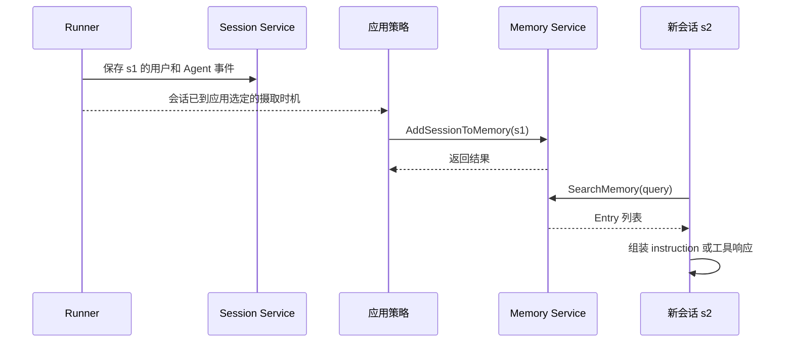
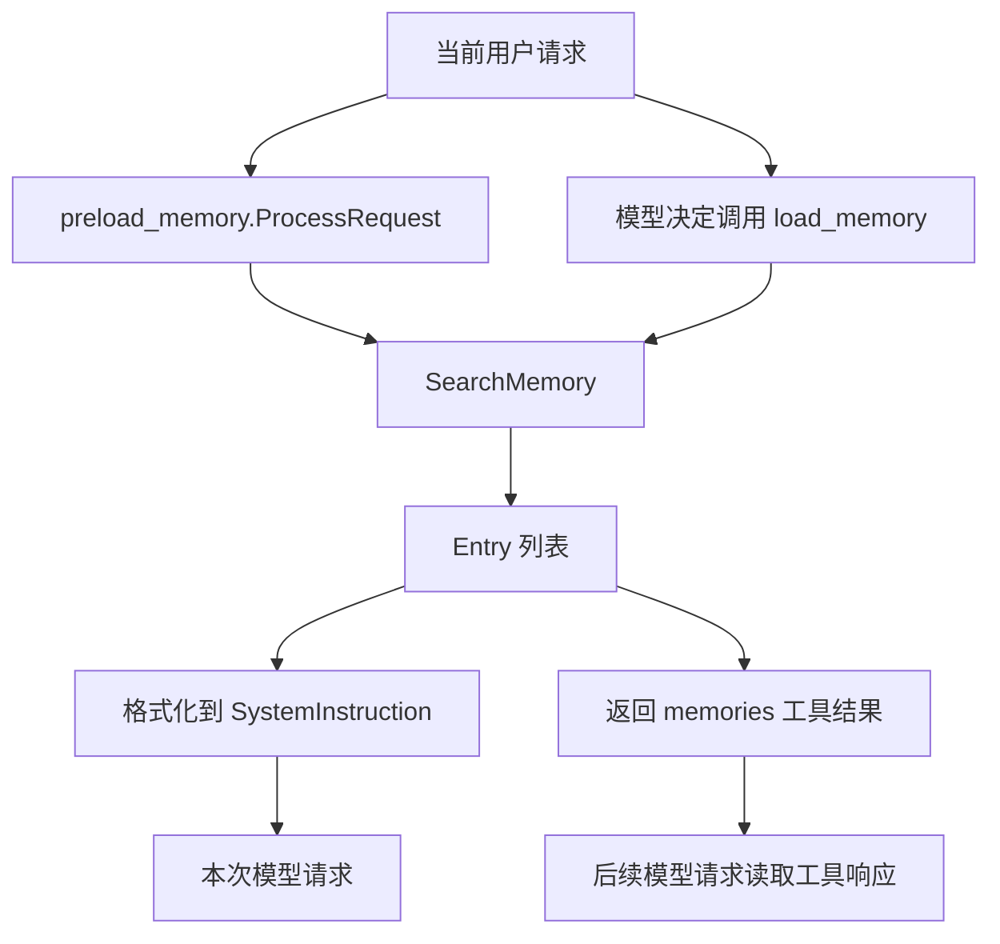

# ADK-Go 源码阅读笔记 · Memory：过去的会话怎样进入下一次模型请求

> **源码基准：[ADK-Go v2.4.0](https://github.com/google/adk-go/tree/v2.4.0)**，commit `4e57df40cbd35f055ba654b03ffb0e509fdd754a`。
>
> [返回源码阅读合集](/blog/adk/) · 配套阅读：[Session、Event 与 State](/blog/adk-session-event/)、[Runner](/blog/adk-runner/)、[Context](/blog/adk-context/)、[Tool](/blog/adk-tool/)、[Flow](/blog/adk-flow/)。

用户在 `s1` 说“以后请用摄氏度报告天气”，第二天新建 `s2`，问“还记得我偏好的温度单位吗”。Session 服务知道每段会话的历史，却不会自动把 `s1` 的内容塞进 `s2`。Memory 提供一条独立路径：应用显式摄取旧 Session，再在新请求中搜索相关 Entry，把结果放进工具响应或模型 instruction。

最先要分清的是 保存 Session、摄取 Memory、消费检索结果。Runner 会在普通事件路径追加 Session 事件，但仅仅配置 MemoryService 不会让每轮结束时自动摄取，也不会自动修改 Prompt。

本文用 `weather/u1/s1` 的温度偏好和 `weather/u1/s2` 的新问题，追踪谁写、什么时候写、如何搜、结果又通过哪条路径到达模型。

### 阅读前先分清这些词

| 术语 | 本文中的含义 | 与相近概念的区别 |
| --- | --- | --- |
| Session | 一段特定对话的历史与状态 | 不等于跨会话搜索索引 |
| Memory Service | 摄取 Session、执行检索的接口 | 不强制向量数据库或自动摘要 |
| Entry | 后端返回的一条记忆内容 | InMemory 是文本事件，Vertex 可以是服务端提炼的 fact |
| `load_memory` | 模型显式调用的函数工具 | 搜索 query 由模型给出 |
| `preload_memory` | 模型请求处理器形式的工具 | 每次请求自动检索，且不向模型声明函数 |

## 一、源码入口与阅读地图

| 顺序 | 位置 | 需要回答的问题 |
| --- | --- | --- |
| 1 | [`memory/service.go`](https://github.com/google/adk-go/blob/v2.4.0/memory/service.go#L27-L66) | 公共写入和检索契约是什么？ |
| 2 | [`runner/runner.go:676-694`](https://github.com/google/adk-go/blob/v2.4.0/runner/runner.go#L676-L694) | 配置的服务怎样进入 InvocationContext？ |
| 3 | [`internal/memory/memory.go`](https://github.com/google/adk-go/blob/v2.4.0/internal/memory/memory.go#L24-L41) | 搜索作用域由谁填充？ |
| 4 | [`memory/inmemory.go`](https://github.com/google/adk-go/blob/v2.4.0/memory/inmemory.go#L32-L213) | 摄取、覆盖、词索引、排序与限制 |
| 5 | [`loadmemorytool/tool.go`](https://github.com/google/adk-go/blob/v2.4.0/tool/loadmemorytool/tool.go#L64-L118) | 显式工具如何把 Entry 交回模型？ |
| 6 | [`preloadmemorytool/tool.go`](https://github.com/google/adk-go/blob/v2.4.0/tool/preloadmemorytool/tool.go#L71-L134) | 哪个 query、哪次请求、注入什么 instruction？ |
| 7 | [`memory/vertexai/vertexai_client.go`](https://github.com/google/adk-go/blob/v2.4.0/memory/vertexai/vertexai_client.go#L63-L138) | 云端写入究竟上传内容还是引用 Session？ |

```text
上一段会话 s1                         新一段会话 s2
Session.Events                        用户新问题
      │                                  │
应用调用 AddSessionToMemory              ├─ preload: 请求前搜索
      │                                  └─ load: 模型调用工具
      ▼                                           │
Memory 后端 <──────────── SearchMemory(query) ─────┘
      │
      └─ Entry[] ──> instruction 或 FunctionResponse ──> 模型
```

`internal/memory.Memory` 是 Context 适配器，不是另一个记忆库。它填充 AppName/UserID，再调用配置的公开 `memory.Service`。服务是进程级或应用装配阶段的依赖；适配器则随 invocation 绑定当前用户和应用身份。

## 二、核心接口与数据结构

### 1. 两个方法，写入由应用决定

以下为[源码摘录](https://github.com/google/adk-go/blob/v2.4.0/memory/service.go#L27-L51)：

```go
type Service interface {
    // A session can be added multiple times during its lifetime.
    AddSessionToMemory(ctx context.Context, s session.Session) error
    SearchMemory(ctx context.Context, req *SearchRequest) (*SearchResponse, error)
}

type SearchRequest struct {
    Query   string
    UserID  string
    AppName string
}

type SearchResponse struct {
    Memories []Entry
}
```

SearchRequest 没有 SessionID，所以搜索不是“在当前会话里找文本”。同一个用户可以从历史多个 Session 获得相关内容；但具体如何隔离 App 仍要看后端，Vertex 的映射与 InMemory 不相同。

“同一 Session 可以多次 Add”是接口允许的用法，并不规定每个后端都覆盖、追加或去重。InMemory 覆盖这段 Session 的索引；Vertex 请求服务端 GenerateMemories，结果由云端记忆生成语义决定。

### 2. Entry 是检索返回对象，不是完整 Event

[`Entry`](https://github.com/google/adk-go/blob/v2.4.0/memory/service.go#L53-L66) 包含 `ID`、`Content *genai.Content`、`Author`、`Timestamp time.Time` 和 `CustomMetadata`。它没有 StateDelta、Workflow Routes 和 Session 全部控制信息。

| 字段 / 对象 | InMemory 来源 | Vertex 当前映射 | 消费方 |
| --- | --- | --- | --- |
| `Content` | 原 Event.Content 指针 | `Memory.Fact` 生成的 user Content | 模型输入或工具返回 |
| `ID` | 原 Event.ID | 当前检索映射未填 | 调用方可选使用 |
| `Author` / `Timestamp` | 原事件字段 | 当前检索映射未填 | preload 的作者和时间格式化 |
| `CustomMetadata` | 原 Event metadata map | 当前检索映射未填 | 应用自行消费 |
| `SearchRequest.AppName` | InMemory 分桶键一部分 | 不发送到云端 scope | 后端解释 |

所以“一条 Memory 永远对应一条原 Event”只对本地实现成立，不能拿它描述云端 fact。公共接口允许内容形式不同，也没有承诺所有 Entry 字段总是非空。

### 3. State 和 Memory 解决不同读取需求

`user:temperature_unit=C` 是确定性键值读取：调用方知道要哪个字段。Memory 搜“摄氏度”是从历史文本中找到相关候选，仍需要模型或应用解释它。InMemory 摄取函数只扫描 Events 中的文本；**单独写 State、没有文本 Event，不会形成可搜的记忆**。

这不是同一份偏好的两个自动同步副本。用户纠正偏好后，State 可以立即覆盖为 F，Memory 却可能仍同时检索到早期 C 和后来 F；解决矛盾需要应用摄取策略和模型上下文，不能假设接口自动选择最新事实。

## 三、主执行路径：s1 写入，s2 读取

### 1. 谁调用 Add，何时调用

Runner 在有 `memoryService` 时创建适配器并放入 InvocationContext，见[装配点](https://github.com/google/adk-go/blob/v2.4.0/runner/runner.go#L676-L694)；这段代码不摄取 Session。显式写入实例包括：

- [`examples/tools/loadmemory/main.go`](https://github.com/google/adk-go/blob/v2.4.0/examples/tools/loadmemory/main.go#L79)：应用把旧会话主动加入 memory。
- [`examples/agentengine/main.go:163-184`](https://github.com/google/adk-go/blob/v2.4.0/examples/agentengine/main.go#L163-L184)：插件在 BeforeRun 记住边界，在 AfterRun 调用 `AddSessionToMemory`。

摄取的时机直接决定内容范围。在 `e-final` 保存前调用，本地后端不会看到尚未进入传入 Session.Events 的最终回答；用只加载 recent events 的 Session 摄取，本地后端也只看这部分。传入的历史子集会替换原来的整段索引，不会自动从 Session Service 补齐缺失事件。



Memory 没有和 Session Append 的共同事务。Session 保存成功、Memory 摄取失败是可能状态；写入成功返回是否意味着立刻可搜，还取决于后端和异步完成配置。

### 2. InMemory 摄取：一条含文本 Event 形成一个 value

[`AddSessionToMemory`](https://github.com/google/adk-go/blob/v2.4.0/memory/inmemory.go#L75-L130) 的实际步骤：

1. 遍历传入 Session 的 `Events().All()`。
2. 跳过 `Content==nil` 的事件；从所有 Part 取非空 Text。
3. 对 Text 建小写词集合，并缓存拼接后的 `textLower`。
4. 没有词的事件跳过；有词的保存为一个 value。
5. 在写锁下按 `(AppName, UserID)` 找用户桶，再用 SessionID 整段替换。

```text
store[(weather,u1)]
  sessionOrder = [s1, s2]
  sessions[s1] = [
    {id:e1, text:"以后请用摄氏度报告天气", words:{...}},
    {id:e2, text:"好的，以后使用摄氏度", words:{...}}
  ]

再次 Add(s1) 后
  sessionOrder 仍为 [s1, s2]      <- 不移到末尾
  sessions[s1] = 新扫描出的 values <- 替换，不累计追加
```

它没有调用模型提炼偏好，也不检查 Author、Branch、IsolationScope 或 Part.Thought 来筛选文本。能访问的历史范围由传入 Session 和应用策略决定。压缩事件通常只有 `Actions.Compaction`、没有 Content，这个摄取器会跳过它，却仍可能摄取未删除的原始历史；“Prompt 已压缩”不意味着 Memory 摄取同一份摘要。

### 3. InMemory 搜索：词重叠计分，之后才截取前十

[`SearchMemory`](https://github.com/google/adk-go/blob/v2.4.0/memory/inmemory.go#L132-L213) 对 query 进行与事件相同的切分：**只按 ASCII 空格 `" "` 切开并转小写**，不做标点清洗、词干归一或通用空白分词。查询词去重后，每条记忆的分数为命中几个不同查询词。

| 记忆文本 | query=`weather Celsius` | 得分 |
| --- | --- | --- |
| `I prefer Celsius weather reports` | 命中 weather、celsius | 2 |
| `weather is clear` | 只命中 weather | 1 |
| `I prefer Fahrenheit` | 无命中 | 0，不返回 |

得分大于零的候选全部扫描后，按分数降序稳定排序；同分按 Session 首次插入顺序，再按 Session 内事件顺序。最后取最多十条，见[排序和 limit](https://github.com/google/adk-go/blob/v2.4.0/memory/inmemory.go#L167-L199)。它不是按 Timestamp 新近程度排序，也不是向量相似度。

含非 ASCII 字符的 query 词额外允许在 `textLower` 里做子串匹配。例如 query `摄氏度` 能找到“以后请用摄氏度报告天气”。但整句“杭州天气怎么样，温度单位跟上次一样”如果没有空格，会作为一个完整 query 词；旧记忆没有这整段子串，就不会匹配。中文子串兜底不等于语义理解。

### 4. 返回 Entry 后，模型不会自动看到它



图中的两条输出属于对应的调用路径，框架不会把一次搜索结果同时广播给两种工具。下节分别改变配置，说明它们的执行代价。

## 四、关键细节与分支

### 4.1 模型主动检索：`load_memory`

[`Declaration`](https://github.com/google/adk-go/blob/v2.4.0/tool/loadmemorytool/tool.go#L64-L79) 暴露一个必填 `query` 字符串。`ProcessRequest` 通过 `PackTool` 把声明和本地工具关联起来，再追加“需要旧记忆时调用 load_memory”的 instruction；此时还没有搜索。

模型调用后，[`Run`](https://github.com/google/adk-go/blob/v2.4.0/tool/loadmemorytool/tool.go#L82-L108) 检查 args 必须是 `map[string]any`、必须有 query、query 必须是 string，然后调用 `toolCtx.SearchMemory`，返回 `{"memories": []Entry}`。空结果是正常的空列表，不是异常。

在例子里，模型可以选择 query `摄氏度` 或 `temperature unit`。工具结果成为 FunctionResponse，由 Flow 保存和组织进后续模型请求。搜索本身不会直接产生最终用户答案，也不负责给 Event 做存储；它复用普通工具事件流。

### 4.2 请求前预载：`preload_memory`

这个工具只实现请求处理能力，不打包 FunctionDeclaration，模型看不到一个可调用的 preload 函数。它在 **每次 LLM 请求**前执行，实际 query 只取 `ctx.UserContent().Parts[0].Text`，见[源码](https://github.com/google/adk-go/blob/v2.4.0/tool/preloadmemorytool/tool.go#L71-L97)。

| 条件 | 行为 |
| --- | --- |
| UserContent nil、无 Parts、首 Part nil 或 Text 空 | 直接跳过，不搜索 |
| 搜索报错 | 返回 `preload memory search failed`，请求处理链收到错误 |
| 没有 Entry | 直接跳过，不加 instruction |
| Entry 有可用文本 | 拼接 `<PAST_CONVERSATIONS>`，追加到请求 instruction |

它不拼接用户所有文本 Part；首 Part 是图片、第二 Part 才有文字时也会跳过。格式化时对 Entry.Content 的所有非空文本 Part 拼接，非零 Timestamp 使用 RFC3339，非空 Author 加作者前缀，见[格式化函数](https://github.com/google/adk-go/blob/v2.4.0/tool/preloadmemorytool/tool.go#L99-L134)。

一次 invocation 若因天气工具执行而调用模型两次，正常请求处理链就可能检索两次；不是“每个用户回合只搜一次”。预加载频率跟随 LLM request。当前工具也不缓存相同 query；选择 preload 应考虑这种重复检索成本和关键词 query 的匹配效果。

### 4.3 没有配置 Memory、回调限制和取消

[`commonContext.SearchMemory`](https://github.com/google/adk-go/blob/v2.4.0/agent/common_context.go#L373-L379) 在没有服务时返回 `memory service is not set`。仅安装工具而没有把 MemoryService 注入 Runner，并不能自动创建一个后端。

普通 callback wrapper 的 `SearchMemory` 明确返回“不支持 callback context”的错误，见[实现](https://github.com/google/adk-go/blob/v2.4.0/agent/callback_context_wrapper.go#L170-L175)。这不能扩大成“任何回调都不可能调用 Memory”：插件拿到 InvocationContext 后，可像 Agent Engine 示例那样通过 `ic.Memory()` 直接调用摄取服务；应用也可以持有公开服务实例。

本地 Memory 方法接收 ctx，但没有在扫描中检查 `ctx.Err()`；取消的 context 不会让长扫描自动提前返回。云端方法把 ctx 传给 RPC 和 Wait，由网络客户端观察取消。工具的 Go error 会进入 Flow 错误链，不会被这两个工具自动转换成“无记忆”。

### 4.4 Vertex：传远端 Session 资源名，不上传本地 Events

[`vertexAIClient.addSession`](https://github.com/google/adk-go/blob/v2.4.0/memory/vertexai/vertexai_client.go#L63-L103) 用配置的 Agent Engine 和 `s.ID()` 生成 Vertex Session resource，作为 `GenerateMemoriesRequest.VertexSessionSource.Session`。它没有遍历本地 `s.Events()` 上传文本。

因此给它传一个任意 InMemory Session，并不能仅凭其 Go 内容在云端生成记忆；对应的远端 Session 资源必须存在、可访问，且包含待生成记忆的事件。这里的 `session.Session` 参数用于提供资源身份和可选边界状态。

`StateKeySessionLastUpdateTime` 为空时不传 StartTime；非空时从 State 读 key，并要求 Go 值类型就是 `time.Time`，然后把它转成 protobuf StartTime，见[配置和类型检查](https://github.com/google/adk-go/blob/v2.4.0/memory/vertexai/vertexai.go#L33-L89)。它不是本地逐事件筛选，也不会自动更新这个水位 key。若 State 经数据库 JSON 读回成字符串，直接 `t.(time.Time)` 会失败；应用需在适当生命周期写入正确的本地类型。

### 4.5 Vertex 的完成和作用域与 InMemory 不相同

`WaitForCompletion=false` 时只提交 GenerateMemories 操作；true 时调用 `op.Wait(ctx)`。提交成功不等于新记忆已经可检索。Search 使用服务端 SimilaritySearchParams，返回 fact 文本；本地“最多十条、词重叠排名、同 Session 覆盖”的规则都不能套用到云端。

云端 scope 仅为 `{"user_id": userID}`，外层资源边界是配置的 Agent Engine `parent`；`SearchRequest.AppName` 没有被加入 RPC。[真实请求映射](https://github.com/google/adk-go/blob/v2.4.0/memory/vertexai/vertexai_client.go#L106-L138)意味着：若两个逻辑 App 复用同一 Agent Engine 和同一 user ID，不能依赖 AppName 字段自动隔离记忆。InMemory 则明确以 AppName+UserID 分桶。

### 4.6 并发、指针和删除生命周期

InMemory 写锁只包住整段 values 替换，扫描 Session 发生在拿 Memory 锁之前；搜索的读锁覆盖整个候选扫描和排序，避免同时改用户 map。两个并发 Add 同一 Session 最后获得写锁者覆盖前者，它不比较“哪份输入更完整、更晚”。

另外，索引中的 Content 和 metadata 没有深拷贝。摄取时缓存的 words/textLower 是当时文本，Content 指针却仍共享；应用后来修改 Content，可能出现“用旧文本命中、返回新文本”的不一致。搜索结果同样带这些指针。把交给 Memory 的文本和结果当作不可变数据，才能保持索引与显示内容一致。

`memory.Service` 只有 Add 和 Search，没有 Delete。删除 Session Service 的 `s1` 不会自动删除 InMemory Memory 中的副本；本地同 Session 再 Add 空历史会覆盖成空索引，但这是此实现的行为，不是跨后端通用删除协议。进程重启后，本地 Memory 全部消失；数据库 Session 保留并不意味着本地 Memory 也保留。

## 五、重新梳理：运行时架构与边界

| 组件 | 输入与产出 | 责任 | 外部仍需决定 |
| --- | --- | --- | --- |
| Session Service | Event → 历史与 State | 保存会话事实 | 何时进入长期记忆 |
| 应用 / 插件 | Session → Add 调用 | 选择摄取时机和范围 | 失败补偿、重试、重复生成 |
| Memory Service | Session / query → Entry | 后端摄取与检索 | Entry 如何进入模型 |
| Context 适配器 | query → SearchRequest | 自动填当前 App/User | 后端如何实现作用域 |
| load/preload 工具 | Entry → 模型请求内容 | 选择显式调用或请求注入 | 模型如何理解、处理冲突 |

普通 Runner 绑定服务，应用写入，工具消费，是主线。Agent Engine 的 AfterRun 插件是应用策略接入框架的一个实例，不是配置 MemoryService 后总会发生的默认动作。

## 六、这个模块解决了什么问题

### 1. 把长历史变成按需取回的上下文

没有 Memory，`s2` 要理解“跟上次一样”，应用只能自己找到 `s1`、读出历史、筛选相关内容并拼入 Prompt。Memory 把摄取和搜索抽成接口，两个工具则把搜索接回模型请求。

### 2. 允许应用选择不同成本和语义

| 选择 | 得到什么 | 代价与限制 |
| --- | --- | --- |
| InMemory 关键词 | 无外部依赖、确定性排序、适合示例测试 | 全量扫描；英文标点敏感；中文子串非语义；进程退出丢失 |
| Vertex MemoryBank | 服务端生成 fact 和相似搜索 | 依赖远端 Session、云端完成时延、不同的 scope 映射 |
| `load_memory` | 模型可构造更聚焦的 query | 要额外工具往返，模型可能不调用 |
| `preload_memory` | 本次模型输入提前有历史 | 每次 LLM 请求搜索；原始首 Part 可能不是理想 query |
| 应用显式摄取 | 可控制保存哪些对话、何时生成 | 需要处理失败和更新策略，框架不会替应用完成 |

这些是源码结构带来的取舍。不能因为方法注释说“semantic search”，就把本地实现描述为 embedding、向量库或智能归纳；真正行为要看选择的 Service。

## 七、重点结论与常见误解

- **配置、摄取、检索、注入是独立步骤。** Runner 的 Memory 适配器只接通能力，不自动完成全部步骤。
- **InMemory 的单位是文本 Event 和 Session 覆盖。** 查询按不同词命中数排名，最多十条，非 ASCII 允许子串。
- **load 与 preload 的搜索时机不同。** 前者模型调用后搜，后者每次 LLM 请求前搜。
- **Vertex 的身份和完成语义不能由本地实现推导。** 它引用远端 Session、按 Agent Engine+User scope 操作，异步提交不等于立即可读。

| 常见误解 | v2.4.0 的实际行为 |
| --- | --- |
| Session 保存了，Memory 就有了 | 需要应用显式 Add |
| User State 会自动索引 | InMemory 只摄取 Event 中的文本 |
| preload 每轮只搜索一次 | 每次 LLM request 都可能搜索 |
| 中文支持代表整句语义理解 | 只是非 ASCII query 词的子串匹配 |
| AppName 在所有后端都用于隔离 | InMemory 使用；Vertex RPC 当前不使用它 |
| Vertex 会上传任意本地 Session 内容 | 传远端 Vertex Session 资源引用 |
| 同 Session 重复 Add 永远去重 | 只有本地实现明确整段覆盖；云端由服务端语义决定 |

**用示例检查理解：** `s1` 只写 `user:temperature_unit=C`、没有文本事件，InMemory 能搜索摄氏度吗？不能。用户新消息第一 Part 是图片、第二 Part 才是问题，preload 会搜索吗？不会。数据库 Session 删除后，本地 Memory 会消失吗？不会自动消失。

## 八、相关源码与进一步阅读

| 主题 | 源码或文章 | 建议关注 |
| --- | --- | --- |
| 公共协议 | [`memory/service.go:27-66`](https://github.com/google/adk-go/blob/v2.4.0/memory/service.go#L27-L66) | 两个方法、SearchRequest、Entry |
| 本地摄取与查询 | [`memory/inmemory.go:75-213`](https://github.com/google/adk-go/blob/v2.4.0/memory/inmemory.go#L75-L213) | 覆盖、词索引、稳定排序、引用共享 |
| 排名测试 | [`inmemory_search_test.go:30-190`](https://github.com/google/adk-go/blob/v2.4.0/memory/inmemory_search_test.go#L30-L190) | ranking、limit、replacement、非 ASCII |
| 并发测试 | [`inmemory_test.go:233`](https://github.com/google/adk-go/blob/v2.4.0/memory/inmemory_test.go#L233) | Add/Search 的 map 并发 |
| 显式检索 | [`loadmemorytool/tool.go:82-118`](https://github.com/google/adk-go/blob/v2.4.0/tool/loadmemorytool/tool.go#L82-L118) | query 检查和 memories 返回 |
| 预加载 | [`preloadmemorytool/tool.go:71-134`](https://github.com/google/adk-go/blob/v2.4.0/tool/preloadmemorytool/tool.go#L71-L134) | 首 Part、每请求、格式化 |
| 云端适配 | [`vertexai_client.go:63-138`](https://github.com/google/adk-go/blob/v2.4.0/memory/vertexai/vertexai_client.go#L63-L138) | Session resource、StartTime、scope、Wait |
| 上游与消费者 | [Session/Event](/blog/adk-session-event/) · [Tool](/blog/adk-tool/) · [Flow](/blog/adk-flow/) | 历史如何保存、工具如何反馈给下一步 |
