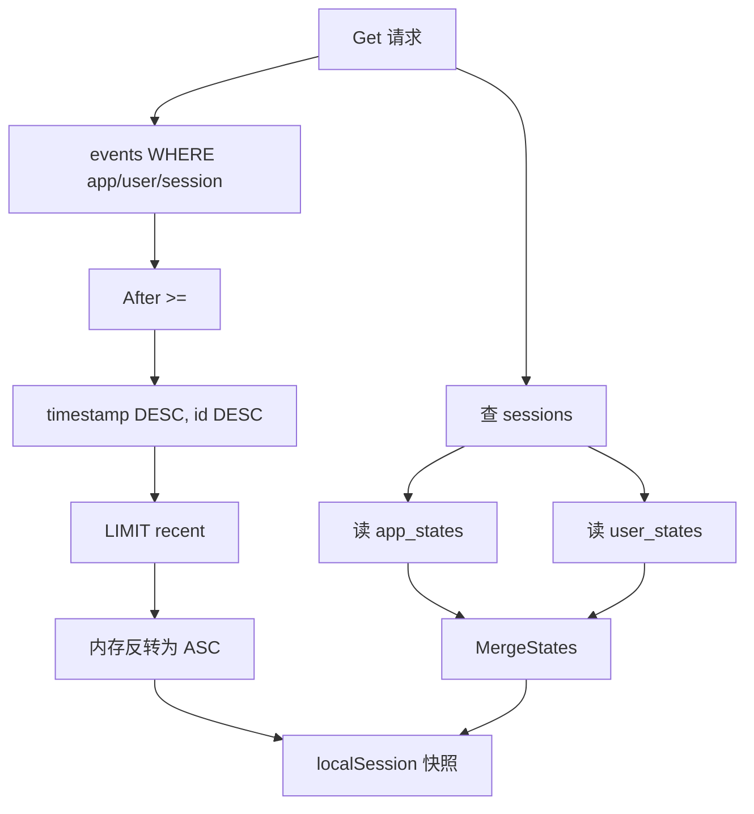
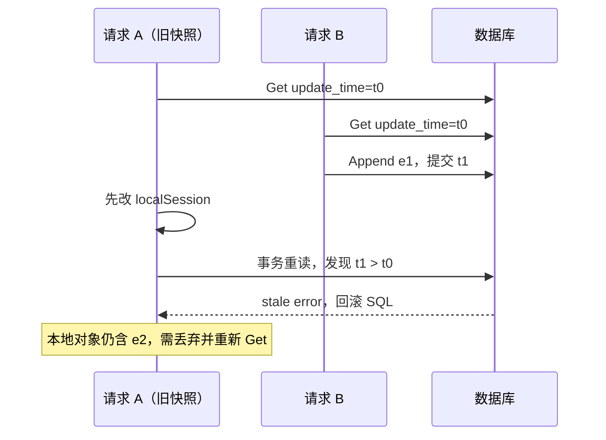

# ADK-Go 源码阅读笔记 · Database Session：一次 AppendEvent 如何跨四张表提交

> **源码基准：[ADK-Go v2.4.0](https://github.com/google/adk-go/tree/v2.4.0)**，commit `4e57df40cbd35f055ba654b03ffb0e509fdd754a`。
>
> [返回源码阅读合集](/blog/adk/) · 前置阅读：[Session、Event 与 State](/blog/adk-session-event/) · 对照阅读：[InMemory Session](/blog/adk-session-inmemory/)、[Memory](/blog/adk-memory/)。

`session/database` 并不是把完整 Session JSON 塞进一列。它把 Session 元数据和 Session state 放在 `sessions`，事件放在 `events`，App/User 共享状态各自放在独立表；一次 `AppendEvent` 在一个 GORM 事务内更新状态、插入事件和推进 `update_time`。

例子中，`weather/u1/s1` 的 `e1` 把 `user:temperature_unit=C`、`last_city=Hangzhou` 写入；另一个请求持有旧快照并尝试追加 `e2`。数据库实现会先把 `e2` 应用到本地 `localSession`，再在事务里用更新时间拒绝 stale 快照。拒绝不等于调用方手中的对象自动回滚。

## 一、源码入口与阅读地图

| 顺序 | 文件 / 符号 | 作用 |
| --- | --- | --- |
| 1 | [`database/service.go:46-82`](https://github.com/google/adk-go/blob/v2.4.0/session/database/service.go#L46-L82) | 构造 Service 与 AutoMigrate |
| 2 | [`database/storage_session.go:30-108`](https://github.com/google/adk-go/blob/v2.4.0/session/database/storage_session.go#L30-L108) | 四个 GORM 模型中的 Session/Event |
| 3 | [`database/service.go:85-158`](https://github.com/google/adk-go/blob/v2.4.0/session/database/service.go#L85-L158) | Create 事务 |
| 4 | [`database/service.go:160-253`](https://github.com/google/adk-go/blob/v2.4.0/session/database/service.go#L160-L253) | Get 的 SQL 过滤和 JSON 解码 |
| 5 | [`database/service.go:354-482`](https://github.com/google/adk-go/blob/v2.4.0/session/database/service.go#L354-L482) | AppendEvent、stale 检查与事务 |
| 6 | [`database/gorm_datatypes.go`](https://github.com/google/adk-go/blob/v2.4.0/session/database/gorm_datatypes.go#L29-L168) | `stateMap` / `dynamicJSON` 的数据库适配 |

```text
Create / Get / AppendEvent
          │
          ▼
   databaseService (*gorm.DB)
          │
  ┌───────┴──────────┐
  │ GORM 操作         │
  │  app_states      │
  │  user_states     │
  │  sessions        │
  │  events          │
  └───────┬──────────┘
          │
          ▼
 PostgreSQL / MySQL / SQLite / Spanner Dialector
```

`NewSessionService` 自己调用 `gorm.Open`；`NewSessionServiceFromDB` 接收既有连接；`AutoMigrate` 通过具体类型断言拿到 `*gorm.DB`，把其他 Session Service 实现传进去会返回 `invalid session service type`。[构造代码](https://github.com/google/adk-go/blob/v2.4.0/session/database/service.go#L38-L82)说明它不是所有 Session Service 都共享的迁移入口。

## 二、核心接口与数据结构

### 1. 四张表和复合身份

`storageSession` 的主键是 `(AppName, UserID, ID)`，Session state 和创建/更新时间也在这行；`storageEvent` 的主键是 `(ID, AppName, UserID, SessionID)`，因此同一 Event ID 可以在不同 Session 出现。[模型定义](https://github.com/google/adk-go/blob/v2.4.0/session/database/storage_session.go#L30-L112)

| 表 | 主键 | 保存 |
| --- | --- | --- |
| `sessions` | app + user + session | Session State、CreateTime、UpdateTime |
| `events` | event + app + user + session | Event 元数据、Content、Actions、Workflow 字段 |
| `app_states` | app | 去掉 `app:` 的共享状态 |
| `user_states` | app + user | 去掉 `user:` 的共享状态 |

模型声明 Session 到 events 的外键 `OnDelete:CASCADE`；实际数据库启用并遵守该外键时，删除会级联清除关联 `events`。App/User 状态没有 Session 外键，不随单个会话删除。[共享状态模型](https://github.com/google/adk-go/blob/v2.4.0/session/database/storage_session.go#L365-L387)分别以 App、App+User 为主键。[Delete](https://github.com/google/adk-go/blob/v2.4.0/session/database/service.go#L330-L352) 是事务内的幂等删除。

### 2. 状态拆分是顶层规则

数据库的 `extractStateDeltas` 和内部辅助包 `sessionutils` 逻辑一致：`app:key` 去前缀写入 `app_states`，`user:key` 写入 `user_states`，普通 key 写入 `sessions.state`，`temp:key` 忽略。[实现](https://github.com/google/adk-go/blob/v2.4.0/session/database/service.go#L524-L550)

```text
Event.StateDelta
  app:provider       ────────> app_states.state[provider]
  user:unit          ────────> user_states.state[unit]
  last_city          ────────> sessions.state[last_city]
  temp:attempt       ────────> 不落库

Get:
  sessions + app_states + user_states
             └──────────────> MergeStates（重新加前缀）
```

初始 Create 也在同一事务拆分 App/User/Session 状态；`temp:` 不进入三张持久状态表。`State().Set` 仍只修改返回的 `localSession`；数据库只有在 `AppendEvent` 时才看到 delta。

### 3. Event 如何映射到 SQL / JSON

`storageEvent` 的 Content、Actions、Routes、Output、NodeInfo、RequestedInput 和多种响应元数据使用 JSON 字段；`Actions` 直接整体 `json.Marshal`，动态字段走 `dynamicJSON` 保存原始 JSON。[写入映射](https://github.com/google/adk-go/blob/v2.4.0/session/database/storage_session.go#L115-L230)

`stateMap` 针对 PostgreSQL 返回 `JSONB`、MySQL 返回 `LONGTEXT`、Spanner 返回 `STRING(MAX)`；`Value` 方法把 nil map 编码成 `{}`，读取 NULL 或空字节恢复为空 map。[类型实现](https://github.com/google/adk-go/blob/v2.4.0/session/database/gorm_datatypes.go#L29-L95)

`dynamicJSON` 保存合法 JSON 原文；它只负责字节和数据库类型，不负责恢复调用方原来的 Go 类型。`Output any` 写入 `Order{Total:100}`，读回 `any` 时会是 `map[string]any` 与 `float64`。Workflow 节点需要依靠 Schema 转换，不能假设裸类型断言仍成立。

## 三、主执行路径：Create、Get、AppendEvent

### 1. Create：三类状态与 Session 记录在同一事务中提交

```go
// 结构化伪代码，对应 database/service.go:112-150
Transaction {
    app   = fetch/create app_states(app)
    user  = fetch/create user_states(app, user)
    split req.State into app/user/session
    save app and user deltas
    create sessions(app, user, session, sessionState)
    return merged localSession
}
```

如果 App 状态写入成功而 Session 行失败，事务回滚会撤销前者；这正是 Create 使用 GORM Transaction 的意义。`createdSession` 在事务外先由 `createStorageSession` 生成时间和 state 包装，但真正插入在事务内。

### 2. Get：为最近 N 条倒序查，再翻回正序

`Get` 先按复合键找 `sessions`，然后构造事件查询：`After` 使用 `timestamp >= ?`，排序为 `timestamp DESC, id DESC`；有 `NumRecentEvents` 时在 SQL 层 Limit，最后把结果反向映射为时间升序。[代码](https://github.com/google/adk-go/blob/v2.4.0/session/database/service.go#L160-L253)



事件时间写入前被 `Truncate(time.Microsecond)`，所以同一微秒的碰撞是正常情况；`id` 是稳定的第二排序键，却不代表原始追加顺序。相同时间按 ID 排序只是确定性排序。Compaction 选覆盖范围时依赖这个稳定结果，应用不应把 ID 字典序解释为业务发生顺序。

### 3. AppendEvent：本地先变，事务后提交

```text
输入 curSession (*localSession), event
        │
        ├─ partial? ──> nil（不写）
        ├─ 空 ID 补 UUID
        ├─ Timestamp 截微秒
        ├─ localSession.appendEvent(event)
        │    ├─ StateDelta 原样更新 local state（含 temp）
        │    └─ Event 过滤 temp 后加入 local events
        └─ applyEvent（GORM transaction）
             ├─ 重读 sessions
             ├─ storageUpdateTime > local updatedAt ? stale error
             ├─ 拆 app/user/session delta
             ├─ Save app/user
             ├─ Insert event
             └─ Save sessions state + update_time
```

App/User 只有存在对应 delta 时才执行状态 Save；没有状态变更的普通事件也仍要插入 Event，并保存 Session 的更新时间。因此“四张表”描述数据结构，不表示每次都更新全部共享状态。

主函数见[`AppendEvent`](https://github.com/google/adk-go/blob/v2.4.0/session/database/service.go#L354-L395)，事务见[`applyEvent`](https://github.com/google/adk-go/blob/v2.4.0/session/database/service.go#L398-L482)。`localSession.appendEvent` 在事务前调用，所以 SQL 失败后，调用者手上的对象可能已经多一条事件和新状态；数据库本身不会有这条事件。错误返回后不要继续把这个 localSession 当权威快照。

## 四、关键细节与分支

### 4.1 stale Session：按微秒更新时间的乐观并发

假设 A、B 都从 `update_time=t0` 获取 `s1`。B 先提交 `e1`，数据库变为 `t1`；A 的本地 `updatedAt` 仍是 `t0`。`applyEvent` 事务重读 Session，若 `storageUpdateTime > sessionUpdateTime`，返回 stale session error。[比较代码](https://github.com/google/adk-go/blob/v2.4.0/session/database/service.go#L414-L424)



这是时间戳保护，不是行版本号或完整 compare-and-swap。若两个 Event 使用相同微秒时间，`storageUpdateTime > sessionUpdateTime` 不成立，后续写可能继续；时间精度由当前实现明确截断到微秒。高并发业务需要在应用侧处理重读、重放和副作用幂等。

还要区分顺序 stale 检查和真正同时进入事务的竞争：这段代码没有显式 `SELECT FOR UPDATE`，最终 Save 也没有附带“旧 update_time 必须相同”的条件。两个事务若都先读到 t0，能否冲突、等待或发生覆盖取决于数据库隔离级别和锁行为，不能仅因存在 Transaction 就宣称跨实例写入已完全串行化。

App/User 共享状态范围更大：`s1`、`s2` 各有自己的 Session 更新时间，却会写同一 User State 行；Session stale 检查不能保护这两条会话之间的 User state read-modify-write。它是整份 JSON map 的读取、合并、Save，应用需要针对目标数据库设计并发更新策略。

### 4.2 Partial 与 temp

Partial Event 在 AppendEvent 开头返回 nil，不写本地、不写数据库。非 partial 事件先通过 `localSession.appendEvent`，它存入本地历史前调用 `trimTempDeltaState`；事务前又调用一次 trim，保证送入 `createStorageEvent` 的 Event 不含 temp。[代码](https://github.com/google/adk-go/blob/v2.4.0/session/database/session.go#L76-L90)

过滤临时 delta 不会改掉输入 Event 的原始 StateDelta map；但空 ID 的补齐和 Timestamp 的截断会原地修改输入 Event。测试 [`TestDatabaseService_AppendEvent_PreservesInputEventTempState`](https://github.com/google/adk-go/blob/v2.4.0/session/database/service_test.go#L364-L423)验证了这一点。数据库 Get 后的历史和三层状态都不会保留临时 delta。

### 4.3 JSON / nullable / 类型分支

`storageEvent` 把空字符串 Branch、IsolationScope、ErrorCode、ErrorMessage 存成 nil 指针；布尔 Partial、TurnComplete、Interrupted 用指针区分数据库 NULL 与 false。读取时 `derefOrZero` 恢复零值。Content 等字段为空时不写 JSON；`dynamicJSON.Value` 返回 NULL。

`Event.Output` 解码到 `any` 会有标准 JSON 类型退化；数组成为 `[]any`，数字成为 `float64`。`RequestInput.Payload` 也必须可 JSON 编码，二进制应放 Artifact Service 并在 Payload 里传 URI。数据库边界不是通用 Go 对象缓存。

编码错误也要分路径看：Event 映射中的 `json.Marshal` 会返回错误；而 `stateMap.GormValue` 当前忽略了 Marshal 的 error，见 [`gorm_datatypes.go:91-94`](https://github.com/google/adk-go/blob/v2.4.0/session/database/gorm_datatypes.go#L91-L94)。因此初始 State 含 channel、function 等不可编码值时，不能假设所有数据库都会在同一位置返回清晰错误。Create 和 Append 的输入应使用 JSON 能稳定表达的值。

### 4.4 Delete、取消与错误

| 位置 | 结果 |
| --- | --- |
| Session 不存在的 Get / Append | `ErrNotFound` 包装；可用 `errors.Is` |
| Delete 合法请求但目标不存在 | 事务成功，保持幂等 |
| 参数缺失 | 普通验证 error |
| SQL / JSON 失败 | 事务回滚；本地 `localSession` 可能已提前变化 |
| Context 取消 | GORM `WithContext(ctx)` 将取消传给数据库；取消不撤销已提交事务 |
| Event 外部副作用 | 不由事务回滚；需要业务幂等 |

### 4.5 Get 是多次查询，不是一个读取事务

Get 依次读取 Session 行、事件、App state、User state，源码没有为整个方法包一个 Transaction。因此一个返回对象可能组合不同查询时刻的数据；例如先读到 s1 的旧更新时间，随后读到另一个请求刚提交的 User 偏好。这里可以称为“本地读取结果”，不能声称它必然是数据库同一时刻的完整一致快照。

List 同样不会加载 events，它适合列会话摘要；需要继续一段依赖历史的运行时应 Get 对应 Session。只取 recent/after 历史也会丢掉更早的工具调用或 Workflow 恢复信息，过滤参数应服务于具体消费场景，而不是统一优化所有运行。

### 4.6 两次追加后的对象变化

| 时刻 | A 的 localSession | B 的 localSession | 数据库 |
| --- | --- | --- | --- |
| 两次 Get 后 | t0，unit=F | t0，unit=F | t0，unit=F |
| B 追加 e1 成功 | 仍 t0，unit=F | t1，unit=C，有 e1 | t1，unit=C，有 e1 |
| A 尝试 e2，stale 失败 | 历史已有本地 e2，city=Beijing；通常仍 t0 | 不变 | 仍只有 e1，无 city=Beijing |
| A 丢弃旧对象并 Get | t1，unit=C，历史只有 e1 | 不变 | 不变 |

重新 Get 恢复的是数据库事实，不意味着应立即重复执行 e2 所代表的业务副作用。若工具在 AppendEvent 前已经调用外部服务，重试必须先判断业务动作是否完成。

## 五、重新梳理：数据库边界

| 组件 | 负责 | 不负责 |
| --- | --- | --- |
| `databaseService` | 把四类对象映射到 GORM、执行事务、检查 stale | 解决 JSON 业务类型恢复 |
| 数据库事务 | 同时提交状态、Event、Session 更新时间 | 撤销已发生的工具副作用 |
| `localSession` | 提供当前 Run 的读写快照 | 自动与其他请求同步 |
| Runner | 在普通事件路径调用 AppendEvent | 失败后自动重放整个 invocation |

一次天气更新的事务边界可以写成：`app/user/session StateDelta + Event 行 + sessions.update_time` 同成同败；但“调用方的本地对象”不在 SQL 事务里。

## 六、这个模块解决了什么问题

它提供跨进程、可重启的 Session 历史与状态，并用复合主键隔离 App/User/Session。把状态拆表可让多个 Session 共享 User/App 偏好而不复制整段历史；SQL 层的 recent/after 过滤避免每次读取全部事件。

代价是 schema、索引、连接池、事件增长和迁移都成为运维责任；JSON 字段牺牲了任意 Go 类型的精确还原；stale 只按更新时间保护，重试可能重复业务工作。耐久保存 Event 不等于业务事务包住工具副作用。

## 七、重点结论与常见误解

- **AppendEvent 同时处理 Event、Session 更新时间和存在的状态变更。** 这些数据库写入在同一事务中提交。
- **Get 的 recent 通过倒序 SQL + 内存反转实现。** 同微秒用 ID 稳定排序，但不表示因果顺序。
- **stale 只拒绝数据库提交。** 本地 `localSession` 的 State 和历史先变化，失败后必须重新读取。

| 误解 | 实际行为 |
| --- | --- |
| AppendEvent 失败会恢复传入 Session | 不会；State 和历史已提前变化，更新时间是否推进取决于失败位置 |
| JSON 字段会恢复业务 struct | `any` 按标准 JSON 类型解码 |
| 删除 Session 删除所有用户偏好 | 共享 App/User 表保留 |
| temp 只是 UI 标记 | 数据库 trim 会使它不进入历史和状态 |
| 相同 Timestamp 就有稳定插入顺序 | 只按 ID 做确定性排序，ID 不编码插入顺序 |

**用示例检查理解：** B 在 s1 更新 User 偏好后，旧 s2 对象会立即变化吗？不会。A 的 stale 错误是否意味着 e2 从任何地方都不存在？不会，A 的本地历史可能已有它。数据库收到同一微秒时间的新事件是否必然拒绝？不会，比较条件是严格大于。

## 八、相关源码与进一步阅读

| 主题 | 链接 | 关注点 |
| --- | --- | --- |
| 构造与迁移 | [`service.go:38-82`](https://github.com/google/adk-go/blob/v2.4.0/session/database/service.go#L38-L82) | Dialector、DB 注入、AutoMigrate |
| Create/Get | [`service.go:85-253`](https://github.com/google/adk-go/blob/v2.4.0/session/database/service.go#L85-L253) | 四表、过滤、排序 |
| AppendEvent | [`service.go:354-482`](https://github.com/google/adk-go/blob/v2.4.0/session/database/service.go#L354-L482) | 本地先变、stale、事务 |
| 模型映射 | [`storage_session.go`](https://github.com/google/adk-go/blob/v2.4.0/session/database/storage_session.go#L30-L330) | JSON 和 nullable 字段 |
| 类型适配 | [`gorm_datatypes.go`](https://github.com/google/adk-go/blob/v2.4.0/session/database/gorm_datatypes.go#L29-L168) | stateMap、dynamicJSON |
| 配套文章 | [Session/Event](/blog/adk-session-event/) · [InMemory](/blog/adk-session-inmemory/) · [Memory](/blog/adk-memory/) | 统一数据模型和实现差异 |
