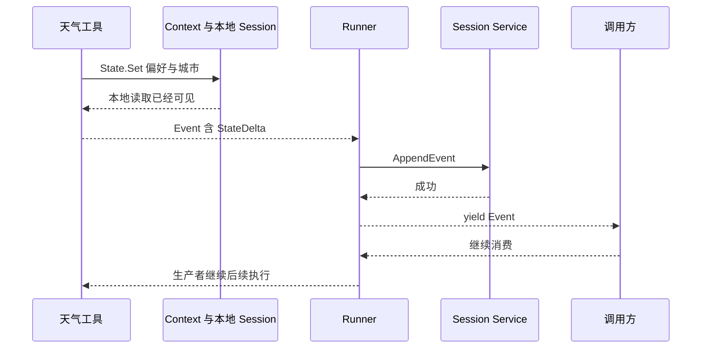
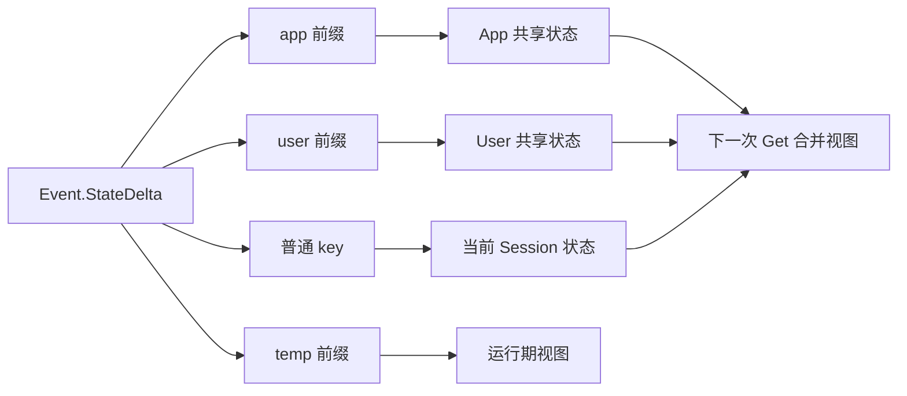

# ADK-Go 源码阅读笔记 · Session、Event 与 State：一轮执行怎样留下历史和状态

> **源码基准：[ADK-Go v2.4.0](https://github.com/google/adk-go/tree/v2.4.0)**，commit `4e57df40cbd35f055ba654b03ffb0e509fdd754a`。以下“当前实现”均指这个版本。
>
> [返回源码阅读合集](/blog/adk/) · 配套阅读：[Runner](/blog/adk-runner/)、[Context](/blog/adk-context/)、[InMemory Session](/blog/adk-session-inmemory/)、[Database Session](/blog/adk-session-database/)、[Memory](/blog/adk-memory/)。

用户先说“以后天气都用摄氏度”，再问“杭州天气怎么样”。应用需要保留三类信息：用户说过什么、这一轮执行发生过什么、下次应该读取哪个偏好。ADK 分别用 `Event`、`Session.Events()` 和带作用域的 `State` 表达这些信息。

**Session 是一段会话的历史与状态入口；Event 承载一次可记录的交互及其动作；StateDelta 则把本次状态修改送进 Session 服务。** 理解这套模型，重点是区分 本地可读、事件携带、存储成功。工具能读到自己刚写的值，并不意味着数据库已经提交。

本文回答三个问题：一段会话怎样标识多轮执行？一次 `State().Set` 如何变成下轮可见的状态？哪些事件会保存、哪些字段只是给其他运行时组件消费？

### 贯穿示例与术语

应用名为 `weather`，用户为 `u1`，有两段会话 `s1`、`s2`。`s1` 的 invocation `i1` 接收“杭州天气怎么样，以后用摄氏度”，工具产生以下增量：

```go
// 对象快照示意：同一个事件可以同时修改不同作用域。
map[string]any{
    "app:weather_provider": "provider-a",
    "user:temperature_unit": "C",
    "last_city":             "Hangzhou",
    "temp:lookup_attempt":   1,
}
```

| 概念 | 例子 | 生命周期和用途 |
| --- | --- | --- |
| Session 身份 | `(weather, u1, s1)` | 一段跨多轮的对话；不能仅凭 `s1` 区分所有用户 |
| Invocation | `i1` | 一次执行关联的一组事件；恢复路径可能延续已有身份 |
| Event | `e-tool` | 一条工具结果、模型响应、用户消息或框架记录 |
| State | `user:temperature_unit=C` | 当前可读的键值视图 |
| StateDelta | `{"user:temperature_unit":"C"}` | 这条事件携带的变更，不是完整状态 |

## 一、源码入口与阅读地图

| 顺序 | 文件 / 符号 | 需要回答的问题 |
| --- | --- | --- |
| 1 | [`session/service.go: Service`](https://github.com/google/adk-go/blob/v2.4.0/session/service.go#L43-L115) | 创建、读取和追加分别通过什么接口？ |
| 2 | [`session/session.go: Session / Event`](https://github.com/google/adk-go/blob/v2.4.0/session/session.go#L36-L149) | 谁保存身份、历史和状态？ |
| 3 | [`agent/common_context.go: callbackContextState`](https://github.com/google/adk-go/blob/v2.4.0/agent/common_context.go#L415-L462) | Context 的写入为什么会记录 delta？ |
| 4 | [`runner/runner.go`](https://github.com/google/adk-go/blob/v2.4.0/runner/runner.go#L725-L775) | Agent 事件何时追加，何时交给调用方？ |
| 5 | [`internal/sessionutils/utils.go`](https://github.com/google/adk-go/blob/v2.4.0/internal/sessionutils/utils.go#L28-L74) | 混合前缀怎样拆成独立状态？ |
| 6 | [`session/sessiontestsuite/service_suite.go`](https://github.com/google/adk-go/blob/v2.4.0/session/sessiontestsuite/service_suite.go#L82) | 服务共享的行为检查有哪些？ |

```text
应用与工具                          运行协调层                 存储层
ctx.State().Set(k, v) ──┐
                       ├─> Event.Actions.StateDelta ──> AppendEvent
模型 / 工具返回 Content ┘                 ↑                 │
                                  Runner 消费 Agent         ├─ 追加历史
                                                          ├─ 更新状态
                                                          └─ 更新时间
```

`session` 是公开包；`internal/sessionutils` 是框架内部的拆合实现，应用不应导入它。应用通常选择一种 `session.Service` 注入 Runner，而不是直接构造未导出的内存 Session 或数据库 Session。

## 二、核心接口与数据结构

### 1. Service 管存储，Session 表达一次读取到的会话

以下为[接口摘录](https://github.com/google/adk-go/blob/v2.4.0/session/service.go#L46-L76)，省略方法注释：

```go
type Service interface {
    Create(context.Context, *CreateRequest) (*CreateResponse, error)
    Get(context.Context, *GetRequest) (*GetResponse, error)
    List(context.Context, *ListRequest) (*ListResponse, error)
    Delete(context.Context, *DeleteRequest) error
    AppendEvent(context.Context, Session, *Event) error
}
```

`Session` 本身[只有六个访问方法](https://github.com/google/adk-go/blob/v2.4.0/session/session.go#L36-L54)：`ID`、`AppName`、`UserID`、`State`、`Events`、`LastUpdateTime`。它不提供 `Save()`。AppendEvent 才把事件交给存储服务；直接调用一个 Session 的 `State().Set()`，是否触发外部写入不能由接口名称推断。在 InMemory 和 Database 中，它只改调用者持有的本地对象。

[Service 文档](https://github.com/google/adk-go/blob/v2.4.0/session/service.go#L51-L76)特别规定：无 ID 的事件最终必须有可读回的 ID，压缩记录 `Actions.Compaction` 必须保存下来。本地分配 ID 的实现会就地写入调用者的 Event；服务端分配 ID 的实现可以在读取时才提供它。不能把“AppendEvent 后原指针必有新 ID”当作所有后端的统一保证。

`GetRequest.After` 的含义是 **timestamp 大于等于给定时间**，不是严格大于；`NumRecentEvents=0` 表示不设数量过滤。[定义见此](https://github.com/google/adk-go/blob/v2.4.0/session/service.go#L103-L115)。服务返回的历史可以是被过滤后的子集，不能无条件拿它重建完整运行状态。

### 2. Event 同时承载消息、控制信息和状态增量

`Event` [内嵌 `model.LLMResponse`](https://github.com/google/adk-go/blob/v2.4.0/session/session.go#L97-L149)，因此可以直接访问 `Content`、`Partial`、`ErrorCode` 等模型响应字段；外层再增加身份和运行时元数据。

| 字段 | 主要写入者 | 消费者 | 不要混淆的概念 |
| --- | --- | --- | --- |
| `ID` / `Timestamp` | `NewEvent` 或具体后端 | 历史查询、引用、排序 | Event ID 不等于 FunctionCall ID |
| `InvocationID` | Context / Runner 关联的生产者 | 运行分组与恢复 | 一轮可以产生很多 Event |
| `Author` | 用户入口、Agent、框架 | 历史组织和 UI | Agent 名不同于 `Content.Role` 的模型协议角色 |
| `Content` | 模型、工具结果、用户消息 | 模型历史、UI | 不等于 Workflow 的 `Output` |
| `Actions.StateDelta` | Context、框架 | Session 服务 | 不等于整个 State |
| `Output` / `Routes` / `NodeInfo` | Workflow 节点与调度层 | 下游节点、路由与恢复 | 并非普通聊天消息 |
| `Branch` / `IsolationScope` | Agent / Workflow 运行层 | Prompt 历史过滤 | 存储隔离键仍是 App、User、Session |
| `RequestedInput` / `LongRunningToolIDs` | 等待输入或长任务路径 | 调度层、客户端 | 保存等待信息不等于自动完成外部任务 |

`NewEvent(ctx, invocationID)` 通过 platform provider 获取 UUID 和当前时间，并预分配 StateDelta、ArtifactDelta 两个 map，见[构造函数](https://github.com/google/adk-go/blob/v2.4.0/session/session.go#L233-L245)。手写 Event 字面量会绕过它：两个本地服务会补空 ID，但不会替手写的零 `Timestamp` 自动补上合理时间。依赖历史排序时，应明确设置时间或使用 `NewEvent`。

`EventActions` 还包括 `ArtifactDelta`、`TransferToAgent`、`Escalate`、`SkipSummarization` 和工具确认数据。[源码注释](https://github.com/google/adk-go/blob/v2.4.0/session/session.go#L248-L276)说明，`ArtifactDelta` 记录文件版本，文件本身由 Artifact 服务负责；`SkipSummarization` 用于函数响应后不再调用模型总结，也被最终响应判定使用。

### 3. State 前缀是一套作用域规则

[前缀定义](https://github.com/google/adk-go/blob/v2.4.0/session/session.go#L415-L428)规定了三种显式前缀；无前缀属于会话：

| 示例 key | 期望可见范围 | 本地持久存储的逻辑位置 |
| --- | --- | --- |
| `app:weather_provider` | `weather` 的所有用户、会话 | App 状态中的 `weather_provider` |
| `user:temperature_unit` | `weather/u1` 的所有会话 | User 状态中的 `temperature_unit` |
| `last_city` | `weather/u1/s1` | Session 状态中的 `last_city` |
| `temp:lookup_attempt` | 当前 invocation 的临时上下文 | 不应进入持久状态 |

读取时重新加回 `app:` 和 `user:`，所以对应用看起来是一个扁平 map。前缀不是嵌套对象路径：`user:profile.name` 是一个字符串 key，服务不会自动递归修改 `profile` 对象。拆分和合并使用顶层 map 复制；同名 key 的新值覆盖旧值，不提供通用删除操作，写 `nil` 也不能直接等同于删除。

## 三、主执行路径：从偏好修改到下一轮读取

### 1. 一个 Session 中有多条事件，不是一条最终文本

```text
Session (weather, u1, s1)
├─ Invocation i1
│  ├─ e-user:  “杭州天气怎么样，以后用摄氏度”
│  ├─ e-call:  get_weather(Hangzhou)
│  ├─ e-tool:  天气结果 + StateDelta
│  └─ e-final: “杭州 23°C”
└─ Invocation i2
   ├─ e-user2: “那明天呢？”
   └─ 后续事件读取 temperature_unit=C、last_city=Hangzhou

Session (weather, u1, s2)
└─ 新读取看到 user:temperature_unit=C，但没有 s1 的 last_city
```

`InvocationID` 把同一执行的事件关联起来；Session 身份通过服务调用和返回对象携带，Event 结构体并没有一个统一的 `SessionID` 字段。数据库保存时再把所属 Session 的 App、User、ID 写入事件行。

### 2. Context.Set 先改运行时，再等待事件提交

关键实现位于 [`callbackContextState.Set`](https://github.com/google/adk-go/blob/v2.4.0/agent/common_context.go#L415-L458)。下面是**保留顺序的控制流伪代码**：

```go
func Set(key string, value any) error {
    actions.StateDelta[key] = value
    // 检查 invocation context、session、state 是否存在。
    return invocation.Session().State().Set(key, value)
}
```

这一步有两个目标：把变更记到当前动作集合，并使同次执行中的后续读取立即可见。`Get` 也先查当前 delta，再回退到 Session State。它并没有调用 `session.Service.AppendEvent`。

工具事件产生后，由 Flow / Agent 把动作带到 Event 上；Runner 处理插件后，对于非 partial 事件先追加，成功后再向调用方 `yield`。普通 `Run` 的实际顺序见 [`runner.go:725-775`](https://github.com/google/adk-go/blob/v2.4.0/runner/runner.go#L725-L775)。



这里的最后一条箭头是 iterator 恢复执行的简化表示，不表示 Runner 直接调用工具下一句。普通事件流中，生产者在 `yield` 处交出控制，消费者完成保存后才让生产链继续；详细双层循环见 [Flow](/blog/adk-flow/)。

| 时刻 | 本地 Session | 服务中的记录 | 调用方 |
| --- | --- | --- | --- |
| `Set` 后 | 新偏好已可读 | 仍是旧值 | 未收到工具结果事件 |
| Event 产生 | 携带 delta | 仍待追加 | Runner 正在处理 |
| `AppendEvent` 成功 | 当前执行视图更新 | 历史和状态按后端规则更新 | 即将收到事件 |
| 新的 `Get(s2)` | 新建读取视图 | 读取同一个 User 状态 | 可见 `user:temperature_unit=C` |

因此 收到非 partial 成功事件发生在追加成功之后。这描述的是 Runner 的这条路径，不能代替后端的耐久性保证，也不能泛化到绕过 Runner 的直接 `Agent.Run`。

### 3. 持久视图如何分流



这是状态作用域的逻辑分流；具体实现并不因此自动获得所有期望特性。尤其是 InMemory 的 `temp:` 处理在当前版本有不一致，第四节会区分“当前 State”和“读回的 Event”。

## 四、关键细节与分支

### 4.1 Partial 与 final 是两个不同判断

`Partial` 表示流式中间片段。普通 Runner 对它只向外输出，不执行追加；InMemory、Database 也在 `AppendEvent` 开头遇到 partial 时直接返回、不追加事件，见 [InMemory](https://github.com/google/adk-go/blob/v2.4.0/session/inmemory.go#L197-L218)、[Database](https://github.com/google/adk-go/blob/v2.4.0/session/database/service.go#L354-L374)。因此不应把仅出现在 partial 事件里的 StateDelta 当作已提交变更。

[`IsFinalResponse`](https://github.com/google/adk-go/blob/v2.4.0/session/session.go#L214-L231)按以下顺序判定：

1. 带 `Compaction`：返回 false。
2. 带 `SkipSummarization` 或非空 `LongRunningToolIDs`：返回 true。
3. 否则要求没有 FunctionCall、没有 FunctionResponse、不是 partial、末尾没有 CodeExecutionResult。

第二项优先于第三项，因此不能简化成“所有 partial 事件的 IsFinalResponse 都为 false”。`IsFinalResponse` 也只表达某个 Agent 的最终响应判断；多 Agent invocation 可以有多个 true。final 不等于整段工作流终止。

### 4.2 `temp:` 的意图与当前后端行为

前缀注释把 `temp:` 定义为 invocation 临时状态；数据库实现会在保存 Event 前过滤临时 delta，并在状态拆分时忽略它。但 InMemory 当前有两个需要保留的实现限制：

- `AppendEvent` 在调用方持有的 Session 的历史里存过滤后的事件；随后服务保存的记录却从原始 Event 克隆 StateDelta，导致 `Get()` 读回的历史事件仍可能含 `temp:`。新读取的 **State** 没有这次 append 的临时 key，但 **Events** 可以带着它。见[两条写入路径](https://github.com/google/adk-go/blob/v2.4.0/session/inmemory.go#L229-L265)及[调用方历史过滤](https://github.com/google/adk-go/blob/v2.4.0/session/inmemory.go#L361-L375)。
- `Create` 把原始 `req.State` 当作合并的 sessionState 参数，初始传入的 `temp:` 会残留在 服务保存的 State 中。见 [`Create:70-87`](https://github.com/google/adk-go/blob/v2.4.0/session/inmemory.go#L70-L87)。

所以临时前缀表达的生命周期不能作为敏感内容从所有内存对象消失的保证。它也没有在 invocation 结束时清空一切旧 Session 指针的能力；旧对象仍然可以保留运行时值。

### 4.3 压缩记录不是一条普通消息

`EventCompaction` 存储时间范围、摘要内容以及被排除的事件引用。[结构注释](https://github.com/google/adk-go/blob/v2.4.0/session/session.go#L324-L372)明确说明：原历史不删除，后续拼 Prompt 时才用摘要替换覆盖范围。它只在 `Actions.Compaction` 中携带内容，`LLMResponse.Content` 可以为空；以“没有 Content”为理由丢弃事件会破坏压缩状态。

该字段由框架写入；工具、回调动作的复制路径会清除调用者设置的压缩字段。InMemory 对 compaction 做专门克隆，避免生产者后来移动覆盖范围。`EventRef` 使用 `{InvocationID, Timestamp}`，因为某些后端会重分配 Event ID；它并不保证唯一，相同 invocation、相同时间可以匹配多条事件，见[引用语义](https://github.com/google/adk-go/blob/v2.4.0/session/session.go#L403-L413)。

### 4.4 JSON 往返会保留协议信息，但不会保留任意 Go 类型

[EventActions.MarshalJSON](https://github.com/google/adk-go/blob/v2.4.0/session/session.go#L279-L313)区分 nil map 和已经分配的空 map：nil 省略字段，空 map 写 `{}`。这避免 Python 端非可选 dict 拒绝 `null`，也保留 Go 端空 map 可继续写入的区别。

[Event.UnmarshalJSON](https://github.com/google/adk-go/blob/v2.4.0/session/session.go#L475-L549)接受 RFC3339 字符串或数字 epoch 秒；数字按微秒解析并检查日期范围，还把全零 `NodeInfo` 归一化成 nil。这些兼容处理不代表 `Output any` 中的具体业务 struct 能原样还原；数据库反序列化到 `any` 后仍会变成通用 map、slice、number。

### 4.5 错误、取消和并发不会自动回滚整轮

| 情形 | 实际边界 |
| --- | --- |
| Session 不存在 | `Get`、`AppendEvent` 包装 `ErrNotFound`；`errors.Is` 可区分，参数错误和后端错误不属于它 |
| `Delete` 目标不存在 | 有效请求是幂等 no-op；`List` 无匹配返回空结果 |
| Agent 产出 Go error | 普通 Runner 先向外 yield error，不把该项走正常追加分支；消费方继续时，外层仍可继续迭代 |
| AppendEvent 失败 | Runner 产出包装后的错误并结束普通事件循环；已经成功追加的前序事件不撤销 |
| 消费者停止迭代 | 当前已保存事件保留；未执行的后续步骤不再因这条 iterator 自动完成 |
| Context 取消 | 由下游实现决定如何观察；内存服务方法没有统一的 `ctx.Err()` 检查，数据库通过 `WithContext(ctx)` 交给 GORM |
| 同一状态并发写 | InMemory 串行追加、同 key 后写覆盖；Database 另有时间戳 stale 检查，均不是通用业务事务 |

这里的错误契约见 [`ErrNotFound`](https://github.com/google/adk-go/blob/v2.4.0/session/service.go#L22-L41)，Runner 顺序见[事件循环](https://github.com/google/adk-go/blob/v2.4.0/runner/runner.go#L725-L775)。工具外部副作用不随事件保存失败自动撤销；支付、发信等业务操作需要自己的幂等和恢复协议。

## 五、重新梳理：运行时架构与边界

| 组件 | 负责 | 不负责 |
| --- | --- | --- |
| Agent / Tool / Context | 产生消息、动作和即时运行状态 | 自动提交所有后端事务 |
| Runner | 普通路径加载 Session、保存用户消息、追加非 partial 输出 | 替业务副作用实现回滚 |
| Session Service | 实现创建、读取、历史追加、状态应用 | 决定哪些记忆值得长期检索 |
| Prompt 处理层 | 从历史选出当前 Agent 可见内容、应用压缩 | 删除所有原始历史 |
| Memory Service | 显式摄取会话并跨会话检索 | 自动等同于 Session 日志 |

天气案例中，`s2` 能读到摄氏度偏好来自 **User State 共享**；它能检索“过去提过怕冷”来自 **Memory 摄取和检索**。这两条路径独立，状态共享不需要把 `s1` 全部消息塞给 `s2`，记忆检索也不自动修改 `user:temperature_unit`。

## 六、这个模块解决了什么问题

### 1. 把一次执行拆成可观察、可继续使用的数据

如果工具只返回“杭州 23°C”字符串，下一轮不知道城市，也无法区分工具执行和模型总结。Event 把内容和动作一起送到统一保存入口，Session 则提供下一轮所需的历史与当前值。

### 2. 把共享范围从业务代码中抽离

App、User、Session 的划分让天气提供方、温度单位、当前城市各归其位。应用仍负责选对 key：若把城市误放 `app:last_city`，它就会被整个应用共享；框架不会推断业务隐私范围。

### 3. 得到统一接口，也承担实现差异

| 选择 | 得到什么 | 需要承担什么 |
| --- | --- | --- |
| 小型 Session / Service 接口 | Runner 可替换后端 | 拷贝、事务、排序、取消语义仍需读具体实现 |
| StateDelta 附着 Event | 历史与状态变化有共同提交入口 | 事件失败前，本地状态可能已变化 |
| State 独立存储 | 无需每次重放全量历史 | 初始状态和其他 Session 的共享写入不在本 Session 日志里 |
| `any` 承载业务数据 | 便于工具和 Workflow 组合 | 跨 JSON 存储需处理类型转换与编码限制 |

“Event 是事实，State 是快照”是有用的理解，但不是严格的 Event Sourcing 保证：Create 初始状态、直接本地 Set、跨会话共享状态，都使“仅重放这个 Session.Events 就能恢复全部 State”不成立。

## 七、重点结论与常见误解

- **Session 组织会话，Event 记录交互，StateDelta 传递变更。** 三者不应互相替代。
- **Context.Set 与存储提交有时间差。** 普通 Runner 的成功非 partial 输出在追加之后；失败不回滚整个 invocation。
- **前缀表达作用域，后端落实具体行为。** InMemory 临时 delta、数据库事务和云端 ID 都需要单独理解。

| 容易产生的理解 | 当前实现中的实际行为 |
| --- | --- |
| State.Set 就是数据库 UPDATE | InMemory / Database 的 Session.Set 只改本地 map |
| final=true 说明所有工作结束 | 多 Agent 可产生多个 final；等待工具也可能判为 final |
| Event 已经做完整深拷贝 | InMemory 只克隆部分字段；嵌套指针仍可能共享 |
| `temp:` 从所有地方消失 | 语义目标是临时状态；当前 InMemory 的 Create 和读回历史存在例外 |
| 历史足以重放所有 State | 共享状态可来自其他 Session，初始 State 也未必有 Event |

**用示例检查理解：** `s1` 更新摄氏度后，已经持有的旧 `s2` 对象会自动变化吗？不会，应重新读取。只产出带 delta 的 partial 事件，能认为偏好已保存吗？不能。数据库追加失败后还能信任原 Session 对象吗？不能，应重新 Get 并处理重试，详见下一篇。

## 八、相关源码与进一步阅读

| 主题 | 源码或文章 | 建议关注 |
| --- | --- | --- |
| 公共接口 | [`session/service.go`](https://github.com/google/adk-go/blob/v2.4.0/session/service.go#L22-L138) | 错误契约、ID、Compaction、过滤 |
| 数据模型 | [`session/session.go`](https://github.com/google/adk-go/blob/v2.4.0/session/session.go#L36-L276) | 身份、状态、最终响应、Workflow 元数据 |
| Context 写入 | [`common_context.go`](https://github.com/google/adk-go/blob/v2.4.0/agent/common_context.go#L415-L462) | delta 和本地状态的双写 |
| 普通保存路径 | [`runner.go`](https://github.com/google/adk-go/blob/v2.4.0/runner/runner.go#L725-L775) | 先追加再 yield |
| 后端实现 | [InMemory](/blog/adk-session-inmemory/) · [Database](/blog/adk-session-database/) | 拷贝、临时状态、事务与并发 |
| 跨会话知识 | [Memory](/blog/adk-memory/) | 写入策略与检索时机 |
| 上下文组织 | [Flow](/blog/adk-flow/) · [Context](/blog/adk-context/) | 数据如何进入下一次模型请求 |
