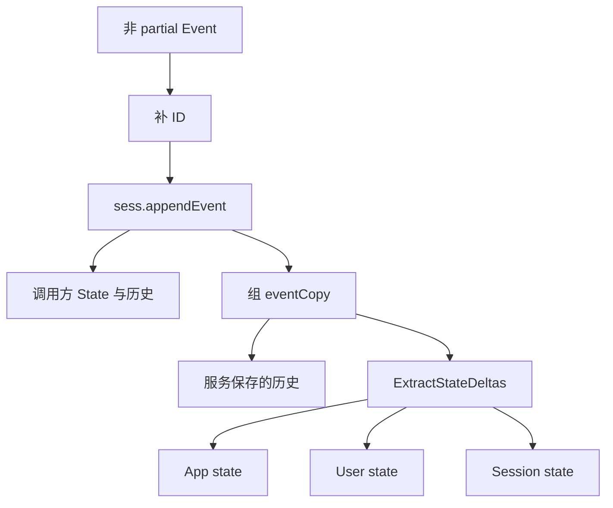
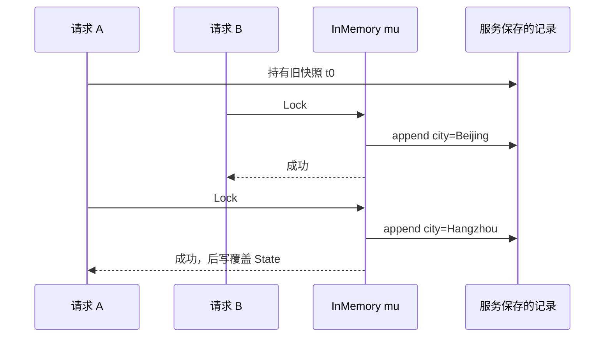

# ADK-Go 源码阅读笔记 · InMemory Session：一把锁下的两份 Session

> **源码基准：[ADK-Go v2.4.0](https://github.com/google/adk-go/tree/v2.4.0)**，commit `4e57df40cbd35f055ba654b03ffb0e509fdd754a`。
>
> [返回源码阅读合集](/blog/adk/) · 前置阅读：[Session、Event 与 State](/blog/adk-session-event/) · 对照阅读：[Database Session](/blog/adk-session-database/)、[Memory](/blog/adk-memory/)。

`session.InMemoryService()` 适合单进程、短生命周期的运行。它没有数据库连接和 JSON 往返，而是用一个有序 map 保存 Session，再用 App/User 两级 map 保存共享状态。真正容易误解的地方是：一次 `AppendEvent` 同时改调用者持有的 Session 和服务 map 中保存的 Session；两边不是同一条 Event 切片。

贯穿例子仍是 `weather/u1`：`s1` 把 `user:temperature_unit=C` 和 `last_city=Hangzhou` 写入；`s2` 读取到用户偏好，却不会自动看到 `s1` 的 Session 状态。随后用 `temp:attempt` 展示当前实现的临时键例外。

### 术语先分开

| 词 | 在 InMemory 中的含义 | 不能推断什么 |
| --- | --- | --- |
| 服务保存的 Session | `omap` 中服务持有的记录 | 不是调用方拿到的同一个指针 |
| 调用方持有的 Session | `Create` / `Get` 返回给调用方的 `*session` | 不是数据库事务代理 |
| State map | 读视图中的扁平 key map | 不代表物理上只有一块 map |
| 保存后的 Event | 追加到某个 Session 的事件对象 | 不保证与传入 Event 深拷贝一致 |

## 一、源码入口与阅读地图

| 顺序 | 位置 | 作用 |
| --- | --- | --- |
| 1 | [`session/service.go:79-85`](https://github.com/google/adk-go/blob/v2.4.0/session/service.go#L79-L85) | `InMemoryService()` 装配 App/User map |
| 2 | [`session/inmemory.go:37-44`](https://github.com/google/adk-go/blob/v2.4.0/session/inmemory.go#L37-L44) | `inMemoryService` 的锁、Session 表、共享状态 |
| 3 | [`session/inmemory.go:46-93`](https://github.com/google/adk-go/blob/v2.4.0/session/inmemory.go#L46-L93) | Create 与初始 State 分发 |
| 4 | [`session/inmemory.go:95-176`](https://github.com/google/adk-go/blob/v2.4.0/session/inmemory.go#L95-L176) | Get/List 的过滤、合并和复制 |
| 5 | [`session/inmemory.go:197-303`](https://github.com/google/adk-go/blob/v2.4.0/session/inmemory.go#L197-L303) | AppendEvent、共享状态与 服务记录 |
| 6 | [`session/inmemory.go:319-481`](https://github.com/google/adk-go/blob/v2.4.0/session/inmemory.go#L319-L481) | 本地 Session、State、临时键过滤 |

```text
InMemoryService()
      │
      ├── mu: sync.RWMutex
      ├── sessions: ordered map[encoded(app,user,session)] *session
      ├── appState:  map[app]stateMap
      └── userState: map[app][user]stateMap

Create/Get ──复制──> 调用方 调用方 *session
AppendEvent ───────> 调用方 *session + 服务记录 *session
```

有序 map 的价值不只是“稳定遍历”：`List` 通过 `ordered.Encode` 后的范围扫描，按 App、User、Session 的编码前缀选出范围。[编码](https://github.com/google/adk-go/blob/v2.4.0/session/inmemory.go#L305-L317)与[扫描边界](https://github.com/google/adk-go/blob/v2.4.0/session/inmemory.go#L150-L157)决定了 `userID==""` 时列出某 App 下所有用户。

## 二、核心接口与数据结构

### 1. 三块物理状态，不是一个全局 map

```go
// session/inmemory.go:37-44
type inMemoryService struct {
    mu        sync.RWMutex
    sessions  omap.Map[string, *session]
    userState map[string]map[string]stateMap
    appState  map[string]stateMap
}
```

Session key 是 `(AppName, UserID, SessionID)` 的有序编码；裸 `SessionID` 不能作为 key，因为不同用户可以都创建 `s1`。三个字段共同定位 Session。正常 append 的 Session 分支只把无前缀 key 写入 服务记录的 `state`；App/User map 分别去掉 `app:`、`user:` 前缀。Create 的初始合并另外保留原始 key，下一节会展开这个例外。读回时由 [`mergeStates`](https://github.com/google/adk-go/blob/v2.4.0/session/inmemory.go#L295-L303) 重新拼成应用看到的视图。

`session` 自己的实现带一把 Session 级锁：

```go
// session/inmemory.go:319-327
type session struct {
    id        id
    mu        sync.RWMutex
    events    []*Event
    state     map[string]any
    updatedAt time.Time
}
```

服务锁保护 map 和跨 Session 状态；Session 锁保护单个对象字段。`AppendEvent` 先拿服务锁，再调用 `sess.appendEvent` 拿 调用方持有的 Session 锁，这些锁是未导出实现细节；公开 API 并没有让应用把几次方法调用包进同一个临界区的能力。

### 2. Create：先写 服务记录，再返回快照

[`Create`](https://github.com/google/adk-go/blob/v2.4.0/session/inmemory.go#L46-L93) 要求 AppName、UserID；空 SessionID 通过 `platform.NewUUID(ctx)` 生成。拆分函数返回 App/User/Session 三份 map；Create 实际只使用前两份更新共享状态，再把原始 `state` 与最新共享状态合并回 `val.state`，最后用 `maps.Clone` 和 `slices.Clone` 给返回值一份快照。

```text
req.State
  ├─ app:currency ──> appState[weather][currency]
  ├─ user:unit ─────> userState[weather][u1][unit]
  ├─ city ──────────> 服务中的 s1.state[city]
  └─ temp:seed ─────> 当前代码的 Create 例外：仍可能进入 state
```

这里的 `temp:seed` 是当前实现限制：`Create` 调用 `ExtractStateDeltas` 更新共享 map，却把未经过滤的 `state` 传给 `MergeStates`。因此临时键的设计意图和 InMemory Create 实际结果不完全一致。不要用 InMemory 的成功读取证明所有后端都接受初始临时状态。

### 3. Get / List：状态复制与事件共享边界不同

`Get` 先复制 Session 元数据，调用 `mergeStates` 生成新 State，再按照 `NumRecentEvents` 从尾部截取、按 `After` 做 `sort.Search`。最后创建新 slice，但 append 的元素仍是同一批 `*Event` 指针。[实现见](https://github.com/google/adk-go/blob/v2.4.0/session/inmemory.go#L95-L138)。

`List` 只返回 Session 元数据和合并后的 State，事件列表保持空；List 不加载 events。[实现见](https://github.com/google/adk-go/blob/v2.4.0/session/inmemory.go#L141-L176)。

| 返回内容 | 是否复制 | 结果 |
| --- | --- | --- |
| Session `state` map | 是 | 调用方改 map 不污染服务记录 |
| `events` slice header | 新建 | 切片增删不影响服务记录中的 slice header |
| slice 中的 `*Event` | 否 | 改 Event 或嵌套指针可能污染共享记录 |
| `LastUpdateTime` | 值 | 读取时刻的时间快照 |

## 三、主执行路径：AppendEvent 的双写

### 1. 正常 append

```text
调用方 Session + event
          │
          ▼
partial? ──是──> return nil（两边都不变）
          │否
          ▼
补空 Event.ID → 类型断言 *session → service.mu.Lock
          │
          ├─ 找服务记录；不存在 => ErrNotFound
          ├─ sess.appendEvent(event)
          │    ├─ updateSessionState（含 temp）
          │    ├─ trimTempDeltaState
          │    └─ 调用方 events 追加 + updatedAt
          ├─ 从原始 event 组 eventCopy
          ├─ 服务记录 events 追加 eventCopy
          └─ ExtractStateDeltas → app/user/服务记录 state
```

核心代码是 [`AppendEvent`](https://github.com/google/adk-go/blob/v2.4.0/session/inmemory.go#L197-L267)。空 ID 在服务内存中由 `platform.NewUUID` 补齐并写回传入对象；Partial 在此之前已经直接返回。类型断言意味着把 Database 返回的 `*localSession` 传给 InMemory 服务会报 unexpected session type。



### 2. 两个状态视图与一个读回陷阱

假定事件的 delta 是：

```go
map[string]any{"temp:attempt": 1, "user:temperature_unit": "C", "last_city": "Hangzhou"}
```

| 对象 | `State()` | `Events().At(0).Actions.StateDelta` |
| --- | --- | --- |
| `Create` 返回的 Session | `temp:attempt=1`、User/Session key | temp 被 `trimTempDeltaState` 移除 |
| 再次 `Get` 返回的 Session | 无本次追加的 temp；共享 User/Session 合并 | 当前 v2.4.0 仍可能含 temp，因为 `eventCopy` 从原始 event 克隆 |
| App/User map | `user:temperature_unit` 在 User map | 不存 temp |

这是源码中两个步骤的顺序差异，不是服务契约。测试 [`TestInMemoryService_AppendEvent_PreservesInputEventTempState`](https://github.com/google/adk-go/blob/v2.4.0/session/inmemory_test.go#L189-L238)覆盖的是输入 Event 不被原地删 key，以及调用方历史被过滤；它不应被解释成 Get 一定无 temp。

### 3. Event 字段的克隆不是深拷贝

`eventCopy` 显式克隆 `StateDelta`、`ArtifactDelta`、工具确认 map、`Compaction`、长任务 ID 和 Routes；`RequestedInput`、`NodeInfo`、`Output` 与 `LLMResponse.Content` 仍沿用指针或值中嵌套指针。[代码](https://github.com/google/adk-go/blob/v2.4.0/session/inmemory.go#L234-L256)。

克隆不是任意对象深拷贝。map 的 clone 只复制顶层 key/value，value 内的 map 或指针仍可共享。[`Compaction.clone()`](https://github.com/google/adk-go/blob/v2.4.0/session/session.go#L375-L400) 会复制摘要 Content 的 Parts 和排除引用；因为它决定之后 Prompt 省略哪些历史，不能让调用者在 append 后修改同一指针。[测试](https://github.com/google/adk-go/blob/v2.4.0/session/inmemory_test.go#L240-L289)固定了这个边界。

### 4. 共享状态只有重新读取才合并

初始时 `s1` 和 `s2` 都持有 `user:temperature_unit=F` 的 Session 对象。`s1` 的 Event 更新成 C 后，服务里的 `userState[weather][u1]` 为 C，调用方持有的 `s1` 对象也为 C；已经取出的 `s2` 仍为 F，因为它的 State 是先前合并的新 map。再调用 `Get(s2)` 才会读取共享 map 中最新的 C。

这也解释了直接 `s2.State().Set("user:temperature_unit", "K")` 的结果：它只改这一个返回对象，并不会去更新服务 User map。下一次 Get 仍从 User map 合并 C。共享是服务读取时的作用域行为，不是所有在手对象之间的实时广播。

## 四、关键细节与分支

### 4.1 Partial、空 ID 与错误

| 分支 | 结果 |
| --- | --- |
| `curSession==nil` / `event==nil` | 立即返回普通 error |
| `event.Partial` | 返回 nil；不补 ID，不写 调用方对象或服务记录 |
| `event.ID==""` | 就地补 UUID |
| Session 类型不是 `*session` | 返回 unexpected type |
| 服务记录 缺失 | 返回包装的 `ErrNotFound` |

`Delete` 只删除 `sessions` 项，不删除 App/User state；缺失目标也是成功。这样删除 `s1` 后，`s2` 仍能看到 `user:temperature_unit`。这不是级联删除共享用户偏好的实现。[源码](https://github.com/google/adk-go/blob/v2.4.0/session/inmemory.go#L178-L195)。

### 4.2 并发是互斥串行，不是版本控制

服务的 `mu` 让两个 AppendEvent 不会并发修改 map；但没有 stale timestamp 检查。两个调用者都从 `updatedAt=t0` 读到 Session 时，后一个 append 仍会成功，事件按锁获得顺序追加，状态同名 key 后写覆盖。事件时间戳可以比前一条旧，服务不会拒绝这类旧时间。`updatedAt` 也直接赋成 Event.Timestamp，因此时间可能倒退。

Get 的 `After` 过滤使用二分查找，注释前提是事件已经按时间有序；它没有先排序。若应用手写乱序时间，保存可以成功，但基于时间的过滤不再满足二分查找的前提。通常使用真实递增事件时间是调用方需要维持的条件，不能把 append 成功等同于时间序列已经合法。



### 4.3 取消、迭代与本地直接 Set

InMemory 方法没有统一检查 `ctx.Err()`；取消是否生效由调用链上游决定。调用方停止消费 Runner iterator 时，已由 Runner Append 成功的事件不会回滚；尚未 yield 的后续事件也不会凭空执行。

`Session.State().Set("local", v)` 只改本地 map；它不生成 Event，也不调用服务。要让另一个 `Get` 或另一个 Session 看见，必须把值放入 Event.Actions.StateDelta 后 AppendEvent。能读到不等于已共享。

## 五、重新梳理：InMemory 的架构边界

| 边界 | 接收 | 产出 | 责任 |
| --- | --- | --- | --- |
| Runner / Agent | Event、StateDelta | 调用 AppendEvent | 决定什么时候产生事件 |
| InMemory Service | `Session + Event` | 更新调用方对象、服务记录、共享 map | 锁、拆分、过滤、复制 |
| 调用方 | Get/Create 返回对象 | 下一次 Run 输入 | 负责不用过期快照继续写 |

“内存实现等于简单数据库”只在数据模型层成立：它复用了 Service 接口与 State 前缀，但没有数据库事务、重启恢复、跨进程协调或 JSON 类型转换。

## 六、这个模块解决了什么问题

它为测试、示例和单进程服务提供无外部依赖的会话后端：创建、查询、追加和共享状态都能在一个 Go 进程中完成。`omap` 让 List 按复合身份范围工作；共享 map 让用户偏好跨 Session 可见；锁让单进程并发不会触发 map race。

代价同样具体：进程退出即丢数据；后写覆盖不检测旧快照；Event 指针共享使调用方必须避免事后修改；初始和读回临时状态存在实现例外。生产多实例应使用具有明确事务和并发策略的后端，不能由“实现了 Service”推出同样的持久化语义。

## 七、重点结论与常见误解

- **InMemory 有两份 Session 视图。** 返回对象供当前调用继续使用；服务 map 中另存一份记录，供以后的 Get 读取。
- **State map 复制不代表 Event 深拷贝。** map/slice/嵌套指针的边界各不相同。
- **锁只提供进程内互斥。** 它不提供 stale 检查和跨实例一致性。

| 误解 | v2.4.0 实际行为 |
| --- | --- |
| `Get` 返回对象就是服务内部对象 | State 是新 map；Event 指针仍可共享 |
| temp 永远不进入任何历史 | 调用方历史过滤，再次 Get 历史可能保留原始 temp |
| Delete Session 会删除 User 状态 | 只删 Session map，App/User map 保留 |
| List 能拿到所有历史 | List 返回的 Session 没有 events |
| AppendEvent 会按时间排序 | 追加按锁顺序，时间戳不做排序或旧值拒绝 |

检查自己是否理解：`s1` 删除后创建 `s2`，摄氏度偏好仍在哪里？User map。两个旧快照同时写 `last_city`，谁胜出？获得服务锁后最后写入者。直接修改 `Get` 返回 Event 后再读，会不会可靠隔离？不会，部分指针共享。

## 八、相关源码与进一步阅读

| 主题 | 链接 | 关注点 |
| --- | --- | --- |
| 构造与状态 | [`inmemory.go:37-93`](https://github.com/google/adk-go/blob/v2.4.0/session/inmemory.go#L37-L93) | map、Create、初始状态 |
| 查询 | [`inmemory.go:95-176`](https://github.com/google/adk-go/blob/v2.4.0/session/inmemory.go#L95-L176) | 过滤、List 空历史、快照 |
| 追加 | [`inmemory.go:197-303`](https://github.com/google/adk-go/blob/v2.4.0/session/inmemory.go#L197-L303) | 两份对象更新、按作用域分发 |
| Session 对象 | [`inmemory.go:319-481`](https://github.com/google/adk-go/blob/v2.4.0/session/inmemory.go#L319-L481) | 本地状态、临时键过滤、锁 |
| 测试 | [`inmemory_test.go`](https://github.com/google/adk-go/blob/v2.4.0/session/inmemory_test.go) | temp、compaction、并发 |
| 配套文章 | [Session/Event](/blog/adk-session-event/) · [Database](/blog/adk-session-database/) | 对比后端语义 |
