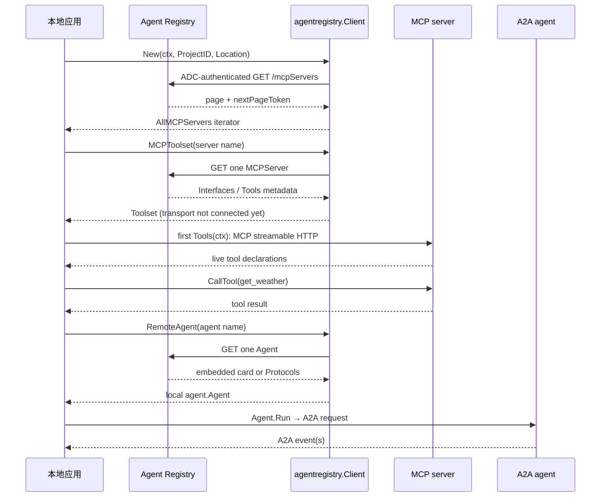

# ADK-Go 源码阅读笔记 · Agent Registry：从目录记录到 RemoteAgent 与 MCPToolset

> **源码基准：[ADK-Go v2.4.0](https://github.com/google/adk-go/tree/v2.4.0)**，commit `4e57df40cbd35f055ba654b03ffb0e509fdd754a`。下文的“当前实现”均指这个版本。
>
> 本文范围是根模块 `agentregistry`：客户端创建、Agent/MCP server/模型 endpoint 的只读发现、分页迭代器，以及两个工厂 `RemoteAgent` 和 `MCPToolset`。注册资源的写入 API、远端 Agent 的业务推理和 MCP server 的工具实现不在这个包里。
>
> [返回 ADK 源码阅读合集](/blog/adk/) · 配套阅读：[Agent](/blog/adk-agent/)、[Tool](/blog/adk-tool/)、[Context](/blog/adk-context/)、[Server](/blog/adk-server/)、[基础设施](/blog/adk-infrastructure/)。

用户要“生成东京天气简报”。应用不把某个 MCP endpoint 写死，而是在 `projects/demo/locations/global` 中寻找声明了 `get_weather` 的 MCP server；找到后用 `MCPToolset` 接入一个本地 `llmagent`。另一条路径把已注册的天气专家解析成 `RemoteAgent`，让本地 Agent 通过 A2A 委托整段任务。

这两个路径共享同一个目录访问层，却在各自读完记录后分开出站：注册表请求可以用 ADC，MCP 的 Google API endpoint 可以复用这份客户端，A2A 远端则**不会**自动拿到注册表凭据。Agent Registry 返回元数据和 endpoint；后续 A2A/MCP 流量直接发往远端服务。

本文回答三个问题：

1. `New` 如何选择 ADC、mTLS endpoint、配额项目和自定义 HTTP client？
2. `List/Get/All` 如何拼资源名、保留过滤器并按需分页？
3. 一条 Agent 记录怎样变成 `agent.Agent`，一条 MCP 记录怎样变成 `tool.Toolset`，两者的出站认证边界在哪里？

### 阅读前先分清这些词

| 术语 | 本文中的准确含义 | 不要混淆 |
| --- | --- | --- |
| Registry `Agent` | 注册表返回的目录记录，包含协议、技能和可选嵌入卡片 | 可运行的 `agent.Agent`；它只是元数据 |
| Agent Card | A2A 客户端协商所需的 `a2a.AgentCard`，可从 `Card.Content` 解码或由协议字段合成 | 注册表记录本身 |
| `List*` / `All*` | `List*` 返回一页；`All*` 返回 Go `iter.Seq2`，消费时才请求下一页 | 一次请求就把所有资源读入内存 |
| Registry HTTP client | 调用 `agentregistry.googleapis.com` 的 REST client，可能带 ADC | 发往 A2A/MCP endpoint 的出站 client |
| MCP `Tool` 元数据 | `MCPServer.Tools` 中目录声明的工具名称和提示 | MCP 会话连上后由 server 实际返回的 live tool |
| `agent.Loader` | 本地名字到已构造 `agent.Agent` 的装载器 | 注册表的远程目录查询 |

贯穿示例使用三个资源名：

```text
projects/demo/locations/global/mcpServers/weather
projects/demo/locations/global/agents/weather-specialist
projects/demo/locations/global/endpoints/gemini
```

应用先查目录，再选择一个工厂。`Endpoint` 目前只有发现模型 endpoint 的数据类型和 `List/Get/All` 方法；本包没有把它直接变成 `model.LLM` 的工厂。

## 一、源码入口与阅读地图

| 阅读顺序 | 源码 / 符号 | 需要回答的问题 |
| --- | --- | --- |
| 1 | [`agentregistry/doc.go#L15-L23`](https://github.com/google/adk-go/blob/v2.4.0/agentregistry/doc.go#L15-L23) | 包负责目录、传输还是业务执行？ |
| 2 | [`agentregistry/client.go#L31-L113`](https://github.com/google/adk-go/blob/v2.4.0/agentregistry/client.go#L31-L113) | `Config` 怎样创建认证 REST client？ |
| 3 | [`agentregistry/requester.go#L27-L105`](https://github.com/google/adk-go/blob/v2.4.0/agentregistry/requester.go#L27-L105) | 相对/完整资源名、header、非 2xx 怎样处理？ |
| 4 | [`agentregistry/types.go#L23-L165`](https://github.com/google/adk-go/blob/v2.4.0/agentregistry/types.go#L23-L165)、[`client.go#L24-L148`](https://github.com/google/adk-go/blob/v2.4.0/agentregistry/client.go#L24-L148) | 三类资源怎样建模和分页？ |
| 5 | [`agentregistry/factory.go#L167-L337`](https://github.com/google/adk-go/blob/v2.4.0/agentregistry/factory.go#L167-L337) | Agent Card、A2A transport 和名称怎样解析？ |
| 6 | [`agentregistry/factory.go#L339-L378`](https://github.com/google/adk-go/blob/v2.4.0/agentregistry/factory.go#L339-L378) | MCP endpoint 怎样接入 `mcptoolset`？ |
| 7 | [`agentregistry/registry_test.go#L29-L198`](https://github.com/google/adk-go/blob/v2.4.0/agentregistry/registry_test.go#L29-L198)、[`client_test.go#L315-L448`](https://github.com/google/adk-go/blob/v2.4.0/agentregistry/client_test.go#L315-L448) | 验证配置、分页和错误的测试在哪里？ |
| 8 | [`agentregistry/remoteagent_e2e_test.go#L36-L109`](https://github.com/google/adk-go/blob/v2.4.0/agentregistry/remoteagent_e2e_test.go#L36-L109)、[`mcptoolset_e2e_test.go#L29-L87`](https://github.com/google/adk-go/blob/v2.4.0/agentregistry/mcptoolset_e2e_test.go#L29-L87) | 两个工厂如何走到真实协议端点？ |

```text
agentregistry.New(ctx, Config)
          │
          ├─ ADC + htransport.NewHTTPClient ─┐
          │                                  ▼
          └─ custom *http.Client       restRequester
                                             │
                           List / Get / All  │ GET
                                             ▼
                 agents / mcpServers / endpoints
                    │                       │
                    │ RemoteAgent           │ MCPToolset
                    ▼                       ▼
              agentCard + A2A          endpoint + MCP transport
                    │                       │
             remoteagent.NewA2A       mcptoolset.New
                    │                       │
              local agent.Agent       local tool.Toolset
```

`requester` 是包内的能力边界：默认实现是 REST，但 `Client` 的发现方法只依赖它。应用不能直接替换未导出的 `requester`，测试则可以在包内用测试 server 构造它；这解释了为什么 HTTP 解析与资源方法可以分开验证。

## 二、核心接口与数据结构

### 1. `Config`、`Client` 和默认请求者

`Config` 只要求项目和位置；`HTTPClient` 为空时，`New` 自己创建 ADC client。以下是决定这条分支的源码摘录（[`client.go#L40-L59`](https://github.com/google/adk-go/blob/v2.4.0/agentregistry/client.go#L40-L59)、[`#L62-L113`](https://github.com/google/adk-go/blob/v2.4.0/agentregistry/client.go#L62-L113)）：

```go
type Config struct {
    ProjectID  string
    Location   string
    HTTPClient *http.Client
}

func New(ctx context.Context, cfg Config) (*Client, error) {
    if cfg.ProjectID == "" || cfg.Location == "" {
        return nil, fmt.Errorf("agentregistry: ProjectID and Location must be set")
    }
    // HTTPClient == nil: FindDefaultCredentials + htransport.NewHTTPClient.
    // HTTPClient != nil: use caller client and select customClientBaseURL().
    // 其余装配省略。
}
```

默认路径调用 `google.FindDefaultCredentials(ctx, cloudPlatformScope)`，再将生产 endpoint `https://agentregistry.googleapis.com/v1` 和 mTLS endpoint `https://agentregistry.mtls.googleapis.com/v1` 交给 `htransport.NewHTTPClient`。Google transport 读取 `GOOGLE_API_USE_MTLS_ENDPOINT` 与 `GOOGLE_API_USE_CLIENT_CERTIFICATE`，并返回实际选中的 endpoint；因此 endpoint 与客户端证书选择来自同一层。

传入自定义 `HTTPClient` 后，代码不再加载 ADC，也不替这个 client 管理证书。只有 `GOOGLE_API_USE_MTLS_ENDPOINT=always` 会把 base URL 切到 mTLS；`never`、`auto` 和空值都保持标准 endpoint（[`client.go#L116-L123`](https://github.com/google/adk-go/blob/v2.4.0/agentregistry/client.go#L116-L123)）。所以“使用了自定义 client”不等于“自动获得 mTLS”。

`Client` 同时保存 requester 和这份 HTTP client。前者用于注册表 REST，后者可能在 `MCPToolset` 的 Google API endpoint 分支被复用（[`client.go#L54-L60`](https://github.com/google/adk-go/blob/v2.4.0/agentregistry/client.go#L54-L60)）。

### 2. 配额 header 是请求者的责任

创建 `restRequester` 时，`userProject` 的优先顺序是：

1. `GOOGLE_CLOUD_QUOTA_PROJECT`；
2. ADC credentials JSON 中的 `quota_project_id`；
3. `Config.ProjectID`。

实现见 [`client.go#L97-L143`](https://github.com/google/adk-go/blob/v2.4.0/agentregistry/client.go#L97-L143)。请求者每次 GET 都设置 `Content-Type: application/json`；只有 `userProject` 非空时才设置 `x-goog-user-project`（[`requester.go#L53-L82`](https://github.com/google/adk-go/blob/v2.4.0/agentregistry/requester.go#L53-L82)）。自定义 client 没有 ADC JSON 可读，但环境变量仍然优先于 `ProjectID`。

这不是请求 body 中的项目字段，而是配额与计费路由 header。把 `Config.ProjectID` 当成“必然的计费项目”会漏掉前两级覆盖。

### 3. 目录记录不是 ADK 执行对象

`types.go` 描述了三类只读资源：

```go
type Agent struct {
    Name, DisplayName, Description, Version string
    Protocols []Protocol
    Skills    []Skill
    Card      *Card
}

type MCPServer struct {
    Name, MCPServerID, DisplayName, Description string
    Protocols []Protocol
    Interfaces []Interface
    Tools []Tool
    Attributes map[string]any
}

type Endpoint struct {
    Name, EndpointID, DisplayName, Description string
    Interfaces []Interface
    Attributes map[string]any
}
```

这是 [`types.go#L23-L108`](https://github.com/google/adk-go/blob/v2.4.0/agentregistry/types.go#L23-L108) 的删节摘录。`Card.Content` 是原始 JSON；当 `Card.Type` 为 `A2A_AGENT_CARD` 时，它可能就是 A2A `AgentCard`。`MCPServer.Tools` 的 `Annotations` 是目录提示，不能代替 live MCP server 返回的 schema；源码注释也明确把它称为 declared metadata（[`types.go#L46-L95`](https://github.com/google/adk-go/blob/v2.4.0/agentregistry/types.go#L46-L95)）。

`Protocol` 包含版本和多个 `Interface`。注册表线上的 `protocolBinding` 是字符串，例如 `JSONRPC`、`HTTP_JSON`、`GRPC`；只有在 `resolve.go` 中映射后，才成为 A2A transport 枚举（[`resolve.go#L24-L97`](https://github.com/google/adk-go/blob/v2.4.0/agentregistry/resolve.go#L24-L97)）。

### 4. 与本地 `AgentLoader`、`RemoteAgent`、`Toolset` 的关系

本地 `agent.Loader` 的契约是 `ListAgents`、`LoadAgent`、`RootAgent`，它管理已经在进程里构造好的 `agent.Agent`（[`agent/loader.go#L21-L32`](https://github.com/google/adk-go/blob/v2.4.0/agent/loader.go#L21-L32)）。`agentregistry.Client` 没有实现这个接口，也没有把远程目录自动注册为 launcher 的应用列表。

| 对象 | 创建者 | 生命周期 / 消费者 | 东京示例中的值 |
| --- | --- | --- | --- |
| `Client` | `agentregistry.New` | 进程内复用；发现和工厂调用 | `ProjectID=demo`, `Location=global` |
| `Agent` 记录 | `GetAgent` / `ListAgents` | 一次目录响应；交给 `agentCard` | `weather-specialist` 的协议和技能 |
| `agent.Agent` | `RemoteAgent` → `remoteagent.NewA2A` | 可作为 root 或 sub-agent；`Run` 时发 A2A | 名称如 `Weather_Specialist` |
| `MCPServer` 记录 | `GetMCPServer` / `AllMCPServers` | 选择 endpoint；不执行工具 | 声明 `get_weather` |
| `tool.Toolset` | `MCPToolset` → `mcptoolset.New` | 传入 `llmagent.Config.Toolsets`；按需列举 live tools | `mcp_tool_set` |
| `Endpoint` 记录 | `GetEndpoint` / `AllEndpoints` | 仅由应用读取 metadata | `gemini`，不会自动生成 Model |

因此 `RemoteAgent` 是“把目录记录适配为一个本地 Agent 接口”，不是 `Loader`；`MCPToolset` 是“把目录记录适配为 Toolset”，不是把 `MCPServer.Tools` 直接复制成工具。

## 三、主执行路径：一次发现、一次装配、一次远端调用

### 1. 从 capability 到 MCP 工具

贯穿示例的应用侧代码可以压缩成下面这样。`AllMCPServers` 的消费会触发真正的目录请求；`MCPToolset` 只解析 endpoint，MCP 会话在后续 `Tools` 调用时懒连接。

```go
ctx := context.Background()
registry, err := agentregistry.New(ctx, agentregistry.Config{
    ProjectID: "demo",
    Location:  "global",
})
if err != nil { /* 处理 ADC / 配置错误 */ }

var provider *agentregistry.MCPServer
for server, err := range registry.AllMCPServers(ctx, agentregistry.WithPageSize(50)) {
    if err != nil {
        /* 处理 *agentregistry.APIError */
        break
    }
    for _, declared := range server.Tools {
        if declared.Name == "get_weather" {
            provider = server
            break
        }
    }
    if provider != nil {
        break
    }
}

if provider == nil {
    /* 当前项目/位置没有声明这个 capability，结束启动 */
}
if provider != nil {
    toolset, err := registry.MCPToolset(ctx, provider.Name)
    // 再把 toolset 放入 llmagent.Config.Toolsets。
    _ = toolset
    _ = err
}
```

`WithPageSize` 只控制一页的上限；如果使用 `WithFilter`，它只是把表达式写入 query，表达式语义由服务端决定。应用仍应检查 `server.Tools`，因为目录过滤和业务能力选择是两层判断。

调用栈如下：

```text
AllMCPServers
  → ListMCPServers
    → getResource[ListMCPServersResponse]
      → restRequester.Get("mcpServers", query)
        → GET /v1/projects/demo/locations/global/mcpServers

MCPToolset("projects/.../mcpServers/weather")
  → GetMCPServer
  → mcpEndpointURI(JSONRPC 优先，HTTP_JSON 备用)
  → egressClient(endpoint)
  → mcptoolset.New(StreamableClientTransport)
  → llmagent.Tools(ctx) 时连接并 ListTools
```

`mcptoolset.New` 的通用行为是：Toolset 创建阶段保存 transport，第一次列举工具时才建立 MCP session；因此“工厂返回成功”不代表远端已经通过网络完成握手。ADK 的 `Toolset.Tools` 最终把 live MCP tools 转为本地 `tool.Tool`，这一步由 [`mcptoolset/set.go#L29-L61`](https://github.com/google/adk-go/blob/v2.4.0/tool/mcptoolset/set.go#L29-L61)、[`#L163-L184`](https://github.com/google/adk-go/blob/v2.4.0/tool/mcptoolset/set.go#L163-L184) 完成。

### 2. 从 Agent 记录到 A2A Agent

`RemoteAgent` 的主线更短：

```text
RemoteAgent(ctx, name)
  → GetAgent(name)
  → agentCard(info, name)
      ├─ embedded Card.Type == A2A_AGENT_CARD → 解码原始 card
      └─ 否则 → Protocols/Skills 合成 card
  → a2aClientFactory(card, caller egress)
      ├─ 当前 JSONRPC + HTTP+JSON transport
      └─ card 宣布的旧版本 compat transport
  → remoteagent.NewA2A
  → 返回可放进本地 Agent tree 的 agent.Agent
```

`remoteagent.NewA2A` 用 `agent.New` 包装一个本地 Agent 外壳；真正的 Agent Card 解析、A2A client 创建和消息发送发生在该 Agent 的 `Run` 中（[`agent/remoteagent/v2/a2a_agent.go#L323-L361`](https://github.com/google/adk-go/blob/v2.4.0/agent/remoteagent/v2/a2a_agent.go#L323-L361)、[`#L368-L496`](https://github.com/google/adk-go/blob/v2.4.0/agent/remoteagent/v2/a2a_agent.go#L368-L496)）。所以 `RemoteAgent` 返回成功只证明目录记录能构造成 Agent，不证明下一次 A2A 请求已经成功。

### 3. 对象快照和边界

```text
目录阶段
  Agent record.Card / Protocols / Skills
      └─ agentCard
           card.Name = "Weather Specialist"（嵌入卡片可能保留空格）
           local agent.Name() = "Weather_Specialist"

MCP 阶段
  MCPServer.Interfaces → URI
  Client.httpClient / caller client → egress HTTP client
  URI → StreamableClientTransport → live MCP tool list

执行阶段
  local agent.Agent.Run → A2A SendMessage/SendStreamingMessage
  local tool.Tool.Run   → MCP CallTool
  Registry Client       → 不参与上述后续请求
```

| 阶段 | 读取 | 写入 / 返回 | 控制权在哪里 |
| --- | --- | --- | --- |
| 目录发现 | Project/Location、filter、page token | 一页资源或 iterator item | `Client` / REST requester |
| Agent 适配 | Card 或 Protocols | `a2a.AgentCard`、清洗后的本地 Agent name | `agentCard` / A2A factory |
| MCP 适配 | Interfaces | `tool.Toolset` 和 streamable transport | `MCPToolset` |
| 首次 live 访问 | MCP server 的工具列表 | ADK `tool.Tool` 声明 | `mcptoolset.set.Tools` |
| 业务执行 | 用户消息、A2A/MCP 协议 | Session Event、模型结果 | `remoteagent` 或 LLM Flow |

### 4. 动态时序



图中两条虚线之后的请求都绕过注册表。注册表只负责在创建时给出 URI、协议和能力描述；运行时的超时、证书、授权和重试由各自的远端 client/transport 决定。

## 四、关键细节与分支

### 4.1 `List`、`Get`、`All`：一页、一个资源和按需 iterator

三种资源都实现同一组方法（[`client.go#L28-L100`](https://github.com/google/adk-go/blob/v2.4.0/agentregistry/client.go#L28-L100)）：

| 调用 | 请求路径 | 返回值 |
| --- | --- | --- |
| `ListAgents` | `.../agents` | `ListAgentsResponse` 一页 |
| `GetAgent(name)` | `name` 若以 `projects/` 开头则原样作为完整资源名 | 一个 `Agent` |
| `AllAgents` | 多次 `ListAgents` | `iter.Seq2[*Agent, error]` |
| `ListMCPServers` / `GetMCPServer` / `AllMCPServers` | `.../mcpServers` | 对应 MCP 类型 |
| `ListEndpoints` / `GetEndpoint` / `AllEndpoints` | `.../endpoints` | 对应 endpoint 类型 |

`ListOption` 只有三个构造器：`WithFilter`、`WithPageSize`、`WithPageToken`；空 filter、非正 page size 和空 token 不写 query（[`types.go#L128-L165`](https://github.com/google/adk-go/blob/v2.4.0/agentregistry/types.go#L128-L165)）。`All*` 的分页循环在 [`client.go#L113-L148`](https://github.com/google/adk-go/blob/v2.4.0/agentregistry/client.go#L113-L148)：

1. 第一页使用调用方的原始 options。
2. 拿到 token 后复制 options slice，再追加 `WithPageToken(token)`；原 slice 不被 append 污染。
3. 每个 item 单独 yield。
4. yield 返回 `false` 时立即结束，因此不会请求下一页。
5. 页面请求出错时 yield 一次 `nil, err`，随后停止。

```go
for agent, err := range registry.AllAgents(ctx, agentregistry.WithPageSize(2)) {
    if err != nil {
        var apiErr *agentregistry.APIError
        // errors.As(err, &apiErr) 可取得状态码和原始 body。
        break
    }
    fmt.Println(agent.DisplayName)
}
```

这不是 channel：iterator 的生产者在消费者进入 range 时才继续执行。消费者提前 `break` 的含义是“停止请求更多目录页”，不是取消已经完成的 HTTP 请求。

### 4.2 请求路径、header 和错误类型

`restRequester.Get` 对 `resourcePath` 做一个明确分叉：以 `projects/` 开头时拼到 base URL 后，不再加默认 parent；否则拼 `projects/<project>/locations/<location>/`（[`requester.go#L64-L70`](https://github.com/google/adk-go/blob/v2.4.0/agentregistry/requester.go#L64-L70)）。这就是 `GetAgent` 可以接受完整 resource name 的原因。

响应 body 先完整读取。非 2xx 返回 `*APIError{StatusCode, Body}`；2xx 才解 JSON。读取失败和 JSON 解码失败是普通包装 error，不会伪装成 `APIError`（[`requester.go#L84-L104`](https://github.com/google/adk-go/blob/v2.4.0/agentregistry/requester.go#L84-L104)）。

```text
HTTP 403 / 404 / 500
  → APIError.StatusCode + APIError.Body

HTTP 200 + 非法 JSON
  → "agentregistry: decoding response: ..."

HTTP client / context 失败
  → "agentregistry: GET <resource>: ..."
```

因此应用可以对状态码做权限或重试提示，同时保留服务返回的诊断 body；但不要把 body 当成稳定的结构化 API，版本可能改变其 JSON 外形。

### 4.3 Agent Card：嵌入优先，协议字段兜底

`agentCard` 有两条互斥路径（[`factory.go#L262-L320`](https://github.com/google/adk-go/blob/v2.4.0/agentregistry/factory.go#L262-L320)）。

**嵌入卡片路径**：当 `Card.Type == "A2A_AGENT_CARD"` 且 content 非空时，直接 `json.Unmarshal` 为 `a2a.AgentCard`。没有 supported interface 或 card name 为空会立即报错；卡片本身的 `Name`、`Version` 等值不被重写，但返回给 ADK 的本地 Agent 名称会经过 `cleanName`。

**合成路径**：否则，从 `Protocols` 中寻找 `Type == "A2A_AGENT"` 的第一个有 URL 的 interface：

- `DisplayName` 为空时退回完整 resource name；
- 非标字符替换为 `_`，连续下划线合并，首尾下划线裁掉，数字开头加 `_`（[`resolve.go#L39-L54`](https://github.com/google/adk-go/blob/v2.4.0/agentregistry/resolve.go#L39-L54)）；
- 未识别的 registry binding 在合成 card 时默认成 HTTP+JSON；
- 缺少 protocol version 时使用 `0.3.0`；
- `Skills` 映射成 A2A `AgentSkill`，输入和输出模式固定为 `text`。

例如：

```text
DisplayName: "Weather Specialist"
resource name: projects/demo/locations/global/agents/weather-specialist
→ agent.Name(): "Weather_Specialist"
→ card.Name:   "Weather_Specialist"（合成路径）
```

嵌入卡片的 `card.Name` 可以仍是带空格的原始值；清洗的是 `remoteagent.NewA2A` 使用的 ADK 名称。这两个字段不能混为同一个 ID。

### 4.4 A2A 兼容 transport 不是“只看当前 SDK 版本”

`a2aClientFactory` 先注册 SDK 当前版本的 JSONRPC 和 HTTP+JSON transport，再扫描 card 的 supported interfaces。若 card 宣布的版本不是 `a2a.Version`，且 binding 是 JSONRPC 或 HTTP+JSON，就追加 `WithCompatTransport(version, binding, factory)`；重复的 `(binding, version)` 只注册一次（[`factory.go#L204-L260`](https://github.com/google/adk-go/blob/v2.4.0/agentregistry/factory.go#L204-L260)）。

这一步解决一个具体兼容问题：注册表常返回 `0.3.0`，而 SDK 默认 factory 只按当前 protocol version 匹配；没有 compat transport 时，client 创建阶段就会得到“no compatible transports found”，请求尚未发出。

```text
card interface: HTTP_JSON @ 0.3.0
  → registry binding 映射为 a2a HTTP+JSON
  → REST transport factory 解析 iface.URL
  → compat transport 注册到 (HTTP+JSON, 0.3.0)
  → CreateFromCard 成功
```

GRPC binding 虽能被 `transportBinding` 识别，但当前 `a2aClientFactory` 没有为它注册 factory；它会被跳过。不能从“字符串映射成功”推断“RemoteAgent 支持该传输”。

### 4.5 MCP endpoint 选择和 live tool

`mcpEndpointURI` 先在 `MCPServer.Protocols` 和顶层 `Interfaces` 中寻找 JSONRPC，找不到再寻找 HTTP_JSON；GRPC 或空接口直接失败（[`factory.go#L368-L378`](https://github.com/google/adk-go/blob/v2.4.0/agentregistry/factory.go#L368-L378)、[`resolve.go#L56-L82`](https://github.com/google/adk-go/blob/v2.4.0/agentregistry/resolve.go#L56-L82)）。

```text
Interfaces = [HTTP_JSON /mcp-http, JSONRPC /mcp-jsonrpc]
                         ↓
MCPToolset → /mcp-jsonrpc
```

工厂把 URI 放进 `mcp.StreamableClientTransport`，然后调用 `mcptoolset.New`（[`factory.go#L339-L366`](https://github.com/google/adk-go/blob/v2.4.0/agentregistry/factory.go#L339-L366)）。目录里的 `MCPServer.Tools` 可以用于 capability 选择，但 `toolset.Tools(ctx)` 会在 live session 上重新列工具；目录声明和实时 schema 可能不同。

### 4.6 出站 client 与 header 的两道边界

MCP 有一个按 endpoint hostname 分流的 `egressClient`（[`factory.go#L108-L165`](https://github.com/google/adk-go/blob/v2.4.0/agentregistry/factory.go#L108-L165)）：

| MCP endpoint | 没有显式 `WithMCPHTTPClient` 时使用 | 认证含义 |
| --- | --- | --- |
| `*.googleapis.com` | 注册表创建的 ADC client | 可复用 registry ADC；仍由远端 API 授权 |
| 其他 host | `http.DefaultClient` | 不自动带 registry ADC |
| 任意 host + 显式 client | 调用方提供的 client | 调用方负责证书、token 和 transport |

`WithMCPHeaders` 的 header 会通过浅复制的 client 和 `headerRoundTripper` 添加到每个请求，不会修改共享的 registry client。重复设置同名 key 时后一次覆盖；不同 key 会累积。

RemoteAgent 故意不同：`RemoteAgent` 使用显式 `WithA2AHTTPClient`，否则直接用 `http.DefaultClient`，再叠加 `WithA2AHeaders`；它**从不**复用 registry 的 ADC client（[`factory.go#L71-L106`](https://github.com/google/adk-go/blob/v2.4.0/agentregistry/factory.go#L71-L106)、[`#L180-L202`](https://github.com/google/adk-go/blob/v2.4.0/agentregistry/factory.go#L180-L202)）。原因是目录凭据只证明应用能读目录，不应无条件转交给目录宣称的任意 A2A endpoint。

两个工厂的默认 client 都没有整体 `http.Client.Timeout`。源码注释建议在 Transport 层限制连接和读写；把全请求 deadline 当作流式响应超时，可能截断 A2A/MCP streaming。

### 4.7 失败路径和恢复边界

| 发生位置 | 表现 | 谁负责 | 是否自动恢复 |
| --- | --- | --- | --- |
| `New` 缺 ProjectID/Location | 配置 error | 应用 | 否 |
| ADC 加载或 mTLS client 创建 | 包装 error | 应用 / 凭据环境 | 否；重试需重新调用 `New` |
| Registry 非 2xx | `*APIError` | 应用 | `All*` 停止；无内置重试 |
| Agent Card JSON、接口或名称无效 | `RemoteAgent` error | 应用数据 / 注册记录 | 否 |
| A2A endpoint 无 auth | client 可创建，调用时远端拒绝 | `WithA2AHTTPClient/Headers` | 包不注入凭据 |
| MCP 没有 JSONRPC/HTTP_JSON endpoint | `MCPToolset` error | 注册记录 / 应用 | 否 |
| MCP session 断开 | 由 `mcptoolset` 的 connection refresher 处理一次重连 | Toolset | 这是 live toolset 的能力，不是 registry 分页重试 |

注册表 `All*` 只在迭代器层报告一次错误；它不把已 yield 的资源撤回，也不从失败页自动重新开始。不要把 MCP 的会话重连误认为 Agent Registry 客户端具备通用网络重试。

## 五、重新梳理：运行时架构与边界

| 边界 | 接收与产出 | 负责的动作 | 明确不负责 |
| --- | --- | --- | --- |
| 应用 / 策略层 | capability 或 resource name → 选择结果 | 过滤、allowlist、处理多 provider、决定是否信任远端 | 不应把目录中的第一个 provider 当成安全策略 |
| `agentregistry.Client` | Project/Location + query → typed metadata | ADC/mTLS 目录 GET、路径、配额 header、分页 | 不代理 A2A/MCP 流量，不执行模型或工具 |
| `RemoteAgent` 工厂 | Agent record → local `agent.Agent` | card 解码/合成、name 清洗、兼容 transport 装配 | 不替远端 endpoint 做认证，不决定远端业务结果 |
| `MCPToolset` 工厂 | MCP server record → `tool.Toolset` | endpoint 选择、Google API client 复用、header 包装、streamable transport | 不把目录 `Tools` 直接当 live tool，不是模型适配器 |
| `remoteagent/v2` | 用户历史 → A2A event | 建 client、发送消息、转换事件和流式结果 | 不管理注册表资源 |
| `mcptoolset` | MCP session → ADK `tool.Tool` | 懒连接、ListTools、CallTool、断线重连 | 不选择哪个 registry server |
| `agent.Loader` / Runner | local `agent.Agent` → invocation | root/sub-agent 装配、Session、事件持久化 | 不查询 Agent Registry |

贯穿示例先由应用决定“`get_weather` 允许哪些 provider”，然后 `Client` 读取目录；工厂把结果变成本地 ADK 抽象，最后由 Runner/Flow 或 `remoteagent` 直接访问远端。注册表所在进程和被访问的远端服务之间没有代理转发层。

**主线规则与例外：** MCP 的 Google API endpoint 是唯一会默认复用 registry ADC 的工厂分支；A2A 始终要求调用方提供自己的认证 client/header。`MCPServer.Tools` 是选择依据，live 工具由 `mcptoolset` 重新发现；`Endpoint` 目前只停留在目录层。

## 六、这个模块解决了什么问题

### 1. 它解决的核心问题

如果应用只使用本地 `agent.New`、`mcptoolset.New` 和 A2A client，它必须知道每个远端服务的地址、协议版本和工具提供者。`agentregistry` 把“按项目/位置发现能力”和“把发现结果接入 ADK”连起来：

- `List/Get/All` 统一目录资源名、query、分页和错误形态；
- `RemoteAgent` 把嵌入或离散的注册信息变成 A2A client 可消费的 card；
- `MCPToolset` 把注册 endpoint 变成 ADK Toolset，同时保留 live MCP discovery；
- 出站 client 选择显式区分目录凭据、Google API endpoint 和第三方服务。

这使应用可以按 capability 选择 provider，而不是把 endpoint 和 token 固定在每个 Agent 配置里。

### 2. 没有它，应用需要重复实现什么

应用仍需做自己的策略，但不必重复实现以下协议胶水：

1. 将 `projects/.../locations/...` parent 与完整 resource name 正确拼接；
2. 在每一页保留 filter/page size 并推进 page token；
3. 将 `HTTP_JSON` 映射到 A2A HTTP+JSON，并为旧协议版本注册兼容 transport；
4. 根据 endpoint 选择 MCP streamable transport，并把静态 header 叠加到副本 client。

这些集中逻辑并不替代应用的 provider allowlist、租户隔离或远端权限检查。

### 3. 设计代价和适用限制

| 当前选择 | 得到什么 | 需要承担什么 | 使用者需要做什么 |
| --- | --- | --- | --- |
| `All*` 使用 lazy `iter.Seq2` | 大目录可边消费边取页，提前停止不会多发请求 | page error 只 yield 一次且没有自动重试 | 在 range 中处理 `(nil, err)`，必要时记录已处理项 |
| card 嵌入优先，协议字段兜底 | 可保留完整 A2A card，也能兼容旧目录记录 | 嵌入 JSON、接口和名称可能在创建时失败 | 将注册数据视为不可信输入，提前验证 |
| A2A 默认 `http.DefaultClient` | 不会把 registry ADC 泄漏到任意远端 | 远端 auth、证书、超时都由应用负责 | 用 `WithA2AHTTPClient/Headers` 明确设置，并在 Transport 层限时 |
| MCP Google API 复用 ADC | Google 托管 MCP 易于接入 | 第三方 endpoint 不会自动认证；live schema 可能与目录过时 | 为第三方提供显式 client/header，并在业务层重新鉴权 |
| 只读 REST client | 目录查询边界简单 | 本包没有注册、更新、删除方法，也没有 Endpoint→Model 工厂 | 将写入生命周期交给独立管理 API，自己装配模型 |

## 七、重点结论与常见误解

### 必须记住

- **目录不等于运行时对象**：`Agent`/`MCPServer`/`Endpoint` 是 JSON metadata；只有工厂才把其中两种转换成 `agent.Agent` 或 `tool.Toolset`。
- **分页由消费者驱动**：`All*` 保留原 options，按需追加 page token；消费者返回 `false` 会阻止下一页请求。
- **认证按出站目标分开**：registry 默认 ADC，MCP 的 Google API endpoint 可复用它，A2A 默认绝不复用；需要显式配置远端凭据。
- **兼容 transport 是版本匹配层**：`0.3.0` 等旧卡片版本需要 `WithCompatTransport`，否则可能在创建 A2A client 时就失败。
- **`AgentLoader` 仍是本地装载器**：把 `RemoteAgent` 放进 loader 是应用自己的装配动作，注册表不会自动成为 launcher 的 loader。

### 常见误解

| 容易产生的理解 | v2.4.0 中的实际行为 | 回看位置 |
| --- | --- | --- |
| `New` 总会使用 ADC | 传入 `Config.HTTPClient` 后不加载 ADC；自定义 client 自己管理 mTLS | [`client.go#L62-L123`](https://github.com/google/adk-go/blob/v2.4.0/agentregistry/client.go#L62-L123) |
| `GetAgent` 返回一个可直接 Run 的 Agent | 它返回目录 `Agent`；必须调用 `RemoteAgent` 才得到本地 `agent.Agent` | [`client.go#L34-L38`](https://github.com/google/adk-go/blob/v2.4.0/agentregistry/client.go#L34-L38)、[`factory.go#L173-L202`](https://github.com/google/adk-go/blob/v2.4.0/agentregistry/factory.go#L173-L202) |
| `MCPServer.Tools` 就是最终工具列表 | `MCPToolset` 连接 live MCP server 后重新 `ListTools` 并转换 | [`types.go#L78-L85`](https://github.com/google/adk-go/blob/v2.4.0/agentregistry/types.go#L78-L85)、[`mcptoolset/set.go#L163-L184`](https://github.com/google/adk-go/blob/v2.4.0/tool/mcptoolset/set.go#L163-L184) |
| A2A 会自动继承 registry 的 bearer token | A2A 默认 `http.DefaultClient`，只有显式 option 才有 caller headers/client | [`factory.go#L191-L200`](https://github.com/google/adk-go/blob/v2.4.0/agentregistry/factory.go#L191-L200) |
| 识别了 `GRPC` 就代表 RemoteAgent 支持 gRPC | `a2aClientFactory` 只为 JSONRPC 和 HTTP+JSON 建 factory，GRPC 会被跳过 | [`resolve.go#L85-L97`](https://github.com/google/adk-go/blob/v2.4.0/agentregistry/resolve.go#L85-L97)、[`factory.go#L216-L243`](https://github.com/google/adk-go/blob/v2.4.0/agentregistry/factory.go#L216-L243) |
| registry 是远端流量的代理 | 工厂只返回直连 transport；运行时请求绕过 registry | [`factory.go#L108-L121`](https://github.com/google/adk-go/blob/v2.4.0/agentregistry/factory.go#L108-L121) |

### 用贯穿示例检查自己是否理解

1. `AllMCPServers` 第一页有 `nextPageToken`，但应用只需要第一个 provider 并 `break`，会不会请求第二页？**不会**；yield 停止后 `pages` 直接返回。
2. Agent 记录只有 `Protocols`，版本为空、binding 是未知字符串，会得到什么？**合成 card 使用 resource/display name、默认版本 `0.3.0`，未知 binding 默认 HTTP+JSON；随后为该版本建立兼容 transport。**
3. 同一 `Client` 解析到 `https://third-party.example/mcp`，没有 `WithMCPHTTPClient`，会不会自动带 registry ADC？**不会**；非 Google API endpoint 使用 `http.DefaultClient`。

## 八、相关源码与进一步阅读

正文中的结论都链接到 `v2.4.0` 固定 tag；继续追踪时可从这些入口开始：

| 主题 | 源码 / 示例 | 建议关注的内容 |
| --- | --- | --- |
| 包职责与配置 | [`agentregistry/doc.go`](https://github.com/google/adk-go/blob/v2.4.0/agentregistry/doc.go)、[`client.go#L40-L143`](https://github.com/google/adk-go/blob/v2.4.0/agentregistry/client.go#L40-L143) | ADC、mTLS endpoint、quota project |
| REST seam | [`requester.go#L27-L105`](https://github.com/google/adk-go/blob/v2.4.0/agentregistry/requester.go#L27-L105)、[`requester_test.go#L37-L155`](https://github.com/google/adk-go/blob/v2.4.0/agentregistry/requester_test.go#L37-L155) | resource path、headers、APIError |
| 类型与分页 | [`types.go#L23-L165`](https://github.com/google/adk-go/blob/v2.4.0/agentregistry/types.go#L23-L165)、[`client.go#L24-L148`](https://github.com/google/adk-go/blob/v2.4.0/agentregistry/client.go#L24-L148)、[`client_test.go#L315-L448`](https://github.com/google/adk-go/blob/v2.4.0/agentregistry/client_test.go#L315-L448) | 三类资源和 early stop |
| Agent Card / A2A | [`factory.go#L167-L337`](https://github.com/google/adk-go/blob/v2.4.0/agentregistry/factory.go#L167-L337)、[`factory_test.go#L159-L372`](https://github.com/google/adk-go/blob/v2.4.0/agentregistry/factory_test.go#L159-L372) | 嵌入/合成 card、name、compat transport |
| MCP 工厂 | [`factory.go#L339-L378`](https://github.com/google/adk-go/blob/v2.4.0/agentregistry/factory.go#L339-L378)、[`factory_test.go#L374-L455`](https://github.com/google/adk-go/blob/v2.4.0/agentregistry/factory_test.go#L374-L455) | endpoint 优先级和 Toolset 构造 |
| 远端消费 | [`agent/remoteagent/v2/a2a_agent.go#L323-L496`](https://github.com/google/adk-go/blob/v2.4.0/agent/remoteagent/v2/a2a_agent.go#L323-L496)、[`tool/mcptoolset/set.go#L29-L61`](https://github.com/google/adk-go/blob/v2.4.0/tool/mcptoolset/set.go#L29-L61)、[`client.go#L36-L135`](https://github.com/google/adk-go/blob/v2.4.0/tool/mcptoolset/client.go#L36-L135) | A2A event、MCP lazy session 与一次重连 |
| 可运行示例 | [`examples/agentregistry/bind/main.go#L58-L105`](https://github.com/google/adk-go/blob/v2.4.0/examples/agentregistry/bind/main.go#L58-L105)、[`#L143-L173`](https://github.com/google/adk-go/blob/v2.4.0/examples/agentregistry/bind/main.go#L143-L173) | 按 capability 选择 MCP provider |
| E2E 证据 | [`remoteagent_e2e_test.go#L36-L109`](https://github.com/google/adk-go/blob/v2.4.0/agentregistry/remoteagent_e2e_test.go#L36-L109)、[`mcptoolset_e2e_test.go#L29-L87`](https://github.com/google/adk-go/blob/v2.4.0/agentregistry/mcptoolset_e2e_test.go#L29-L87) | JSONRPC/HTTP+JSON 与 streamable HTTP |
| 配套阅读 | [Agent](/blog/adk-agent/)、[Tool](/blog/adk-tool/)、[Server](/blog/adk-server/)、[基础设施](/blog/adk-infrastructure/)、[合集](/blog/adk/) | 本文之外的 Agent tree、工具执行、入站服务和凭据 seam |

读完这篇，应该能把三个看起来相似的动作分开：**从目录发现资源、把资源适配成本地 ADK 类型、以及真正向远端发送业务请求**。它们分别由 `Client`、两个工厂和 A2A/MCP 下层负责。
