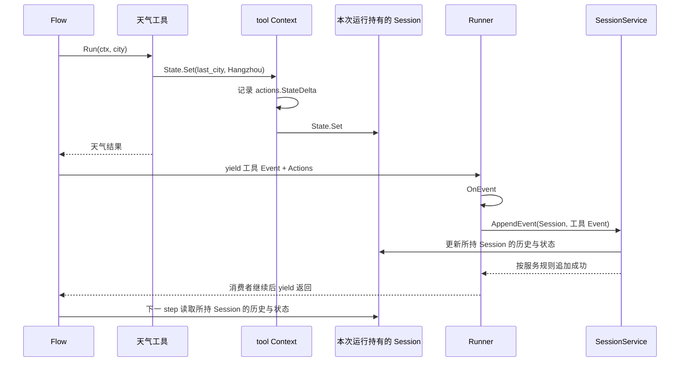
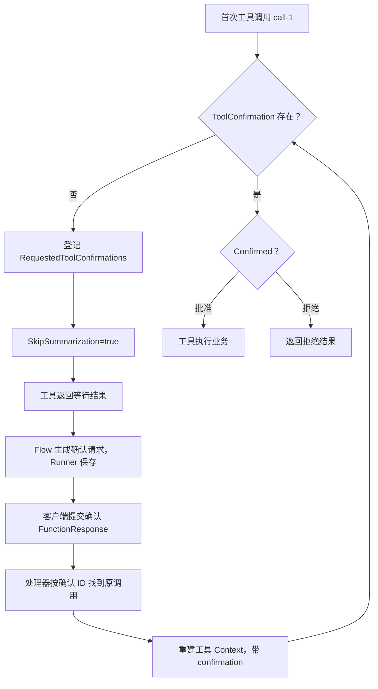

# ADK-Go 源码阅读笔记 · Context：上下文能力、状态变化与恢复边界

> **源码基准：[ADK-Go v2.4.0](https://github.com/google/adk-go/tree/v2.4.0)**，commit `4e57df40cbd35f055ba654b03ffb0e509fdd754a`。本文的“当前实现”均指这个版本。
>
> 范围：公开 Context 接口、commonContext、callback/tool wrapper、状态与 artifact 追踪、派生和恢复信息；workflow 调度算法见配套文章。
>
> [返回 ADK 源码阅读合集](/blog/adk/) · 配套阅读：[Agent](/blog/adk-agent/)、[Runner](/blog/adk-runner/)、[Flow](/blog/adk-flow/)、[Tool](/blog/adk-tool/)、[Workflow](/blog/adk-workflow/)、[Session Event](/blog/adk-session-event/)。

工具函数收到一个 `agent.Context`，里面既能读用户输入，也能写状态、搜索 Memory、请求用户确认。它究竟是一份数据、一组服务，还是一个可以随时结束 Agent 的控制器？

答案需要分两层：**Context 接口列出运行能力，具体构造器和 wrapper 决定当前调用点真正可用的能力。** 同样写着 `agent.Context`，Agent 回调、工具、workflow 节点收到的对象并不完全相同。

本文用“杭州天气怎么样”贯穿：`weather_agent` 调用 `get_weather`，工具写入 `last_city=Hangzhou`，然后返回天气。第四节再把工具改成需要确认的“购买天气报告”，观察正常读写与暂停恢复的区别。

本文回答三个问题：

1. Go context、InvocationContext、ReadonlyContext、Context 各自提供什么？
2. 工具写入的状态怎样进入 Event，何时才涉及持久化？
3. Context 派生、取消、分支和确认能保证什么，又不能保证什么？

### 阅读前先分清这些词

| 术语 | 含义 | 不应混成 |
| --- | --- | --- |
| Go Context | Deadline、Done、Err、Value 的请求链 | Session 状态容器 |
| InvocationContext | 当前 Agent、Session、服务和 invocation 环境 | 单次模型请求 |
| EventActions.StateDelta | 本事件声明的状态变化 | Context 派生用的 Delta |
| FunctionCallID | 模型要求的一次函数调用 ID | Event.ID 或 InterruptID |
| InterruptID | workflow 等待外部响应的中断键 | 当前节点 RunID |
| Branch / IsolationScope | 历史选择条件 | 用户权限或数据库隔离 |

## 一、源码入口与阅读地图

| 阅读顺序 | 文件 / 符号 | 要回答的问题 |
| --- | --- | --- |
| 1 | `agent/context.go` | 三个公开接口之间到底怎样组合？ |
| 2 | `internal/context/invocation_context.go` | Runner 创建的基础环境在哪里？ |
| 3 | `agent/common_context.go` | callbacks、tools、nodes 怎样共享实现？ |
| 4 | `callback_context_wrapper.go`、`tool_context_wrapper.go` | 同一接口在不同调用点有哪些护栏？ |
| 5 | `agent/common_context_delta.go` | 浅拷贝派生保留和替换哪些字段？ |
| 6 | `internal/llminternal/request_confirmation_processor.go` | 确认对象怎样在下一次输入后重建？ |
| 7 | `runner/run_node.go`、`runner/runner.go` | 谁把 Context 里的 actions 接到 Event 和存储？ |

```text
应用的 context.Context
          │ Runner 注入父子树、Plugin、运行配置等 Value
          ▼
internal/context.InvocationContext
  ├─ Session、Agent、InvocationID、UserContent
  ├─ Artifacts、Memory、RunConfig
  └─ Branch、IsolationScope、Ended
          │
          ▼
agent.commonContext
  ├─ Go Context 链 + invocation 环境
  ├─ actions / artifacts
  ├─ functionCallID / confirmation
  └─ resumeInputs / Path / RunID / SubScheduler
          │
      按场景构造
  ┌───────┼─────────────────┐
  ▼       ▼                 ▼
普通节点  callback wrapper  tool wrapper
```

public API 位于 `agent`；`internal/context` 是 Runner 等框架代码使用的适配层，应用不能从模块外直接导入 internal。业务扩展通常由框架把 Context 传进 callback、工具或节点函数。

## 二、核心接口与数据结构

### 1. 三个接口是组合关系

以下为 [context.go#L63-L159](https://github.com/google/adk-go/blob/v2.4.0/agent/context.go#L63-L159) 的**删节摘录**；省略服务和派生方法，只保留足以看清关系的字段：

```go
type InvocationContext interface {
    context.Context
    Agent() Agent
    Session() session.Session
    InvocationID() string
    Branch() string
    IsolationScope() string
    UserContent() *genai.Content
    RunConfig() *RunConfig
    EndInvocation()
    Ended() bool
    ResumedInput(interruptID string) (any, bool)
    // 省略 Artifacts、Memory、WithContext、WithICDelta。
}

type ReadonlyContext interface {
    context.Context
    UserContent() *genai.Content
    InvocationID() string
    AgentName() string
    ReadonlyState() session.ReadonlyState
    UserID() string
    AppName() string
    SessionID() string
    Branch() string
}

type Context interface {
    ReadonlyContext
    InvocationContext
    State() session.State
    FunctionCallID() string
    Actions() *session.EventActions
    // 省略 artifact、memory、confirmation、node 和派生方法。
}
```

Context 同时包含 InvocationContext 和 ReadonlyContext，而后两者不互相包含。静态类型为 InvocationContext 的变量没有 AgentName、ReadonlyState、UserID 等方法，不能直接赋给 ReadonlyContext；能从 Session 间接推导这些值，不改变 Go 的接口方法集合。

三个接口都嵌入 Go context，因此 Context 自身可以直接传给支持 `context.Context` 的 HTTP、模型或存储 API。

### 2. Invocation、Agent call、step 的区别

context.go 的原始注释用下面的结构解释调用层次（[L28-L62](https://github.com/google/adk-go/blob/v2.4.0/agent/context.go#L28-L62)）：

```text
invocation e-1
  ├─ weather_agent.Run
  │    ├─ step 1: LLM → get_weather
  │    └─ step 2: LLM → 最终答案
  └─ 也可能继续 transfer 到另一个 Agent
```

工具结果回来后再交给模型总结，需要新的一次模型调用，所以是新的 step。HITL 恢复可能在下一次 Runner 调用时沿用 invocation ID；一次 HTTP 请求也不一定等于一次完整 invocation。

### 3. commonContext 有两条上下文链

[结构定义](https://github.com/google/adk-go/blob/v2.4.0/agent/common_context.go#L158-L188) 的删节摘录：

```go
type commonContext struct {
    context.Context
    invocationContext InvocationContext
    artifacts         Artifacts
    actions           *session.EventActions

    functionCallID   string
    toolConfirmation *toolconfirmation.ToolConfirmation

    resumeInputs       map[string]any
    path, runID        string
    subScheduler       DynamicSubScheduler
    outputForAncestors []string
}
```

内嵌的 Go Context 决定 `Done / Err / Value`；`invocationContext` 决定 Agent、Session、InvocationID、服务等 ADK 环境。它们经常来自同一个父对象，但派生 API 不一定同时改两者，第四节会解释差别。

### 4. 谁创建、修改和消费

| 对象 / 字段 | 创建者 | 修改者 | 消费者 | 天气例子 |
| --- | --- | --- | --- | --- |
| 基础 InvocationContext | Runner | 派生方法按字段替换 | Agent、Flow | e-1 / weather_agent |
| callback actions | callback 构造器或调用方 | 当前 callback 的 State 写入 | callback Event 构造者 | last_city |
| tool Context | Flow / tool node | 工具写 Actions、State、确认 | Flow / node 创建工具 Event | call-1 |
| StateDelta | actions 初始化或事件创建 | State.Set / 工具代码 | Session Service | last_city=Hangzhou |
| confirmation | 恢复处理器或首次请求 | RequestConfirmation 初始化 | 工具判断 Confirmed | 未确认 / 批准 / 拒绝 |
| resumeInputs | workflow 激活时注入 | 调度器 | 当前节点 ResumedInput | interrupt-1 的 payload |

ReadonlyContext 只是收窄写方法。`UserContent()` 返回指针，`ReadonlyState()` 仍委托当前 Session State，没有深拷贝或冻结；见 [readonly_context.go#L26-L72](https://github.com/google/adk-go/blob/v2.4.0/internal/context/readonly_context.go#L26-L72)。

## 三、主执行路径：从天气工具到事件状态

### 1. Runner 创建，Agent 派生，Flow 再创建工具 Context

普通 Runner 先用内部构造器绑定 Session、服务、Agent、UserContent、RunConfig、InvocationID；基础构造器在未传 ID 时生成 `e-` 前缀的 UUID。见 [invocation_context.go#L27-L54](https://github.com/google/adk-go/blob/v2.4.0/internal/context/invocation_context.go#L27-L54)。

Agent.Run 派生当前 Agent Context，Flow 收到函数调用后，再调用 `NewToolContext(ic, "call-1", actions, confirmation)`。该构造器：

1. 若输入是原生 commonContext，浅拷贝其字段；否则以 InvocationContext 为底层包装。
2. 空 FunctionCallID 才生成 UUID。
3. 准备 StateDelta、ArtifactDelta map。
4. 设置本次函数 ID、确认对象、tracked artifacts。
5. 返回 toolContextWrapper。

见 [common_context.go#L106-L155](https://github.com/google/adk-go/blob/v2.4.0/agent/common_context.go#L106-L155)。

### 2. 工具 State.Set 同时触及两处

假设 Session 当前 `last_city=Beijing`，工具执行：

```go
// 工具处理函数中的示意片段，不是完整工具定义。
if err := ctx.State().Set("last_city", "Hangzhou"); err != nil {
    return nil, err
}
```

变化为：

```text
之前
  Session.State["last_city"] = Beijing
  actions.StateDelta        = {}

State.Set("last_city", "Hangzhou")
  ① actions.StateDelta["last_city"] = Hangzhou
  ② Session.State().Set("last_city", "Hangzhou")

之后
  工具再调用 State.Get → 优先读 delta → Hangzhou
  工具 Event.Actions.StateDelta → {last_city: Hangzhou}
  Runner.AppendEvent → Session Service 的持久化 / 应用规则
```

源码 [callbackContextState](https://github.com/google/adk-go/blob/v2.4.0/agent/common_context.go#L415-L462) 的关键摘录如下，省略了 nil 检查：

```go
func (c *callbackContextState) Set(key string, val any) error {
    if c.ctx.actions != nil && c.ctx.actions.StateDelta != nil {
        c.ctx.actions.StateDelta[key] = val
    }
    return c.ctx.invocationContext.Session().State().Set(key, val)
}
```

Set 既不只是写一个待提交 map，也不等于数据库提交成功。它写当前 Session State，事件 delta 还要由创建者放入 Event，再进入 Session Service 的 AppendEvent 路径。服务后端具体怎样保存，由其实现决定。

### 3. 读、写、遍历的语义不完全对称

| 方法 | 实际顺序 | 影响 |
| --- | --- | --- |
| State.Get | 先查 actions.StateDelta，再查 Session.State | 同一个工具能读到刚写的 delta |
| State.Set | 先写 delta，再调用底层 State.Set | 底层报错前 delta 可能已修改 |
| State.All | 直接返回底层 State.All | 不是“底层 + delta”独立合并视图 |
| ReadonlyState | 直接返回 Session.State 的只读接口 | 不经过 callback delta 的优先读逻辑 |

若底层 State.Set 失败，框架这里没有撤回先写入的 delta。业务应处理错误，不能把“没有返回成功”推断为“所有内存变化都没发生”。

如果取出 map 或 slice 后原地修改，也未必会产生 StateDelta；需要显式 Set，并自行管理共享引用。Context 不知道任意对象内部发生了什么。

### 4. 事件把状态变化交给下一步



图中表示非 partial 工具事件成功追加的正常路径：AppendEvent 属于 SessionService，Session 是本次运行持有的历史与状态视图。下一 step 的 ContentsRequestProcessor 直接遍历 `ctx.Session().Events()`，并不是每一步重新调用 SessionService.Get 查询数据库；见 [contents_processor.go#L88-L102](https://github.com/google/adk-go/blob/v2.4.0/internal/llminternal/contents_processor.go#L88-L102)。

Context 不自行 yield。它收集变化并暴露服务；Flow、Agent 或 workflow node 才构建事件，Runner 才消费普通事件。仅手动创建 Context 并写 actions，而不把 actions 接进 Event，Runner 不会扫描内存自动发现它。

### 5. Artifact 是已执行保存 + 版本记录

工具的 `trackedArtifacts.Save` 先调用底层保存，成功后才把版本写入 `ArtifactDelta[name]`。版本记录不是文件字节，也不是延期保存请求。

```text
ctx.Artifacts().Save("weather.txt", data)
    → Artifact Service 保存内容
    → 返回 version=2
    → actions.ArtifactDelta["weather.txt"] = 2
    → 工具 Event 携带版本变更
```

若后面的 Event 持久化失败，已经保存的 artifact 不会由 Context 自动删除。这里没有跨 Artifact Service 和 Session Service 的事务。见 [common_context.go#L464-L495](https://github.com/google/adk-go/blob/v2.4.0/agent/common_context.go#L464-L495)。

## 四、关键细节与分支

### 4.1 同样的 Context 接口，不同 wrapper 能力

callback/tool wrapper 不是透明代理。以下是 v2.4.0 的具体行为：

| 方法 | callback wrapper | tool wrapper |
| --- | --- | --- |
| AgentName / 用户会话身份、Branch | 转发 | 转发 |
| State / ReadonlyState / Artifacts | 转发 | 转发 |
| Deadline / Done / Err / Value | 转发 | 转发 |
| Actions / FunctionCallID | 日志 + nil / 空串 | 转发 |
| SearchMemory / RequestConfirmation | 日志 + error | 转发 |
| ToolConfirmation | 日志 + nil | 转发 |
| Agent / Session / Memory / RunConfig | 日志 + nil | 日志 + nil |
| EndInvocation / Ended | no-op / false，并记日志 | no-op / false，并记日志 |
| WithAgentTimeout | 日志 + (nil, nil) | 日志 + (nil, nil) |
| WithAgentCancel | 日志 + (nil, nil) | 转发 |
| Path / SubScheduler / OutputForAncestors | 空值并记日志 | 转发 |
| ResumedInput / RunID | 空值并记日志 | 空值并记日志 |

源码：[callback_context_wrapper.go#L36-L258](https://github.com/google/adk-go/blob/v2.4.0/agent/callback_context_wrapper.go#L36-L258)、[tool_context_wrapper.go#L35-L244](https://github.com/google/adk-go/blob/v2.4.0/agent/tool_context_wrapper.go#L35-L244)。

例如工具搜索 Memory 应调用 `ctx.SearchMemory(ctx, query)`；`ctx.Memory()` 在工具 wrapper 中返回 nil。普通 Agent callback 不支持这两个入口。

接口声明存在，不等于当前调用点获得有效实现。Runner 的 run 级 Plugin 可以直接收到普通 Context，因此不能把这张 callback-wrapper 表扩大为“所有名字包含 callback 的函数都一样”。

这也解释 Agent before 返回 Content 为何能结束 Agent：结束动作由框架拿着外层 InvocationContext 执行；它不是让用户 callback 调用 wrapper.EndInvocation。

### 4.2 构造函数相近，保留的数据却不同

| 构造入口 | 关键行为 |
| --- | --- |
| NewContext | 创建普通 Context；传入原生 commonContext 时只保留两条基础 context 引用 |
| Promote | 已是原生 commonContext 则原样返回，否则包装 |
| PromoteWithDelta | Promote 后 WithDelta |
| NewCallbackContext | 准备 actions，直接用原始 Artifacts |
| NewCallbackContextWithArtifactTracking | 另外给 Artifacts.Save 加版本追踪 |
| NewToolContext | 浅拷贝原生 commonContext 的专用字段，并重设工具信息和 actions |

构造实现见 [common_context.go#L35-L142](https://github.com/google/adk-go/blob/v2.4.0/agent/common_context.go#L35-L142)。

`internal/context.NewCallbackContext` 调用的是带 ArtifactTracking 的公开构造器；`agent.NewCallbackContext` 本身并不额外追踪。因此要看完整包路径。见 [internal/context/callback_context.go#L22-L36](https://github.com/google/adk-go/blob/v2.4.0/internal/context/callback_context.go#L22-L36)。

已有节点 Context 需要派生时，宜沿用 WithDelta；把它重新丢进 NewContext，可能失去 Path、RunID、resumeInputs 等专用信息。

### 4.3 Delta 派生：指针表达“不改”和“改成零值”

以下是 [common_context_delta.go#L23-L40](https://github.com/google/adk-go/blob/v2.4.0/agent/common_context_delta.go#L23-L40) 的原字段：

```go
type CommonContextDelta struct {
    ResumeInputs           *map[string]any
    InvocationContextDelta *InvocationContextDelta
    Path                   *string
    RunID                  *string
    SubScheduler           *DynamicSubScheduler
    OutputForAncestors     *[]string
}

type InvocationContextDelta struct {
    Context        *context.Context
    UserContent    **genai.Content
    Agent          *Agent
    Branch         *string
    IsolationScope *string
}
```

`Branch == nil` 表示保留原分支；`Branch` 指向空字符串表示清空。`UserContent` 使用双重指针，因此可以表达“把输入内容显式设为 nil”。

这是**派生配置 delta**，与 EventActions.StateDelta 没有相同的保存语义。前者替换 Context 字段，后者描述要随事件传递的会话状态变化。

```text
parent commonContext ────────┐
  actions ──────────────────┼──► 同一个 EventActions
  Session ──────────────────┼──► 同一个 Session
                            │
child := parent.WithDelta   │
  Path = "root/tool@1"       │
  actions ──────────────────┘
  Session ─────────────────────► 同一个 Session
```

新 Context 不代表新 Session、新 actions map 或独立事务。构造器重新分配哪些字段，要逐项看实现。

### 4.4 WithDelta 与 WithICDelta 不完全等价

`commonContext.WithDelta` 浅拷贝自己，再把 InvocationContextDelta 交给底层；若 delta 包含 Go Context，还同步替换内嵌 Go Context。

`commonContext.WithICDelta` 则只替换持有的 invocationContext，**不会同步改内嵌 Go Context**。因此通过 commonContext 本身调用 Done / Value，可能仍走旧链；通过它的 ADK 环境委托又走新 invocation 链。见 [common_context_delta.go#L44-L83](https://github.com/google/adk-go/blob/v2.4.0/agent/common_context_delta.go#L44-L83)。

wrapper 的 WithDelta / WithICDelta 直接返回底层派生结果，没有重新包回同类 wrapper。它们是当前 API 使用护栏，**不是不可绕过的安全沙箱**。应用不应依赖它们实施强权限隔离。

### 4.5 EndInvocation、取消、超时：三者不能互换

基础 invocation 的 EndInvocation 只是写 bool；WithICDelta 是结构体浅拷贝，因此派生标志不会自动向父对象广播。commonContext.EndInvocation 仅委托给它持有的 invocationContext。见 [invocation_context.go#L98-L104](https://github.com/google/adk-go/blob/v2.4.0/internal/context/invocation_context.go#L98-L104)、[L131-L153](https://github.com/google/adk-go/blob/v2.4.0/internal/context/invocation_context.go#L131-L153)。

| 操作 | 直接效果 | 不保证 |
| --- | --- | --- |
| EndInvocation | 当前 invocation 实现的 Ended 变 true | 关闭 Done、打断网络、父级同时结束 |
| Go cancel | 关闭当前取消链 Done | 撤销已完成副作用、强制不配合的函数退出 |
| WithAgentTimeout | 普通 commonContext 上给内嵌 Go Context 加超时 | wrapper 上可用、改变全部底层字段 |

ADK 停止标志影响后续调度，Go 取消链用于让正在进行的 I/O 感知停止。

工具里为一次请求加超时，直接使用标准库即可：

```go
// 工具 handler 内的示意片段；endpoint 来自应用配置。
ioCtx, cancel := context.WithTimeout(ctx, 3*time.Second)
defer cancel()

req, err := http.NewRequestWithContext(ioCtx, http.MethodGet, endpoint, nil)
if err != nil {
    return nil, err
}
// 后续用 req 发请求，处理响应并关闭 Body。
```

ioCtx 给 I/O 使用；原始 ctx 继续提供 ADK 能力。不需要调用 tool wrapper 不支持的 WithAgentTimeout，也不要随手用 context.Background 替换原链而丢失取消和 Value。

### 4.6 RequestConfirmation：请求登记和批准执行分开

把天气工具改成“购买一份收费天气报告”。首次调用的 `FunctionCallID=call-1`，工具先检查：

```text
ToolConfirmation() == nil
  → RequestConfirmation(hint, payload)
  → 返回“等待确认”
  → 不执行购买副作用

下一次恢复调用：
  confirmation.Confirmed == true  → 执行购买
  confirmation.Confirmed == false → 返回拒绝
```

RequestConfirmation 的真实动作只有：

1. 空 FunctionCallID 返回 error。
2. 初始化 RequestedToolConfirmations map。
3. 用原始 FunctionCallID 写入 Hint、Payload、`Confirmed:false`。
4. 设 `SkipSummarization=true`，阻止普通工具结果继续被模型总结。
5. 返回 nil。

见 [common_context.go#L388-L409](https://github.com/google/adk-go/blob/v2.4.0/agent/common_context.go#L388-L409)。

该方法不阻塞等待，也不自动跳过工具后面的代码。发起后仍继续执行购买，就是工具业务逻辑自身越过了确认边界。



确认请求的 ID 和原始工具 call ID 是两层关联。恢复 processor 读取最近的 user Event，解析 `adk_request_confirmation` FunctionResponse，用响应 ID 匹配本 Agent 曾发出的确认请求，再从请求中取出原始 FunctionCall，以原始 call ID 重建工具 Context。它会检查同一确认 ID 是否指向冲突的原始调用，并跳过其他 Agent 作者的请求。见 [request_confirmation_processor.go#L55-L209](https://github.com/google/adk-go/blob/v2.4.0/internal/llminternal/request_confirmation_processor.go#L55-L209)。

随后按原请求顺序重分派，并跳过当前历史快照中已有响应的调用。工具会重新进入 handler；这不是恢复 Go 栈。因此确认检查必须放在副作用之前，且跨调用去重仍属于业务和存储设计。见 [L216-L257](https://github.com/google/adk-go/blob/v2.4.0/internal/llminternal/request_confirmation_processor.go#L216-L257)。

### 4.7 Workflow 恢复字段与 Memory 服务

| 字段 / 方法 | 含义 |
| --- | --- |
| ResumedInput(interruptID) | 当前激活的恢复 payload，按 InterruptID 查询 |
| Path | 当前节点组合路径；动态子节点含父路径、名字与运行标识 |
| RunID | 动态子节点运行标识，不是 InvocationID |
| SubScheduler | 当前动态激活调度子节点的入口 |
| OutputForAncestors | 需要把当前输出交给哪些委托祖先 |

commonContext 先查自己的 resumeInputs map，没找到再委托底层；基础 InvocationContext 总返回 `nil,false`。返回 `nil,true` 代表 key 存在但 payload 为 nil，不能只判断 payload。见 [common_context.go#L190-L241](https://github.com/google/adk-go/blob/v2.4.0/agent/common_context.go#L190-L241)。

ToolConfirmation 和 ResumedInput 是不同恢复接口；工具 wrapper 的 ResumedInput 当前还会返回空值。不能把 FunctionCallID 与 InterruptID 混用。

Memory 的 SearchMemory 首先检查服务是否配置，再委托已绑定 App/User 的适配器；缺少服务返回 error。具体搜索算法由后端决定，Context 不把关键词检索自动升级成向量搜索。见 [common_context.go#L373-L379](https://github.com/google/adk-go/blob/v2.4.0/agent/common_context.go#L373-L379) 与 [Memory](/blog/adk-memory/)。

### 4.8 Branch 与 IsolationScope：两道历史过滤

Branch 使用点分层级。当前 invocation 与 event 的 Branch 任一为空，这一层就放行；非空时，当前分支能看自己和祖先，不能看兄弟分支。祖先匹配带点边界，`agent_0` 不会误匹配 `agent_00`。见 [utils.go#L186-L204](https://github.com/google/adk-go/blob/v2.4.0/internal/utils/utils.go#L186-L204)。

| 当前 Branch | Event Branch | Branch 检查 |
| --- | --- | --- |
| weather.source_a | 空 | 可见 |
| weather.source_a | weather | 可见，祖先 |
| weather.source_a | weather.source_a | 可见，同分支 |
| weather.source_a | weather.source_b | 不可见，兄弟 |
| weather | weather.source_a | 不可见，子分支 |

IsolationScope 则要求严格相等：有 scope 的 Agent 只看同 scope，空 scope 的 Agent 只看空 scope。即使 Branch 放行，也可能在 scope 检查被排除。见 [contents_processor.go#L140-L151](https://github.com/google/adk-go/blob/v2.4.0/internal/llminternal/contents_processor.go#L140-L151)。

这两者作用于模型历史选择，不切分 Session.State，不是用户权限检查。节点派生通过 InvocationContextDelta 设置 scope；把同一个 Session 放进不同 Context，并不会自动得到独立状态存储。

### 4.9 错误与并发边界

| 发生位置 | 直接结果 | 已执行部分 |
| --- | --- | --- |
| State.Set 底层失败 | error | delta 可能已改，无自动回滚 |
| Artifact.Save 失败 | error，通常不记版本 | 是否有外部残留取决于服务 |
| Artifact 保存成功、Event append 失败 | Event 持久化 error | artifact 不自动删除 |
| SearchMemory 服务缺失 | error | 不发搜索请求 |
| RequestConfirmation 缺 call ID | error | 不登记确认 |
| wrapper 不支持的方法 | 日志、空值、no-op 或 error | 不代表编译失败 |
| Context 取消 | Done / Err 可观察 | 不撤销工具已完成副作用 |

trackedArtifacts 中还保留“同名并发保存版本需要锁和较新版本比较”的 TODO。不同 Context 共享 actions 或 Session 引用时，要由具体调度和服务实现解决竞争；Context 类型本身不提供事务隔离。

## 五、重新梳理：运行时架构与边界

| 边界 | Context 提供什么 | 真正执行者 |
| --- | --- | --- |
| 请求取消 | Go Context 的 Done / Err / Deadline | 支持 Context 的模型、工具和服务 |
| 当前运行身份 | Agent、Session、InvocationID | Runner 创建，Agent/节点派生 |
| 状态变化 | State 视图、EventActions | 工具写入，事件生产者装载，Session Service 应用 |
| 文件保存 | 绑定作用域的 Artifacts | Artifact Service |
| 工具确认 | 原调用 ID、确认对象、请求 actions | Flow / Runner / workflow / 客户端共同续接 |
| 节点恢复 | resumeInputs、Path、RunID | workflow runtime |
| 方法可用性 | 普通 Context 与 wrapper | 构造路径决定实际实现 |

天气工具写 last_city 时，Context 负责记录变化和连接 Session；Flow 负责把变化放进工具 Event；Runner 负责消费并追加。Context 不替代其中任何一个模块，也没有独立的后台保存循环。

## 六、这个模块解决了什么问题

### 1. 显式传递一次运行需要的能力

如果工具只接收参数 map，它无法知道属于哪个用户、会话和函数调用，也不能把状态变化与当前 Event 对齐。Context 将这些请求级信息、绑定服务和控制信息放到显式接口中，减少在每个 handler 里重复组装。

### 2. 设计代价

| 当前选择 | 得到什么 | 代价 |
| --- | --- | --- |
| 大 Context 接口复用 | callback、tool、node 共用基础设施 | 方法存在不代表所有场景可用 |
| wrapper 运行时护栏 | 能记录误用并返回受限结果 | 某些误用只在运行时表现为 nil 或 no-op |
| 浅拷贝派生 | 保留 Session / 服务，方便替换身份与路径 | 共享引用需自行管理，不能当隔离副本 |
| State 同时更新视图与 delta | 当前执行立即读到变化，事件可记录变化 | 错误时没有跨两次写入的事务回滚 |
| 确认登记后重入 handler | 无需长期挂起函数栈 | 副作用必须放在确认检查后，并考虑幂等 |
| Go Context 与 invocation 环境分离 | 可分别派生 I/O 链与 ADK 字段 | 某些派生 API 只更新一条链 |

## 七、重点结论与常见误解

- **接口关系是组合**：Context 包含两个接口，InvocationContext 不包含 ReadonlyContext。
- **能力看构造路径**：普通 Context、callback wrapper、tool wrapper 有不同有效方法。
- **状态有三个阶段**：当前视图、事件 delta、服务持久化不能混为一谈。
- **派生是浅拷贝**：新对象可能仍共享 actions、Session、map 和 slice。
- **停止与恢复各有协议**：Ended、Go cancel、工具确认、节点 ResumedInput 不是同一种机制。

| 误解 | v2.4.0 的实际行为 | 回看 |
| --- | --- | --- |
| ReadonlyContext 是冻结快照 | 只收窄方法，仍返回底层引用 | 第二节 |
| State.Set 只是暂存变化 | 还调用当前 Session.State.Set | 第三节 |
| 工具可随时 EndInvocation | tool wrapper 的该方法是 no-op | 4.1 |
| WithDelta 自动保留 wrapper | 返回底层派生 Context | 4.4 |
| RequestConfirmation 返回 nil 就已批准 | 只是登记请求，Confirmed 初始 false | 4.6 |
| 重新恢复工具就是继续原函数栈 | handler 会重新进入 | 4.6 |

### 用贯穿示例检查自己

1. last_city 写入后工具立即 Get 能读到什么？**先读当前 delta，因此是 Hangzhou。**
2. 底层 State.Set 报错，delta 一定为空吗？**不是；delta 在底层 Set 前已经写入。**
3. 购买报告首次 RequestConfirmation 后能继续购买吗？**不能；必须返回等待，恢复时检查 Confirmed。**
4. 为工具 HTTP 请求加超时用什么？**标准库 context.WithTimeout(ctx, ...)，保留原 ctx 访问 ADK 能力。**

## 八、相关源码与进一步阅读

| 主题 | 固定源码 / 文章 |
| --- | --- |
| 公开接口 | [agent/context.go#L63-L240](https://github.com/google/adk-go/blob/v2.4.0/agent/context.go#L63-L240) |
| 基础 InvocationContext | [internal/context/invocation_context.go#L27-L153](https://github.com/google/adk-go/blob/v2.4.0/internal/context/invocation_context.go#L27-L153) |
| 构造、工具、状态、Artifacts | [common_context.go#L35-L495](https://github.com/google/adk-go/blob/v2.4.0/agent/common_context.go#L35-L495) |
| 派生 Delta | [common_context_delta.go#L23-L83](https://github.com/google/adk-go/blob/v2.4.0/agent/common_context_delta.go#L23-L83) |
| wrapper 行为测试 | [callback_context_wrapper_test.go#L138-L258](https://github.com/google/adk-go/blob/v2.4.0/agent/callback_context_wrapper_test.go#L138-L258) |
| 确认重分派 | [request_confirmation_processor.go#L37-L257](https://github.com/google/adk-go/blob/v2.4.0/internal/llminternal/request_confirmation_processor.go#L37-L257) |
| 配套阅读 | [Agent](/blog/adk-agent/)、[Runner](/blog/adk-runner/)、[Session Event](/blog/adk-session-event/)、[Tool](/blog/adk-tool/)、[Workflow](/blog/adk-workflow/) |
