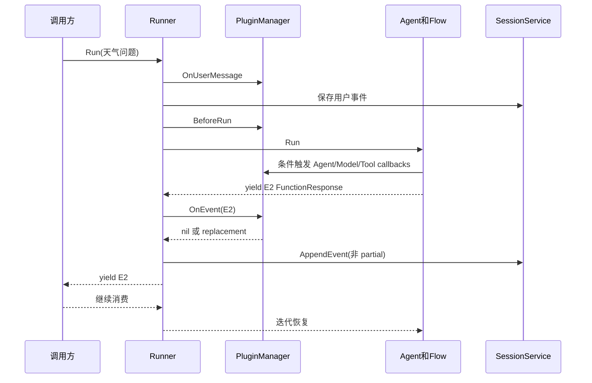
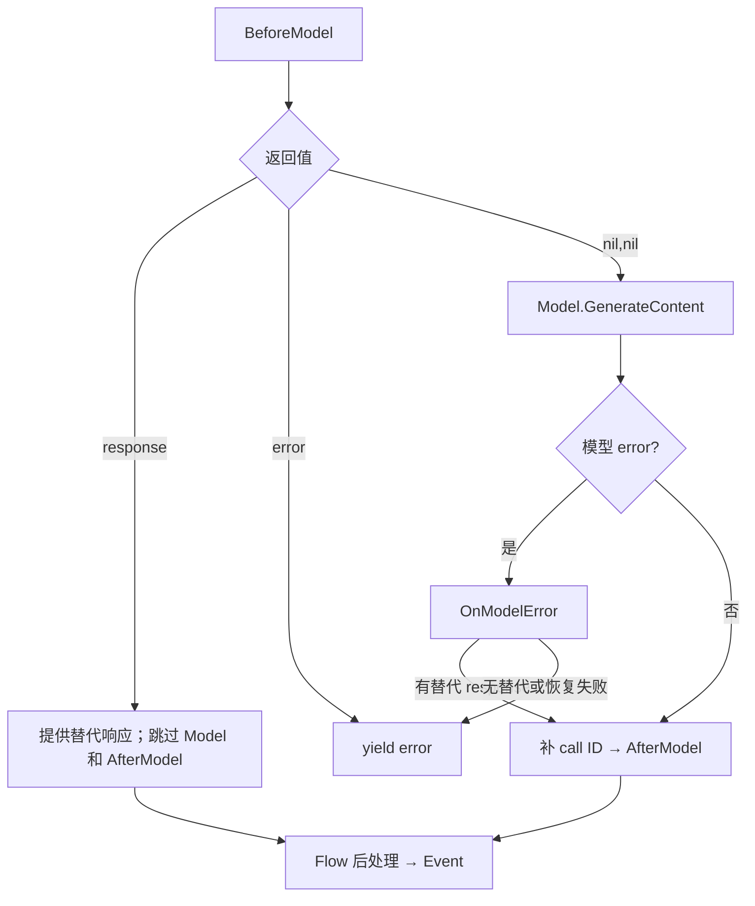

# ADK-Go 源码阅读笔记 · Plugin：理解每一次拦截会跳过什么

> **源码基准：[ADK-Go v2.4.0](https://github.com/google/adk-go/tree/v2.4.0)**，commit `4e57df40cbd35f055ba654b03ffb0e509fdd754a`。以下行为均限定于此版本。
>
> [返回 ADK 源码阅读合集](/blog/adk/) · 配套阅读：[Runner](/blog/adk-runner/)、[Flow](/blog/adk-flow/)、[Context](/blog/adk-context/)、[Tool](/blog/adk-tool/)、[Workflow](/blog/adk-workflow/)。

用户问“东京现在天气怎样”，Agent 调 `get_weather(city="Tokyo")`，模型再生成回答。应用希望同时记录审计日志、复用缓存并限制高风险能力。Plugin 把这些横切逻辑接到 Runner、Agent、Model、Tool 和 Event 的真实调用点上。

回调返回值决定哪些后续步骤会执行。`AfterModel` 不保证在 `BeforeModel` 后出现；`OnEvent` 不保证收到每个曾被写入 Session 的事件；`AfterRun` 也有尚未注册 defer 就返回的分支。

本文让 `audit`、`cache`、`policy` 三个插件按此顺序注册。正常路径先假设所有回调返回 `nil,nil`，然后逐一改变缓存命中、工具错误和事件拒绝条件。

| 术语 | 准确含义 |
| --- | --- |
| Plugin 实例 | Runner 共享的一组 callback 和可选 CloseFunc，可同时服务多个 invocation |
| PluginManager | 内部按注册顺序调度回调的对象 |
| 返回 nil | 保留当前对象并继续同阶段；共享指针仍可能已被原地修改 |
| 返回非 nil | 结束当前阶段的回调链，具体跳过哪些后续步骤由调用方决定 |
| Invocation / FunctionCall / Event ID | 分别标识逻辑运行、一次工具请求、一个历史事件，不能相互替代 |

## 一、源码入口与阅读地图

| 层 | 入口 | 阅读问题 |
| --- | --- | --- |
| 配置 | [`plugin/plugin.go#L28-L80`](https://github.com/google/adk-go/blob/v2.4.0/plugin/plugin.go#L28-L80) | 注册的函数保存在哪里？ |
| 调度 | [`plugin_manager.go#L44-L133`](https://github.com/google/adk-go/blob/v2.4.0/internal/plugininternal/plugin_manager.go#L44-L133) | 顺序、去重、nil 与 error 怎样处理？ |
| Run / Event | [`runner.go#L703-L775`](https://github.com/google/adk-go/blob/v2.4.0/runner/runner.go#L703-L775) | 插件先于持久化还是后于持久化？ |
| Agent | [`agent.go#L163-L211`](https://github.com/google/adk-go/blob/v2.4.0/agent/agent.go#L163-L211) | BeforeAgent 返回内容后还会运行 AfterAgent 吗？ |
| Model / Tool | [`base_flow.go#L815-L999`](https://github.com/google/adk-go/blob/v2.4.0/internal/llminternal/base_flow.go#L815-L999)、[`#L1374-L1465`](https://github.com/google/adk-go/blob/v2.4.0/internal/llminternal/base_flow.go#L1374-L1465) | 两种 before 返回替代结果后分别跳过什么？ |

```text
runner.PluginConfig.Plugins = [audit, cache, policy]
                  │
                  ▼
            PluginManager
                  │ context value（共享实例）
       ┌──────────┼────────────┐
       ▼          ▼            ▼
     Runner      Agent        Flow
   Run/Event   Agent hooks   Model/Tool hooks
       │          │            │
       └──────────┴────────────┘
                  │
       每一个调用点自己决定后续控制流
```

## 二、核心接口与数据结构

### Plugin 与 Agent Callback 的边界

源码：[`runner/runner.go#L113-L161`](https://github.com/google/adk-go/blob/v2.4.0/runner/runner.go#L113-L161)。


#### 1. Plugin 是 Runner 级别的配置

创建 Runner 时传入：

```go
p, err := plugin.New(plugin.Config{
    Name: "audit",
    OnEventCallback: func(
        ctx agent.InvocationContext,
        event *session.Event,
    ) (*session.Event, error) {
        // 观察或返回替代事件。
        return nil, nil
    },
})
if err != nil {
    return nil, err
}

r, err := runner.New(runner.Config{
    AppName:       "my-app",
    Agent:         rootAgent,
    SessionService: sessionService,
    PluginConfig: runner.PluginConfig{
        Plugins: []*plugin.Plugin{p},
    },
})
```

Runner 构造时会把 `runner.PluginConfig` 转成内部的 `plugininternal.PluginConfig`，创建一个 `PluginManager`。之后在普通 `Run`、Node 路径和 Live 路径中，Runner 都会把这个 manager 放到调用上下文里。

#### 2. Agent Callback 是某一个 Agent 的配置

Agent 自身的 callback 位于 `agent.Config`：

```go
agent.Config{
    BeforeAgentCallbacks: []agent.BeforeAgentCallback{
        func(ctx agent.Context) (*genai.Content, error) {
            return nil, nil
        },
    },
    AfterAgentCallbacks: []agent.AfterAgentCallback{
        func(ctx agent.Context) (*genai.Content, error) {
            return nil, nil
        },
    },
}
```

它们只绑定到这个 Agent。子 Agent 有自己的 callback 列表；Plugin 则通过继承的 Go `context.Context` 对整个 Agent tree 生效。

| 维度 | Plugin | Agent Callback |
| --- | --- | --- |
| 注册位置 | `runner.PluginConfig` | `agent.Config` / `llmagent.Config` |
| 作用范围 | 一个 Runner 管理的整条执行流 | 一个 Agent 实例 |
| 传播方式 | `context.Context` value | Agent 结构体字段 |
| 回调顺序 | 先于同阶段的 Agent callback | Plugin 之后执行 |
| 能否改写 | 视 callback 返回值而定 | 可提供替代结果并跳过后续处理 |
| 典型用途 | 审计、策略、全局 telemetry、重试、录制 | Agent 私有逻辑、局部 prompt/工具策略 |

源码中的顺序非常明确：例如 `runBeforeAgentCallbacks` 先调用 PluginManager 的 `RunBeforeAgentCallback`，只有 Plugin 没有返回 content/error 时，才遍历当前 Agent 的 `beforeAgentCallbacks`。


### Plugin 的 12 个生命周期入口

源码：[`plugin/plugin.go#L28-L80`](https://github.com/google/adk-go/blob/v2.4.0/plugin/plugin.go#L28-L80)。


`plugin.Config` 把回调按“执行粒度”分成六组：

| 粒度 | Before / 主体 / After | 回调 | 输入 | 能否替代结果 |
| --- | --- | --- | --- | --- |
| 用户消息 | 消息进入前 | `OnUserMessageCallback` | `InvocationContext`, `*genai.Content` | 可替换消息 |
| 一次 Run | Run 前后 | `BeforeRunCallback` / `AfterRunCallback` | `InvocationContext` | Before 可直接返回 content |
| 一个事件 | 事件产出时 | `OnEventCallback` | `InvocationContext`, `*session.Event` | 可替换事件 |
| 一个 Agent | Agent 前后 | `BeforeAgentCallback` / `AfterAgentCallback` | `agent.Context` | 可返回 content |
| 一次模型调用 | 模型前后/错误 | `BeforeModelCallback` / `AfterModelCallback` / `OnModelErrorCallback` | request/response/error | 可返回替代 response |
| 一次工具调用 | 工具前后/错误 | `BeforeToolCallback` / `AfterToolCallback` / `OnToolErrorCallback` | tool/args/result/error | 可返回替代结果 |

以下是 Config 的源码摘录：

```go
type Config struct {
    Name string

    OnUserMessageCallback OnUserMessageCallback
    OnEventCallback       OnEventCallback

    BeforeRunCallback BeforeRunCallback
    AfterRunCallback  AfterRunCallback

    BeforeAgentCallback agent.BeforeAgentCallback
    AfterAgentCallback  agent.AfterAgentCallback

    BeforeModelCallback  llmagent.BeforeModelCallback
    AfterModelCallback   llmagent.AfterModelCallback
    OnModelErrorCallback llmagent.OnModelErrorCallback

    BeforeToolCallback  llmagent.BeforeToolCallback
    AfterToolCallback   llmagent.AfterToolCallback
    OnToolErrorCallback llmagent.OnToolErrorCallback

    CloseFunc func() error
}
```

`Plugin` 本身只是把这些函数保存起来，并提供 accessor；真正按顺序执行和处理返回值的是 `PluginManager`。


### PluginManager：按注册顺序运行，遇到非 nil 结果就结束本阶段回调

源码：[`internal/plugininternal/plugin_manager.go#L44-L133`](https://github.com/google/adk-go/blob/v2.4.0/internal/plugininternal/plugin_manager.go#L44-L133)。


内部结构很简单：

```go
type PluginManager struct {
    plugins      []*plugin.Plugin
    closeTimeout time.Duration
}
```

#### 1. 插件名称是唯一身份

`NewPluginManager` 按配置顺序调用 `registerPlugin`：

- nil plugin 直接报错；
- `Name()` 重复直接报错；
- 不重复则 append 到 `plugins`。

```text
Plugins: [A, B, C]

执行顺序：A → B → C
```

它不是按类型去重，也不是 map 覆盖。名称为空目前仍然是一个合法字符串，但多个空名称会被判定为重复，因此自定义插件应给出稳定且唯一的名字。

#### 2. 普通 callback 的调度模板

以 BeforeModel 为例，以下为删去注释的源码摘录：

```go
func (pm *PluginManager) RunBeforeModelCallback(
    ctx agent.Context,
    req *model.LLMRequest,
) (*model.LLMResponse, error) {
    for _, p := range pm.plugins {
        callback := p.BeforeModelCallback()
        if callback == nil {
            continue
        }

        response, err := callback(ctx, req)
        if err != nil {
            return nil, err
        }
        if response != nil {
            return response, nil // Early exit
        }
    }
    return nil, nil
}
```

所有可返回结果的阶段基本都是同一个模式：

```text
调用 Plugin A
  ├─ 返回 nil, nil       → 继续 B
  ├─ 返回 result, nil     → 停止当前阶段；外层决定怎样使用 result
  └─ 返回 nil, err        → 停止，错误向上返回
```

所以 Plugin callback 的返回值不是“附加信息”，而是协议的一部分。

#### 3. 多个 Plugin 不是 middleware 叠加链

很多人会下意识地把 Plugin 想成 HTTP middleware：每个插件都能包住下一个插件，最后再反向返回。但 ADK-Go 当前实现不是这样。

例如 A 的 BeforeTool callback 返回一个非 nil map：

- B 的 BeforeTool 不会运行；
- 当前 Agent 的 BeforeTool callbacks 也不会运行；
- 真实 `tool.Run` 不会运行；
- 这个 map 会被当成工具结果继续走后续的 error/after 处理。

这是一种“首个非空结果获胜”的 callback chain，而不是所有插件都必然收到同一个阶段。


### Plugin 如何挂进 Context

源码：[`internal/plugininternal/plugin_manager.go#L273-L289`](https://github.com/google/adk-go/blob/v2.4.0/internal/plugininternal/plugin_manager.go#L273-L289)。


Runner 创建 `InvocationContext` 后，会将 PluginManager 放入 Go context：

```go
func ToContext(ctx context.Context, pm *PluginManager) context.Context {
    return context.WithValue(
        ctx,
        plugincontext.PluginManagerCtxKey,
        pm,
    )
}
```

Runner 的普通路径、Node 路径和 Live 路径都会做这件事。之后 Agent、LLM Flow 只需要从 `ctx.Value` 取出一个满足所需方法的对象。

#### 1. 为什么没有公开的 `FromContext`

`agent` 包只需要：

```go
type pluginManager interface {
    RunBeforeAgentCallback(agent.Context) (*genai.Content, error)
    RunAfterAgentCallback(agent.Context) (*genai.Content, error)
}
```

`llminternal` 只需要模型和工具相关的六个方法，下面是省略签名的结构示意：

```go
type pluginManager interface {
    RunBeforeModelCallback(...)
    RunAfterModelCallback(...)
    RunOnModelErrorCallback(...)
    RunBeforeToolCallback(...)
    RunAfterToolCallback(...)
    RunOnToolErrorCallback(...)
}
```

这是 Go 的结构化接口技巧：调用方在本包里声明“我需要的方法集合”，而不是反向依赖具体的 `PluginManager` 类型。这样既避免 import cycle，也让每个层只知道自己需要的能力。

Context 里保存具体 manager，每个执行层只通过自己的局部能力接口使用它。

#### 2. Context 中的 PluginManager 是共享的

Agent 运行时会不断从父 InvocationContext 派生子 context，但 PluginManager 存在于底层 Go context value 中，因此不会因为进入子 Agent、模型 callback 或工具 callback 就丢失。

这就是 Plugin 能覆盖所有子 Agent 和每个工具调用的原因；它不是把 callback 列表复制到每个 Agent 上，而是让同一个 manager 随 context 传播。


### Callback Context：为什么 Plugin 拿到的不是完整 Context

源码：[`agent/tool_context_wrapper.go#L144-L169`](https://github.com/google/adk-go/blob/v2.4.0/agent/tool_context_wrapper.go#L144-L169)。


Agent 和模型 callback 通过 CallbackContext 运行；普通工具 callback 直接收到该次 FunctionCall 的 ToolContext。二者参数都写作 `agent.Context`，实际支持的方法不同，必须追踪构造者。

#### 1. callback context 共享 delta

模型回调通过：

```go
icontext.NewCallbackContextWithDelta(
    ctx,
    stateDelta,
    artifactDelta,
)
```

创建 context。工具 callback 使用工具自己的 `EventActions`。

这意味着 callback 中通过 `ctx.State().Set(...)` 写入的值，会落到当前即将生成的 Event 的 `StateDelta`；通过 `ctx.Artifacts().Save(...)` 保存 artifact，也会跟踪版本到 `ArtifactDelta`。

例如 `functioncallmodifier` 的 AfterModel callback 会把被剥离的参数存到：

```go
stateKey := fmt.Sprintf("%s/%s", fc.ID, name)
ctx.State().Set(stateKey, arg)
```

这不是写一个与事件无关的全局 map，而是写入当前 callback 的 delta。

#### 2. callback wrapper 会拒绝不适用的调用

以下方法在 callback context 上会记录“不支持”并返回空值或 error：

- `Actions()`；
- `RequestConfirmation()`；
- `ToolConfirmation()`；
- `SearchMemory()`；
- `InvocationContext()`；
- `Agent()`；
- `EndInvocation()`；
- `WithAgentCancel()` / `WithAgentTimeout()`；
- `Session()`、`RunConfig()`、`ResumedInput()` 等节点/恢复能力。

上述限制只适用于 CallbackContext。普通 Tool callbacks 接收的 ToolContext 支持 `Actions()`、`FunctionCallID()`、`ToolConfirmation()`、`RequestConfirmation()`，但仍不等于完整 Invocation。Agent/Model callback 可以通过 State、Artifacts、UserContent、AgentName、InvocationID 使用该阶段能力。

#### 3. Agent callback 的 actions 如何落库

Agent callback 通过 `NewCallbackContext(ctx, actions)` 共享一个 `EventActions`。如果 callback 返回 content，框架会把 actions 拷贝到新 event。

框架会清除 `Actions.Compaction`：

```go
func eventActionsFrom(actions *session.EventActions) session.EventActions {
    out := *actions
    out.Compaction = nil
    return out
}
```

这是有意的边界：compaction record 是框架决定的历史压缩元数据，不应该由普通 callback 伪造。


## 三、主执行、数据与事件流

### 一次普通 Run 的完整顺序

源码：[`runner/runner.go#L703-L775`](https://github.com/google/adk-go/blob/v2.4.0/runner/runner.go#L703-L775)。


以 `runner.Run` 的普通 Agent 路径为例：

```text
Runner.Run
  │
  ├─ 创建 / 读取 Session
  ├─ 创建 InvocationContext
  ├─ plugininternal.ToContext
  ├─ appendMessageToSession
  │    └─ OnUserMessageCallback
  │         └─ 可替换要写入 Session 的用户消息
  ├─ BeforeRunCallback
  │    └─ 可提前返回一个 event，跳过 Agent
  ├─ rootAgent.Run
  │    ├─ BeforeAgentCallback
  │    │    └─ Plugin → Agent callbacks
  │    ├─ Agent 主体
  │    │    └─ LLM Flow / Workflow / 子 Agent
  │    └─ AfterAgentCallback
  ├─ 对 Agent yield 的每个 event 执行 OnEventCallback
  ├─ 持久化非 partial event
  ├─ yield 给调用方
  └─ AfterRunCallback
```

注意 `OnEventCallback` 的位置：它在 Runner 收到 Agent event 后、Session Service 持久化前执行。也就是说它处在“事件出厂前”的位置。

#### BeforeRun 的早退

`BeforeRunCallback` 可以返回一个 `*genai.Content`：

```go
BeforeRunCallback: func(ctx agent.InvocationContext) (*genai.Content, error) {
    if isMaintenanceWindow(ctx) {
        return genai.NewContentFromText(
            "服务正在维护，请稍后再试。",
            genai.RoleModel,
        ), nil
    }
    return nil, nil
},
```

源码语义是：返回非 nil content 或 error 就触发 early exit。不过当前 `Runner.Run` / `run_node.go` 的 early-exit 分支会把**原始用户消息 `msg`** 放进新 event，而不是把 `earlyExitResult` 放进 event；`earlyExitResult` 主要承担“是否早退”的信号作用。这是阅读当前实现时必须注意的行为，不能只按 `BeforeRunCallback` 的注释把它当成最终回答接口。

如果 callback 返回 error，Runner 会把 error 一并 yield 出去；原始用户消息也会被保留下来。若需要稳定地产生一条自定义 Agent 输出，更适合使用 `BeforeAgentCallback`，因为该路径确实把 callback 返回的 content 写进新 event。

#### AfterRun 不产生 event

`AfterRunCallback` 的类型是：

```go
type AfterRunCallback func(agent.InvocationContext)
```

它没有返回 content 或 error，因此不能替换最终回答，也不能再生成一个事件。它适合：

- 关闭本次 run 的计时器；
- flush 指标；
- 记录 invocation 完成状态；
- 释放临时资源。

普通 Agent 和 Node 路径在 BeforeRun 前注册 defer；只有执行到此处，后续正常结束、早退和错误才会运行 AfterRun。此前的读取 Session、OnUserMessage 错误或可选用户事件 yield 返回 false 都可能尚未注册。Live 的 defer 则在成功建立 innerIter 后的包装迭代器中；BeforeRun 早退或 RunLive 建立失败不会进入它。


### Agent 级 callback：每个 Agent 都有一套

源码：[`agent/agent.go#L163-L211`](https://github.com/google/adk-go/blob/v2.4.0/agent/agent.go#L163-L211)。


`agent.Run` 的核心结构是：

```text
创建当前 Agent 的 node context
        │
        ▼
Plugin BeforeAgent
        │ 若无结果
        ▼
当前 Agent 的 BeforeAgentCallbacks
        │ 若无结果
        ▼
Agent 主体 Run
        │
        ▼
Plugin AfterAgent
        │ 若无结果
        ▼
当前 Agent 的 AfterAgentCallbacks
```

#### BeforeAgent 的返回值会跳过 Agent 主体

如果 Plugin 或 Agent 自己的 BeforeAgent callback 返回 content：

1. 创建一个由当前 Agent authored 的 event；
2. 把 callback 的 content 放进 event；
3. 把 callback context 积累的 actions 复制到 event；
4. 调用 `ctx.EndInvocation()`；
5. 不进入当前 Agent 的主体 `Run`。

因此它可以实现权限拒绝、缓存命中和静态答案。`Ended()` 在主体前和主体后都检查，所以 before 提前结束、主体结束 invocation、消费者停止都可能跳过 AfterAgent；它不是 defer 清理钩子。

这里有一个容易忽略的顺序：Plugin 的 BeforeAgent 返回结果后，当前 Agent 的 callback 不会执行；当前 Agent callback 返回结果后，后面的 callback 和 Agent 主体也不会执行。

#### AfterAgent 可以追加 event，但不会结束 invocation

AfterAgent callback 返回 content 时，框架会创建一个新的 event。它不会再次执行 Agent 主体，也不会在这个阶段调用 `EndInvocation`。源码特意保留了这个语义：AfterAgent 已经是当前 Agent Run 的最后一步，设置 ended flag 不会影响之后的主体循环。

这类 event 适合做：

- 给 Agent 输出加统一尾注；
- 生成审计说明；
- 把内部结果变成用户可见文本；
- 通过 `StateDelta` 写入完成标记。


### 模型回调：Plugin 可以改 request，也可以伪造 response

源码：[`internal/llminternal/base_flow.go#L815-L999`](https://github.com/google/adk-go/blob/v2.4.0/internal/llminternal/base_flow.go#L815-L999)。


LLM Flow 的 `callLLM` 在真正调用模型前，先运行：

```text
Plugin.BeforeModelCallbacks
        │ 无 response/error
        ▼
Agent.BeforeModelCallbacks
        │ 无 response/error
        ▼
真正的 model.GenerateContent
        │
        ├─ 发生 error
        │    └─ Plugin.OnModelError → Agent.OnModelError
        │
        └─ 得到 response
             │
             ▼
        Plugin.AfterModel
             │ 无替代 response/error
             ▼
        Agent.AfterModel
             │
             ▼
        返回 Flow
```

#### BeforeModel 的两个用途

##### 1. 修改请求

这是最常见的用途：

```go
BeforeModelCallback: func(
    ctx agent.Context,
    req *model.LLMRequest,
) (*model.LLMResponse, error) {
    if req.Config == nil {
        req.Config = &genai.GenerateContentConfig{}
    }
    req.Config.SystemInstruction = genai.NewContentFromText(
        "请优先使用内部知识库。",
        genai.RoleUser,
    )
    return nil, nil
},
```

因为 callback 收到的是最终准备送往模型的 request，所以它可以改：

- `Contents`；
- system instruction；
- model 参数；
- tools 和 function declarations；
- labels 或其他 GenerateContent 配置。

##### 2. 直接返回模型响应

```go
BeforeModelCallback: func(
    ctx agent.Context,
    req *model.LLMRequest,
) (*model.LLMResponse, error) {
    if cached, ok := cache.Get(hashRequest(req)); ok {
        return cached, nil
    }
    return nil, nil
},
```

非 nil response 会直接 yield 并退出 `callLLM`，不仅跳过真实模型，也跳过 OnModelError 和 AfterModel。返回 error 也沿这个早退分支传播；OnModelError 只处理进入真实模型迭代后出现的错误。这样可以实现录制回放、缓存和测试替身，但不能假设缓存命中仍会触发 AfterModel。

#### AfterModel 可以改写模型输出

`AfterModelCallback` 接收 response 和 error：

```go
AfterModelCallback: func(
    ctx agent.Context,
    response *model.LLMResponse,
    responseErr error,
) (*model.LLMResponse, error) {
    if responseErr != nil {
        return nil, responseErr
    }
    normalizeFunctionCalls(response)
    return response, nil
},
```

只要返回非 nil response，Flow 就使用它继续后续的 FunctionCall 处理；如果返回 nil、nil，则保留原始 response。

在真实模型输出或 OnModelError 恢复路径上，ADK-Go 在 AfterModel 前补 FunctionCall ID。但 BeforeModel 返回的替代响应跳过这个位置；替代响应提供方应明确维护自己的 FunctionCall ID。

#### OnModelError 是恢复点，不只是日志点

模型调用失败时，Flow 先尝试 Plugin 的 `OnModelErrorCallback`，然后是 Agent 的 error callback。

- callback 返回 replacement response：Flow 用它继续；
- callback 返回 nil、nil：原始模型错误继续向上；
- callback 返回 error：恢复失败，使用新错误。

因此可以实现 fallback model、有限重试、降级回答和“把错误转成模型可处理的 response”。


### 工具回调：返回值不是新参数，而是工具结果

源码：[`internal/llminternal/base_flow.go#L1374-L1465`](https://github.com/google/adk-go/blob/v2.4.0/internal/llminternal/base_flow.go#L1374-L1465)。


工具 callback 的类型很容易产生误读：

```go
type BeforeToolCallback func(
    ctx agent.Context,
    tool tool.Tool,
    args map[string]any,
) (map[string]any, error)
```

虽然内部 manager 的局部变量有时叫 `newArgs`，但在 `base_flow.go` 的调用方里，它被接收为 `response`：

```go
response, err = pluginManager.RunBeforeToolCallback(
    toolCtx,
    tool,
    fArgs,
)

if response == nil && err == nil {
    response, err = tool.Run(toolCtx, fArgs)
}
```

所以 `BeforeToolCallback` 返回 map 的含义是：**直接提供工具结果，跳过真实的 `tool.Run`**，不是修改后再把新 args 传给工具。

#### 普通 FunctionTool 的条件执行链

```text
Plugin.BeforeTool
      │ 返回 nil,nil
      ▼
Agent.BeforeTool callbacks
      │ 返回 nil,nil
      ▼
tool.Run
      │ error
      ▼
Plugin.OnToolError
      │ 返回 nil,nil
      ▼
Agent.OnToolError callbacks
      │
      ▼
Plugin.AfterTool
      │ 返回 nil,nil
      ▼
Agent.AfterTool callbacks
      │
      ▼
最终 FunctionResponse
```

以下示例均限定普通 FunctionTool；StreamingFunctionTool 在 `handleFunctionCalls` 中直接进入 RunStream，不走这套 callTool 回调链。

如果 Plugin 的 BeforeTool 返回：

```go
return map[string]any{
    "result": "cache hit",
}, nil
```

那么真实工具不会执行，但这个 map 会继续进入 AfterTool 阶段，并最终成为 FunctionResponse 的 response。

#### OnToolError 可以把错误变成成功结果

```go
OnToolErrorCallback: func(
    ctx agent.Context,
    t tool.Tool,
    args map[string]any,
    err error,
) (map[string]any, error) {
    return map[string]any{
        "retryable": true,
        "message":   "temporary backend failure",
    }, nil
},
```

此时 `callTool` 会把 `response` 设置成该 map，并把 `err` 清掉。后续 AfterTool 看到的是一个没有 Go error 的结果。

但要注意：把 error 转成成功结果不会撤销工具已经发生的外部副作用。Plugin 的恢复策略必须区分“工具根本没有成功执行”和“工具已经执行但响应丢失”。


### OnEvent：Agent 输出进入持久化前的改写机会

源码：[`runner/runner.go#L748-L774`](https://github.com/google/adk-go/blob/v2.4.0/runner/runner.go#L748-L774)。


`OnEventCallback` 的签名是：

```go
type OnEventCallback func(
    agent.InvocationContext,
    *session.Event,
) (*session.Event, error)
```

Runner 收到 Agent 或 Workflow 产出的 event 后，先调用 PluginManager：

```go
modifiedEvent, err := pluginManager.RunOnEventCallback(ctx, event)
if err != nil {
    if !yield(nil, err) { return }
    continue
}

event = fromPlugin(event, modifiedEvent, record)

if !event.LLMResponse.Partial {
    sessionService.AppendEvent(ctx, storedSession, event)
}
yield(event, nil)
```

并非每次 AppendEvent 都调用 OnEvent：初始用户消息经 OnUserMessage 后直接保存；BeforeRun 提前返回的事件也由专门分支直接保存。普通 Agent/Node 的成功输出事件经过 OnEvent；已携带 Go error 的迭代结果则由 Runner 直接转发。

#### 1. nil 返回意味着保留原事件

```go
return nil, nil
```

表示不替换，Runner 继续使用原指针。Plugin 仍然可以原地修改 event，但这会直接改变即将持久化的对象。

#### 2. 返回新事件会改变落库内容

```go
OnEventCallback: func(
    ctx agent.InvocationContext,
    event *session.Event,
) (*session.Event, error) {
    clone := *event
    clone.Author = "redacted-agent"
    return &clone, nil
},
```

新事件会被后续 Session Service 持久化，并被调用方 yield。它不是只对日志输出生效。

#### 3. 不能在 OnEvent 中伪造 compaction record

Runner 会先保存原 event 的 `Actions.Compaction`，调用 Plugin 后，再通过 `fromPlugin` 把框架决定的 compaction record 恢复到最终 event 上。

这样即使 Plugin：

- 原地修改了 `event.Actions.Compaction`；
- 返回了一个带自定义 compaction 的新 event；
- 返回原指针；

最终落库的 compaction 元数据仍以框架原本决定的值为准。

Plugin 可以做脱敏和事件改写，但不能伪造 Actions.Compaction来植入未经框架确认的历史压缩范围。

#### 4. Partial event 也会经过 OnEvent

Runner 在判断是否持久化前才检查 `LLMResponse.Partial`，所以 partial event 仍然可以被 Plugin 观察、修改和 yield，只是普通路径不会把它追加到 Session Service。

这对流式 telemetry 很重要：如果只观察落库事件，就会漏掉 partial response；如果要记录完整 token 流，应在 OnEvent 或 model callback 中处理。


### 同一组对象如何经过完整的天气查询

以下是对象快照示意，省略 schema、时间戳等字段。假设 Agent 名 `weather_agent`，逻辑运行 ID 为 `inv-1`。

```text
OnUserMessage:
  msg="东京现在天气怎样" → normalizedMsg="查询东京天气"
  InvocationContext.UserContent = normalizedMsg
  user event E0.Content = normalizedMsg → AppendEvent

BeforeModel（第一次）:
  request.Contents = [E0]；request.Tools[get_weather] = handler
  audit/cache/policy 均 nil,nil → 真正调用模型
AfterModel:
  response.FunctionCall = {ID: call-weather-1, name: get_weather}
OnEvent:
  E1 = model FunctionCall → 持久化 → yield

BeforeTool / Run / AfterTool:
  args={city:Tokyo} → result={temperature_c:22,condition:sunny}
OnEvent:
  E2 = FunctionResponse(ID:call-weather-1, Author:weather_agent, Role:user)
  → 持久化 → yield

BeforeModel（第二次）:
  request.Contents = [E0,E1,E2] → Model 返回自然语言
OnEvent:
  E3 = "东京晴，22°C" → 持久化 → yield
AfterAgent → AfterRun
```

这不是插件负责保存 E0–E3：插件获得改写机会，Runner 和 Session Service 才执行保存。模型第二次看到工具结果，依赖 E2 沿事件迭代器返回外层并被保存后，再恢复 Flow；不能把一段 OnEvent 日志当作已成功落库的证据。



## 四、关键细节与分支

### 普通 Run、Workflow 和 Live 的差异

源码：[`runner/runner.go#L903-L984`](https://github.com/google/adk-go/blob/v2.4.0/runner/runner.go#L903-L984)。


PluginManager 并不只服务 LlmAgent。

#### 1. 普通 Agent 路径

普通 `Runner.Run` 的事件处理是：

```text
Agent.Run yield event
  → OnEvent
  → 非 partial 才 AppendEvent
  → yield 给调用方
```

#### 2. Workflow / Node 路径

`runner/run_node.go` 为 Workflow 构造 invocation context，并在工作流事件流上执行同样的 OnEvent 处理。Workflow 的 Node event、HITL interrupt、恢复产生的 event 也会经过 Plugin。

BeforeRun 和 AfterRun 也在 node invocation 周围执行，因此一个 Plugin 可以同时观察 LLM Agent 和非 LLM Workflow。

#### 3. Live 路径

`RunLive` 将 PluginManager 放进 Live invocation context，并在包装 `innerIter` 时执行：

- `OnEventCallback`；
- non-partial event 的落库；
- partial event 的 yield；
- after-run cleanup。

Live 路径还有转录和工具事件的排序缓冲逻辑，所以 Plugin 看到的是 Runner 包装后的事件流，而不是底层连接刚收到的每一帧原始数据。

Live run 没有普通 `Run` 的初始 user message 参数，`iCtx.UserContent` 为空；通过 `runnerLiveSession.Send` 发送的用户内容会保存到 Session，但该路径不是标准 `appendMessageToSession` 的同一入口。


### 插件生命周期与资源释放

源码：[`internal/plugininternal/plugin_manager.go#L273-L285`](https://github.com/google/adk-go/blob/v2.4.0/internal/plugininternal/plugin_manager.go#L273-L285)。


`plugin.Config` 提供：

```go
CloseFunc func() error
```

`plugin.New` 会把 nil CloseFunc 替换成一个返回 nil 的函数，因此 `Plugin.Close()` 本身不会因为 nil function panic。

`PluginManager.Close()` 会按注册顺序调用每个 Plugin 的 Close，并收集错误：

```text
Close A
Close B
Close C

如果有错误：
failed to close plugins: [error closing plugin 'A': ...]
```

但这里要区分配置字段和实际调用：当前 `PluginManager` 虽然保存了 `closeTimeout`，`Close()` 的实现并没有使用这个 timeout；它只是同步调用每个 `Plugin.Close()`。同时，Runner 没有在 Run 的结束路径自动调用 `pluginManager.Close()`。

因此不要仅凭 `PluginConfig.CloseTimeout` 就认为资源一定会在超时后关闭。使用带后台 goroutine、网络 client、批处理队列的 Plugin 时，应明确设计宿主应用的关闭流程，并在宿主侧确保 CloseFunc 被真正触发。

#### Agent Analytics 的 CloseFunc

BigQuery analytics plugin 是一个很好的资源管理例子：

```go
CloseFunc: func() error {
    processor.Close()
    if err := writeClient.Close(); err != nil {
        return fmt.Errorf(
            "failed to close BigQuery write client: %w",
            err,
        )
    }
    return nil
},
```

它的 `BatchProcessor.Close()` 会 cancel 后台处理 context，并等待 `done` channel，确保队列中的数据有机会 flush。宿主仍需实际调用关闭函数，远端写入失败也可能导致遥测丢失。


### 内置插件一：Logging Plugin

源码：[`plugin/loggingplugin/logging_plugin.go#L47-L66`](https://github.com/google/adk-go/blob/v2.4.0/plugin/loggingplugin/logging_plugin.go#L47-L66)。


`loggingplugin.New` 一次性填充了 12 个 callback，是理解生命周期的具体示例。

它记录：

- 用户消息、Invocation ID、Session、User、App；
- BeforeRun / AfterRun；
- Agent 开始和结束；
- 模型请求、模型名、system instruction、可用工具；
- 模型 response、partial、turn complete、token usage；
- 模型错误；
- 工具开始、参数、FunctionCall ID；
- 工具结果和工具错误；
- 每个 event、作者、是否 final、FunctionCall、FunctionResponse、长任务 ID。

有返回值的 callback 均返回 nil,nil；AfterRun 没有返回值。这组实现只记录内容：

```text
观察，不改变控制流

BeforeModel  → 记录 request → nil,nil → 真的调用模型
BeforeTool   → 记录 args    → nil,nil → 真的执行工具
OnEvent      → 记录 event   → nil,nil → 原 event 落库
```

#### 日志 Plugin 的安全问题

源码中的日志会打印工具参数和部分模型内容。生产环境中不能直接照搬：

- 工具参数可能含 token、密码或个人数据；
- FunctionResponse 可能含文件内容；
- system instruction 可能包含内部策略；
- `formatArgs` 的截断不是脱敏；
- ANSI 终端输出不等于结构化审计日志。

Logging Plugin 更像开发期 tracing 示例，生产审计应建立字段级 allowlist 和隐私策略。


### 内置插件二：FunctionCallModifier

源码：[`plugin/functioncallmodifier/plugin.go#L54-L121`](https://github.com/google/adk-go/blob/v2.4.0/plugin/functioncallmodifier/plugin.go#L54-L121)。


`functioncallmodifier` 是一个典型的“模型边界双向转换器”：

#### BeforeModel：给模型的声明增加参数

配置包括：

```go
type FunctionCallModifierConfig struct {
    Predicate           func(toolName string) bool
    Args                map[string]*genai.Schema
    OverrideDescription func(originalDescription string) string
}
```

BeforeModel 遍历 `req.Config.Tools` 中的 FunctionDeclaration，只处理：

1. 通过 `Predicate` 的工具；
2. 同时存在于 `req.Tools` 的本地工具。

然后把额外参数写入 declaration.Parameters.Properties，并可重写描述。这里操作的是 genai.Schema 的 Parameters 字段，不是通用合并 ParametersJsonSchema；若工具声明使用另一种 schema 表示，需要结合所用模型适配器理解转换结果。

这两个条件很重要：它不会修改模型原生工具，也不会修改一个只存在于声明里、但本地没有执行实现的函数。

#### AfterModel：从 FunctionCall 中剥离参数并写入 state

模型返回 FunctionCall 后，AfterModel：

1. 找到目标 FunctionCall；
2. 删除配置中指定的参数；
3. 用 `functionCallID/argumentName` 生成 state key；
4. 用 `ctx.State().Set` 记录原参数；
5. 返回 nil、nil，让修改后的 response 继续 Flow。

结果是：模型调用工具时看到额外参数，但真正的工具 handler 只收到原始参数；额外信息通过 Session State 另行传递。

这是一种“在模型协议和业务工具协议之间增加适配层”的 Plugin 设计，而不是普通日志钩子。


### 内置插件三：RetryAndReflect

源码：[`plugin/retryandreflect/plugin.go#L128-L200`](https://github.com/google/adk-go/blob/v2.4.0/plugin/retryandreflect/plugin.go#L128-L200)。


`retryandreflect` 只注册：

```go
AfterToolCallback
OnToolErrorCallback
```

它维护：

```go
scopedFailureCounters map[string]map[string]int
```

并用 mutex 保护并发访问。

#### 1. 错误时返回反思 response

工具失败后，OnToolError 根据：

- 工具名；
- 参数；
- error 类型和信息；
- 当前失败次数；
- 最大 retry 次数；
- 计数 scope；

生成一个特殊结果，告诉模型应该反思工具调用并重试。

#### 2. 成功时重置失败计数

AfterTool 在 `err == nil` 时清理该工具的失败计数。但如果 OnToolError 刚刚返回的是 reflection response，它不会把这个“反思消息”误认为业务成功并清零计数。

#### 3. 两种计数 scope

```go
type TrackingScope string

const (
    Invocation TrackingScope = "invocation"
    Global     TrackingScope = "global"
)
```

- `Invocation`：按 `ctx.InvocationID()` 隔离，默认适合单次任务自愈；
- `Global`：所有用户和 turn 共用，可能导致一个用户的失败影响另一个用户。

#### 4. 确认错误不会触发自动重试

源码明确跳过：

```go
if errors.Is(err, tool.ErrConfirmationRequired) ||
   errors.Is(err, tool.ErrConfirmationRejected) {
    return nil, nil
}
```

这很重要：人工拒绝不是工具故障，不能把“用户拒绝”反思成“请再调用一次”。


### 内置插件四：Agent Analytics

源码：[`plugin/agentanalytics/batch_processor.go#L76-L117`](https://github.com/google/adk-go/blob/v2.4.0/plugin/agentanalytics/batch_processor.go#L76-L117)。

这里有一个版本边界：`plugin/agentanalytics` 在源码树中是独立 nested module，自己的 [`go.mod`](https://github.com/google/adk-go/blob/v2.4.0/plugin/agentanalytics/go.mod) 声明 module path `google.golang.org/adk/plugin/agentanalytics`，并依赖 `google.golang.org/adk/v2 v2.0.0`。因此本文可以用它说明 Plugin 生命周期，但不能把它的依赖版本当成根模块 `v2.4.0` 的同一发布单元。


BigQuery analytics plugin 展示了 Plugin 作为事件遥测管线的完整形态：

```text
OnUserMessage / BeforeRun
BeforeAgent / AfterAgent
BeforeModel / AfterModel / OnModelError
BeforeTool / AfterTool / OnToolError
OnEvent
        │
        ▼
整理成 map[string]any
        │
        ▼
BatchProcessor queue
        │
        ▼
Arrow RecordBatch
        │
        ▼
BigQuery Storage Write API
```

它不是每次 callback 立刻写 BigQuery，而是将事件放入有界 channel：

- 达到 batch size 时异步 flush；
- 定时 flush；
- 队列满时丢弃并记录 warning；
- Close 时 cancel 后台 goroutine 并 flush 剩余队列。

这说明一个实践原则：Plugin callback 在 Agent 执行过程中同步运行。异步遥测可减少远端网络延迟对执行的阻塞；是否允许丢弃和延迟，需要由产品对审计完整性的要求决定。

但异步 telemetry 有自己的语义：

- callback 返回 nil 不代表数据已经写入远端；
- 队列满时事件可能丢失；
- 进程异常退出时未 flush 的数据会丢失；
- close 过程必须真正被调用。


### 如何写一个全局策略 Plugin

源码：[`internal/llminternal/base_flow.go#L1374-L1418`](https://github.com/google/adk-go/blob/v2.4.0/internal/llminternal/base_flow.go#L1374-L1418)。


下面是一个“禁止高风险工具直接执行”的例子：

```go
riskPlugin, err := plugin.New(plugin.Config{
    Name: "risk-policy",

    BeforeToolCallback: func(
        ctx agent.Context,
        t tool.Tool,
        args map[string]any,
    ) (map[string]any, error) {
        if t.Name() != "delete_file" {
            return nil, nil
        }

        if approved, err := ctx.State().Get("delete_approved"); err != nil || approved != true {
            return map[string]any{
                "error": "delete_file requires approval",
            }, nil
        }

        return nil, nil
    },
})
```

这个实现的语义是：

- 目标工具不是 `delete_file`：继续后面的 Plugin、Agent callback 和真实工具；
- 没有批准：返回一个替代结果，真实工具不会运行；
- 已批准：返回 nil、nil，让真实工具继续。

普通 BeforeTool 收到 ToolContext，可以调用 RequestConfirmation；但还要设置合适的控制动作、跳过真实工具、在恢复时读取 ToolConfirmation，不能只调用一次方法就假设自动完成全部协议。固定工具确认优先使用 FunctionTool 的 RequireConfirmation/provider；Agent/Model CallbackContext 才是明确不支持 RequestConfirmation 的上下文。


### 如何写一个模型缓存 Plugin

源码：[`internal/llminternal/base_flow.go#L815-L835`](https://github.com/google/adk-go/blob/v2.4.0/internal/llminternal/base_flow.go#L815-L835)。


模型缓存适合放在 BeforeModel。下面为配置示意，cache、requestKey 是应用提供的辅助对象/函数，并非 ADK API：

```go
cachePlugin, err := plugin.New(plugin.Config{
    Name: "llm-cache",

    BeforeModelCallback: func(
        ctx agent.Context,
        req *model.LLMRequest,
    ) (*model.LLMResponse, error) {
        key, err := requestKey(req)
        if err != nil {
            return nil, err
        }

        if response, ok := cache.Load(key); ok {
            return response, nil
        }
        return nil, nil
    },

    AfterModelCallback: func(
        ctx agent.Context,
        response *model.LLMResponse,
        responseErr error,
    ) (*model.LLMResponse, error) {
        if responseErr == nil && response != nil {
            // 真实代码中应将 key 与 response 关联保存。
            cache.Store(response)
        }
        return nil, nil
    },
})
```

设计时要注意：

- request key 必须包含 model、tools、system instruction 和相关 generation config；
- 流式 response 不能只缓存单个 partial chunk；
- 含用户隐私和时间敏感数据的请求不应无条件缓存；
- 缓存命中返回的 response 仍会经过 Flow 的后处理和 FunctionCall 处理。


### 多个 Plugin 的组合规则

源码：[`internal/plugininternal/plugin_manager.go#L110-L133`](https://github.com/google/adk-go/blob/v2.4.0/internal/plugininternal/plugin_manager.go#L110-L133)。


假设注册了三个 Plugin：

```go
Plugins: []*plugin.Plugin{audit, cache, policy}
```

#### BeforeModel

```text
audit.BeforeModel
  ├─ 返回 response → cache/policy 不运行，模型不调用
  └─ nil
      ▼
cache.BeforeModel
  ├─ 返回 cache → policy 不运行，模型不调用
  └─ nil
      ▼
policy.BeforeModel
  └─ nil → Agent BeforeModel → 模型
```

#### AfterModel

```text
模型返回
  ▼
audit.AfterModel
  ├─ 返回 replacement → 后续 Plugin 和 Agent AfterModel 跳过
  └─ nil
      ▼
cache.AfterModel
      ▼
policy.AfterModel
      ▼
Flow 后续处理
```

#### AfterRun

AfterRun 没有返回值和 error，因此三个 Plugin 都会按注册顺序收到通知。

#### OnEvent

第一个返回 replacement event 的 Plugin 会阻止后面的 OnEvent Plugin 继续处理同一个 event。因此如果既有脱敏 Plugin 又有审计 Plugin，必须明确谁先运行，以及审计应该记录脱敏前还是脱敏后的内容。

Plugin 没有优先级字段，顺序由 `runner.PluginConfig.Plugins` 决定；把顺序当成 API 设计的一部分。


### 错误、取消与恢复矩阵

| 条件 | 实际行为 | 天气示例的结果 |
| --- | --- | --- |
| OnUserMessage error | appendMessageToSession 返回错误，尚未进入 BeforeRun defer | 用户事件未完成追加，Agent 不运行 |
| BeforeModel 返回缓存 response | `callLLM` 直接 yield 并 return | 跳过真实 Model、OnModelError 和 AfterModel，Flow 仍可执行缓存中的 FunctionCall |
| 真正 Model error，OnModelError 给 replacement | 接着补 FunctionCall ID 并运行 AfterModel | 降级结果沿正常事件管线继续 |
| BeforeTool 返回缓存 map | 跳过真实 Run，仍进入 AfterTool | audit.AfterTool 可看到缓存结果 |
| OnEvent error | Runner yield error 后 continue | 该事件不保存、不向用户 yield；后续事件是否继续取决于消费者和生产者 |
| 消费者 yield 返回 false | 当前迭代停止；已注册 defer 执行 | 不再有后续正常事件，不能假设 AfterAgent 必跑 |
| 进程退出前未调用 Close | PluginManager 不自动替宿主清理 | 队列里 telemetry 可能未 flush |

`OnEvent` 的错误尤其需要小心：[`runner.go#L754-L769`](https://github.com/google/adk-go/blob/v2.4.0/runner/runner.go#L754-L769) 没有对该事件重试，而是跳过它。若 E2 的 FunctionResponse 被跳过，后续模型历史就可能缺少天气结果；如果 E2 同时带 StateDelta，该 delta 也不会经此路径保存。

OnEvent 既是输出过滤点，也是历史写入前的控制点；过滤失败可能让后续执行缺少刚产生的信息。



## 五、运行时架构与边界

| 模块 | 负责 | 不保证 |
| --- | --- | --- |
| Plugin | 回调实现、自己的缓存/计数/队列 | 所有阶段都会被调用 |
| PluginManager | 注册顺序、名称唯一、首个结果/错误终止同阶段 | 回滚已修改的参数和外部副作用 |
| Runner | 用户消息、Run hooks、事件 hooks 和保存 | BeforeRun 所有模式完全相同 |
| Agent / Flow | 按执行分支选择 Agent/Model/Tool hooks | after hook 一定与 before hook 成对 |
| Session Service | 接受 AppendEvent 并更新历史/state | 把 telemetry 队列成功等价为事件已落库 |

同一 Runner 的 plugin 实例被不同 invocation 共享。多个工具默认可以并发执行，同一个 plugin 的 `BeforeTool`/`AfterTool` 也可能并发进入；缓存和计数需要隔离键、同步与生命周期管理。另一个独立 Runner 创建的 manager 不会因为名为同一插件就自动共享注册链；例如 AgentTool 新建 Runner，应按实际构造配置判断覆盖范围。

## 六、为什么这样设计，以及需要付出的代价

天气查询中，日志、缓存和策略都不属于天气 handler 本身；它们需要看到请求或事件的不同形态。Plugin 把共同规则放在执行边界，避免为每个 Agent 复制同样的配置。但首个非 nil 结果获胜，使注册顺序成为程序行为的一部分。

| 设计选择 | 收益 | 代价与使用方式 |
| --- | --- | --- |
| context 注入共享 manager | 子调用可获取扩展能力，各包只依赖局部接口 | 共享插件状态要并发安全，并区分 invocation |
| 首个非 nil 结果结束本阶段回调 | 能实现缓存、策略拒绝、替代响应 | 后面插件可能完全看不到这一阶段；强制策略应安排在会直接返回结果的缓存之前 |
| OnEvent 在保存前 | 脱敏内容可同时覆盖展示和历史 | 不应无意破坏 FunctionCall/Response ID、NodeInfo、Output 等恢复协议 |
| AfterRun 无返回值 | 清理不会再插入输出事件 | 错误只能由插件记录，且必须已经进入 defer 所在作用域 |
| 异步 analytics 队列 | Agent 不必同步等待远端写入 | 队列满可丢数据，宿主要真正调用 Close |

`retryandreflect` 也不等同于底层网络重试：它返回一份引导模型反思的工具结果，等待后续模型决定再次调用。最大反思次数、模型重试和 Workflow 节点重试是三个独立控制层。

## 七、重点结论与常见误解

### 常见误解与源码结论

源码：[`internal/plugininternal/plugin_manager.go#L171-L272`](https://github.com/google/adk-go/blob/v2.4.0/internal/plugininternal/plugin_manager.go#L171-L272)。


#### 误解一：Plugin 只是观察者

错误。BeforeModel、BeforeTool、OnEvent 等 callback 都可以改变执行结果或跳过主体。

#### 误解二：所有 Plugin 都会收到每个阶段

错误。某个 Plugin 返回非 nil result 后，同一阶段后面的 Plugin 和 Agent callback 都会被跳过。

#### 误解三：BeforeTool 返回 map 是修改后的参数

错误。它是工具结果，会跳过真实 `tool.Run`。要修改参数，可以原地更新 args map 并返回 nil,nil；返回非 nil map 则是替代结果。

#### 误解四：OnEvent 只影响展示，不影响历史

错误。它在持久化前执行，返回的新 event 会被 Session Service 保存。

#### 误解五：OnEvent 可以任意伪造 compaction

错误。Runner 会恢复框架保存的 compaction record，Plugin 不能通过替代 event 修改历史压缩边界。

#### 误解六：CloseTimeout 会自动保证 Plugin 关闭

当前源码不能这样保证：`closeTimeout` 被保存，但 `PluginManager.Close()` 没有使用它；Runner 的 Run 结束路径不自动 Close。资源型 Plugin 必须自行确认宿主关闭流程。

#### 误解七：Callback 中可以拿到完整 InvocationContext

错误。Agent/Model callback 收到 CallbackContext，普通 Tool callback 收到 ToolContext。需要完整 Session/Agent 等 invocation 能力时， `OnUserMessage`、`BeforeRun`、`AfterRun`、`OnEvent` 这类直接接受 `InvocationContext` 的入口才适合使用。

#### 误解八：Plugin 的 error 会自动被吞掉

错误。Manager 遇到 error 立即返回；调用方通常会让 error 终止当前阶段。只有 callback 自己返回 replacement response/result，才是明确的恢复。


### 实现 Plugin 时的检查清单


#### 生命周期

- [ ] 插件名称是否稳定且唯一？
- [ ] 需要覆盖的是一次 Run、每个 Agent、每次模型调用，还是每个事件？
- [ ] 普通 Run、Workflow 和 Live 路径是否都测试过？
- [ ] partial event 是否应该记录或修改？

#### 返回值与跳过的步骤

- [ ] Before callback 返回非 nil 时，是否真的希望跳过后续插件和主体？
- [ ] BeforeTool 返回的 map 是否被误当成“修改后的 args”？
- [ ] OnModelError 是否能安全地产生 replacement response？
- [ ] OnEvent 替换事件后，后续审计插件看到的是哪一个版本？

#### Context 与持久化

- [ ] 是否使用了正确的 callback context 能力？
- [ ] state 修改是否通过 `ctx.State().Set` 进入 delta？
- [ ] artifact 保存是否需要跟踪版本？
- [ ] 是否尝试从 callback context 调用 `Actions()`、`RequestConfirmation()` 或 `EndInvocation()`？
- [ ] 是否错误地修改了 `Actions.Compaction`？

#### 并发与资源

- [ ] callback 是否会执行网络 I/O？
- [ ] 异步队列是否有上限？队列满了怎么办？
- [ ] Plugin 内部状态是否需要 mutex？
- [ ] CloseFunc 是否真正被宿主调用？
- [ ] 关闭时是否 flush 后台任务？
- [ ] 同一个 Plugin 是否会被多个并发 invocation 使用？


### 最终模型：Plugin 是事件驱动执行图上的控制平面


把 ADK-Go Plugin 压缩成一句话：

> Plugin 是通过 context value 注入 Runner 的全局回调管理器；它在用户消息、Run、Agent、Model、Tool 和 Event 边界上，以“首个非 nil 结果结束本阶段回调”的规则观察或改写执行流。

下面是正常路径示意，各条线受前文条件约束，不能当成每个 hook 都必然执行的保证：

```text
runner.PluginConfig
        │
        ▼
PluginManager
        │
        ├─ 注册顺序 + 名称去重
        ├─ callback 顺序调度
        ├─ 遇到非 nil 结果后跳过剩余回调
        └─ context value 传播
                │
                ▼
┌────────────────────────────────────────────┐
│                 Runner Run                  │
│                                            │
│ OnUserMessage → BeforeRun                  │
│        │                                   │
│        ├─ BeforeAgent → Agent              │
│        │       ├─ BeforeModel → LLM        │
│        │       │       ├─ AfterModel       │
│        │       │       └─ OnModelError     │
│        │       └─ Tool                    │
│        │               ├─ BeforeTool       │
│        │               ├─ OnToolError      │
│        │               └─ AfterTool        │
│        │                                   │
│        └─ AfterAgent                      │
│                                            │
│ OnEvent → Persist → Yield                  │
│                                            │
│ AfterRun                                   │
└────────────────────────────────────────────┘
```

最终应该这样区分几个概念：

- **Agent Callback**：某个 Agent 的局部扩展点；
- **Plugin**：Runner 范围内的全局扩展点；
- **PluginManager**：注册顺序、返回结果后停止遍历和错误传播的实际控制器；
- **Callback Context**：为了让 callback 只能做适合该阶段的事情而提供的受限视图；
- **OnEvent**：事件进入 Session Service 之前的最后一个全局改写点；
- **CloseFunc**：插件资源释放协议，由宿主显式管理。

理解 Plugin 的关键不是记住 12 个 callback 名称，而是记住每个 callback 的三个问题：

1. 它收到的是 `InvocationContext`、受限 `agent.Context`、request、response 还是 event？
2. 它返回非 nil 时，是替换什么、跳过什么？
3. 它修改的数据，最终会不会进入 Event、Session 或下一次模型请求？

回答清楚这三点，ADK-Go 的 logging、缓存、策略、重试反思、函数调用改写和 BigQuery analytics 就都能被还原成同一个生命周期机制的不同应用。

### 用天气示例检查理解

1. `cache.BeforeModel` 返回 response 后，`policy.BeforeModel` 和 `cache.AfterModel` 会运行吗？**不会**；同阶段在 cache 处停止，整个 `callLLM` 也提前返回。
2. `cache.BeforeTool` 返回天气 map 后，AfterTool 会运行吗？**普通 FunctionTool 路径会**；模型和工具 before 返回替代结果后的执行步骤不同。
3. OnEvent 对 FunctionResponse 返回 error，Session 还会收到原事件吗？**不会**；Runner 跳过该事件。消费者若继续迭代，后续执行仍可能推进。
4. 在工具 callback 内能请求确认吗？**可以使用传入的 ToolContext**；Agent/Model callback 的 CallbackContext 不具备相同工具能力。

## 八、源码索引与进一步阅读

| 主题 | 固定源码 |
| --- | --- |
| 配置与访问器 | [`plugin/plugin.go#L28-L115`](https://github.com/google/adk-go/blob/v2.4.0/plugin/plugin.go#L28-L115) |
| 管理器调度与关闭 | [`plugin_manager.go#L44-L289`](https://github.com/google/adk-go/blob/v2.4.0/internal/plugininternal/plugin_manager.go#L44-L289) |
| Runner 事件与特殊 compaction 保护 | [`runner.go#L467-L487`](https://github.com/google/adk-go/blob/v2.4.0/runner/runner.go#L467-L487)、[`#L703-L775`](https://github.com/google/adk-go/blob/v2.4.0/runner/runner.go#L703-L775) |
| Model 条件链 | [`base_flow.go#L815-L999`](https://github.com/google/adk-go/blob/v2.4.0/internal/llminternal/base_flow.go#L815-L999) |
| Tool 条件链 | [`base_flow.go#L1374-L1465`](https://github.com/google/adk-go/blob/v2.4.0/internal/llminternal/base_flow.go#L1374-L1465) |
| 管理器测试 | [`plugin/plugin_manager_test.go`](https://github.com/google/adk-go/blob/v2.4.0/plugin/plugin_manager_test.go) |
| 内置插件测试 | [`functioncallmodifier/plugin_test.go`](https://github.com/google/adk-go/blob/v2.4.0/plugin/functioncallmodifier/plugin_test.go)、[`retryandreflect/plugin_test.go`](https://github.com/google/adk-go/blob/v2.4.0/plugin/retryandreflect/plugin_test.go) |
| Agent Analytics 独立模块 | [`plugin/agentanalytics/go.mod`](https://github.com/google/adk-go/blob/v2.4.0/plugin/agentanalytics/go.mod)、[`batch_processor.go#L76-L117`](https://github.com/google/adk-go/blob/v2.4.0/plugin/agentanalytics/batch_processor.go#L76-L117) |
| 配套阅读 | [Runner](/blog/adk-runner/)、[Flow](/blog/adk-flow/)、[Tool](/blog/adk-tool/)、[合集](/blog/adk/) |
