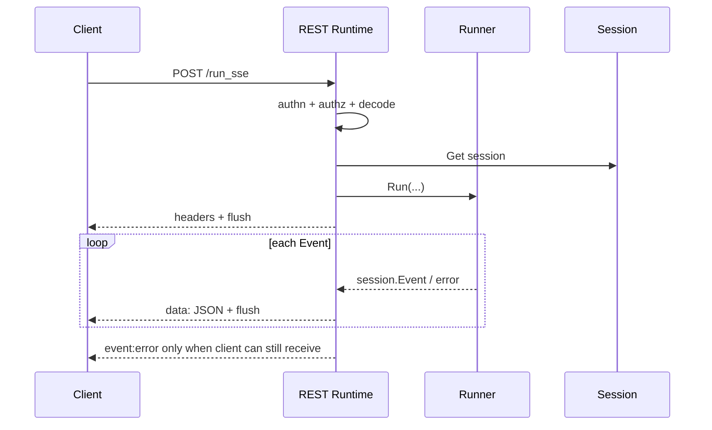

# ADK-Go 源码阅读笔记 · Server：同一个 Agent 怎样被暴露成四种协议

> **源码基准：[ADK-Go v2.4.0](https://github.com/google/adk-go/tree/v2.4.0)**，commit `4e57df40cbd35f055ba654b03ffb0e509fdd754a`。下文的“当前实现”均指这个版本。
>
> [返回 ADK 源码阅读合集](/blog/adk/) · 前置阅读：[Runner](/blog/adk-runner/)、[Artifact](/blog/adk-artifact/) · 配套阅读：[Launcher](/blog/adk-launcher/)、[基础设施](/blog/adk-infrastructure/)。

用户向服务发送“东京现在天气怎样？”。在 ADK-Go 中，这句话可以从 REST `POST /run` 进入，也可以从 `/run_sse` 按事件流返回；同一个 Agent 还可以由 A2A JSON-RPC 或 Agent Engine 的执行方法调用。对应的执行入口最终都把输入交给 Runner，但它们对事件的包装、结束状态、会话 ID 和错误传递方式并不相同；Agent Engine 另外提供的会话 CRUD 方法则不会进入 Runner。

本文把 `server` 看成**协议边界**，而不是另一个 Agent 执行引擎：

* `server/adkrest` 建立 REST 路由、认证 middleware、授权检查，并为每次请求创建 Runner；
* `server/adka2a/v2` 实现 A2A `AgentExecutor`，把 ADK `session.Event` 转成 Task、artifact 和 status event；根路径的 `server/adka2a` 是兼容旧版 a2a-go 的 façade，已委托给 v2，不是另一套执行引擎；
* `server/agentengine` 把 Agent Engine 的 `class_method` 分派到会话方法或 JSONL 流式方法；
* `cmd/launcher/web` 只负责把这些 handler 挂到总 router、加前缀、CORS 和 HTTP server 生命周期。

REST、A2A 和 Agent Engine 都把实际推理交给 Runner；Server 负责身份、传输、编码和状态协议，不复制 Flow 的模型/工具循环。

## 先分清四个相似但不同的对象

| 对象 | 输入 / 输出 | 真正负责什么 | 不负责什么 |
| --- | --- | --- | --- |
| `adkrest.Server` | `http.Request → http.Response` | 注册 REST 路由、健康检查、认证包装 | 不保存 Agent 状态，不直接调用模型 |
| `RuntimeAPIController` | REST JSON → `session.Event` | 校验 Session、创建 Runner、输出 JSON/SSE/WebSocket | 不决定模型循环和事件持久化策略 |
| `adka2a.Executor` | A2A `Message` → A2A `Event` | Task 生命周期、artifact 聚合、A2A/ADK part 与 metadata 转换 | 不监听端口，不提供 JSON-RPC HTTP handler |
| `agentengine.NewHandler` | Agent Engine Query → JSON/JSONL | 注册方法名、限制 payload、分派 method handler | 不实现 A2A Task，也不负责入站 authn |

`Launcher` 是第五个容易混淆的名字：它把上述 handler 挂在 `/api`、A2A 路径或 Agent Engine 前缀下，但并不改变这些 handler 的业务协议。

版本边界也要单独记住：[`server/adka2a`](https://github.com/google/adk-go/blob/v2.4.0/server/adka2a/executor.go#L15-L25) 的 `NewExecutor` 已标记 deprecated，它把旧版 A2A 类型转换后委托给 [`server/adka2a/v2`](https://github.com/google/adk-go/blob/v2.4.0/server/adka2a/v2/executor.go#L150-L160)。阅读当前实现时应以 v2 为主，旧包只在维护兼容客户端时追踪。

## 一、源码入口与阅读地图

| 顺序 | 源码与符号 | 要回答的问题 |
| --- | --- | --- |
| 1 | [`server/doc.go`](https://github.com/google/adk-go/blob/v2.4.0/server/doc.go#L15-L16) | `server` 顶层包的职责边界是什么？ |
| 2 | [`server/adkrest/handler.go#L42-L129`](https://github.com/google/adk-go/blob/v2.4.0/server/adkrest/handler.go#L42-L129) | `NewServer` 怎样装配路由、服务和默认认证？ |
| 3 | [`server/adkrest/internal/routers/routers.go#L37-L107`](https://github.com/google/adk-go/blob/v2.4.0/server/adkrest/internal/routers/routers.go#L37-L107)、[`runtime.go#L23-L54`](https://github.com/google/adk-go/blob/v2.4.0/server/adkrest/internal/routers/runtime.go#L23-L54) | 哪些 REST 路径公开，哪些被 middleware 保护？ |
| 4 | [`server/adkrest/controllers/runtime.go#L134-L348`](https://github.com/google/adk-go/blob/v2.4.0/server/adkrest/controllers/runtime.go#L134-L348) | 非流式、SSE 和 Live 请求怎样进入 Runner？ |
| 5 | [`server/authn/authn.go#L48-L122`](https://github.com/google/adk-go/blob/v2.4.0/server/authn/authn.go#L48-L122)、[`server/authz/authz.go#L24-L44`](https://github.com/google/adk-go/blob/v2.4.0/server/authz/authz.go#L24-L44) | 401 认证和 403 授权分别在哪一层发生？ |
| 6 | [`server/adka2a/v2/executor.go#L60-L243`](https://github.com/google/adk-go/blob/v2.4.0/server/adka2a/v2/executor.go#L60-L243)、[`processor.go#L30-L146`](https://github.com/google/adk-go/blob/v2.4.0/server/adka2a/v2/processor.go#L30-L146) | A2A Task 如何驱动 Runner 并收敛成最终状态？ |
| 7 | [`server/adka2a/v2/events.go#L74-L154`](https://github.com/google/adk-go/blob/v2.4.0/server/adka2a/v2/events.go#L74-L154)、[`task_artifact.go#L40-L140`](https://github.com/google/adk-go/blob/v2.4.0/server/adka2a/v2/task_artifact.go#L40-L140) | ADK Event、A2A part 和 artifact 的 partial 语义怎样互换？ |
| 8 | [`server/agentengine/handler.go#L40-L143`](https://github.com/google/adk-go/blob/v2.4.0/server/agentengine/handler.go#L40-L143)、[`controllers/agent_engine.go#L33-L96`](https://github.com/google/adk-go/blob/v2.4.0/server/agentengine/controllers/agent_engine.go#L33-L96) | Agent Engine 怎样按 `class_method` 分派请求？ |
| 9 | [`cmd/launcher/web/api/api.go#L272-L302`](https://github.com/google/adk-go/blob/v2.4.0/cmd/launcher/web/api/api.go#L272-L302)、[`web/a2a/a2a.go#L85-L158`](https://github.com/google/adk-go/blob/v2.4.0/cmd/launcher/web/a2a/a2a.go#L85-L158) | Launcher 只做了哪些挂载工作？ |

```text
HTTP / JSON-RPC / Agent Engine request
                 │
        Launcher 组装、加前缀、启动监听
                 │
       ┌─────────┼──────────┐
       ▼         ▼          ▼
   adkrest    adka2a     agentengine
   REST       Executor   Method registry
       │         │          │
       └─────────┴──────────┘
                 ▼
       Runner.Run / Session Service
                 ▼
          Agent → Flow → Model/Tool
                 │
           session.Event iterator
                 │
       各协议自己的编码和终态
```

`Server` 的静态路由和 `Executor` 的状态机不是同一个层次：前者决定 HTTP 请求落到哪个 handler，后者决定一个 A2A Task 是否处于 `working`、`input-required` 或 `completed`。

## 二、核心接口与数据结构

### 1. `ServerConfig` 是服务级装配单

`NewServer` 接收 `ServerConfig`，其中最重要的字段是三个 Service、`AgentLoader`、插件、compaction，以及入站认证和授权（[`handler.go#L136-L186`](https://github.com/google/adk-go/blob/v2.4.0/server/adkrest/handler.go#L136-L186)）：

```go
type ServerConfig struct {
    SessionService  session.Service
    MemoryService   memory.Service
    AgentLoader     agent.Loader
    ArtifactService artifact.Service
    SSEWriteTimeout time.Duration
    PluginConfig    runner.PluginConfig
    Authenticator   authn.Authenticator
    Authorizer      authz.Authorizer
    Compaction      *compaction.Config
}
```

它不是某一次对话的 request body。一个 REST Server 可以同时服务多个 `appName`，每次请求才从 `AgentLoader` 取 Agent、从路径或 JSON body 取得 user/session，并把同一套 Service 交给新建的 Runner。`Compaction` 也是 server-wide 配置；`NewServer` 在启动时调用 `validateCompactionAgainstAgents`，避免配置通过初始化却在每一个请求的 `runner.New` 里失败（[`handler.go#L42-L67`](https://github.com/google/adk-go/blob/v2.4.0/server/adkrest/handler.go#L42-L67)）。

`Server` 还持有一个 debug telemetry store，并暴露 `SpanProcessor()` 与 `LogProcessor()`；这些 processor 只有被应用注册到自己的 OTel provider 后才会收到数据，不是 `NewServer` 自动开启的全局追踪（[`handler.go#L203-L224`](https://github.com/google/adk-go/blob/v2.4.0/server/adkrest/handler.go#L203-L224)）。

### 2. `NewServer` 注册的是多组 Router

当前实现把 Sessions、Runtime、Apps、Artifacts、Version、Agent Graph、Tests、Eval 注册为一组 `routers.Router`；开启 `IncludeDebugAPI` 时再追加 Debug Router（[`handler.go#L86-L115`](https://github.com/google/adk-go/blob/v2.4.0/server/adkrest/handler.go#L86-L115)）。Runtime 的三条核心路径是：

| 方法 | 路径 | 返回形态 | 入口 |
| --- | --- | --- | --- |
| `POST` | `/run` | 一次 JSON 数组 | `RunHandler` |
| `POST` | `/run_sse` | SSE `data:` 事件 | `RunSSEHandler` |
| `GET` | `/run_live` | WebSocket 双向消息 | `RunLiveHandler` |

其它 Router 的边界可以按 URL 看出来：

| Router | 代表路径 | 作用 |
| --- | --- | --- |
| Sessions | `/apps/{app_name}/users/{user_id}/sessions[/{session_id}]` | 创建、读取、更新、删除和列出 Session |
| Artifacts | `/apps/{app_name}/users/{user_id}/sessions/{session_id}/artifacts...` | 列出、读取版本和删除 artifact |
| Apps | `/list-apps` | 列出 `AgentLoader` 可加载的 app |
| Version | `/version` | 返回构建版本；public |
| Agent Graph / Tests / Eval | `/dev/apps/{app_name}/...` | Web UI 开发端点；部分 Go 能力明确返回 not implemented |
| Debug（可选） | `/debug/...` 与 `/dev/apps/{app_name}/debug/...` | trace、event graph 等诊断接口 |

健康检查 `/health` 在 `NewServer` 中直接注册；`/version` 是 Version Router 的 public route。其余 route 默认不是 public，是否真正要求凭据取决于 `Authenticator` 是否为 nil。

### 3. 认证和授权是两道闸门

`SetupSubRouters` 给每一条未标记 `Public` 的 route 包上 `authn.Middleware`（[`routers.go#L60-L106`](https://github.com/google/adk-go/blob/v2.4.0/server/adkrest/internal/routers/routers.go#L60-L106)）。`Authenticator.Authenticate` 成功后把 `*authn.Caller` 放到 request context；缺凭据返回 401，provider 自身失败返回 500（[`authn.go#L79-L121`](https://github.com/google/adk-go/blob/v2.4.0/server/authn/authn.go#L79-L121)）。

`NewServer` 对 nil `Authenticator` 使用 `authn.NewNoop()`，对 nil `Authorizer` 使用 `authz.NewNoop()`（[`handler.go#L81-L84`](https://github.com/google/adk-go/blob/v2.4.0/server/adkrest/handler.go#L81-L84)）。因此“配置了 server”不等于“已经启用身份隔离”：默认 caller 是空身份，默认 authorizer 允许任意 caller 代表任意 user。生产配置通常要把能设置非空 `Caller.UserID` 的 Authenticator 和 `authz.NewStrict()` 配对；Strict 只允许 caller 与路径/body 中的 user ID 完全相等（[`strict.go#L24-L44`](https://github.com/google/adk-go/blob/v2.4.0/server/authz/strict.go#L24-L44)）。

```text
请求
  │
  ├─ authn.Middleware.Authenticate
  │      失败 → 401 / provider failure → 500
  │      成功 → request.Context = Caller
  ▼
controller
  └─ Authorizer.CanActAsUser(userID)
         失败 → 403
         成功 → 读取 Session / 运行 Agent
```

认证 middleware 只知道请求身份，不知道 JSON 里的 `userId` 是否属于该 caller；Runtime、Sessions、Artifacts 和 Debug controller 还要在各自的 user 边界调用 Authorizer。这也是为什么只写一个 `Authenticator` 而不写 `Authorizer` 仍然可能允许跨用户操作。

内置 `authn.NewHeader` 读取的是受信任上游写入的单值 header，并不是 HTTP Basic 或客户端自证身份；若客户端可以直接改这个 header，就等于绕过了认证（[`header.go#L22-L55`](https://github.com/google/adk-go/blob/v2.4.0/server/authn/header.go#L22-L55)）。

### 4. Runtime 的输入和输出是 Session Event 的投影

REST Runtime 请求的结构由 `RunAgentRequest` 定义（[`internal/models/runtime.go#L23-L57`](https://github.com/google/adk-go/blob/v2.4.0/server/adkrest/internal/models/runtime.go#L23-L57)）：

```json
{
  "appName": "weather",
  "userId": "alice",
  "sessionId": "session-1",
  "newMessage": {"role": "user", "parts": [{"text": "东京天气怎样？"}]},
  "streaming": true,
  "stateDelta": {"city": "Tokyo"}
}
```

`FunctionCallEventID` 为 Web UI/HITL 兼容字段，当前 Runtime 解码后不参与 Runner 配置。`decodeRequestBody` 设置 `DisallowUnknownFields`，所以拼写错误的字段会在执行前得到 400，而不是静默丢弃。

返回 JSON 中的 `models.Event` 是 `session.Event` 的 API 形状；它携带 `Partial`、`TurnComplete`、`Actions`、`LongRunningToolIDs`、错误和内容等字段。Server 没有创建另一种“server event”来替代 Session Event，而是通过 `models.FromSessionEvent` 做序列化投影。

### 5. A2A Executor 的协议对象

`adka2a/v2` 暴露的核心接口是 `Runner` 和 `ExecutorConfig`。`Runner.Run` 只要求返回 `iter.Seq2[*session.Event,error]`，所以可以注入自定义 Runner；默认 provider 才会把 `runner.Config` 交给 `runner.New`（[`executor.go#L73-L103`](https://github.com/google/adk-go/blob/v2.4.0/server/adka2a/v2/executor.go#L73-L103)、[`executor.go#L445-L474`](https://github.com/google/adk-go/blob/v2.4.0/server/adka2a/v2/executor.go#L445-L474)）。

```text
ExecutorConfig
├─ RunnerProvider / RunnerConfig
├─ RunConfig
├─ BeforeExecute / AfterEvent / AfterExecute
├─ A2APartConverter / GenAIPartConverter
├─ OutputArtifactPerRun | OutputArtifactPerEvent
└─ A2AExecutionCleanupCallback
```

`OutputArtifactPerEvent` 用一个 artifact ID 累积同一 agent 的 partial 事件；`OutputArtifactPerRun` 是兼容路径，会把 partial 内容放进临时 artifact，并在终止时发 reset update。两者都是 A2A 输出策略，不会改变 ADK Session 是否保存事件。

### 6. Agent Engine 通过 `MethodHandler` 扩展

Agent Engine 的最小契约是：

```go
type MethodHandler interface {
    Name() string
    Handle(context.Context, http.ResponseWriter, []byte) error
    Metadata() (*structpb.Struct, error)
}
```

`NewHandler` 先调用 `config.Validate`，再用 root Agent 检查 compaction 是否真的可服务；不满足时在返回 handler 前失败，而不是让进程启动后每个请求都失败（[`handler.go#L40-L65`](https://github.com/google/adk-go/blob/v2.4.0/server/agentengine/handler.go#L40-L65)）。随后它创建两个 `AgentEngineAPIController`：一个注册四个会话方法，另一个注册两个流式方法（[`handler.go#L67-L84`](https://github.com/google/adk-go/blob/v2.4.0/server/agentengine/handler.go#L67-L84)、[`handler.go#L109-L124`](https://github.com/google/adk-go/blob/v2.4.0/server/agentengine/handler.go#L109-L124)）。Controller 启动时把 handler 列表转成 `map[name]handler`，重复名字直接报错；请求 body 解码为 `models.Query` 后，按 `ClassMethod` 查 map 并调用 `Handle`（[`agent_engine.go#L41-L96`](https://github.com/google/adk-go/blob/v2.4.0/server/agentengine/controllers/agent_engine.go#L41-L96)）。

非流式组是 `async_create_session`、`async_get_session`、`async_list_sessions`、`async_delete_session`；“非流式”指会话管理方法，不是再次执行一个同步模型回答。流式组是 `async_stream_query` 与 `streaming_agent_run_with_events`。

## 三、主执行路径：同一条天气请求的三种输出

### 1. REST 非流式：一次收集，最后编码

以 `POST /run` 为例，调用顺序如下：

```text
POST /run
  → authn.Middleware
  → RuntimeAPIController.RunHandler
  → decodeRequestBody (DisallowUnknownFields)
  → Authorizer.CanActAsUser(userId)
  → validateSessionExists(SessionService.Get)
  → AgentLoader.LoadAgent(appName)
  → runner.New(...)
  → Runner.Run(..., StreamingModeNone)
  → range iter.Seq2[*session.Event, error]
  → models.FromSessionEvent
  → EncodeJSONResponse([]Event)
```

`runAgent` 会先确认 Session 已存在，再构造 Runner；若请求携带 `stateDelta`，它被包装成 `runner.WithStateDelta`，随本次 Run 进入 Runner（[`runtime.go#L160-L193`](https://github.com/google/adk-go/blob/v2.4.0/server/adkrest/controllers/runtime.go#L160-L193)）。Runner 产生的每个 Event 都先进入内存 slice，迭代结束后才编码成一个 JSON 数组。

```text
T0  body → RunAgentRequest{app, user, session, newMessage}
T1  SessionService.Get 确认 session-1 存在
T2  AgentLoader.LoadAgent("weather") + runner.New
T3  Runner.Run → Event(user) → Event(model partial/final) → Event(tool)
T4  非 compaction 错误 → 500；正常结束 → []models.Event
T5  HTTP body 一次性写出 JSON 数组
```

注意 Runner 仍负责把需要持久化的 Event 写入 Session；Runtime 的 slice 只是响应收集器。`compaction.ErrCompaction` 被视为记账失败：事件和回答已经产生时，REST handler 记录日志并继续，不把已有回答改报成 500（[`runtime.go#L178-L190`](https://github.com/google/adk-go/blob/v2.4.0/server/adkrest/controllers/runtime.go#L178-L190)）。

### 2. REST SSE：先建立流，再逐条 flush

`POST /run_sse` 走同一个 `getRunner`，但 handler 在执行前设置 write deadline、`text/event-stream`、禁缓存和 keep-alive，并先 flush headers（[`runtime.go#L196-L247`](https://github.com/google/adk-go/blob/v2.4.0/server/adkrest/controllers/runtime.go#L196-L247)）。每个事件被转换成 JSON 后写为：

```text
data: {"id":"...","partial":true,"content":...}

```

`flashEvent` 写入 `data: ...\n\n` 后立即 flush；执行错误则写成：

```text
event: error
data: {"error":"..."}

```

因此 SSE 的“流式”有两层含义：HTTP 传输逐条发送；`RunConfig.StreamingMode` 是否让模型产生 partial 响应，则由请求的 `streaming` 字段决定（[`runtime.go#L320-L347`](https://github.com/google/adk-go/blob/v2.4.0/server/adkrest/controllers/runtime.go#L320-L347)）。endpoint 是 SSE，不代表每个模型响应必然有 partial event。



若客户端断开或 flush 失败，handler 记录日志并结束；它不会再递归发送错误事件。写超时由 `SSEWriteTimeout` 覆盖本次响应的 deadline，和外层 `http.Server.WriteTimeout` 是两层不同配置。

### 3. Runtime Live 是 WebSocket 旁路

`GET /run_live` 不经过 SSE 编码。Handler 读取 query 中的 `appName/userId/sessionId`，升级 WebSocket，调用 `Runner.RunLive`，另起 goroutine 把客户端文本、二进制音频、activity start/end 转成 `agent.LiveRequest`；Runner 的 live iterator 再被编码回 WebSocket JSON（[`runtime.go#L360-L430`](https://github.com/google/adk-go/blob/v2.4.0/server/adkrest/controllers/runtime.go#L360-L430)、[`runtime.go#L439-L513`](https://github.com/google/adk-go/blob/v2.4.0/server/adkrest/controllers/runtime.go#L439-L513)）。

它与 `/run_sse` 共用认证授权和 Runner 装配，但消息是双向、长期存在的 realtime session；不能拿 SSE 的单向 `data:` 规则去推断 Live 的关闭和音频行为。

### 4. A2A：Task 状态包住 Event iterator

`Executor.Execute` 的关键顺序是（[`executor.go#L162-L243`](https://github.com/google/adk-go/blob/v2.4.0/server/adka2a/v2/executor.go#L162-L243)）：

```text
A2A Message
  → toGenAIContent
  → 创建 executor plugin + Runner
  → BeforeExecuteCallback（可换 context 或拒绝）
  → HandleInputRequired（检查上一个 Task 的函数回复是否完整）
  → 没有 StoredTask ? yield submitted
  → prepareSession (Get；不存在则 Create)
  → yield working
  → r.Run(...)
  → eventProcessor.process 每个 session.Event
  → yield artifact update
  → yield final artifact reset（兼容模式可能有）
  → yield completed / input-required / failed
```

`prepareSession` 会用 `RunnerConfig.AppName`、从 A2A context 派生的 user/session ID 查找 Session；`Get` 失败时尝试创建空状态 Session（通常对应首次请求的“不存在”）（[`executor.go#L409-L431`](https://github.com/google/adk-go/blob/v2.4.0/server/adka2a/v2/executor.go#L409-L431)）。所以 A2A 的首次请求可以没有预先创建的 ADK Session，而 REST `/run` 默认要求 session 已存在。

`eventProcessor` 对每个 ADK Event 做四件事：累积 `Escalate`/`TransferToAgent` action，生成带 app/user/session/invocation 元数据的 map，处理 long-running function call，再把 GenAI parts 转成 A2A parts。LLM error 会先保存为 deferred failed status，等已有内容成为 artifact 后再发送终态（[`processor.go#L72-L146`](https://github.com/google/adk-go/blob/v2.4.0/server/adka2a/v2/processor.go#L72-L146)）。

状态判定是明确的优先级：

| 条件 | 最终 A2A 状态 | 说明 |
| --- | --- | --- |
| ADK/processor/LLM 错误 | `failed` | 错误消息放入 status message；已生成的 artifact 仍可先发 |
| 存在 long-running function call | `input-required` | 函数调用 ID 放进状态消息，等待下一次 A2A 输入 |
| 没有上述条件 | `completed` | `AfterExecuteCallback` 后发送终态 |
| `Cancel` 被调用 | `canceled` | `Cancel` 本身只产生取消 status；资源清理由 `Cleanup` 负责 |

`process` 遇到普通 Runner error 时会生成 failed event；遇到 compaction error 则记录并继续，因为这不等于本轮 Agent 失败（[`executor.go#L349-L386`](https://github.com/google/adk-go/blob/v2.4.0/server/adka2a/v2/executor.go#L349-L386)）。消费者停止 `yield` 会提前结束执行，后面的终态不会自动补发。

### 5. A2A part 和 metadata 不是简单 JSON 转换

`ToA2AParts` 将文本、思考标记、文件、function call/response、代码执行结果分别映射成 A2A Text/File/Data part；函数调用的 Data part 带 `adk_type=function_call` 和 `adk_is_long_running` 元数据（[`parts.go#L75-L116`](https://github.com/google/adk-go/blob/v2.4.0/server/adka2a/v2/parts.go#L75-L116)、[`parts.go#L154-L200`](https://github.com/google/adk-go/blob/v2.4.0/server/adka2a/v2/parts.go#L154-L200)）。A2A 侧的 task/context ID 写入 ADK Event 的 `a2a:task_id`、`a2a:context_id`；反向转换只恢复安全的 action，`transfer_to_agent` 不会未经信任判断自动恢复（[`metadata.go#L43-L51`](https://github.com/google/adk-go/blob/v2.4.0/server/adka2a/v2/metadata.go#L43-L51)、[`metadata.go#L155-L183`](https://github.com/google/adk-go/blob/v2.4.0/server/adka2a/v2/metadata.go#L155-L183)）。

### 6. Agent Engine：方法分派和两种 JSONL 流

Agent Engine 总 handler 的路线是：

```text
POST /reasoning_engine 或 /stream_reasoning_engine
  → AgentEngineAPIController.Query
  → io.LimitReader(maxPayloadSize)
  → json.Unmarshal(models.Query)
  → handlers[query.ClassMethod]
  → MethodHandler.Handle(ctx, rw, payload)
```

`async_stream_query` 可以接受结构化 `message`；如果完整请求不能按结构体解码，它还尝试文本请求并构造 `genai.Content`。它创建 Runner 时使用 `AutoCreateSession: true` 和 `StreamingModeSSE`，然后把有内容的 Event 每条编码成 JSON line；已产生回答后遇到 compaction error 只记录并继续（[`stream_query.go#L61-L140`](https://github.com/google/adk-go/blob/v2.4.0/server/agentengine/controllers/method/stream_query.go#L61-L140)、[`stream_query.go#L202-L221`](https://github.com/google/adk-go/blob/v2.4.0/server/agentengine/controllers/method/stream_query.go#L202-L221)）。

`streaming_agent_run_with_events` 的外层参数只有 `request_json`。它先解出内部 request，再把 Gemini Enterprise 首轮的 Discovery Engine session resource 与 ADK backend session 区分开：能 `Get` 到就沿用，不能就 `Create` 一个新 Session，并把 backend ID 放进后续响应。这个方法故意用 `StreamingModeNone`，因为同时发送 partial 和 final 会让 Gemini Enterprise 渲染重复文本（[`streaming_agent_run_with_events.go#L61-L137`](https://github.com/google/adk-go/blob/v2.4.0/server/agentengine/controllers/method/streaming_agent_run_with_events.go#L61-L137)、[`streaming_agent_run_with_events.go#L150-L193`](https://github.com/google/adk-go/blob/v2.4.0/server/agentengine/controllers/method/streaming_agent_run_with_events.go#L150-L193)、[`streaming_agent_run_with_events.go#L241-L263`](https://github.com/google/adk-go/blob/v2.4.0/server/agentengine/controllers/method/streaming_agent_run_with_events.go#L241-L263)）。

这两个方法都叫“stream”，但协议语义不同：前者是 ADK partial 事件的 JSONL，后者是一个事件封装加 backend `session_id` 的 JSONL，后者不强制模型 partial。

## 四、关键细节与分支

### 1. 认证失败、授权失败和业务失败是三类响应

| 发生位置 | 典型条件 | HTTP / 协议表现 | 是否进入 Runner |
| --- | --- | --- | --- |
| `authn.Middleware` | 无凭据或凭据无效 | 401；provider 内部错误为 500 | 否 |
| `Authorizer` | caller 不能代表 body/path 中的 user | 403 | 否 |
| Runtime 解码 | JSON 错误或未知字段 | 400；空的业务字段会在后续 Session/Agent 校验中失败 | 否 |
| Session/Agent/Runner | session 不存在、Agent 加载或运行失败 | 非流式通常 404/500；SSE 先后可能是 HTTP 错误或 `event:error` | 已到对应阶段 |
| A2A processor | part 转换、LLM response 或 callback 失败 | `TaskStateFailed` status event | 已产生的 artifact 可先发送 |

SSE 在 headers flush 之前还能用 HTTP 状态报告解码、session 和 runner 错误；flush 之后只能写 `event: error`，无法再修改 HTTP status。这是传输状态和业务状态的边界。

### 2. REST 的 trailing slash 不应依赖 301/307

`SetupSubRouters` 关闭 `mux.StrictSlash`，由 fallback handler 去掉尾斜杠后原地重新分派。原因是 POST 被 redirect 后可能变成 GET，body 也会丢失；直接重派才能保留方法和请求体（[`routers.go#L69-L105`](https://github.com/google/adk-go/blob/v2.4.0/server/adkrest/internal/routers/routers.go#L69-L105)）。因此 `/apps/weather/users/alice/sessions/` 的行为不是普通浏览器重定向语义。

### 3. A2A 的 partial 和 REST 的 partial 不是同一条线

A2A 没有 ADK Session 的 `Partial` 字段，所以 `OutputArtifactPerEvent` 用 `Append`、`LastChunk` 和 metadata 复原聚合；兼容的 legacy maker 则把 partial 写进 ephemeral artifact，终止时发一个空 Data part 的 reset update（[`task_artifact.go#L70-L140`](https://github.com/google/adk-go/blob/v2.4.0/server/adka2a/v2/task_artifact.go#L70-L140)）。反向 `ToSessionEventWithParts` 遇到“partial + LastChunk” reset 会丢弃该事件，不把清理信号误当用户文本（[`events.go#L93-L120`](https://github.com/google/adk-go/blob/v2.4.0/server/adka2a/v2/events.go#L93-L120)）。

Agent Card 是另一条静态能力描述路径：Launcher 从 root Agent 的名称、描述和 `BuildAgentSkills` 生成 Card，再把 JSON-RPC 接口 URL 和 streaming capability 写进去；它描述“能调用什么”，不承载一次调用的 Task 状态（[`agent_card.go#L29-L91`](https://github.com/google/adk-go/blob/v2.4.0/server/adka2a/v2/agent_card.go#L29-L91)）。

### 4. `input-required` 是可恢复状态，不是普通错误

当 ADK Event 的 `LongRunningToolIDs` 含有函数调用 ID 时，`inputRequiredProcessor` 会把调用 part 收集到最终 status message，避免 partial 与 final 重复。下一次 Execute 先由 `HandleInputRequired` 检查新消息是否为这些 ID 的 FunctionResponse；缺少任一回复时，仍返回 `input-required` 并标出缺少的 ID，而不是重新运行 Agent（[`input_required.go#L43-L105`](https://github.com/google/adk-go/blob/v2.4.0/server/adka2a/v2/input_required.go#L43-L105)、[`input_required.go#L149-L180`](https://github.com/google/adk-go/blob/v2.4.0/server/adka2a/v2/input_required.go#L149-L180)）。

取消一个处于 `input-required` 的 Task 时，`Cleanup` 会从 Session 历史找出尚未完成的远程子 Agent task，并逐个调用 A2A client cancel；这是取消旁路，不是把已执行的业务副作用回滚（[`executor.go#L256-L346`](https://github.com/google/adk-go/blob/v2.4.0/server/adka2a/v2/executor.go#L256-L346)）。

### 5. Agent Engine 的会话 ID 有两种命名空间

`streaming_agent_run_with_events` 的首轮 `session_id` 可能是外部资源名：

```text
projects/{project}/locations/global/collections/default_collection/
engines/{engine}/sessions/{session}
```

Vertex/ADK Session Service 不能把这个资源名当作任意 backend ID。handler 会先尝试用它读取 ADK Session；读取失败时创建内部 ID，并在每条响应里返回这个 ID。调用方下一轮应使用返回的 backend ID，而不是继续传外部资源名。

### 6. Launcher 只挂载，不替协议做决策

API Launcher 调 `adkrest.NewServer`，把 server 的 debug span/log processor 追加到 telemetry 配置，再交给 CORS 和 `http.StripPrefix`，默认路径前缀是 `/api`（[`api.go#L272-L301`](https://github.com/google/adk-go/blob/v2.4.0/cmd/launcher/web/api/api.go#L272-L301)）。A2A Launcher 构造 Agent Card、`adka2a.NewExecutor` 和 a2a-go handler，注册主版本和兼容版本 JSON-RPC 路径（[`a2a.go#L101-L157`](https://github.com/google/adk-go/blob/v2.4.0/cmd/launcher/web/a2a/a2a.go#L101-L157)）。Agent Engine Launcher 则调用 `agentengine.NewHandler`，按配置前缀挂两个 POST 路径（[`agentengine.go#L83-L95`](https://github.com/google/adk-go/blob/v2.4.0/cmd/launcher/web/agentengine/agentengine.go#L83-L95)）。

所以改变 `--path_prefix`、CORS origin 或监听端口，不会改变 Runtime 的事件转换；改变 `ExecutorConfig.OutputMode`，也不会自动改变 Launcher 的路由。

### 7. 并发和顺序由不同层保证

Runtime 只按 Runner iterator 顺序写响应；它不重新排序 Event，也不并行执行多个请求。A2A 的 `yield` 是消费者握手：消费者返回 false 时，Executor 立即停止后续 artifact/status 输出。模型、工具和 workflow 内部的并发语义仍由 Flow/Workflow 负责，Server 不会替它们加全局锁。

## 五、重新梳理：运行时架构与边界

| 边界 | 输入 → 输出 | 负责的动作 | 明确不负责 |
| --- | --- | --- | --- |
| Launcher | CLI/Config → mounted handler | 选择子入口、路径前缀、CORS、HTTP 生命周期、Agent Card | 不校验每个用户的授权，不转换 Event |
| REST `adkrest` | HTTP JSON/SSE/WebSocket → `session.Event` JSON | 路由、authn/authz、Session 检查、Runner 装配、传输编码 | 不执行模型循环，不替 Session Service 保存事件 |
| A2A `adka2a` | A2A Message → Task/Artifact/Status | part/metadata 转换、Task 终态、partial 聚合、恢复/取消协议 | 不监听 HTTP，不定义 Agent Card 的挂载 URL |
| Agent Engine | Query → method JSON/JSONL | 方法注册、payload 限制、会话 CRUD、两种流式方法 | 不实现 A2A Task，不提供通用授权 middleware |
| Runner / Flow | `genai.Content` → `session.Event` iterator | Invocation、模型调用、工具、事件持久化 | 不决定 REST/SSE/A2A wire format |
| Session / Artifact Service | Session/Event/Blob → storage | 会话历史、状态、artifact 版本 | 不知道客户端用哪种协议 |

同一个天气请求跨过这些边界时，数据不会被重复推理：Runner 只运行一次；REST 直接投影 Event，A2A 维护自己的 Task/artifact 终态，Agent Engine 维护自己的 JSONL envelope。只有协议状态需要新增元数据，才会出现 `adk_*` 或 `a2a:*` 字段。

**主线规则与例外：** 通常是“Launcher 挂载 → Server 认证/解码 → Runner 产 Event → Server 编码”。例外是 A2A 的 `input-required`：Executor 可以在调用 Runner 前根据 StoredTask 判断回复不完整，直接返回等待状态；另一个例外是 Agent Engine 首轮外部 session resource，需要先创建 backend Session 才能进入 Runner。

## 六、Server 解决了什么问题，以及代价是什么

### 1. 把执行内核复用到不同协议

REST、A2A 和 Agent Engine 不需要各自复制 Agent/Flow/Tool 循环。它们共享 Runner 的事件 iterator，只在边界上做不同编码：JSON 数组适合一次性调用，SSE 适合单向增量，A2A 需要跨请求的 Task 状态，Agent Engine 需要平台约定的 method 名称和 JSONL。

### 2. 把身份和用户作用域放到可测试的边界

`Authenticator` 负责“谁在调用”，`Authorizer` 负责“能否代表哪个 user”。两者通过 context 和显式 user ID 连接，不把身份判断散落进 Agent 代码；测试也可以分别验证 401、403 和业务错误。

### 3. 给长任务和远程 Agent 一个恢复协议

A2A 的 `input-required`、task/context ID、long-running function call metadata 和 Cleanup 让远程 Agent 能等待外部输入、继续或取消。它的代价是必须维护两套事件语义：ADK Session Event 仍是本地历史，A2A Task status/artifact 是对外协议状态，二者不能只靠 JSON 结构体互转。

### 4. 代价：配置、生命周期和默认值必须被看见

* `NewServer`、`NewHandler`、A2A setup 都会在初始化时检查 compaction；同一个 server 的配置会影响它服务的所有 app。
* nil Authenticator/Authorizer 的 no-op 默认方便本地开发，却不提供生产隔离。
* SSE deadline、HTTP server timeout、Agent Engine payload limit、A2A artifact mode 是不同层的限制，调大一个不会自动调大另一个。
* Server 只负责传输级取消；已经写入外部系统的工具副作用不会因 HTTP 断开、A2A Cancel 或 server shutdown 自动回滚。

## 七、重点结论与常见误解

- `adkrest.NewServer` 是 HTTP handler 工厂；它不启动端口，Launcher 或调用方负责把它挂到 `http.Server`。
- `/run` 收集完整响应再返回；`/run_sse` 逐事件 flush；`/run_live` 是双向 WebSocket，三者不能互换。
- 认证失败是 401，授权失败是 403；只设置 Authenticator 而没有 Authorizer，仍可能允许 caller 代表任意 user。
- `RuntimeAPIController` 的响应 slice 不等于 Session 持久化；真正的 Event 保存由 Runner/Session Service 完成。
- A2A `Executor` 的 `working`、`input-required`、`completed`、`failed` 是 Task 状态，不是 ADK Event 的 `Partial` 或 `TurnComplete` 的别名。
- A2A partial artifact 需要 `Append`/`LastChunk` 和 metadata 聚合；legacy 模式的 reset update 是协议清理信号，不是用户可见空答案。
- Agent Engine 的两个流式方法都输出 JSONL，但 `async_stream_query` 强制 SSE 模式，而 `streaming_agent_run_with_events` 使用 `StreamingModeNone` 防止重复渲染。
- Launcher 改变的是挂载位置、CORS、Agent Card 和监听生命周期，不改变 Runner 的模型/工具执行规则。

## 八、相关源码与进一步阅读

- [`server/doc.go`](https://github.com/google/adk-go/blob/v2.4.0/server/doc.go)：Server 顶层包的协议定位。
- [`server/adkrest/handler.go`](https://github.com/google/adk-go/blob/v2.4.0/server/adkrest/handler.go)：`NewServer`、`ServerConfig`、health 和 telemetry processor。
- [`server/adkrest/internal/routers/routers.go`](https://github.com/google/adk-go/blob/v2.4.0/server/adkrest/internal/routers/routers.go)、[`runtime.go`](https://github.com/google/adk-go/blob/v2.4.0/server/adkrest/internal/routers/runtime.go)：Route、Public 标记与 Runtime 路径。
- [`server/adkrest/controllers/runtime.go`](https://github.com/google/adk-go/blob/v2.4.0/server/adkrest/controllers/runtime.go)：非流式、SSE、WebSocket Runtime。
- [`server/adkrest/internal/models/runtime.go`](https://github.com/google/adk-go/blob/v2.4.0/server/adkrest/internal/models/runtime.go)：REST 请求和 Live 请求结构。
- [`server/authn`](https://github.com/google/adk-go/tree/v2.4.0/server/authn)、[`server/authz`](https://github.com/google/adk-go/tree/v2.4.0/server/authz)：入站身份认证与 user 作用域授权。
- [`server/adka2a/v2/executor.go`](https://github.com/google/adk-go/blob/v2.4.0/server/adka2a/v2/executor.go)：A2A Executor、RunnerProvider、Task 生命周期和取消。
- [`server/adka2a/executor.go`](https://github.com/google/adk-go/blob/v2.4.0/server/adka2a/executor.go)：旧版 A2A façade；类型兼容和转换最终委托 v2。
- [`server/adka2a/v2/processor.go`](https://github.com/google/adk-go/blob/v2.4.0/server/adka2a/v2/processor.go)、[`input_required.go`](https://github.com/google/adk-go/blob/v2.4.0/server/adka2a/v2/input_required.go)：Event processor、错误和 input-required 恢复。
- [`server/adka2a/v2/events.go`](https://github.com/google/adk-go/blob/v2.4.0/server/adka2a/v2/events.go)、[`parts.go`](https://github.com/google/adk-go/blob/v2.4.0/server/adka2a/v2/parts.go)、[`task_artifact.go`](https://github.com/google/adk-go/blob/v2.4.0/server/adka2a/v2/task_artifact.go)：Event/part/metadata/artifact 转换。
- [`server/adka2a/v2/agent_card.go`](https://github.com/google/adk-go/blob/v2.4.0/server/adka2a/v2/agent_card.go)：从 ADK Agent 描述生成 A2A Agent Skills。
- [`server/agentengine/handler.go`](https://github.com/google/adk-go/blob/v2.4.0/server/agentengine/handler.go)、[`controllers/agent_engine.go`](https://github.com/google/adk-go/blob/v2.4.0/server/agentengine/controllers/agent_engine.go)：Agent Engine handler 注册与分派。
- [`server/agentengine/controllers/method/stream_query.go`](https://github.com/google/adk-go/blob/v2.4.0/server/agentengine/controllers/method/stream_query.go)、[`streaming_agent_run_with_events.go`](https://github.com/google/adk-go/blob/v2.4.0/server/agentengine/controllers/method/streaming_agent_run_with_events.go)：两种 JSONL 流式方法。
- [`server/agentengine/internal/helper/emit_json.go`](https://github.com/google/adk-go/blob/v2.4.0/server/agentengine/internal/helper/emit_json.go)：JSONL 单行编码和 flush。
- [`cmd/launcher/web/api/api.go`](https://github.com/google/adk-go/blob/v2.4.0/cmd/launcher/web/api/api.go)、[`web/a2a/a2a.go`](https://github.com/google/adk-go/blob/v2.4.0/cmd/launcher/web/a2a/a2a.go)、[`web/agentengine/agentengine.go`](https://github.com/google/adk-go/blob/v2.4.0/cmd/launcher/web/agentengine/agentengine.go)：Launcher 的挂载层。
- [Runner](/blog/adk-runner/)：为什么同一个 `session.Event` iterator 能被多个协议消费。
- [Workflow](/blog/adk-workflow/)：Server 之下的节点调度、事件和暂停恢复。
- [基础设施](/blog/adk-infrastructure/)：出站 auth、Telemetry 与 Server 入站 authn/authz 的边界。
