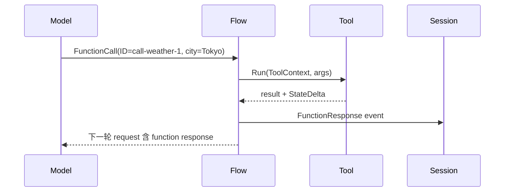
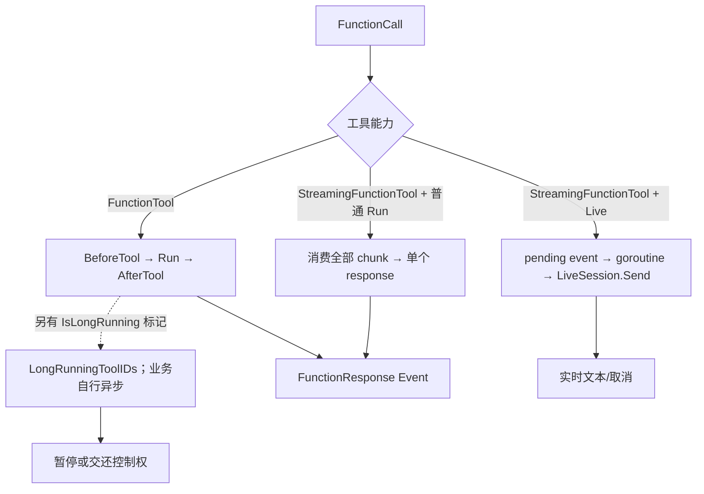

# ADK-Go 源码阅读笔记 · Tool：从声明到执行，再回到事件

> **源码基准：[ADK-Go v2.4.0](https://github.com/google/adk-go/tree/v2.4.0)**，commit `4e57df40cbd35f055ba654b03ffb0e509fdd754a`。下文的“当前实现”均指这个版本。
>
> [返回 ADK 源码阅读合集](/blog/adk/) · 前置阅读：[Flow](/blog/adk-flow/) · 配套阅读：[Plugin](/blog/adk-plugin/)、[Workflow](/blog/adk-workflow/)。

用户问：“东京现在天气怎样？”模型返回 `get_weather(city="Tokyo")`。Tool 的工作不是把这串 JSON 直接交给某个函数，而是把**模型可见的声明**、**本地可执行的实现**、**工具上下文里的动作**和**要写回 Session 的事件**接成一条协议。本文用这一次调用贯穿正常、失败、流式、长任务与确认恢复路径。

FunctionDeclaration 只是模型可见的能力描述；本地执行还要在当前请求的 `req.Tools` 中找到实现。

| 词 | 在本文中的准确含义 | 不要混淆 |
| --- | --- | --- |
| Tool | `Name`、`Description`、`IsLongRunning` 三项公共元数据 | 不是必然带 `Run` 的公开接口 |
| FunctionCall ID | 模型这一次调用的 `FunctionCall.ID`，如 `call-weather-1` | 工具确认事件自己的 ID 可以不同 |
| Toolset | 根据上下文返回工具集合，本条 Flow 会缓存收集结果 | 不是静态全局注册表 |
| FunctionResponse | Tool 结果在 `session.Event` 中的模型协议表示 | 不等于已对用户显示的文本 |

## 一、源码入口与阅读地图

| 阅读顺序 | 源码 | 需要回答的问题 |
| --- | --- | --- |
| 1 | [`tool/tool.go#L37-L57`](https://github.com/google/adk-go/blob/v2.4.0/tool/tool.go#L37-L57) | 公共 Tool/Toolset 契约是什么？ |
| 2 | [`internal/toolinternal/tool.go#L28-L62`](https://github.com/google/adk-go/blob/v2.4.0/internal/toolinternal/tool.go#L28-L62) | 哪些能力只在 ADK 内部识别？ |
| 3 | [`tool/toolutils/toolutils.go#L29-L73`](https://github.com/google/adk-go/blob/v2.4.0/tool/toolutils/toolutils.go#L29-L73) | 声明与本地实现如何写入请求？ |
| 4 | [`tool/functiontool/function.go#L77-L181`](https://github.com/google/adk-go/blob/v2.4.0/tool/functiontool/function.go#L77-L181) | Go 泛型函数怎样获得 schema 和声明？ |
| 5 | [`internal/llminternal/base_flow.go#L1160-L1360`](https://github.com/google/adk-go/blob/v2.4.0/internal/llminternal/base_flow.go#L1160-L1360) | FunctionCall 怎样并发执行并生成事件？ |
| 6 | [`internal/llminternal/request_confirmation_processor.go#L37-L229`](https://github.com/google/adk-go/blob/v2.4.0/internal/llminternal/request_confirmation_processor.go#L37-L229) | 确认回复怎样从历史恢复原调用？ |

```text
Tool / Toolset
     │ Tools(ReadonlyContext)
     ▼
  Flow.f.Tools
     │ ProcessRequest
     ├───────────────┐
     ▼               ▼
req.Tools       req.Config.Tools
本地执行表       模型声明
     │               │
     └──────┬────────┘
            ▼
      FunctionCall
            │ ID + Name + Args
            ▼
       ToolContext
            │
            ├─ Run / RunStream
            ├─ Actions / StateDelta
            └─ FunctionResponse Event
```

## 二、接口与数据：公开能力、内部能力和对象生命周期

### 1. 公共接口故意很小

源码中的 `Tool` 只有三个方法；`Toolset.Tools` 接收只读上下文并返回当前工具列表（[`tool/tool.go#L37-L57`](https://github.com/google/adk-go/blob/v2.4.0/tool/tool.go#L37-L57)）。它没有 `Run`、`Declaration` 或 `ProcessRequest`。原因是 Tool 也可以代表 Gemini 原生能力或仅修改请求的工具，并不一定有本地 handler。

```go
// 源码摘录，保留决定分层的字段。
type Tool interface {
    Name() string
    Description() string
    IsLongRunning() bool
}

type Toolset interface {
    Name() string
    Tools(ctx agent.ReadonlyContext) ([]Tool, error)
}
```

`FilterToolset` 在 Toolset 结果上执行谓词过滤；它是暴露面控制，不是后端权限校验。工具最终仍要在 handler 和服务端重新鉴权。

### 2. 内部 capability interface 才决定能否接入 Flow

[`internal/toolinternal/tool.go#L28-L62`](https://github.com/google/adk-go/blob/v2.4.0/internal/toolinternal/tool.go#L28-L62) 将能力拆开：

```go
type FunctionTool interface {
    tool.Tool
    Declaration() *genai.FunctionDeclaration
    Run(ctx agent.Context, args any) (map[string]any, error)
}
type StreamingFunctionTool interface {
    tool.Tool
    Declaration() *genai.FunctionDeclaration
    RunStream(ctx agent.Context, args any) iter.Seq2[string, error]
}
type RequestProcessor interface {
    ProcessRequest(ctx agent.Context, req *model.LLMRequest) error
}
```

另有 `ResponseDeferrer` 和 `SkipSummarizationResultDisplayer` 两个内部标记。一个对象满足公共 `Tool`，并不表示它能被 LlmAgent 使用：请求预处理需要 `RequestProcessor`，FunctionCall 执行需要 `FunctionTool` 或 `StreamingFunctionTool`。

### 3. 同一个示例中的对象变化

| 阶段 | 对象 | 示例值 | 创建/修改者 |
| --- | --- | --- | --- |
| Toolset | `[]tool.Tool` | `get_weather` | `toolProcessor` 调 `Tools` |
| 请求 | `req.Tools` | `{"get_weather": *functionTool}` | `PackTool` 注册本地表 |
| 请求 | `req.Config.Tools` | FunctionDeclaration(name=`get_weather`) | `PackTool` 合并声明 |
| 模型响应 | `FunctionCall` | ID=`call-weather-1`, args=`city=Tokyo` | 模型适配层 |
| 工具上下文 | `Actions.StateDelta` | `last_city=Tokyo` | `NewToolContext` 与 handler |
| 事件 | `FunctionResponse` | ID=`call-weather-1`, response=`{...}` | `handleFunctionCalls` |

这里有本地执行表与模型声明数组：req.Tools 查找 handler，req.Config.Tools 描述能力。普通函数工具只写其中一份会得到不完整行为。

### 4. 泛型、JSON Schema 与运行时转换分别做什么

天气工具的 Go 参数是 `WeatherArgs`，模型产生的却是 JSON-like map。二者能相接，是因为 FunctionTool 把“定义时生成 schema”和“运行时转换数据”分成两步。`New[TArgs,TResults]` 先检查输入类型，允许 struct、map 及其指针，不直接接受 string/int。无参数业务也需要参数类型，例如下面的**配置片段**：

```go
refresh, err := functiontool.New(
    functiontool.Config{Name: "refresh_weather_cache"},
    func(ctx agent.Context, args struct{}) (map[string]any, error) {
        return map[string]any{"ok": true}, nil
    },
)
```

构造阶段 Resolve 显式 InputSchema 与 OutputSchema；没提供时调用 `jsonschema.For[T]` 推导。显式 schema 不会让 Go 类型约束失效，也不表示构造器已经静态证明 schema 与 handler 类型完全一致（[`function.go#L77-L119`](https://github.com/google/adk-go/blob/v2.4.0/tool/functiontool/function.go#L77-L119)、[`#L267-L276`](https://github.com/google/adk-go/blob/v2.4.0/tool/functiontool/function.go#L267-L276)）。

```text
创建时：
  WeatherArgs / WeatherResult
              │ jsonschema.For + Resolve
              ▼
  inputSchema / outputSchema
              │ Declaration()
              ▼
  模型看到参数约束

执行时：
  FunctionCall.Args map
              │ ConvertToWithJSONSchema
              ▼
  WeatherArgs{City:"Tokyo"}
              │ handler(ctx, args)
              ▼
  WeatherResult{22,"sunny"}
              │ ConvertToWithJSONSchema
              ▼
  FunctionResponse.Response map
```

Declaration 根据已解析 schema 填充 ParametersJsonSchema 和 ResponseJsonSchema。IsLongRunning 为 true 时，还会给描述追加“已返回 pending 后不要再次调用”的自然语言提示。它只能影响模型行为，不能取代后端去重。

输出兼容逻辑也有次序：先尝试转为 map；若失败且存在 output schema，验证原始 output 是否符合 schema；验证仍失败就返回转换错误，只有允许这个 output 时才退到 `{"result": output}`。所以“结果被包一层 result”并不表示 schema 失效。

FunctionTool 的 recover 覆盖 Run 里的转换、confirmation provider、handler 等同步过程。panic 转换为带 stack 的 error，但它不会撤销已经写入外部系统的数据，也不会捕获任意后台 goroutine 的 panic。

### 5. ToolContext：每个调用一份动作容器

源码在每个任务里创建 `agent.NewToolContext(..., fnCall.ID, actions, confirmation)`。最值得跟踪的是 FunctionCallID 与 EventActions：

| 方法 | 天气例子中能做什么 | 边界 |
| --- | --- | --- |
| `FunctionCallID()` | 读取 `call-weather-1`，关联日志/业务请求 | 不等于 Event.ID |
| `Actions()` | 设置 StateDelta、SkipSummarization、RequestedToolConfirmations | 动作需要随事件被消费 |
| `State()` | 读取 state，通过上下文跟踪写入 | 不是外部服务事务 |
| `Artifacts()` | 保存天气图并取得版本 | 大文件由 Artifact Service 管理 |
| `SearchMemory(...)` | 搜索以前出行偏好 | 不等同于完整 `Memory()` 入口 |
| `ToolConfirmation()` | 恢复时读确认值 | 首次通常为 nil |
| `RequestConfirmation(...)` | 记录原 FunctionCall 需要确认 | 还要配合停止本轮和下一轮回复 |
| `WithAgentCancel()/Done()` | 协作取消流式查询 | 不能强制中止忽略 context 的代码 |

ToolContext wrapper 会拒绝 Session、Agent、RunConfig、EndInvocation、WithBranch、WithAgentTimeout 等节点能力，同时保留工具动作与取消能力（[`tool_context_wrapper.go#L29-L169`](https://github.com/google/adk-go/blob/v2.4.0/agent/tool_context_wrapper.go#L29-L169)）。方法出现在统一 `agent.Context` 接口，不代表每种 wrapper 都支持它。

还要区分**请求预处理时**的 ToolContext：此时没有模型 FunctionCall，ID 为空字符串；逐工具预处理传入一个空 EventActions，Toolset 预处理传入 nil actions。ProcessRequest 不能假设自己已有真实调用 ID 或非 nil StateDelta map（[`base_flow.go#L778-L807`](https://github.com/google/adk-go/blob/v2.4.0/internal/llminternal/base_flow.go#L778-L807)）。

## 三、主执行流：请求预处理、调用分派与事件合并

### 1. 从 Toolset 到 LLM 请求

`toolProcessor` 先取得 LlmAgent 的显式 Tools，再调用每个 Toolset 的 `Tools` 并追加结果（[`internal/llminternal/tools_processor.go#L27-L50`](https://github.com/google/adk-go/blob/v2.4.0/internal/llminternal/tools_processor.go#L27-L50)）。Flow 随后对每个 Tool 调 `RequestProcessor.ProcessRequest`，Toolset 自身若实现该能力还会再获得一次请求处理机会。

```text
toolProcessor
  ├─ explicit Tools
  └─ Toolset.Tools(ReadonlyContext)
          │
          ▼
      f.Tools
          │
          ▼
  each ProcessRequest
          │
          ▼
      callLLM
```

`functiontool.New` 的 `ProcessRequest` 只是调用 `toolutils.PackTool`（[`tool/functiontool/function.go#L154-L181`](https://github.com/google/adk-go/blob/v2.4.0/tool/functiontool/function.go#L154-L181)）。`PackTool` 先检查名称重复，再把对象写入 `req.Tools`，最后把非 nil 的 `Declaration` 合并到一个 `genai.Tool.FunctionDeclarations` 中（[`tool/toolutils/toolutils.go#L36-L73`](https://github.com/google/adk-go/blob/v2.4.0/tool/toolutils/toolutils.go#L36-L73)）。

| `req.Tools` | `Config.Tools` | 结果 |
| --- | --- | --- |
| 有 | 有 | 模型可见，FunctionCall 可由本地执行 |
| 有 | 无 | 模型不可见，但工具可在请求预处理阶段改写内容 |
| 无 | 有 | 平台原生工具，模型侧执行，本地没有 `Run` |
| 无 | 无 | 不在这次请求中 |

### 2. `functiontool.New` 如何把强类型函数接入协议

`New` 去掉输入指针层级，并要求最终输入类型是 struct 或 map；未显式提供 schema 时，用泛型类型推导输入、输出 schema（[`tool/functiontool/function.go#L77-L119`](https://github.com/google/adk-go/blob/v2.4.0/tool/functiontool/function.go#L77-L119)）。一个可运行的天气工具可以写成：

```go
type WeatherArgs struct {
    City string `json:"city"`
}
type WeatherResult struct {
    TemperatureC int    `json:"temperature_c"`
    Condition     string `json:"condition"`
}

getWeather, err := functiontool.New(
    functiontool.Config{Name: "get_weather", Description: "查询城市天气"},
    func(ctx agent.Context, args WeatherArgs) (WeatherResult, error) {
        ctx.Actions().StateDelta["last_city"] = args.City
        return WeatherResult{TemperatureC: 22, Condition: "sunny"}, nil
    },
)
```

模型传回的 args 先是 `map[string]any`，`Run` 使用 JSON Schema 转换成 `WeatherArgs`，调用 handler，再把 `WeatherResult` 转回 map；若输出不能成为 map 且 schema 校验允许，框架包装成 `{"result": ...}`（[`tool/functiontool/function.go#L184-L246`](https://github.com/google/adk-go/blob/v2.4.0/tool/functiontool/function.go#L184-L246)）。handler panic 会被 recover 成 error，而不是直接让整个 Flow 崩溃。

### 3. FunctionCall 到 FunctionResponse

模型回传 `call-weather-1` 后，`handleFunctionCalls` 为每个 FunctionCall 创建 task 和 ToolContext；默认 task runner 可以并发运行多个调用（[`internal/llminternal/base_flow.go#L1160-L1192`](https://github.com/google/adk-go/blob/v2.4.0/internal/llminternal/base_flow.go#L1160-L1192)）。单次调用的普通 FunctionTool 经过 `callTool`，结果封装为 Role=user 的 FunctionResponse Event，再由 `mergeParallelFunctionResponseEvents` 合并（[`internal/llminternal/base_flow.go#L1274-L1360`](https://github.com/google/adk-go/blob/v2.4.0/internal/llminternal/base_flow.go#L1274-L1360)）。

```text
T0  req.Tools["get_weather"] = functionTool
    req.Config.Tools = [FunctionDeclaration]
T1  model → FunctionCall{ID: call-weather-1, Args: {city: Tokyo}}
T2  NewToolContext(call-weather-1, Actions{StateDelta:{}})
T3  Run → {temperature_c:22, condition:sunny}
T4  Event{FunctionResponse.ID: call-weather-1, Actions.StateDelta:last_city=Tokyo}
T5  Flow → 持久化事件 → 下一次模型请求读取 FunctionResponse
```



### 4. 工具集合的“动态”不等于每个模型 step 重新枚举

toolProcessor 先收集显式工具和 Toolset 结果到 `f.Tools`；后面的确认恢复处理器也靠它找待恢复工具。所有 request processors 完成后，Flow 对逐个工具执行 ProcessRequest，再对支持该能力的 Toolset 执行 ProcessRequest（[`base_flow.go#L749-L807`](https://github.com/google/adk-go/blob/v2.4.0/internal/llminternal/base_flow.go#L749-L807)）。

收集过程有以下**源码摘录**：

```go
if f.Tools != nil {
    return
}
```

因此 Toolset 根据**实际被调用时**的上下文选择工具；同一个 Flow 已有列表时，不保证每个模型 step 都重新列出远端工具。每步重新执行 ProcessRequest 与重新执行 Tools(ctx) 是两件事（[`tools_processor.go#L29-L49`](https://github.com/google/adk-go/blob/v2.4.0/internal/llminternal/tools_processor.go#L29-L49)）。

PackTool 的顺序同样有意义：先注册 req.Tools，再检查 Declaration。即使声明为 nil，本地名字仍被占用。多个 Toolset 与显式 Tools 汇入同一请求后重名会失败；它不会允许“最后一个覆盖前面的实现”。

### 5. 事件交给外层之后发生什么

Flow 先发模型 FunctionCall 事件，再执行工具，随后发 FunctionResponse；第二次模型请求在工具结果返回后才构造。

| 时刻 | 生产与消费 | 新信息 | 下一步 |
| --- | --- | --- | --- |
| T1 | Flow yield 模型 E1 | `get_weather(call-weather-1)` | 外层处理后 Flow 才执行 handler |
| T2 | Tool 返回 result | 天气数据与 delta 还在内存中 | 封装 FunctionResponse E2 |
| T3 | Flow yield E2 | 与原调用同 ID 的结果 | Runner 保存非 partial event，再向调用方 yield |
| T4 | Flow 下一 step | 历史新增 E1、E2 | 模型可根据天气作答 |
| T5 | 模型 E3 | “东京晴，22°C” | step 最后一条 event 满足条件后 Flow 结束 |

见 [`base_flow.go#L671-L705`](https://github.com/google/adk-go/blob/v2.4.0/internal/llminternal/base_flow.go#L671-L705)。直接使用 Agent/Flow 的调用者必须考虑历史更新；yield 本身不等于数据库写入。经过 Workflow 时，非 partial event 还通过 processed channel 等待外层消费完成，详见 [Workflow](/blog/adk-workflow/)。

如果消费者在 E1 就停止，handler 可能尚未执行。尤其 E1 已因 LongRunningToolIDs 被标 final 时，不能把“看到 final”当成“后台任务已经启动”；需要看消费方是否继续让执行推进到 Run。

## 四、关键分支：替代结果、并发、确认、长任务与流式工具

### 1. 普通工具的 callback 如何跳过 handler

`callTool` 的实际顺序是 Plugin.BeforeTool → Agent.BeforeTool → `tool.Run` → error callbacks（若有错误）→ AfterTool（[`internal/llminternal/base_flow.go#L1374-L1418`](https://github.com/google/adk-go/blob/v2.4.0/internal/llminternal/base_flow.go#L1374-L1418)）。任一 before callback 返回非 nil result，就把它当成**工具结果**，跳过后续 before callback 和真实 `Run`；它不是“修改后的 args”。

```text
BeforeTool A: nil,nil  → BeforeTool B
BeforeTool B: result   → 不执行 Run，直接 AfterTool
BeforeTool B: error    → error callbacks，最后 FunctionResponse.error
```

可以原地修改 args 并返回 nil,nil，让真实工具继续；BeforeTool 返回的非 nil map 会替代 handler 输出。

工具不存在或对象只有公共 `Tool` 时，Flow 使用 `fakeTool` 走 OnToolError，通常把错误放入 FunctionResponse，而不是让模型调用直接失效。

### 2. 并发与合并

多个 FunctionCall 通过 `platform.RunTasks` 运行；实际完成顺序不保证与模型 parts 顺序一致，但合并后的 FunctionResponse parts 按原数组位置写回。`StateDelta` 深度合并，`SkipSummarization`、`Escalate` 等布尔动作采用任一为 true 的规则；并发写同一业务 key 仍可能产生覆盖，业务工具必须自行保证幂等。

### 3. HITL：两个 ID、两轮事件

设置 `RequireConfirmation` 或 provider 后，第一次 `Run` 会调用 `RequestConfirmation`、写入 `Actions.RequestedToolConfirmations[原始 FunctionCall ID]`，再返回 `ErrConfirmationRequired` 和 `SkipSummarization`（[`tool/functiontool/function.go#L202-L225`](https://github.com/google/adk-go/blob/v2.4.0/tool/functiontool/function.go#L202-L225)）。Flow 随后生成一个特殊的 `adk_request_confirmation` FunctionCall。这里有两个 ID：

```text
原始调用 ID:      call-weather-1
确认请求 ID:      confirm-7f...   ← generateRequestConfirmationEvent 新生成
用户回复: FunctionResponse{ID: confirm-7f..., Response:{confirmed:true}}
恢复执行: 根据确认 ID 找回原始 call-weather-1 的 Name + Args
```

`generateRequestConfirmationEvent` 按模型 parts 顺序创建确认请求，并把确认请求 ID 放进 `LongRunningToolIDs`（[`internal/llminternal/functions.go#L32-L94`](https://github.com/google/adk-go/blob/v2.4.0/internal/llminternal/functions.go#L32-L94)）。下一轮 `RequestConfirmationRequestProcessor` 只信任当前 Agent authored 的原始调用，并拒绝同一确认 ID 对应不同原始调用的历史（[`internal/llminternal/request_confirmation_processor.go#L109-L151`](https://github.com/google/adk-go/blob/v2.4.0/internal/llminternal/request_confirmation_processor.go#L109-L151)）。因此恢复是“从已保存事件重放”，不是阻塞原 goroutine 等点击。

用户通常只回复确认 ID 和布尔值，批准关联的是 Agent 已发出的原始 FunctionCall；历史冲突时拒绝恢复。

### 4. 长任务与流式任务不是一回事

`IsLongRunning()` 只参与模型响应事件的 `LongRunningToolIDs` 标记（[`internal/llminternal/base_flow.go#L1026-L1056`](https://github.com/google/adk-go/blob/v2.4.0/internal/llminternal/base_flow.go#L1026-L1056)），并允许 nil result 不生成普通 FunctionResponse（[`internal/llminternal/base_flow.go#L1279-L1285`](https://github.com/google/adk-go/blob/v2.4.0/internal/llminternal/base_flow.go#L1279-L1285)）。它不会自动启动后台线程；handler 仍需自己创建外部任务、保存资源 ID 和提供进度。

`StreamingFunctionTool` 的分支不同：普通模式消费完整 `RunStream` 并拼成一个结果；Live 模式立即返回 pending，后台 goroutine 按 chunk 通过 `LiveSession.Send` 发送，并注册 cancel（[`internal/llminternal/base_flow.go#L1213-L1267`](https://github.com/google/adk-go/blob/v2.4.0/internal/llminternal/base_flow.go#L1213-L1267)）。这条分支直接调用 `RunStream`，不经过普通 `callTool` 的 BeforeTool/AfterTool 链；工具必须观察 `ctx.Done()` 和 `yield` 返回值。



### 5. 回调的三个返回形态

BeforeTool 收到的是同一份 fArgs map，随后 Run 也使用它。因此可以原地规范化城市名，再继续执行：

```go
// 配置片段：修改 args 后让后续回调和真实工具继续。
BeforeToolCallback: func(
    ctx agent.Context, t tool.Tool, args map[string]any,
) (map[string]any, error) {
    if t.Name() == "get_weather" && args["city"] == "东京" {
        args["city"] = "Tokyo"
    }
    return nil, nil
},
```

| 返回值 | 真实 Run | 后面同阶段 callback | AfterTool |
| --- | --- | --- | --- |
| nil, nil | 后面 callback 也允许才执行 | 继续 | 普通 FunctionTool 路径会进入 |
| 非 nil map, nil | 跳过 | 跳过 | 收到这份替代 result |
| nil, error | 跳过 | 跳过 | 先尝试 OnToolError，再进入 AfterTool |

下面是**控制流伪代码**，省略 Plugin 与 Agent 各自的遍历：

```go
result, err := beforeTool(toolCtx, fArgs)
if result == nil && err == nil {
    result, err = tool.Run(toolCtx, fArgs)
}
if err != nil {
    replacement, callbackErr := onToolError(toolCtx, fArgs, err)
    if replacement != nil || callbackErr != nil {
        result, err = replacement, callbackErr
    }
}
replacement, afterErr := afterTool(toolCtx, fArgs, result, err)
if replacement != nil || afterErr != nil {
    result, err = replacement, afterErr
}
if err != nil {
    return map[string]any{"error": err.Error()}
}
return result
```

Plugin 在同阶段先于 Agent callback。OnToolError 返回 nil,nil 时表示未恢复，原错误仍保留；返回 map,nil 才将错误替换为结果。AfterTool 还可以进一步替换结果或错误。见 [`base_flow.go#L1374-L1465`](https://github.com/google/adk-go/blob/v2.4.0/internal/llminternal/base_flow.go#L1374-L1465)。

普通 Tool callback 收到 ToolContext，能用 Actions 和 RequestConfirmation；Model/Agent callback 的 CallbackContext 不是同一种 wrapper。工具不存在时只调用 OnToolError，不会先调用不存在工具的 BeforeTool，也不会走完整 AfterTool 链。

### 6. 失败的位置决定后续行为

| 失败位置 | 表现 | 后续 |
| --- | --- | --- |
| Toolset.Tools | 无法收集当前工具 | 预处理返回 Go error，不调用模型 |
| ProcessRequest / PackTool | 不支持处理能力、名字重复、注入失败 | 当前请求失败 |
| FunctionTool 参数转换 | schema/type 不匹配 | 尝试错误回调，最后通常形成 FunctionResponse.error |
| handler error / panic | 业务错误或 recover 后的错误 | 模型可根据错误结果改参数或解释失败 |
| OnToolError 返回替代 map | 应用逻辑提供恢复结果 | AfterTool 与事件生成继续 |
| 普通 RunStream error | 停止拼接，返回 error map | 不经过普通工具 callback 链 |
| Live RunStream error | 后台记录错误并退出 | 已发 pending/chunk 不撤销，不补跑普通错误回调 |
| context 取消 / 消费者停止 | 中断外层执行或发送 | 外部业务副作用不自动回滚 |

确认请求的 ErrConfirmationRequired 也是 Go error，但 FunctionTool 同时写 RequestedToolConfirmations 和 SkipSummarization。只看错误文本无法决定“继续总结还是等用户”，必须读取控制字段。普通业务错误常被封装为模型可见的结果；请求构造错误则发生在模型请求之前。

### 7. 并行结果合并的精确规则

[`mergeParallelFunctionResponseEvents#L1468-L1499`](https://github.com/google/adk-go/blob/v2.4.0/internal/llminternal/base_flow.go#L1468-L1499) 重用第一个非 nil event 作为合并结果，再追加各结果的 Parts。顺序来自原 FunctionCall 的位置，不是任务完成时间。

| EventActions 字段 | 合并方式 | 工程含义 |
| --- | --- | --- |
| SkipSummarization | 任一 true 则 true | 一个工具要求停止总结会影响合并事件 |
| Escalate | 任一 true 则 true | 后面的 false 不会取消它 |
| TransferToAgent | 后面非空值覆盖前面 | 不宜让并行工具竞争转移目标 |
| StateDelta | 嵌套 map 递归合并，其他值后者覆盖 | 不是冲突检测或事务隔离 |
| RequestedToolConfirmations | 按 key 复制合并 | key 是原 FunctionCall ID |
| ArtifactDelta | 同名 artifact 取更高版本 | 不按完成时间选版本 |

实现见 [`base_flow.go#L1502-L1563`](https://github.com/google/adk-go/blob/v2.4.0/internal/llminternal/base_flow.go#L1502-L1563)。东京与大阪两个调用都写 last_city，最终值由结果合并次序决定，不能据此推断哪个外部请求最后完成。所有槽位都为 nil（例如全部延迟响应）时，合并结果为 nil，不会凭空产生工具结果。

### 8. 把确认恢复走完整

将示例改成付费天气查询，仅改变配置，让实际访问天气后端前先取得批准：

```go
functiontool.Config{
    Name: "get_weather",
    RequireConfirmation: true,
    // 可选：RequireConfirmationProvider: func(args WeatherArgs) bool { ... }
}
```

provider 必须是 `func(TArgs) bool`，否则构造失败；存在 provider 时，它的值覆盖静态 flag。首次调用先转换参数，再判断确认，最后才进入 handler。

一次完整历史的**对象示意**如下：

```text
inv-1 / E1（weather_agent）
  FunctionCall ID=call-weather-1, Name=get_weather, Args={city:Tokyo}

inv-1 / E2（weather_agent，Role=user）
  FunctionResponse ID=call-weather-1, Response={error:"requires confirmation..."}
  Actions.RequestedToolConfirmations[call-weather-1]={Confirmed:false}
  Actions.SkipSummarization=true

inv-1 / E3（weather_agent，Role=model）
  FunctionCall ID=confirm-7f, Name=adk_request_confirmation
  Args.originalFunctionCall={ID:call-weather-1,Name:get_weather,Args:{city:Tokyo}}
  LongRunningToolIDs=[confirm-7f]

用户回复事件（Author=user）
  FunctionResponse ID=confirm-7f, Name=adk_request_confirmation
  Response={confirmed:true}

恢复产生的工具结果
  FunctionResponse ID=call-weather-1, Name=get_weather
  Response={temperature_c:22,condition:sunny}
```

E2 先于 E3 yield；否则客户端看到确认框就暂停消费，可能漏掉同批次已完成的其他工具结果。顺序见 [`base_flow.go#L693-L705`](https://github.com/google/adk-go/blob/v2.4.0/internal/llminternal/base_flow.go#L693-L705)。

下一次请求中的恢复步骤是：

1. 从后往前找最新 Author=user 事件；若没有 FunctionResponse 就不恢复，不会越过新的普通用户消息任意寻找旧批准。
2. 解析 adk_request_confirmation 回复，兼容直接 map 与 Web 客户端单一 response JSON 字符串包裹。
3. 只扫描当前 Agent authored 的确认请求，按**确认 ID**提取 originalFunctionCall。
4. 同确认 ID 若嵌入不同原调用，则拒绝恢复该歧义调用。
5. 按**原 FunctionCall ID**去重并保留请求次序；查找确认回复之后已有的 FunctionResponse，移除已经处理的调用。
6. 把原调用和确认 map 交给 handleFunctionCalls。ToolConfirmation 不再 nil，true 才进入 handler，false 返回 ErrConfirmationRejected。

证据见 [`request_confirmation_processor.go#L55-L103`](https://github.com/google/adk-go/blob/v2.4.0/internal/llminternal/request_confirmation_processor.go#L55-L103)、[`#L109-L151`](https://github.com/google/adk-go/blob/v2.4.0/internal/llminternal/request_confirmation_processor.go#L109-L151)、[`#L180-L255`](https://github.com/google/adk-go/blob/v2.4.0/internal/llminternal/request_confirmation_processor.go#L180-L255)。去重限制在这段历史处理逻辑内，不代替后端幂等，也不让事件存储天然防篡改。

### 9. 长任务、延迟响应与停止总结是三个决定

ResponseDeferrer 表示 FunctionResponse 可能由外部机制生成。只有 **result==nil** 且 DefersResponse 为 true，Flow 才省略自动响应；已返回非 nil map 时仍会生成事件（[`base_flow.go#L1279-L1295`](https://github.com/google/adk-go/blob/v2.4.0/internal/llminternal/base_flow.go#L1279-L1295)）。

IsLongRunning 与 Run/RunStream 是两个维度。它让模型调用事件标上 LongRunningToolIDs，并允许没有即时结果时省略 FunctionResponse。Event.IsFinalResponse 对非空 LongRunningToolIDs 返回 true，但 Flow 外循环实际判断 step 的**最后一条事件**。如果长任务又返回了普通非 final FunctionResponse，不能只凭之前模型事件上的 flag 就断言后面不会再调用模型（[`base_flow.go#L122-L168`](https://github.com/google/adk-go/blob/v2.4.0/internal/llminternal/base_flow.go#L122-L168)）。

SkipSummarization 表示不用模型继续总结本条结果，既用于 AgentTool 最终答案，也用于内部确认或 UI 回执。只有实现 SkipSummarizationResultDisplayer 且返回 true，框架才从 result 提取附加可见文本（[`base_flow.go#L1297-L1315`](https://github.com/google/adk-go/blob/v2.4.0/internal/llminternal/base_flow.go#L1297-L1315)）。

是否停止模型总结、是否附加用户文本，是两个决定。客户端不应把所有 FunctionResponse.error 和确认内容直接显示成最终回答。

### 10. 流式创建与取消

下面是**配置示例**，省略 import 和错误处理：

```go
watch, err := functiontool.NewStreaming(
    functiontool.Config{Name: "watch_weather", Description: "逐项返回天气更新"},
    func(ctx agent.Context, args WeatherArgs) iter.Seq2[string, error] {
        return func(yield func(string, error) bool) {
            for _, update := range []string{"Tokyo 22°C\n", "Tokyo sunny\n"} {
                if ctx.Err() != nil { return }
                if !yield(update, nil) { return }
            }
        }
    },
)
```

普通模式直接连接 chunk，不自动加换行。Live 模式将每个 chunk 包装为 Role=user 的文本 `Function watch_weather returned: ...` 发给 LiveSession，不是逐个生成与原 ID 关联的普通 FunctionResponse。

流式注册表按工具名与调用 ID 保存 cancel；stop_streaming 的 function_name 会取消该名字下全部活动实例。handler 若阻塞在不支持 context 的 I/O，框架无法强制中止。它也不是持久任务机制：进程重启不会自动继续原 RunStream。

## 五、架构边界：Tool 不负责哪些事

| 边界 | Tool/Flow 负责 | 交给谁 |
| --- | --- | --- |
| 模型协议 | 声明 schema、将 FunctionCall 转为 FunctionResponse | 模型适配器与 Flow |
| 本地业务 | handler 的参数转换和错误封装 | 应用代码/后端服务 |
| Session | 把 StateDelta、ArtifactDelta 和 FunctionResponse 放入 Event | Runner/Session Service |
| 确认恢复 | 记录原始调用、生成确认事件、按 ID 重放 | 客户端交互 + RequestConfirmationProcessor |
| 长任务 | 标记 LongRunning，允许本轮结束 | 外部队列、任务服务、业务轮询 |
| 权限 | Toolset 过滤和 callback 策略 | 业务鉴权、MCP Server、平台权限 |

Tool Context 也有边界。`toolContextWrapper` 明确拒绝 `InvocationContext()`、`Agent()`、`Session()`、`RunConfig()`、`WithBranch()` 等调用，并保留 `Actions()`、`FunctionCallID()`、`RequestConfirmation()`、State、Artifact 和取消能力（[`agent/tool_context_wrapper.go#L51-L169`](https://github.com/google/adk-go/blob/v2.4.0/agent/tool_context_wrapper.go#L51-L169)）。所以 handler 不应把 `agent.Context` 当成完整 invocation。

### 1. 内置工具其实在不同阶段工作

| 类型 | 包 | 进入模型前 | 模型请求后 |
| --- | --- | --- | --- |
| 普通 Go 函数 | functiontool | PackTool 注册与声明 | Run 调 handler |
| 远程 MCP | mcptoolset | 列远端工具，包装声明 | MCP Client.CallTool |
| Agent 工具 | agenttool | 把 Agent 转为函数声明 | 新 Runner/Session 执行，提取结果 |
| 退出循环 | exitlooptool | 暴露退出函数 | 设置 Escalate 与 SkipSummarization |
| 预载记忆 | preloadmemorytool | 根据用户文本检索 memory，追加 instruction | 无本地模型 FunctionCall |
| 示例注入 | exampletool | 把 few-shot 示例写进 instruction | 无本地模型 FunctionCall |
| 技能集合 | skilltoolset | Toolset 注入目录、使用规则 | 实际 load 工具按各自 Run 执行 |
| 原生能力 | geminitool | 把 genai.Tool 加入 Config.Tools | 由模型平台处理 |
| Artifact 加载 | loadartifactstool | 列目录，并加载上一步请求的内容 | Run 返回所请求名称，触发下步加载 |

因此“模型看不见的工具还会执行 ProcessRequest”并不矛盾。它的用途就是在调用模型前注入数据。相反，Gemini 原生工具可以没有 req.Tools 本地实现。

### 2. AgentTool 不是透明地共享父 Session

AgentTool 的 Run 会创建新的 InMemory Session、Artifact、Memory service 和 Runner，复制父 State 中不以 `_adk` 开头的键，生成子 Session，再执行子 Agent（[`agent_tool.go#L152-L187`](https://github.com/google/adk-go/blob/v2.4.0/tool/agenttool/agent_tool.go#L152-L187)）。

```text
父 Agent / call-weather-agent-1
          │ args
          ▼
AgentTool.Run
  新 Session Service
  新 Artifact / Memory Service
  新 Runner
  父 state（排除 _adk 前缀）→ 子 Session 初值
          │
          ▼
子 Agent 多个事件
          │ 消费并保留最后有 Content 的事件
          ▼
非 thought 文本 / OutputSchema 校验
          │
          ▼
父工具结果 map → FunctionResponse(call-weather-agent-1)
```

输入有 Agent InputSchema 时，校验参数并将 map 序列化为用户 JSON 文本；没有时从 `args["request"]` 取输入（[`agent_tool.go#L117-L150`](https://github.com/google/adk-go/blob/v2.4.0/tool/agenttool/agent_tool.go#L117-L150)）。它消费子事件，碰到 Go error 或事件 ErrorCode/ErrorMessage 就返回错误；否则取**最后一条有 Content 的事件**，拼接其中非 thought 文本。无文本时返回空 map；有 OutputSchema 时校验结构，否则包装为 `{"result": outputText}`（[`#L189-L234`](https://github.com/google/adk-go/blob/v2.4.0/tool/agenttool/agent_tool.go#L189-L234)）。

注意它不是扫描所有历史找到最后一条非空答案，也不把所有子事件逐条发到父客户端。最后一条 Content 没有文本时，前面的文本不会自动被找回来。父子工具调用边界会折叠中间事件，父 state 的复制也不意味着子结果自动全量写回父 Session。

AgentTool 的 SkipSummarization 配置表示子 Agent 已产生最终结果；DisplayResultOnSkipSummarization 让该结果仍能作为父工具事件里的可见文本。它与普通子 Agent 转移、Workflow AgentNode 都是不同执行方式。

### 3. MCP Toolset：协议适配仍要遵守本地工具契约

MCP Toolset 在 Tools(ctx) 入口向 MCP Client 列工具并应用过滤，然后为每个远端工具生成 mcpTool（[`mcptoolset/set.go#L164-L185`](https://github.com/google/adk-go/blob/v2.4.0/tool/mcptoolset/set.go#L164-L185)）。远端 Name、Description、InputSchema、OutputSchema 成为 FunctionDeclaration；ProcessRequest 仍使用 PackTool。

```text
MCP Tool                 ADK mcpTool
  Name            ─────> Name
  Description     ─────> Description
  InputSchema     ─────> ParametersJsonSchema
  OutputSchema    ─────> ResponseJsonSchema
                               │
                          PackTool
                               │
FunctionCall ─────────────> MCP Client.CallTool
                               │
                     CallToolResult 转 map/error
```

MCP 结果的分派见 [`mcptoolset/tool.go#L96-L151`](https://github.com/google/adk-go/blob/v2.4.0/tool/mcptoolset/tool.go#L96-L151)：

- CallTool 自身失败：包装为 Go error，普通 Flow 再尝试 OnToolError。
- `IsError` 为 true：把格式化内容加入错误信息，再返回 Go error。
- StructuredContent 非 nil：返回 `{"output": structuredContent}`。
- 否则格式化普通 Content，返回 `{"output": text}`。

该适配器的返回契约是 map。图片、音频、嵌入资源会由 formatMCPContent 转为文本描述或可读资源内容，并不等于把所有原始多模态块透明交给模型（[`tool.go#L159-L217`](https://github.com/google/adk-go/blob/v2.4.0/tool/mcptoolset/tool.go#L159-L217)）。

MCP 支持静态确认与 provider，provider 接收工具名和原输入。通用 `tool.WithConfirmation` 也能包装 Toolset 中有 Declaration 和 Run 的工具，但不是给任何 Tool 都凭空增加执行能力；不可执行的原生工具不会因此变成本地 FunctionTool（[`tool/tool.go#L129-L166`](https://github.com/google/adk-go/blob/v2.4.0/tool/tool.go#L129-L166)）。

过滤器控制当前暴露给模型的工具列表，MCP Server 和业务服务仍须鉴权；工具描述和 schema 不是权限系统。

### 4. 预载 Memory、Example、Gemini 原生工具

preloadmemorytool 提取当前用户文本，调用 SearchMemory，将记忆整理后追加进 instruction；它没有等待模型主动发一次“预载” FunctionCall（[`preloadmemorytool/tool.go#L73-L97`](https://github.com/google/adk-go/blob/v2.4.0/tool/preloadmemorytool/tool.go#L73-L97)）。天气示例可以在这里附上用户习惯使用摄氏度的信息。

exampletool 的 ProcessRequest 构造 few-shot instruction，并追加到请求（[`exampletool/tool.go#L62-L72`](https://github.com/google/adk-go/blob/v2.4.0/tool/exampletool/tool.go#L62-L72)）。例子是给模型参考的输入输出模式，并不表示这些示例里的工具副作用被真正执行。

Gemini 原生工具则直接追加 genai.Tool；GoogleSearch 的处理只是将 GoogleSearch 结构放入 Config.Tools（[`geminitool/google_search.go#L41-L46`](https://github.com/google/adk-go/blob/v2.4.0/tool/geminitool/google_search.go#L41-L46)）。需要对应模型平台支持，不能将这一配置直接等价为所有 LLM 后端通用的本地搜索 handler。

### 5. load_artifacts 为什么跨两次请求

load_artifacts 展示了 Run 与 ProcessRequest 的配合：

1. ProcessRequest 列出可用 artifact，并向模型说明如何请求它。
2. 模型发出 FunctionCall，Run 返回它请求的 artifact 名称。
3. 下一次请求预处理扫描最近的 load_artifacts FunctionResponse。
4. Artifact Service 加载实际内容。
5. 内容追加到 req.Contents 后，模型才看到天气图或附件。

见 [`load_artifacts_tool.go#L88-L131`](https://github.com/google/adk-go/blob/v2.4.0/tool/loadartifactstool/load_artifacts_tool.go#L88-L131)、[`#L157-L225`](https://github.com/google/adk-go/blob/v2.4.0/tool/loadartifactstool/load_artifacts_tool.go#L157-L225)。所以不能只检查第一次 Run 的返回 map，就断言文件内容没有传给模型；真实加载发生在下一步的预处理。

### 6. 自定义同步工具需要哪些方法

应用不能直接 import ADK 的 internal/toolinternal 包，但可以通过 Go 的结构化接口，提供相同方法而被内部断言识别。下面是**完整类型定义示例**，省略 import：

```go
type weatherTool struct{}

func (*weatherTool) Name() string { return "get_weather" }
func (*weatherTool) Description() string { return "查询城市天气" }
func (*weatherTool) IsLongRunning() bool { return false }

func (t *weatherTool) Declaration() *genai.FunctionDeclaration {
    return &genai.FunctionDeclaration{
        Name: t.Name(),
        Description: t.Description(),
        ParametersJsonSchema: map[string]any{
            "type": "object",
            "properties": map[string]any{
                "city": map[string]any{"type": "string"},
            },
            "required": []string{"city"},
        },
    }
}

func (t *weatherTool) ProcessRequest(ctx agent.Context, req *model.LLMRequest) error {
    return toolutils.PackTool(req, t)
}

func (t *weatherTool) Run(ctx agent.Context, args any) (map[string]any, error) {
    values, ok := args.(map[string]any)
    if !ok { return nil, fmt.Errorf("expected map arguments") }
    city, ok := values["city"].(string)
    if !ok || city == "" { return nil, fmt.Errorf("city is required") }
    return map[string]any{"city": city, "temperature_c": 22}, nil
}
```

这里公共 Tool 负责身份，Declaration 负责模型描述，ProcessRequest 负责把对象与声明放入当前请求，Run 才执行业务。绝大多数同步函数宜使用 functiontool.New，避免重复实现 schema、转换、确认与 panic recovery。

只做请求注入时，可以只实现公共 Tool 加 ProcessRequest；不必伪造一个永远不会被调用的 Run。原生 genai.Tool 同理，但需要确认所用模型支持其字段。

## 六、它解决的问题、代价与适用方式

如果没有这层协议，应用需要自己同时维护：模型函数声明与本地 handler 的一致性、强类型 JSON 转换、并发 FunctionResponse 合并、state/artifact delta、确认恢复和流式取消。Tool 把这些工作放入 Flow 可识别的几个 capability interface，使 MCP、普通 Go 函数、AgentTool 和 Gemini 原生工具可以共存。

代价也来自同一设计：

| 选择 | 得到 | 代价/使用建议 |
| --- | --- | --- |
| `Tool` 与内部 capability 分离 | 原生工具、请求处理器可不伪造 `Run` | 自定义 Tool 必须明确实现 `RequestProcessor` 与执行接口 |
| `req.Tools` 与声明双轨 | 模型协议和本地实现各自清晰 | 名称重复会在请求构造时失败，必须全局唯一 |
| FunctionCall 并发 | 多工具吞吐高 | 副作用要幂等，不能依赖完成顺序 |
| 事件化确认/长任务 | 不阻塞服务 goroutine，可恢复 | 客户端必须保存 ID；后台任务状态由业务维护 |
| Live 流式后台 goroutine | 用户能实时看到 chunk | 取消是协作式的，handler 不监听就无法及时停 |

MCP 工具在本地包装成 `mcpTool` 后仍走 `PackTool`、确认和 FunctionResponse；Gemini Search 等原生工具只写 `req.Config.Tools`，不应伪造本地 handler。

## 七、结论与常见误解

- **公开 Tool 没有 `Run`**：执行能力由内部 `FunctionTool`/`StreamingFunctionTool` 提供。
- **声明和注册必须同时成立**：`Declaration` 只影响模型；`req.Tools` 才让 Flow 能找到实现。
- **普通 callback 可跳过后续处理，流式分支不同**：普通 FunctionTool 的 Before/After 返回非 nil 结果后，不再调用本阶段剩余回调；StreamingFunctionTool 直接走 `RunStream`。
- **`IsLongRunning` 不等于后台执行**：它是事件终止语义，外部任务仍由应用负责。
- **确认是双 ID + 两轮历史**：确认 ID 用于用户回复，原始 FunctionCall ID 用于恢复真正工具。
- **错误分层**：请求预处理错误通常阻断模型调用；handler 业务错误通常进入 `{"error": ...}` FunctionResponse。
- **`SkipSummarization` 不等于显示结果**：只有实现 `SkipSummarizationResultDisplayer` 且返回 true 的工具才会附加可见文本。

用贯穿示例自测：如果 `BeforeTool` 返回缓存天气，`get_weather` handler 不运行但 AfterTool 仍可改写结果；如果工具要求确认，第一次只产生确认事件，第二轮才执行；如果 `RunStream` 在 Live 中收到 `stop_streaming`，能否停止取决于 handler 是否观察取消上下文。

## 八、源码索引与进一步阅读

```text
https://github.com/google/adk-go/blob/v2.4.0/tool/tool.go
https://github.com/google/adk-go/blob/v2.4.0/internal/toolinternal/tool.go
https://github.com/google/adk-go/blob/v2.4.0/tool/toolutils/toolutils.go
https://github.com/google/adk-go/blob/v2.4.0/tool/functiontool/function.go
https://github.com/google/adk-go/blob/v2.4.0/internal/llminternal/base_flow.go
https://github.com/google/adk-go/blob/v2.4.0/internal/llminternal/request_confirmation_processor.go
```

| 主题 | 推荐位置 |
| --- | --- |
| Tool/Toolset 公共接口 | [`tool/tool.go#L37-L117`](https://github.com/google/adk-go/blob/v2.4.0/tool/tool.go#L37-L117) |
| capability interface | [`internal/toolinternal/tool.go#L28-L62`](https://github.com/google/adk-go/blob/v2.4.0/internal/toolinternal/tool.go#L28-L62) |
| 请求打包与重名检查 | [`tool/toolutils/toolutils.go#L36-L73`](https://github.com/google/adk-go/blob/v2.4.0/tool/toolutils/toolutils.go#L36-L73) |
| FunctionTool 类型转换、确认、panic | [`tool/functiontool/function.go#L184-L246`](https://github.com/google/adk-go/blob/v2.4.0/tool/functiontool/function.go#L184-L246) |
| 普通/流式分派与事件合并 | [`internal/llminternal/base_flow.go#L1160-L1360`](https://github.com/google/adk-go/blob/v2.4.0/internal/llminternal/base_flow.go#L1160-L1360) |
| Plugin 回调替代结果 | [`internal/llminternal/base_flow.go#L1374-L1465`](https://github.com/google/adk-go/blob/v2.4.0/internal/llminternal/base_flow.go#L1374-L1465) |
| HITL 确认生成与恢复 | [`internal/llminternal/functions.go#L32-L94`](https://github.com/google/adk-go/blob/v2.4.0/internal/llminternal/functions.go#L32-L94)、[`request_confirmation_processor.go#L37-L229`](https://github.com/google/adk-go/blob/v2.4.0/internal/llminternal/request_confirmation_processor.go#L37-L229) |
| 退出循环 | [`tool/exitlooptool/tool.go#L15-L42`](https://github.com/google/adk-go/blob/v2.4.0/tool/exitlooptool/tool.go#L15-L42) |
| Agent Skills Toolset | [`tool/skilltoolset/toolset.go#L50-L120`](https://github.com/google/adk-go/blob/v2.4.0/tool/skilltoolset/toolset.go#L50-L120)、[`skill/source.go#L33-L60`](https://github.com/google/adk-go/blob/v2.4.0/tool/skilltoolset/skill/source.go#L33-L60) |
| Tool confirmation 数据协议 | [`tool/toolconfirmation/tool_confirmation.go#L27-L112`](https://github.com/google/adk-go/blob/v2.4.0/tool/toolconfirmation/tool_confirmation.go#L27-L112) |
| 配套文章 | [Plugin](/blog/adk-plugin/)、[Workflow](/blog/adk-workflow/)、[合集](/blog/adk/) |
