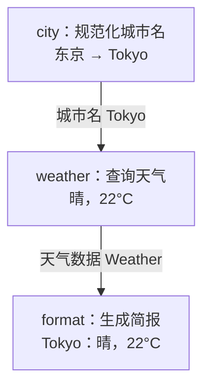
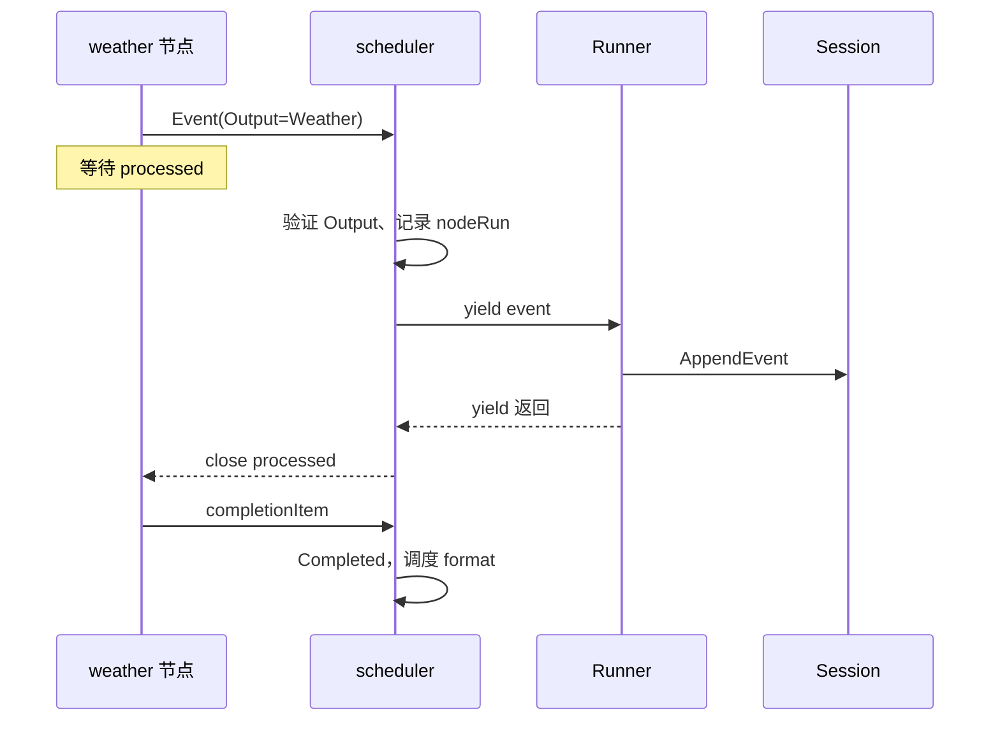
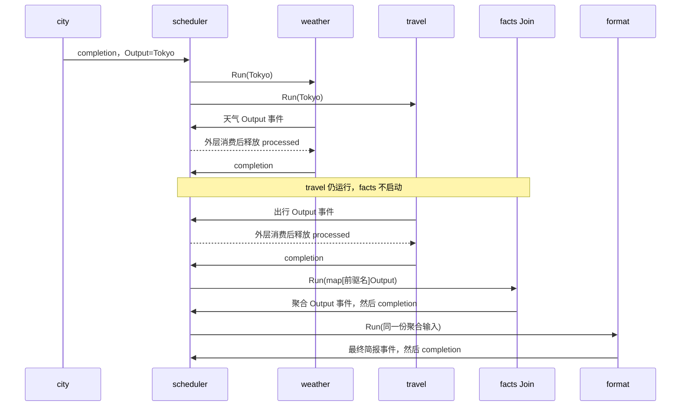
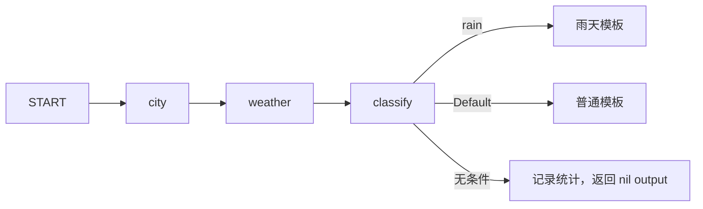
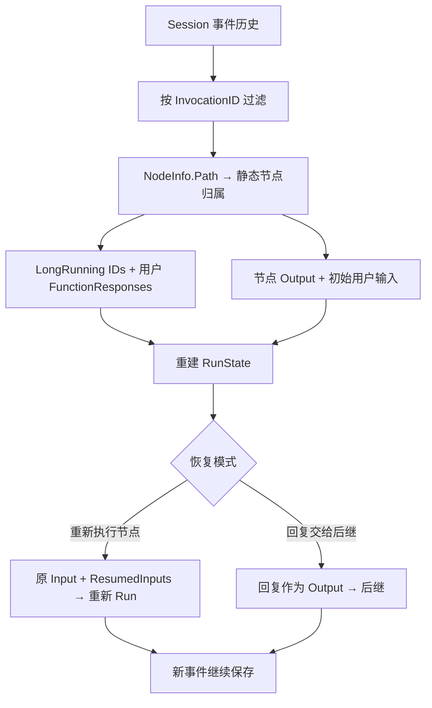

# ADK-Go 源码阅读笔记 · Workflow：图怎样执行，暂停后怎样继续

> **源码基准：[ADK-Go v2.4.0](https://github.com/google/adk-go/tree/v2.4.0)**，commit `4e57df40cbd35f055ba654b03ffb0e509fdd754a`。下文的“当前实现”均指此版本。
>
> 本文完整比较三组相关代码：`workflow` 定义 Node、Edge 与图调度，`agent/workflowagent` 将图接入 Agent/Runner，`agent/workflowagents` 下的 Sequential、Parallel、Loop 直接组合已有 Agent。先解释图的构建与执行，再比较两种组合方式的数据传递、并发、停止和恢复边界。
>
> [返回 ADK 源码阅读合集](/blog/adk/) · 配套阅读：[Agent](/blog/adk-agent/)、[Runner](/blog/adk-runner/)、[Context](/blog/adk-context/)、[Tool](/blog/adk-tool/)、[Plugin](/blog/adk-plugin/)。

用户要求“为东京生成天气简报”。最小实现可以是三个确定性节点：规范化城市名、查询天气、格式化简报。以后还可以同时查询出行提示，根据天气路由到不同模板，或者在发送简报前等待用户确认。



图中的天气是示例程序返回的固定数据。`city` 输出城市名，`weather` 输出天气结构，`format` 把结构化数据变成简报文本；节点之间的箭头对应后文的 `Edge`。

Workflow 解决的是：**把节点产生的事件解释为输出、路由与等待信号，再决定谁能开始、谁必须暂停、下一次输入应该交给谁。** 它不要求每个节点调用模型，也不把每个节点当作一轮聊天。

节点返回事件迭代器；普通数据只是 `Event.Output`，控制信息还包括 Routes、NodeInfo 和 LongRunningToolIDs。

### 阅读前分清图定义、运行状态与关联 ID

| 名称 | 含义 | 本文示例 |
| --- | --- | --- |
| 图（内部 `graph`） | 节点与边的结构索引，不保存当前 goroutine | 出边表与入边表 |
| 边（公开 `Edge`） | 一个来源、一个目标和可选条件 | `weather → facts` |
| Node | 可被图调度的定义对象 | `city`、`weather`、`format` |
| activation | 某个 Node 的一次执行 | `weather` 第一次运行 |
| InvocationID | 一次逻辑运行；暂停与回复可沿用 | `inv-1` |
| Path / RunID | 节点在层级执行树中的位置与运行编号 | `weather_report@1/weather@1`、`1` |
| Branch | LLM 历史可见范围的分支标识 | 并行执行后的 `weather@1` |
| InterruptID | 用户输入请求与回复的关联键 | `approve-inv-1` |

Path 用斜杠描述层级，Branch 用点描述历史分支；二者不是同一个字符串。静态 scheduler 的 RunID 当前固定为 `1`，动态子调度器才有自动递增或显式 `WithRunID` 语义。

## 一、源码入口与阅读地图

| 顺序 | 源码与符号 | 阅读重点 |
| --- | --- | --- |
| 1 | [`workflow/workflow.go#L30-L54`](https://github.com/google/adk-go/blob/v2.4.0/workflow/workflow.go#L30-L54) `Node` | 输入验证、输出验证与事件迭代器 |
| 2 | [`graph.go#L17-L96`](https://github.com/google/adk-go/blob/v2.4.0/workflow/graph.go#L17-L96)、[`workflow.go#L125-L146`](https://github.com/google/adk-go/blob/v2.4.0/workflow/workflow.go#L125-L146) | Graph、Edge、入口与终端 |
| 3 | [`workflow/workflow.go#L238-L329`](https://github.com/google/adk-go/blob/v2.4.0/workflow/workflow.go#L238-L329) `New/Run/RunNode` | 构建静态图、创建每次运行的 scheduler |
| 4 | [`workflow/scheduler.go#L249-L405`](https://github.com/google/adk-go/blob/v2.4.0/workflow/scheduler.go#L249-L405) | 节点 goroutine、路径、并发上限 |
| 5 | [`workflow/scheduler.go#L434-L648`](https://github.com/google/adk-go/blob/v2.4.0/workflow/scheduler.go#L434-L648) | event/completion 队列与消费者握手 |
| 6 | [`workflow/scheduler.go#L816-L1086`](https://github.com/google/adk-go/blob/v2.4.0/workflow/scheduler.go#L816-L1086) | 完成、等待、重试、路由与 Join |
| 7 | [`workflow/persistence.go#L60-L115`](https://github.com/google/adk-go/blob/v2.4.0/workflow/persistence.go#L60-L115)、[`resume.go#L73-L230`](https://github.com/google/adk-go/blob/v2.4.0/workflow/resume.go#L73-L230) | 从历史重建，按中断 ID 恢复 |
| 8 | [`agent/workflowagent/workflow.go#L34-L158`](https://github.com/google/adk-go/blob/v2.4.0/agent/workflowagent/workflow.go#L34-L158) | 把图接入普通 Agent/Runner 调用方式 |
| 9 | [`sequentialagent#L80-L91`](https://github.com/google/adk-go/blob/v2.4.0/agent/workflowagents/sequentialagent/agent.go#L80-L91)、[`parallelagent#L68-L172`](https://github.com/google/adk-go/blob/v2.4.0/agent/workflowagents/parallelagent/agent.go#L68-L172)、[`loopagent#L75-L105`](https://github.com/google/adk-go/blob/v2.4.0/agent/workflowagents/loopagent/agent.go#L75-L105) | 直接组合 Agent 的执行循环与停止条件 |

```text
应用构造
  NewFunctionNode / NewAgentNode / NewToolNode / NewDynamicNode
                         │
                 []workflow.Edge
                         │
                workflow.New(name, edges)
                         │
执行入口                 ▼
  Workflow.Run / RunNode → newScheduler（每次新建）
                         │
      ┌──────────────────┼──────────────────┐
      ▼                  ▼                  ▼
  node goroutine    node goroutine     node goroutine
      └──────────────────┼──────────────────┘
                         ▼
                eventQueue + completion
                         ▼
            单消费者更新运行状态、选择后继
                         ▼
                 外层 Runner 保存事件
```

`Workflow` 保存图定义，`scheduler` 保存本次进程内运行的 goroutine、取消函数、计时器和状态表。`workflowagent.New` 把图装进一个 Agent：其 `Run` 根据用户消息选择新的 `Workflow.Run` 或 `Workflow.Resume`，并不把所有节点改造成 LlmAgent。

## 二、核心接口与数据结构

### 1. Node 的真实契约

以下为接口**源码摘录**，保留全部方法，省略大部分注释（[`workflow.go#L30-L54`](https://github.com/google/adk-go/blob/v2.4.0/workflow/workflow.go#L30-L54)）：

```go
type Node interface {
    Name() string
    Description() string
    Config() NodeConfig
    InputSchema() *jsonschema.Resolved
    OutputSchema() *jsonschema.Resolved
    ValidateInput(input any) (any, error)
    ValidateOutput(output any) (any, error)
    Run(ctx agent.Context, input any) iter.Seq2[*session.Event, error]
}
```

`Run` 不是返回一个最终值的函数。本文的内置 FunctionNode/Workflow 把执行放在返回的函数里，调用者 range 消费时才推进。Node 接口本身不禁止自定义实现先做准备甚至副作用，再返回 iterator。节点可以先发进度事件，再发一次 output，也可以只请求输入而不发 output。消费者停止迭代时，scheduler 取消进行中的节点并收尾。

自定义节点通常嵌入 `BaseNode`，继承名称、配置与默认 schema 验证，只实现 Run（[`base_node.go#L29-L94`](https://github.com/google/adk-go/blob/v2.4.0/workflow/base_node.go#L29-L94)）。schema 为 nil 时不做相应验证。不要把 `any` 当成“忽略数据契约”：具体 FunctionNode 泛型包装还可能执行 Go 类型转换。

### 2. 现成节点各自适配什么

| 节点 | 输入到输出 | 适合用途 | 关键边界 |
| --- | --- | --- | --- |
| FunctionNode | `IN → OUT`，包装为 Event | 城市名规范化、JSON 转换、业务计算 | 普通返回值进入 Output；`*session.Event` 可自行携带 Routes |
| EmittingFunctionNode | `IN + emit → OUT` | 进度、状态事件、HITL 请求 | `ErrNodeInterrupted` 被吞为正常暂停信号，前面必须已发等待事件 |
| AgentNode | node input → Agent 的 UserContent → Agent events | 把 LLM 能力放入图 | 最终模型文本可成为 MessageAsOutput，等待事件不算最终业务输出 |
| ToolNode | node input → Tool.Run → Output | 直接运行本地同步工具 | 不经过 LLM Flow 的 `callTool`；不能假设自动获得它的 callback/确认协议 |
| JoinNode | 多个前驱完成后的 map → 同一 map | 等所有并行结果后汇合 | 需要显式 Join；普通节点多条入边不等于 等待全部前驱的条件 |
| DynamicNode | 在函数体里用 `RunNode` 调子节点 | 运行期循环、条件和动态子任务 | 子调用通过动态 scheduler，恢复时可能从函数开头重入 |
| WorkflowNode | input → 嵌套 Workflow.RunNode | 子图复用 | 名称与层级路径要保持可区分 |

相关实现见 [`function_node.go#L322-L381`](https://github.com/google/adk-go/blob/v2.4.0/workflow/function_node.go#L322-L381)、[`agent_node.go#L85-L193`](https://github.com/google/adk-go/blob/v2.4.0/workflow/agent_node.go#L85-L193)、[`tool_node.go#L158-L184`](https://github.com/google/adk-go/blob/v2.4.0/workflow/tool_node.go#L158-L184)。

AgentNode 中，未声明模式的 LlmAgent 以图节点的 `single_turn` 默认模式运行，绑定放在传给该 Agent 的 context 中，不会把同级 Agent 的模式一起改变（[`agent_node.go#L104-L145`](https://github.com/google/adk-go/blob/v2.4.0/workflow/agent_node.go#L104-L145)）。图构造还会校验 task/chat 模式的放置条件；“Agent 实现了接口”不代表所有模式都能随意放进任何图边。

### 3. Output、Routes、Content 是三个不同通道

```text
Event E-weather
  Content      = 给用户/模型看的消息，可为空
  Output       = {city:Tokyo, temperature_c:22, condition:sunny}
  Routes       = ["normal"]            控制哪些边触发
  NodeInfo.Path= weather_report@1/weather@1
  InvocationID = inv-1
```

- **Output** 决定下游输入。普通字符串 FunctionNode 的输出可以只有 Output，不能因此假设 UI 一定显示文字。
- **Routes** 用于匹配条件边。输出 `"normal"` 本身不会自动生成 route tag。
- **Content** 服务聊天协议或展示。AgentNode 通过 `NodeInfo.MessageAsOutput` 声明某条模型消息同时承担输出，恢复时也可从消息还原。

scheduler 每次 activation 至多接受一个 output 和一个 routing event；第二次设置分别记录 `ErrMultipleOutputs`、`ErrMultipleRoutingEvents`（[`scheduler.go#L37-L51`](https://github.com/google/adk-go/blob/v2.4.0/workflow/scheduler.go#L37-L51)）。多个进度事件应避免都携带 Output。动态子节点的事件按 NodeInfo.Path 区分归属，不能被父节点当成自己的多个输出。

### 4. NodeConfig 控制执行，不是状态本身

[`config.go#L55-L91`](https://github.com/google/adk-go/blob/v2.4.0/workflow/config.go#L55-L91) 中值得先认识这些字段：

| 配置 | 当前语义 |
| --- | --- |
| `RetryConfig == nil` | 不自动重试；调用 `DefaultRetryConfig()` 才启用那套默认策略 |
| `Timeout > 0` | 单次 activation 的 deadline，仍受父 context deadline 约束 |
| `RerunOnResume: &true` | 恢复时重新进入该节点函数 |
| `RerunOnResume: nil / &false` | 通常按“把回复交给后继”处理；DynamicNode 的构造器会把 nil 改为 true |
| `WaitForOutput` | 当前主要在动态 RunNode 路径解释，不能当作所有静态节点的 Join 开关 |
| `ParallelWorker` | 对列表输入进行逐项并发执行并聚合；与图上的并行执行是不同维度 |

三态指针允许节点构造器区分“未配置”和“明确禁用”。直接使用 `NodeConfig{}` 与 DynamicNode 默认后的 Config，恢复行为可能不同。

### 5. Graph：保存连接关系，不保存正在运行的任务

图（graph）描述“有哪些节点、谁连接谁”；调度器（scheduler）描述“这一次运行中谁在执行、谁完成、谁在等待”。这两个对象需要分开理解：同一份图定义可以用于多个 Session，每次调用 Run 都新建运行状态，不能把图里的 Node 对象当成一次执行的状态记录。

v2.4.0 没有让应用直接构造的公开 `Graph` 类型。应用提供公开的 `Node` 和 `[]Edge` 给 `workflow.New`，返回公开 `*Workflow`；Workflow 内部持有未导出的 `*graph`。未导出表示它只在 workflow 包内部使用，并不是应用应该导入的另一个 internal 包。

下面是**源码摘录**，展示这两层类型的关系（[`workflow.go#L125-L151`](https://github.com/google/adk-go/blob/v2.4.0/workflow/workflow.go#L125-L151)、[`graph.go#L20-L24`](https://github.com/google/adk-go/blob/v2.4.0/workflow/graph.go#L20-L24)）：

```go
// 应用可构造的公开类型。Edge 定义在 workflow.go。
type Edge struct {
    From  Node  // The source node
    To    Node  // The target node
    Route Route // Routing condition
}

// 包内类型。应用不直接访问它的字段。
type graph struct {
    successors    map[Node][]Edge
    predecessors  map[Node][]Edge
    isRootWrapper bool
}
```

`newGraph` 对每条边写入两张表：

- **出边表 `successors[from]`**：从某节点出发能检查哪些边。city 完成后，scheduler 从这里找到 weather 和 travel。
- **入边表 `predecessors[to]`**：哪些节点连接到这个目标。facts Join 从这里知道必须等待 weather 和 travel。
- **全部节点**由两张表的 key 求并集得到，没有额外公开的“节点注册列表”。一个完全没出现在 Edge 里的节点不会进入这张图。

构建过程见 [`graph.go#L26-L37`](https://github.com/google/adk-go/blob/v2.4.0/workflow/graph.go#L26-L37)，节点集合见 [`#L66-L79`](https://github.com/google/adk-go/blob/v2.4.0/workflow/graph.go#L66-L79)。表以 Node 对象为 key；运行时还另建 `nodesByName`，用于收到 `completionItem.nodeName` 后找回 Node 定义（[`scheduler.go#L249-L275`](https://github.com/google/adk-go/blob/v2.4.0/workflow/scheduler.go#L249-L275)）。

这解释了为什么名称和对象身份都重要：多个边引用同一个 weather Node 是正常用法；创建两个不同 Node 对象却都取名 weather，会让运行状态无法按名字区分，因此构建校验拒绝它。出边列表保留构造边时的顺序，但全部节点由 map 收集，不应把它的枚举顺序当成执行顺序。

图建立时复制 Edge 的值进入邻接表，之后改写原 edges slice 不会重接已构建的图；但这不是对 Node、Route 所引用对象的深复制。图定义构造完成后，应保持节点身份与配置稳定。

### 6. Edge：从哪里到哪里、什么条件下触发

Edge 只有三个字段，**没有输入映射函数、表达式或字段选择器**：

| 字段 | 保存什么 | 天气例子 |
| --- | --- | --- |
| `From` | 来源 Node 对象 | city |
| `To` | 目标 Node 对象 | weather |
| `Route` | 可选匹配条件 | nil 表示无条件 |

Edge 本身不调用下游。它只是定义；只有来源节点完成、scheduler 选择后继时，边才参与计算。普通目标的 input 来自来源节点本次 activation 的 Output；Route 只决定选不选这个目标，不改变传递的数据。

公开构造 API 都在 [`edgebuilder.go#L22-L93`](https://github.com/google/adk-go/blob/v2.4.0/workflow/edgebuilder.go#L22-L93)。下面是**等价配置片段**，假设 city/weather/travel/facts/format 已按第三章定义：

```go
// 显式六条边。
edges := []workflow.Edge{
    {From: workflow.Start, To: city},
    {From: city, To: weather},
    {From: city, To: travel},
    {From: weather, To: facts},
    {From: travel, To: facts},
    {From: facts, To: format},
}

// 同一拓扑的 builder 写法，二选一使用。
edges = workflow.NewEdgeBuilder().
    Add(workflow.Start, city).
    AddFanOut(city, weather, travel).
    AddFanIn(facts, weather, travel).
    Add(facts, format).
    Build()
```

几个名字容易让人想多：

- `AddFanOut` 只是追加多条无条件出边；并发启动发生在 scheduler，不发生在 builder。
- `AddFanIn` 只是追加多条无条件入边；它不会把任意目标自动变成 JoinNode。facts 必须由 `NewJoinNode` 明确创建。
- `Chain(a,b,c)` 产生 `a→b`、`b→c`；它不是一个新的执行节点。
- `AddRoute` 接受 `Route`；`AddRoutes` 将 map 的字符串 key 转成 StringRoute。后者遍历 Go map，不能依赖它固定 sibling 启动次序。
- `Build` 返回边列表，不会启动节点，也不完成全部图校验；校验在 workflow.New 中。

#### 条件是在节点完成时检查的

Route 是公开接口 `Matches(*session.Event) bool`；标准 StringRoute、IntRoute、BoolRoute、MultiRoute 读取 routing event 的 `Routes []string`。整数和布尔条件也转成字符串匹配，所以 BoolRoute(true) 对应 route tag `"true"`，不是检查 Output 的 Go 布尔值（[`workflow.go#L63-L123`](https://github.com/google/adk-go/blob/v2.4.0/workflow/workflow.go#L63-L123)）。

| 同一个来源节点的出边 | 触发条件 | 是否改变传给目标的 input |
| --- | --- | --- |
| `Route == nil` | 来源成功完成后，总会成为候选 | 不改变 |
| 具体 Route | 有 routing event 且 Matches 为 true | 不改变 |
| `workflow.Default` | 本次没有具体 Route 匹配 | 不改变 |
| 条件均未匹配且无 Default | 没有这个分支的后继 | 不产生输入 |

Default 是一个特殊对象。它的 Matches 实现返回 false，scheduler 通过 `edge.Route == Default` 单独处理，不能把它实现成一个总返回 true 的自定义 Route 来代替。

无条件边不算“匹配到具体条件”，所以它和 Default 可以同时触发；多个具体条件也可以同时成立。框架不是见到第一条匹配边就停止。相同目标通常在一次后继计算里去重，构建期还禁止相同 From/To 重复出现；如果同一目标允许多个 route，应使用 MultiRoute。实际计算见 [`scheduler.go#L986-L1034`](https://github.com/google/adk-go/blob/v2.4.0/workflow/scheduler.go#L986-L1034)。

#### 输入映射要放到节点中

设 weather 返回：

```text
Output = {city:"Tokyo", temperature_c:22, condition:"sunny"}
```

边 `weather → format` 把**整个 Output**交给 format，不会因为 format 参数名叫 temperature 就只选中 temperature_c。需要重命名字段、取子字段、合并业务数据时，可增加一个 FunctionNode，或者在目标节点的输入转换中显式处理。

多个普通后继收到的是同一个来源 output 值；scheduler 的 `successor.input` 和 `NodeState.Input` 直接保存它，没有逐边深复制。若 output 包含 map、slice 或指针，并行节点不应随意原地修改共享数据，应复制后再改，或约定输入只读。目标的 ValidateInput 仍可能转换或复制数据；调度层本身没有统一深复制保证。数据传递与类型转换分别见 [`scheduler.go#L1048-L1055`](https://github.com/google/adk-go/blob/v2.4.0/workflow/scheduler.go#L1048-L1055)、[`#L395-L399`](https://github.com/google/adk-go/blob/v2.4.0/workflow/scheduler.go#L395-L399)。

Join 是特殊目标：它不直接采用“最后一个完成前驱的 output”，而是重新读取**全部声明前驱**的 NodeState.Output，组装 `map[前驱名]输出`。已经 Completed 但没有 Output 的前驱贡献 nil；尚未 Completed 的前驱会阻止本次调度 Join（[`scheduler.go#L1042-L1086`](https://github.com/google/adk-go/blob/v2.4.0/workflow/scheduler.go#L1042-L1086)）。

### 7. START、终端与构建校验

`workflow.Start` 是公开的入口哨兵 Node，名称为 START。它的 Run 返回空事件序列；scheduler 在它完成时特别传递用户 seed input，而不是读取不存在的 START.Output（[`workflow.go#L132-L146`](https://github.com/google/adk-go/blob/v2.4.0/workflow/workflow.go#L132-L146)、[`scheduler.go#L927-L935`](https://github.com/google/adk-go/blob/v2.4.0/workflow/scheduler.go#L927-L935)）。

该 API 没有对应的公开 End 哨兵。终端节点是**出边为空的普通节点**，排除 START；天气图的 format 就是终端。图可以有多个终端，但一次正常执行最终只能有至多一个终端产生非 nil Output，否则 finalize 报 ErrMultipleTerminalOutputs。终端节点形状与这次实际终端输出是两个判断（[`graph.go#L82-L96`](https://github.com/google/adk-go/blob/v2.4.0/workflow/graph.go#L82-L96)、[`scheduler.go#L650-L678`](https://github.com/google/adk-go/blob/v2.4.0/workflow/scheduler.go#L650-L678)）。

`workflow.New` 先校验 Node/入口和子 Workflow 名称，再建图并进行图级校验（[`workflow.go#L238-L267`](https://github.com/google/adk-go/blob/v2.4.0/workflow/workflow.go#L238-L267)）：

| 构造步骤 | 检查什么 | 能提前发现的问题 |
| --- | --- | --- |
| validateNodes | Node 名称唯一、存在 Start 出边、不能指回 Start、Agent 模式放置 | 两个不同对象重名、没有入口、错误放置 task/chat Agent |
| validateSubWorkflowNames | 子图与父图的名称 | 名称冲突 |
| newGraph | 建立出边、入边索引 | 此步骤不执行用户函数 |
| validateUniqueEdges / DefaultRoute | 相同 From/To 不重复、每个源至多一个 Default | 反复添加同一连接、多个 fallback |
| validateConnectivity | Edge 中所有节点从 Start 结构可达 | 与入口断开的节点 |
| validateCycles | 不允许全由无条件边构成的环 | 无条件循环 |
| validateFanIn | 普通非 Join 目标不能有多条无条件入边 | 多前驱并发覆盖按名字保存的运行记录 |
| validateStaticSchemas | 两端都声明 schema 时，规范化后比较一致性 | 上游与下游声明不一致 |
| validateStateSchemaConsistency | 使用 state 参数的节点所需字段 | 引用了 state schema 未声明字段 |

确切顺序见 [`validation.go#L68-L84`](https://github.com/google/adk-go/blob/v2.4.0/workflow/validation.go#L68-L84)、[`#L157-L179`](https://github.com/google/adk-go/blob/v2.4.0/workflow/validation.go#L157-L179)。

校验通过还不等于图一定能走到最终答案。可达性按连接关系检查，不证明运行时 route 一定会选中它；环检查只遍历 Route=nil 的边，Default 也被当成条件边，因此条件环仍需业务提供退出条件。schema 比较在一端未声明时跳过；两端都声明时比较规范化表示，不是一般意义的“任意兼容类型都接受”（[`validation.go#L290-L366`](https://github.com/google/adk-go/blob/v2.4.0/workflow/validation.go#L290-L366)、[`#L495-L524`](https://github.com/google/adk-go/blob/v2.4.0/workflow/validation.go#L495-L524)）。

Join 还要按实际实现理解：节点注释描述“仅执行一次”和“条件路由进入 Join 是配置错误”，但当前 validateFanIn 对 Join 直接跳过，scheduler 只检查前驱 Completed，没有通用的“Join 已完成就绝不再启动”判断。下面第三章的无环图确实只会调度一次 Join；若加入循环或让条件跳过前驱，不能把这两个注释推成全局保证（[`join_node.go#L27-L36`](https://github.com/google/adk-go/blob/v2.4.0/workflow/join_node.go#L27-L36)、[`validation.go#L377-L394`](https://github.com/google/adk-go/blob/v2.4.0/workflow/validation.go#L377-L394)、[`scheduler.go#L1048-L1086`](https://github.com/google/adk-go/blob/v2.4.0/workflow/scheduler.go#L1048-L1086)）。

### 8. 三个包的关系：`workflow`、`workflowagent`、`workflowagents`

这三个名字相近，但对应两种组合方式和一个适配层：

| 包 | 主要入口 | 构造结果 | 执行关系写在哪里 |
| --- | --- | --- | --- |
| `workflow` | `workflow.New(name, edges, opts...)`、各类 Node 构造器 | `*workflow.Workflow`、Node | `[]workflow.Edge`、路由、节点配置 |
| `agent/workflowagent` | `workflowagent.New(Config)` | `agent.Agent` | `Config.Edges` 创建图，再由适配器选择 Run / Resume |
| `agent/workflowagents/sequentialagent` | `sequentialagent.New(Config)` | `agent.Agent` | `AgentConfig.SubAgents` 的排列顺序 |
| `agent/workflowagents/parallelagent` | `parallelagent.New(Config)` | `agent.Agent` | 同一 `SubAgents` 列表的并发执行 |
| `agent/workflowagents/loopagent` | `loopagent.New(Config)` | `agent.Agent` | 反复遍历 `SubAgents`，受次数与 Escalate 控制 |

`workflowagents` 这个复数目录在本版本包含上面三类 Agent。它们直接组合 Agent 的运行过程，不会先把 `SubAgents` 自动翻译成 `workflow.Edge`。

```text
方式一：显式定义节点与边

  workflow.Node + []workflow.Edge
                  |
                  v
          workflow.Workflow
                  |
      agent/workflowagent 适配
                  |
                  v
             agent.Agent ----> Runner

方式二：组合已有 Agent

  []agent.Agent
       |
       +-- sequentialagent：按顺序运行
       +-- parallelagent：并发运行
       +-- loopagent：反复运行
                  |
                  v
             agent.Agent ----> Runner
```

`workflowagent` 使用 `workflow`，`workflowagents` 则提供另一组直接组合 Agent 的实现。两种方式都能交给 Runner，并不意味着它们内部使用同一套调度算法。

#### `workflowagent`：让图成为 Runner 可以执行的 Agent

以下为 [`workflowagent.Config`](https://github.com/google/adk-go/blob/v2.4.0/agent/workflowagent/workflow.go#L34-L42) 的源码摘录：

```go
type Config struct {
    Name                 string
    Description          string
    SubAgents            []agent.Agent
    BeforeAgentCallbacks []agent.BeforeAgentCallback
    AfterAgentCallbacks  []agent.AfterAgentCallback
    Edges                []workflow.Edge
}
```

构造函数实际完成两次装配：

```text
workflowagent.New(cfg)
  -> workflow.New(cfg.Name, cfg.Edges)
  -> 保存 workflow 定义
  -> agent.New(agent.Config{
       Name / Description / SubAgents / callbacks,
       Run: wrapper.run,
     })
  -> 返回 agent.Agent
```

源码：[New](https://github.com/google/adk-go/blob/v2.4.0/agent/workflowagent/workflow.go#L50-L81)。这里 `Edges` 描述图的连接关系，`SubAgents` 描述 Agent tree；把 Agent 填进 SubAgents，并不会自动替它生成图节点和边。`workflow.New` 的其他可选参数也不是 `workflowagent.Config` 中自动存在的同名字段。

在 Runner 驱动这个 Agent 后，适配器检查当前用户内容：

```text
wrapper.run(ctx)
  -> detectResume(ctx.UserContent())
       |
       +-- 没有匹配的 FunctionResponse -> workflow.Run(ctx)
       |
       +-- name == adk_request_input
              -> 按 FunctionResponse.ID 收集用户回复
              -> ReconstructRunState(Session, InvocationID)
              -> workflow.Resume(context, state, responses)
```

`decodeWorkflowInputResponse` 按 `response`、`payload`、完整 Response map 的优先级提取数据；`response` 是字符串时还会尝试 JSON 解码。因此 UI 只发送一句“批准”与发送带正确 name、ID 和 payload 的 FunctionResponse，不是同一种输入。

适配器本身只持有图定义；当前恢复调用从 Session 的事件历史重建运行状态。不要仅根据旧注释中的“state lives in session.State”就推断它保存了一份可直接读取的运行状态对象。依据：[run / detectResume](https://github.com/google/adk-go/blob/v2.4.0/agent/workflowagent/workflow.go#L95-L158)、[回复解码](https://github.com/google/adk-go/blob/v2.4.0/agent/workflowagent/workflow.go#L161-L187)。

#### `workflowagents`：三个组合器分别怎样运行

**SequentialAgent** 的主体是两层循环，外层遍历 SubAgents，内层消费当前子 Agent 的全部事件，再进入下一个子 Agent。它不按 `Event.Output` 建立一条有类型的边，也不自动把上一个 Agent 的返回值作为下一个 Agent 的函数参数。

```text
SequentialAgent.SubAgents = [weather, travel, writer]

weather.Run -> 全部事件结束
                 |
                 v
travel.Run  -> 全部事件结束
                 |
                 v
writer.Run  -> 全部事件结束
```

需要传递业务数据时，应约定共享 State key，或通过可见的 Session 历史传递上下文。例如上游 LlmAgent 使用不同的 OutputKey 保存结果，下游的 instruction 读取这些 key。不能假设只把三个 Agent 排在一起，就已经定义好了数据结构与验证规则。

实现见 [`sequentialagent.Run`](https://github.com/google/adk-go/blob/v2.4.0/agent/workflowagents/sequentialagent/agent.go#L80-L91)。该循环转发 error，并没有在此处写出统一的 `err != nil` 返回规则；后续是否执行还受调用方是否继续消费、子 Agent 和 Context 的状态影响。

**ParallelAgent** 给每个子 Agent 创建运行上下文和 goroutine，经 channel 转发各自的事件。事件到达次序取决于实际执行速度；运行结束时等待所有子任务收尾，不会自动生成一个包含所有业务结果的 Join 输出 map。

```text
                      +--> weather.Run --+
ParallelAgent.Run ----|                  +--> 事件 channel --> 外层消费
                      +--> travel.Run ---+
                             |
                所有子任务结束并完成清理
                             |
                  ParallelAgent 的运行返回
```

分支历史使用不同的 Branch，但子 Agent 仍共享 Session、Artifact/Memory 服务等对象。不同 Branch 不等于不同 State 数据库；同时写同一个 key 仍需要应用约定。每条事件后的 ack 只表示上层 yield 已返回，正常的非 partial 成功路径中包含 Session 追加，但 ack 本身不是存储成功证明。

源码：[创建分支与并发任务](https://github.com/google/adk-go/blob/v2.4.0/agent/workflowagents/parallelagent/agent.go#L68-L116)、[事件转发与等待](https://github.com/google/adk-go/blob/v2.4.0/agent/workflowagents/parallelagent/agent.go#L118-L172)。其内部 `run` 会在返回结果迭代函数前启动子任务；不能仅凭返回类型，就推断每层函数开始工作的时机完全相同。

**LoopAgent** 每一轮按顺序运行 SubAgents。`MaxIterations > 0` 时，在整轮结束后扣减次数；为 0 时不按次数结束。观察到 `event.Actions.Escalate` 后，它仍先消费完当前子 Agent 的事件，再在子 Agent 结束处返回，不继续运行这一轮剩下的子 Agent。

```text
LoopAgent: SubAgents=[draft, review], MaxIterations=3

第1轮：draft -> review
第2轮：draft -> review -- Escalate --> 当前 review 结束后返回
第3轮：不再运行
```

`Escalate`、`IsFinalResponse()` 和次数上限不是同一个判定。某个子 Agent 生成了 final 文本，不代表 LoopAgent 已收到退出循环的动作。源码：[`loopagent.Config`](https://github.com/google/adk-go/blob/v2.4.0/agent/workflowagents/loopagent/agent.go#L28-L36)、[`Run`](https://github.com/google/adk-go/blob/v2.4.0/agent/workflowagents/loopagent/agent.go#L75-L105)。

三个构造器都接管 `AgentConfig.Run`；应用不能再向同一个配置提供自定义 Run。如果需要不同的执行策略，可以使用自定义 Agent，或把过程明确写成 workflow 的节点和边。

#### 同一个天气任务，怎样选择表达方式

假设希望同时查询天气与出行建议，再写一份简报：

```text
Agent 组合方式
  SequentialAgent
    +-- ParallelAgent[weatherAgent, travelAgent]
    |      通过约定的不同 State key 保存结果
    +-- writerAgent 读取结果并生成简报

图方式
  city Node
    +-- Edge --> weather Node --+
    +-- Edge --> travel Node ---+--> JoinNode --> format Node
         输出与边定义后继输入；Join 显式表达等待条件
```

下列为构造片段，`weatherAgent`、`travelAgent`、`writerAgent` 均为已创建的 `agent.Agent`，错误处理不能省略：

```go
collect, err := parallelagent.New(parallelagent.Config{
    AgentConfig: agent.Config{
        Name: "collect",
        SubAgents: []agent.Agent{weatherAgent, travelAgent},
    },
})
if err != nil {
    return err
}
report, err := sequentialagent.New(sequentialagent.Config{
    AgentConfig: agent.Config{
        Name: "report",
        SubAgents: []agent.Agent{collect, writerAgent},
    },
})
if err != nil {
    return err
}
```

这段代码定义执行顺序，业务数据如何从查询者传给写作者仍需要各 Agent 自己约定。图版本则把输入、输出和连接关系明确放在 Node、Edge、JoinNode 中。

| 需要表达的事情 | 通常适合的入口 |
| --- | --- |
| 已有几个 Agent，按固定顺序运行 | SequentialAgent |
| 几个相互独立的 Agent 并发工作 | ParallelAgent；需要统一回答时再接一个汇总 Agent |
| 反复生成、检查，按次数或退出动作结束 | LoopAgent |
| 显式数据输入输出、条件边、多分支 Join、节点级等待与恢复 | workflow 图 |
| 希望图由已有 Launcher / Runner / Agent 回调入口使用 | 在图定义外使用 workflowagent |

两种组合方式可以进一步嵌套，但要分别检查历史可见性、状态 key、取消和恢复的边界。SequentialAgent 或 ParallelAgent 本身并不因为名字包含 workflow，就自动拥有图引擎的 Routes、Join 和历史重建算法。


## 三、主执行流：从简单链到五节点分支图

### 1. 一个无需模型服务的完整例子

下面是**可运行示例**，天气数据固定为本地示例值，便于只观察图执行；它不查询真实天气。模块依赖 `google.golang.org/adk/v2 v2.4.0`，源码的 Go 版本要求为 `go 1.26.6`。

```go
package main

import (
    "context"
    "fmt"
    "log"
    "strings"

    "google.golang.org/adk/v2/agent"
    "google.golang.org/adk/v2/agent/workflowagent"
    "google.golang.org/adk/v2/model"
    "google.golang.org/adk/v2/runner"
    "google.golang.org/adk/v2/session"
    "google.golang.org/adk/v2/workflow"
    "google.golang.org/genai"
)

type Weather struct {
    City string `json:"city"`
    TemperatureC int `json:"temperature_c"`
    Condition string `json:"condition"`
}

func main() {
    city := workflow.NewFunctionNode("city",
        func(_ agent.Context, input string) (string, error) {
            if strings.Contains(input, "东京") { return "Tokyo", nil }
            return "", fmt.Errorf("本例只接受东京")
        }, workflow.NodeConfig{})

    weather := workflow.NewFunctionNode("weather",
        func(_ agent.Context, city string) (Weather, error) {
            return Weather{City: city, TemperatureC: 22, Condition: "晴"}, nil
        }, workflow.NodeConfig{})

    format := workflow.NewFunctionNode("format",
        func(ctx agent.Context, w Weather) (*session.Event, error) {
            text := fmt.Sprintf("%s：%s，%d°C", w.City, w.Condition, w.TemperatureC)
            ev := session.NewEvent(ctx, ctx.InvocationID())
            ev.Output = text
            ev.LLMResponse = model.LLMResponse{
                Content: genai.NewContentFromText(text, genai.RoleModel),
            }
            return ev, nil
        }, workflow.NodeConfig{})

    root, err := workflowagent.New(workflowagent.Config{
        Name: "weather_report",
        Edges: workflow.Chain(workflow.Start, city, weather, format),
    })
    if err != nil { log.Fatal(err) }
    r, err := runner.NewInMemory("weather-demo", root)
    if err != nil { log.Fatal(err) }

    msg := genai.NewContentFromText("为东京生成天气简报", genai.RoleUser)
    for ev, err := range r.Run(context.Background(), "u1", "s1", msg, agent.RunConfig{}) {
        if err != nil { log.Fatal(err) }
        if ev.Content == nil { continue }
        for _, p := range ev.Content.Parts {
            if p.Text != "" { fmt.Println(p.Text) }
        }
    }
}
```

将其保存为 `main.go`，在独立 Go module 中添加上述固定版本依赖后运行 `go run .`，预期文本是 `Tokyo：晴，22°C`。这里消费完整事件流，没有在任意一个 `IsFinalResponse()` 为 true 的中间节点处提前 break。图的完成由 scheduler 的节点状态和终端输出判断，不能简单复用“看到一条 final 聊天消息就停”的客户端逻辑。

### 2. 构建图和运行图分属两个时机

`workflow.Chain(Start, city, weather, format)` 只产生三条 Edge（[`edgebuilder.go#L70-L79`](https://github.com/google/adk-go/blob/v2.4.0/workflow/edgebuilder.go#L70-L79)）。`workflow.New` 校验边、节点名称和输入输出等约束，再构建 successors/predecessors 两张邻接表；它不执行函数。

```text
定义期：
  Edge{START → city}
  Edge{city → weather}
  Edge{weather → format}
           │
           ▼
  graph.successors / graph.predecessors

运行期：
  userInput = "为东京生成天气简报"
      START.Input → city.Input
      city.Output="Tokyo" → weather.Input
      weather.Output=Weather{...} → format.Input
      format.Output="Tokyo：晴，22°C"
```

`Workflow.Run` 给命名 Workflow 建立 `weather_report@1` 路径，再用 UserContent 中拼接的文本作为 seed input；`RunNode` 创建新的 scheduler，调度 START（[`workflow.go#L277-L346`](https://github.com/google/adk-go/blob/v2.4.0/workflow/workflow.go#L277-L346)）。START 的 Run 不产生事件，完成时把自己的 Input 转交后继，这是一个明确的特殊规则。

### 3. 每次节点启动会创建什么

`startNode` 为节点派生带 Path、RunID、Branch、ResumeInputs 的 Context，再创建 timeout/cancel context，写入 `NodeRunning` 并启动 goroutine（[`scheduler.go#L358-L405`](https://github.com/google/adk-go/blob/v2.4.0/workflow/scheduler.go#L358-L405)）。

| 对象 | 创建者 | 正常 weather activation 的值 | 何时消费 |
| --- | --- | --- | --- |
| NodeState | scheduler | Input=`Tokyo`, Status=Running, TriggeredBy=`city` | 完成或恢复时 |
| nodeRun | scheduler | output 尚无，routingEvent 尚无 | 每个事件到达时更新 |
| node Context | startNode | Path=`weather_report@1/weather@1`, RunID=`1` | handler 运行期间 |
| Event | FunctionNode | Output=Weather | scheduler 验证并转交外层 |
| completionItem | runNode 的 defer | nodeName=`weather`, err=nil | 后继调度 |

`ValidateInput` 在真正进入 `Node.Run` 前执行。FunctionNode 先尝试 Go 类型断言，失败时借助 JSON 类型转换将 map 等对象转换成泛型输入；所以“上游回传 map，下游接收 struct”可以成立，但仍必须满足结构与 schema（[`function_node.go#L244-L283`](https://github.com/google/adk-go/blob/v2.4.0/workflow/function_node.go#L244-L283)）。

### 4. 最容易漏掉的事件握手

节点不是把事件丢进 channel 就立刻继续。非 partial event 附有 `processed` channel：生产者发送之后等它关闭；消费者调用外层 yield、等待它返回后才 close（[`scheduler.go#L470-L490`](https://github.com/google/adk-go/blob/v2.4.0/workflow/scheduler.go#L470-L490)、[`#L586-L601`](https://github.com/google/adk-go/blob/v2.4.0/workflow/scheduler.go#L586-L601)）。

```text
节点 goroutine              scheduler 单消费者               Runner
      │ Event + processed            │                         │
      ├─────────────────────────────>│                         │
      │ 等待 processed               ├── yield(event) ────────>│
      │                              │                  OnEvent plugin
      │                              │                  AppendEvent
      │                              │                  yield 给客户端
      │                              │<── yield 返回 ──────────┤
      │<──── close(processed) ───────┤                         │
      │ 继续节点迭代                 │                         │
      │ completionItem ─────────────>│ 调度后继                 │
```

这使天气结果 E2 能先进入 Session，再启动需要读它的后续节点。partial event 不进行同样的等待。processed 表示外层消费者已经返回，不证明某个数据库事务成功：正常 Runner 会先 AppendEvent；直接使用 Workflow 时，调用者必须自己负责持久化；如果 Plugin 拒绝事件或调用者放弃消费，也不能声称它已保存。

scheduler 先 `handleEvent`，然后 yield：它补 Branch、Content.Role 与 NodeInfo.Path，验证输出、记录路由与未解决的 interrupt。输出验证错误记录在本次 accumulator，在 completion 时成为节点错误。此版本的 `handleEvent` 不返回用于阻止 yield 的错误，因此不能将 schema 检查理解成“无效 event 一定完全不可见”（[`scheduler.go#L714-L788`](https://github.com/google/adk-go/blob/v2.4.0/workflow/scheduler.go#L714-L788)）。



### 5. 节点结束与整个图结束

完成时有明确的优先顺序（[`scheduler.go#L816-L936`](https://github.com/google/adk-go/blob/v2.4.0/workflow/scheduler.go#L816-L936)）：

1. 父 context 已取消：区分外部取消和节点自己的业务错误。
2. 节点取消、等待输出、可重试错误或不可恢复错误：分别进入取消、等待、重试或失败分支。
3. accumulator 中发现重复输出/路由、schema 错误：节点失败。
4. 仍有未解决 `LongRunningToolIDs`：`NodeWaiting`，不调度后继。
5. 否则 `NodeCompleted`，保存 Output，清除重入输入，再按路由调度后继。

没有进行中节点和重试计时器后，scheduler 结束。若有 Waiting 节点，这是一次暂停；若没有 Waiting，`finalize` 检查**实际有输出的终端节点至多一个**。图可以画出多个条件终端，但这次运行不能让两个终端同时产出互相竞争的结果（[`scheduler.go#L650-L678`](https://github.com/google/adk-go/blob/v2.4.0/workflow/scheduler.go#L650-L678)）。

### 6. 把主线扩展成五节点分支图

现在保留“东京天气简报”的输入，增加并行出行提示和一次汇合。这里有**五个工作节点** city、weather、travel、facts、format，另加入口哨兵 START。facts 是 JoinNode，不包含业务查询；format 是唯一结构终端。

```text
                         Output="Tokyo：晴，22°C"
                         ┌──── weather ────┐
                         │                 │
START ──> city ───────────┤                 ├──> facts ──> format
          Output="Tokyo" │                 │    Join       唯一终端
                         └──── travel ─────┘
                         Output="适合步行"

每条箭头都是 Edge；这张图的六条边都没有 Route 条件。
city 完成后可同时启动 weather/travel。
facts 必须等这两个声明前驱都 Completed。
```

图内部的两张表可写成下面的**邻接关系示意**。它不是 map 的实际打印顺序：

```text
出边 successors                         入边 predecessors
START   → [START→city]                   START   → []
city    → [city→weather, city→travel]     city    → [START→city]
weather → [weather→facts]                weather → [city→weather]
travel  → [travel→facts]                  travel  → [city→travel]
facts   → [facts→format]                 facts   → [weather→facts, travel→facts]
format  → []                            format  → [facts→format]
```

注意 city 出边表告诉 scheduler“可以启动谁”；facts 入边表告诉 scheduler“是否等齐”。如果只保存前一张表，最后一个完成的节点无法知道 facts 还依赖谁，这正是 graph 同时建立两种索引的原因。

#### 完整公开 API 示例

下面是**可运行示例**，同样使用固定天气数据，不需要模型凭据。它使用 `workflow.New` 配置并发上限，并把 `graph.Run` 作为普通 Agent 的 Run。这里局部变量 graph 的类型是公开 `*workflow.Workflow`，不是内部 `graph` 类型；该包装仅演示新的完整运行，人工输入自动恢复仍使用前面的 workflowagent 适配方式。

```go
package main

import (
	"context"
	"fmt"
	"log"
	"strings"

	"google.golang.org/adk/v2/agent"
	"google.golang.org/adk/v2/model"
	"google.golang.org/adk/v2/runner"
	"google.golang.org/adk/v2/session"
	"google.golang.org/adk/v2/workflow"
	"google.golang.org/genai"
)

func main() {
	city := workflow.NewFunctionNode("city",
		func(_ agent.Context, input string) (string, error) {
			if !strings.Contains(input, "东京") {
				return "", fmt.Errorf("本例只接受东京")
			}
			return "Tokyo", nil
		}, workflow.NodeConfig{})

	weather := workflow.NewFunctionNode("weather",
		func(_ agent.Context, city string) (string, error) {
			return city + "：晴，22°C", nil
		}, workflow.NodeConfig{})

	travel := workflow.NewFunctionNode("travel",
		func(_ agent.Context, city string) (string, error) {
			return "适合步行", nil
		}, workflow.NodeConfig{})

	facts := workflow.NewJoinNode("facts")
	format := workflow.NewFunctionNode("format",
		func(ctx agent.Context, input map[string]any) (*session.Event, error) {
			text := fmt.Sprintf("%v；%v", input["weather"], input["travel"])
			ev := session.NewEvent(ctx, ctx.InvocationID())
			ev.Output = text
			ev.LLMResponse = model.LLMResponse{
				Content: genai.NewContentFromText(text, genai.RoleModel),
			}
			return ev, nil
		}, workflow.NodeConfig{})

	edges := workflow.NewEdgeBuilder().
		Add(workflow.Start, city).
		AddFanOut(city, weather, travel).
		AddFanIn(facts, weather, travel).
		Add(facts, format).
		Build()

	graph, err := workflow.New("weather_parallel", edges, workflow.WithMaxConcurrency(2))
	if err != nil {
		log.Fatal(err)
	}
	root, err := agent.New(agent.Config{Name: "weather_parallel", Run: graph.Run})
	if err != nil {
		log.Fatal(err)
	}
	r, err := runner.NewInMemory("weather-graph-demo", root)
	if err != nil {
		log.Fatal(err)
	}
	msg := genai.NewContentFromText("为东京生成天气简报", genai.RoleUser)
	for ev, err := range r.Run(context.Background(), "u1", "s1", msg, agent.RunConfig{}) {
		if err != nil {
			log.Fatal(err)
		}
		if ev.Content == nil {
			continue
		}
		for _, part := range ev.Content.Parts {
			if part.Text != "" {
				fmt.Println(part.Text)
			}
		}
	}
}
```

在依赖 `google.golang.org/adk/v2 v2.4.0` 的独立 module 中运行 `go run .`，预期输出：

```text
Tokyo：晴，22°C；适合步行
```

weather 与 travel 可能以任意顺序完成。format 通过前驱名取值，所以无论谁先返回，最终句子的天气部分都在出行提示前。这是**格式化函数选择顺序**，不是调度器保证完成顺序。

### 7. 真正保存“谁能运行”的是哪几份数据

图没有可变的 ready 标记，scheduler 也没有一个名叫 readyQueue 的全图队列。它用几份不同用途的表协调执行（[`scheduler.go#L74-L140`](https://github.com/google/adk-go/blob/v2.4.0/workflow/scheduler.go#L74-L140)）：

| 数据结构 | 内容 | 天气/出行示例中的用途 |
| --- | --- | --- |
| `state.Nodes[name]` | NodeStatus、Input、Output、TriggeredBy、Branch | 记录 weather 是否 Completed，facts 读取它 |
| `runsByName[name]` | 正在运行节点的 output、routingEvent、错误和 interrupt 累积值 | 已收到天气 Output，但节点还没有结束时存放结果 |
| `runCancels[name]` | 本次运行的 cancel function | 超时、失败或消费者停止时请求节点退出 |
| `eventQueue` | eventItem、completionItem、retryItem | 节点向唯一消费者报告事件、结束与重试到期 |
| `pendingQueue` | 配额不足时排队的 activation | maxConcurrency=1 时暂缓 travel |
| `retryTimers` | 等待退避时间结束的重试 | weather 暂时失败时保留后续重新尝试 |

**“就绪”只是解释上的称呼**：前驱完成并经 findSuccessors 选中的目标，可以尝试启动。若配额够，直接 startNode；配额满，才进入 pendingQueue。NodePending 还可能表示正在等待重试计时器，并不等于一定在 pendingQueue 中。

Input、Output 在两份运行记录中的时机也不同。收到 weather 的输出事件时，值先进入 `runsByName["weather"].output`；只有完成通知通过检查后，才写入 `state.Nodes["weather"].Output` 并置 Completed。Join 检查后者，因此不会把“已经看见输出”误判成“前驱已结束”。

### 8. 从 START 到 format 的实际调度算法

下面是**控制流伪代码**，用于解释先后次序，不是复制完整 Go 实现：

```text
创建 scheduler
给 START 保存 seed input
尝试启动 START

只要仍有运行节点或重试计时器：
    从 eventQueue 或父 context 读取通知

    如果是 eventItem：
        更新该节点的 output / routes / interrupt 累积信息
        交给外层消费者处理事件
        释放该事件的 processed 握手
        此时不遍历出边

    如果是 completionItem：
        移除该节点的运行记录，回收并发名额
        先判断取消、失败、重试、等待
        只有可正常继续时：
            状态设为 Completed，保存 Output
            读取来源节点的出边
            按 Route 选择目标
            对 Join 检查全部前驱，组装输入
            配额足够就启动，否则进入 pendingQueue
        再尝试启动 pendingQueue 中已经排队的任务

    如果是 retryItem：
        清除对应重试计时器
        用保存的原 Input / TriggeredBy / Branch 尝试重跑

没有运行节点/重试后：
    若有 Waiting，保留为暂停
    否则检查实际终端输出是否超过一个
```

对应代码分别是 [`workflow.go#L317-L329`](https://github.com/google/adk-go/blob/v2.4.0/workflow/workflow.go#L317-L329)、[`scheduler.go#L553-L648`](https://github.com/google/adk-go/blob/v2.4.0/workflow/scheduler.go#L553-L648)、[`#L816-L936`](https://github.com/google/adk-go/blob/v2.4.0/workflow/scheduler.go#L816-L936)。

这个算法没有先给全图排出固定线性顺序。输出、完成顺序和 route 都要在运行时确定；条件循环也可能让已完成节点再次被选中。所以“按图执行”不是从左到右遍历一遍所有 Node。

#### 正常执行的逐时刻状态表

以下是**一种允许的事件顺序**：weather 先完成，travel 后完成，并发上限为 2。缩写 `—` 表示尚未调度（状态表中可能根本没有条目），`R` 表示 Running，`C` 表示 Completed。表中的“本次就绪候选”是解释用的集合，源码没有同名字段；此例配额足够，候选立即启动，pendingQueue 始终为空。

| 时刻 / 收到的通知 | city | weather | travel | facts | format | 本次就绪候选 → 动作 | 保存/传递的数据 |
| --- | --- | --- | --- | --- | --- | --- | --- |
| T0：初始化 START | — | — | — | — | — | START 启动 | START.Input=用户原文 |
| T1：START completion | R | — | — | — | — | {city} → 启动 | city.Input=用户原文 |
| T2：city 输出事件 | R | — | — | — | — | ∅，暂不触发出边 | city 的运行累积值为 Tokyo |
| T3：city completion | C | R | R | — | — | {weather,travel} → 启动两者 | city.Output=Tokyo；两者 Input=Tokyo |
| T4：weather 输出事件 | C | R | R | — | — | ∅ | 天气值先存入 weather 的运行累积记录 |
| T5：weather completion | C | C | R | — | — | facts 前驱未等齐，候选为空 | weather.Output=天气文本；facts 还没启动 |
| T6：travel 输出事件 | C | C | R | — | — | ∅ | 出行值先存入 travel 的运行累积记录 |
| T7：travel completion | C | C | C | R | — | {facts} → 启动 | facts.Input={weather:天气文本, travel:出行文本} |
| T8：facts 输出事件 | C | C | C | R | — | ∅ | Join 原样输出这份聚合 map |
| T9：facts completion | C | C | C | C | R | {format} → 启动 | format.Input=聚合 map |
| T10：format 输出事件 | C | C | C | C | R | ∅ | 最终简报已交外层消费，但节点尚未完成 |
| T11：format completion | C | C | C | C | C | 没有出边 | 唯一终端 Output 成为本次图结果 |

T5 是分支汇合的关键：检查失败时 facts 并没有启动，也不会因此被设置成 NodeWaiting。它只是**尚不能列入本次后继**；travel 完成后会重新检查事实是否满足。真正的 NodeWaiting 是已运行节点发出等待信号之后进入的状态。

T4/T6/T10 则说明 **Output 事件与 completion 是两种通知**。输出产生后，节点可能继续发进度事件、等待外层消费，甚至随后失败。若在第一条 Output 到达时立刻启动后继，后继可能使用一个最终失败的前驱结果；因此当前实现等 completion 后才决定连接哪些边。



#### 并发上限改变启动时机，不改变依赖关系

把示例中的 `WithMaxConcurrency(2)` 改为 1，city 完成后按出边顺序先启动 weather，travel 变为 NodePending 并排入 pendingQueue。weather 完成时 facts 仍不能启动，因为 travel 尚未 Completed；随后 tryDispatchPending 取出 travel，travel 完成后才启动 facts。

```text
上限=2：
  city 完成 → weather R + travel R → 二者都 C → facts R

上限=1：
  city 完成 → weather R + travel Pending
  weather 完成 → facts 条件未满足 → travel R
  travel 完成 → 二者都 C → facts R
```

配额判断读取 `len(runsByName)`；排队 activation 保留 Input、TriggeredBy、Branch 和恢复输入。pendingQueue 内部按 FIFO 取出，但它不是“所有新候选都必须先排入的全局公平队列”：完成处理可能直接启动新后继，然后才调用 tryDispatchPending（[`scheduler.go#L302-L350`](https://github.com/google/adk-go/blob/v2.4.0/workflow/scheduler.go#L302-L350)、[`#L602-L620`](https://github.com/google/adk-go/blob/v2.4.0/workflow/scheduler.go#L602-L620)）。

### 9. 改变一个条件，调度怎样变

先有上面完整成功轨迹，再看失败、重试、等待对它的改变：

| 改变的条件 | 状态/队列怎样变 | 边是否触发 | 独立兄弟怎样处理 |
| --- | --- | --- | --- |
| weather 临时失败且策略允许重试 | weather Pending，建立 retryTimer；到期用原输入再启动 | 失败的这次不触发 weather→facts | travel 可继续并先完成 |
| weather 不可重试或次数耗尽 | weather Failed；scheduler 请求其他运行节点取消并继续收取完成通知 | 不再调度新后继 | travel 若还在执行会收到取消 |
| travel 发出输入请求并结束 | travel Waiting，从 runsByName 移除，保存 interrupt ID | travel→facts 暂不触发 | weather 可继续完成；等待不立即取消它 |
| 某个 route 没有匹配 | 对应目标不成为候选 | 只影响未命中的边 | 其他匹配或无条件分支照常 |
| Join 的某个声明前驱未完成 | 本次不加入 Join successor | 尚不触发 Join 的执行，更谈不上它的出边 | 等其他完成通知重新检查 |
| 用户取消整个 context | 运行节点收到取消，排队工作和重试不再启动 | 不调度新后继 | 收尾后报告取消原因 |
| 调用方停止消费 iterator | 请求取消并收取内部完成通知 | 不再启动后继 | 不会在 yield 已返回 false 后再次输出错误 |

等待节点不会让全部独立分支立即停止。主循环仍处理 runsByName、retryTimers 以及因释放名额而可启动的排队工作；等当前运行任务都结束或暂停，事件序列才结束（[`scheduler.go#L561-L562`](https://github.com/google/adk-go/blob/v2.4.0/workflow/scheduler.go#L561-L562)、[`#L852-L899`](https://github.com/google/adk-go/blob/v2.4.0/workflow/scheduler.go#L852-L899)）。

此外，“图没有最终输出”不一定是错误。若条件让某个 Join 的必要前驱根本不运行，Join 只是一直没有被选为后继，状态不自动变成 Waiting；所有已启动任务结束后，finalize 允许零个终端输出，调用者可能看到正常结束却没有简报。需要应用保证分支选择和汇合依赖相容，而不是期待引擎自动推断“跳过的前驱也算完成”。


## 四、关键分支：路由、并行、重试与暂停恢复

### 4.1 下雨时换模板：Routes 不等于 Output

将 `weather` 之后加一个 `classify` 节点，返回一条 `Event{Output: weather, Routes: []string{"rain"}}`。下游 `rain_report` 和 `normal_report` 分别配置 `StringRoute("rain")` 与 Default。这是**结构示意**：

```go
edges := workflow.NewEdgeBuilder().
    Add(workflow.Start, city).
    Add(city, weather).
    Add(weather, classify).
    AddRoute(classify, rainReport, workflow.StringRoute("rain")).
    AddRoute(classify, normalReport, workflow.Default).
    Build()
```

[`findSuccessors#L986-L1034`](https://github.com/google/adk-go/blob/v2.4.0/workflow/scheduler.go#L986-L1034) 的规则是：

| 边类型 | 触发条件 |
| --- | --- |
| Route=nil | 总是触发，且不算“匹配到具体 route” |
| String/Int/Bool/MultiRoute | routing event 中的 Routes 匹配 |
| Default | 没有任何具体 route 匹配时触发 |
| 全是条件边且均未匹配、无 Default | 停在当前节点，不作为错误 |

所以“无条件边 + Default”可以同时触发，并不是 if/else。相同 From/To 不应使用重复边表达多个条件，构建校验要求使用 MultiRoute；每个源节点也只能有一个 Default。



示例中的统计节点是侧支，只发无 Output 的事件或返回 nil，避免与最终简报构成多个终端输出。路由选择只负责启动目标，不提供对业务副作用的回滚。

### 4.2 并行天气与出行提示：汇合需要 JoinNode

将 city 的输出同时交给 `weather` 与 `travel`，再经 Join 汇总：

```text
                         ┌─ weather ─┐
START → city("Tokyo") ────┤           ├─ Join("facts") → format
                         └─ travel ──┘

facts.Input / Output = {
  "weather": Weather{City:Tokyo, TemperatureC:22, Condition:sunny},
  "travel":  "适合步行"
}
```

Join 只有在**每条声明入边的前驱都 Completed** 后才被调度，输入是前驱名称到 Output 的 map（[`scheduler.go#L1042-L1086`](https://github.com/google/adk-go/blob/v2.4.0/workflow/scheduler.go#L1042-L1086)）。先完成的 weather 不会让 facts 提前开始。Join 的 schema 若存在，是验证每个前驱输出，不是把整个 map 当成同一种对象验证（[`join_node.go#L68-L88`](https://github.com/google/adk-go/blob/v2.4.0/workflow/join_node.go#L68-L88)）。

不能随意把两条边汇入普通 FunctionNode；当前验证明确拒绝非 JoinNode 的多条无条件入边（[`validation.go#L61-L65`](https://github.com/google/adk-go/blob/v2.4.0/workflow/validation.go#L61-L65)）。条件入边也不能让 Join 等待永远不会被触发的前驱，应先把选择逻辑设计清楚。

并行执行会派生不同 Branch，避免 LLM 子节点默认看见兄弟分支的聊天历史；Join 取前驱 Branch 的公共前缀。Branch 不自动隔离外部数据库写入，也不保证 Session State 并发写没有冲突。

`workflow.WithMaxConcurrency(n)` 限制**图调度**的并行 activation，超额任务进入 FIFO pending 队列；不限制 DynamicNode 内部同步等待的 `RunNode` 子调用，否则父节点占满配额再等子节点会死锁（[`workflow.go#L199-L212`](https://github.com/google/adk-go/blob/v2.4.0/workflow/workflow.go#L199-L212)）。

### 4.3 天气服务失败：节点重试与取消

若 weather 返回 error，只有配置非 nil RetryConfig 才进入重试。`DefaultRetryConfig()` 返回一个独立拷贝：最多五次尝试、初始 1 秒、上限 60 秒、指数因子 2、jitter；默认谓词排除 `ErrInputValidation`（[`config.go#L22-L46`](https://github.com/google/adk-go/blob/v2.4.0/workflow/config.go#L22-L46)）。最多次数含首次尝试，不是额外重试五次。

```text
weather Running
  ├─ 成功 → Completed → format
  ├─ 可重试失败 → Pending → timer → 新 activation
  ├─ 次数耗尽 / 不可重试 → Failed → 取消兄弟并 drain
  └─ 外部 context 取消 → Cancelled → drain → 返回取消原因
```

节点重试用原 Input、TriggeredBy 和 Branch，创建新 accumulator，避免失败尝试的 Output 被当成下一次的第二个 Output。但已经保存的事件、已经调用的外部 API 不会回滚。对于“发送天气短信”这样的副作用，应用需要业务幂等键；节点重试不是 exactly-once 承诺。

取消也不是杀线程。runNode 发送事件时会观察 `ctx.Done()`，但节点里不响应 context 的阻塞函数仍可能延长收尾。scheduler 取消后继续消费队列中的 completion，不再调度后继；消费者已返回 false 时不能再次 yield 错误，否则违反 Go iterator 协议（[`scheduler.go#L518-L648`](https://github.com/google/adk-go/blob/v2.4.0/workflow/scheduler.go#L518-L648)）。

### 4.4 发送前等确认：先结束这一轮，再恢复

新增 `approve` 节点，在天气简报完成后询问“确认发送吗”。它应发出 `NewRequestInputEvent`，随后结束本次 iterator；EmittingFunctionNode 可以返回 `ErrNodeInterrupted`。这不是一个停在函数中间等待用户的 goroutine。

[`request_input.go#L72-L113`](https://github.com/google/adk-go/blob/v2.4.0/workflow/request_input.go#L72-L113) 同时构造三处关联字段：

```text
Event E-ask
  RequestedInput.InterruptID = approve-inv-1
  Content.FunctionCall.Name  = adk_request_input
  Content.FunctionCall.ID    = approve-inv-1
  LongRunningToolIDs         = [approve-inv-1]

用户回复 E-answer（新的 Event.ID）
  Author                        = user
  Content.FunctionResponse.Name = adk_request_input
  Content.FunctionResponse.ID   = approve-inv-1
  Response                      = {response: true}
```

这里 RequestInput 与 FunctionCall 使用**同一个 InterruptID**。它不同于 [Tool 确认](/blog/adk-tool/) 中“原始业务调用 ID + 新的确认请求 ID”的双 ID 结构，不能互换两个协议名。

若 InterruptID 留空，构造器生成 UUID。若使用 `ResumeOrRequestInput` 重入模式，则需要一个跨本次重入稳定、跨独立运行唯一的 key，例如 `"approve-" + ctx.InvocationID()`；每次重入随意生成新 ID 会找不到上一次回复，永远重新提问。

InterruptID 在暂停与恢复之间必须一致，在同一 Session 的新请求间应唯一。

### 4.5 两种恢复方式：回复交给后继，或重新执行节点

两种恢复模式共享同一输入事件协议，区别在于谁继续执行（[`resume.go#L150-L220`](https://github.com/google/adk-go/blob/v2.4.0/workflow/resume.go#L150-L220)）：

| 模式 | 配置 | 恢复后 | 原函数是否重跑 |
| --- | --- | --- | --- |
| 回复交给后继（源码称 handoff） | `RerunOnResume: nil / &false`（普通节点） | 回复成为 asker 的 Output，再交给后继 | 不重跑 asker |
| 重新执行节点（源码称 re-entry） | `RerunOnResume: &true` | 原 Input 再次传入，回复放到 `ctx.ResumedInput(id)` | 从函数开头重跑 |

把回复交给后继的方式适合 `ask → publish`：ask 只负责询问，publish 接收布尔批准。重新执行节点的方式适合同一 approve 节点“提问，拿回复，决定下一步”。下面是将原本 format 后的文本作为输入的**可嵌入示例**：

```go
rerun := true
approve := workflow.NewEmittingFunctionNode[string, any]("approve",
    func(ctx agent.Context, report string, emit func(*session.Event) error) (any, error) {
        reply, err := workflow.ResumeOrRequestInput(ctx, emit, session.RequestInput{
            InterruptID: "approve-" + ctx.InvocationID(),
            Message: "确认发送天气简报吗？",
            Payload: report,
        })
        if err != nil { return nil, err }
        approved, ok := reply.(bool)
        if !ok { return nil, fmt.Errorf("期待布尔回复") }
        if !approved { return "用户取消发送", nil }
        // 真实发送应使用业务幂等键。
        return "已批准：" + report, nil
    }, workflow.NodeConfig{RerunOnResume: &rerun})
```

`ResumeOrRequestInput` 先查询 `ResumedInput`；若有值立即返回，否则 emit 请求并返回 `ErrNodeInterrupted`（[`request_input.go#L123-L130`](https://github.com/google/adk-go/blob/v2.4.0/workflow/request_input.go#L123-L130)）。所以真实副作用应在确认值已经取得且校验之后执行；放在这行前面会随着重入重复。

把回复交给后继时，有一个路由限制：恢复后的 `findSuccessors` 传入 routing event=nil，具体 StringRoute 等条件边不会触发，只有无条件边与 Default 正常触发。若要根据批准值选择路径，应让后继节点先把回复转换成 Routes，或重新执行当前节点，让它明确发出路由事件（[`resume.go#L194-L218`](https://github.com/google/adk-go/blob/v2.4.0/workflow/resume.go#L194-L218)）。

### 4.6 恢复依据是事件历史，不是残留 goroutine

`ReconstructRunState` 的实现扫描 Session.Events，而不是读取某个保存好的 scheduler blob（[`persistence.go#L60-L115`](https://github.com/google/adk-go/blob/v2.4.0/workflow/persistence.go#L60-L115)）。虽然个别结构注释仍提到 state 持久化，实际恢复入口依赖以下历史证据：

1. 按 InvocationID 限定本次逻辑运行，避免新天气请求读到旧请求结果。
2. 根据 NodeInfo.Path 将事件归属到静态节点，动态子节点的等待归入其静态祖先。
3. 收集 LongRunningToolIDs，并读取 Author=user 的 FunctionResponse 作为对应回复；工具自己的 pending response 不算用户回答。
4. 收集 Output 或 MessageAsOutput，以及原始用户输入，重建重入节点的 Input。
5. 有未答中断时 Waiting；重入节点有已答内容时可 Pending；采用“回复交给后继”的节点全部答完后 Completed，Output 为回复。



Runner 根据回复 FunctionResponse.ID 找到历史 FunctionCall，复用它的 InvocationID（[`runner/run_node.go#L433-L465`](https://github.com/google/adk-go/blob/v2.4.0/runner/run_node.go#L433-L465)）。`workflowagent.detectResume` 只提取 `adk_request_input` 回复；正常文本消息并不是“任何 Waiting 节点的答案”，没有匹配协议时会按新输入处理。

恢复校验与去重也有范围：

| 情况 | 实际结果 |
| --- | --- |
| ResponseSchema 不匹配 | `ErrInvalidResumeResponse`，不把错误答案当成成功输出 |
| 非空 responses 没有有效节点被调度 | `ErrNothingToResume` |
| 空 responses 或 nil state | 空操作 |
| 同一中断多次用户回复 | 历史扫描保留最后回复，后一次可覆盖前一次无效 payload |
| 收到回复后，要运行的后继已经在历史中产出 | `completed` 集合用于避免重复触发后继 |
| 重新运行节点函数 | 应用自己的前置副作用仍需幂等，不能假设被框架自动撤销 |

恢复两次遍历的原因是 Join：先把本轮收到答案、需要将回复交给后继的所有询问节点置为 Completed，再检查它们的后继，Join 检查是否全部完成时，才能看到完整的前驱集合。

### 4.7 动态节点：重入时怎样避开已完成子任务

将天气和出行查询放在 DynamicNode 函数体中，可以使用 `workflow.RunNode[OUT]` 按运行期逻辑调子节点。它要求 Context 携带 SubScheduler；普通 FunctionNode 的 Context 不能凭空承担这一能力（[`run_node.go#L115-L151`](https://github.com/google/adk-go/blob/v2.4.0/workflow/run_node.go#L115-L151)）。

```text
DynamicNode report
  RunNode(weather) → report@1/weather@1 → output cached by path
  RunNode(approve) → report@1/approve@1 → interrupt（不缓存成功结果）

恢复后重新进入 report 函数
  RunNode(weather) → 从同 Invocation 的历史恢复已完成 output
  RunNode(approve) → 重新进入等待节点，读取用户回复
```

dynamicSubScheduler 以 childPath 缓存成功输出，在创建时按同 Invocation 的历史重建；失败与等待不缓存为成功（[`dynamic_scheduler.go#L28-L48`](https://github.com/google/adk-go/blob/v2.4.0/workflow/dynamic_scheduler.go#L28-L48)、[`#L130-L160`](https://github.com/google/adk-go/blob/v2.4.0/workflow/dynamic_scheduler.go#L130-L160)）。自动 RunID 依赖同名子调用的顺序；列表可能重排时，应使用稳定的 `WithRunID("city-Tokyo")`。自定义 ID 不能纯数字，不能含 `/` 或 `@`，避免与计数器和路径分隔符冲突。

`WithUseAsOutput()` 让一个子节点的输出同时作为父节点输出：通过 `NodeInfo.OutputFor` 标识委托关系，父节点不再重复发终端 output。每个父 activation 最多一个这样的委托；这不是让所有子结果自动聚合。

## 五、重新梳理：架构与责任边界

| 层 | 输入与产出 | 负责 | 不负责 |
| --- | --- | --- | --- |
| Node 定义 | input → iterator | 业务计算、事件、输出/路由选择 | Session 服务的可靠保存 |
| Workflow/graph | Edge 集合 → 调度图 | 校验、邻接索引、终端节点识别 | 真实模型和外部服务调用 |
| scheduler | 节点事件/完成 → 生命周期与后继 | 并发、握手、取消、重试、Join | 外部业务事务回滚 |
| workflowagent | Agent.Run → Workflow.Run/Resume | 与 Agent 接口、HITL 回复协议衔接 | 替代 Node 的类型约束 |
| workflowagents 三种组合器 | SubAgents → 子 Agent 事件 | 按顺序、并发或循环运行子 Agent | 自动生成 Edge、Join 输入或图恢复状态 |
| Runner | 用户输入/事件 → Session 与调用方 | invocation、Plugin、非 partial 保存 | 自动修复被插件破坏的节点协议 |
| Session | 持久化事件与 state | 提供恢复可读取的历史 | 保存活着的 goroutine/函数栈 |

表中 graph/scheduler 属于图引擎路径。Sequential、Parallel、Loop 在自己的 Run 循环里直接驱动 SubAgents；组合器的 Parallel 不是创建一张隐式图，Sequential 也不是把 Event.Output 自动转成下一节点 input。第二章给出了三包的实际构造关系与组合示例。

对天气示例，正常路径是 `Runner → workflowagent → Workflow → scheduler → nodes → Runner 保存`。根 LlmAgent 的 Runner 路径还会使用合成单节点 Workflow 连接该引擎，但不能据此说所有根 Agent 都走相同包装：`isLlmAgent` 的分派条件限定了那条路径（[`runner/run_node.go#L41-L64`](https://github.com/google/adk-go/blob/v2.4.0/runner/run_node.go#L41-L64)）。

NodeInfo、InvocationID、Output 与中断回复共同构成恢复依据。OnEvent 插件若随意改写它们，或保存层漏掉等待事件，图定义本身再正确也无法推导出应该恢复哪个动作。

## 六、这个模块解决什么问题，又付出什么代价

### 1. 它补齐的是“什么时候继续”

把三个天气函数依次调用很容易。但加上并行、条件分支、类型验证、节点超时、等待人工输入和跨进程恢复后，普通函数调用栈不足以表达整个任务状态。Workflow 把继续条件显式写入节点、边和事件：完成再触发后继，Join 等齐输入，中断停止后继，回复通过 ID 找回等待点。

如果没有这一层，应用通常要重复实现节点状态表、分支计数、错误优先级、并发取消、输出聚合和恢复相关性；这些协议集中到 scheduler 后，不同业务节点只需遵守同一事件契约。

### 2. 当前设计的代价

| 设计选择 | 得到什么 | 需要承担什么 |
| --- | --- | --- |
| 每节点 goroutine + 单消费者状态表 | 并行生产，调度字段只由一个消费者更新 | handler 不响应 context 会拖慢取消；外部共享对象仍需同步 |
| 非 partial 事件握手 | 节点继续前给外层保存机会 | 外层消费者越慢，节点越慢；直接调用者要自己保存 |
| 一次 activation 一个 Output | 后继输入与恢复缓存明确 | 进度事件不能滥用 Output；多终端结果需显式汇合 |
| 历史重建 | 不依赖原进程栈，可通过持久事件续接 | ID、路径、图结构和历史保留策略必须兼容 |
| 重新执行节点 + 子输出缓存 | 动态逻辑可从头执行并复用已完成子任务 | 直接写在函数体里的副作用可能重复；子节点身份要稳定 |
| 节点配置可重试 | 业务可以对临时失败自愈 | 重试不提供业务 exactly-once，也不是模型工具反思重试 |

恢复仍需要应用重新构造兼容的图；事件不会序列化 Go handler。节点改名、调整中断协议、改变输入结构，都可能让旧 Session 失去可恢复路径。源码在 Workflow 构造处还保留 graph fingerprint 校验的 TODO，不能把版本迁移安全当成已有保证（[`workflow.go#L245-L251`](https://github.com/google/adk-go/blob/v2.4.0/workflow/workflow.go#L245-L251)）。

## 七、重点结论与常见误解

### 必须记住

- **Node 是事件生产者**：Output、Content、Routes 和 RequestedInput 各有作用，不能靠最终文本推断整个图状态。
- **完成由 completion 驱动**：收到 Output 事件和收到 completion 不是同一个时刻，后继在完成处理后才被调度。
- **暂停会结束这一轮**：原 goroutine 不等用户；恢复通过历史重建和中断 ID 匹配。
- **恢复有两种模式**：把回复交给后继时，询问节点不再执行；重新执行节点时，从开头重跑并读取 ResumedInput。
- **握手依赖消费方**：正常 Runner 会保存非 partial event；Workflow 自身没有数据库事务承诺。

| 常见理解 | 当前实际行为 |
| --- | --- |
| Node 接口就是 `Run(ctx) → output` | 它有 input/schema/config，并返回事件迭代器 |
| workflowagent.Config.SubAgents 自动变成图节点 | 图关系来自 Edges；SubAgents 是 Agent tree，二者分别配置 |
| ParallelAgent 自动产生 Join 输出 map | 它转发并发子事件；业务汇总需要另约定 state 或后接汇总 Agent |
| LoopAgent 看见 final 文本就退出 | 它还受 MaxIterations、Escalate 和消费状态控制 |
| 两条入边连一个函数就自动等齐 | 汇合需要 JoinNode，普通汇合有校验限制 |
| Output=`"rain"` 会走 rain 路由 | 需要 Event.Routes 包含对应 tag |
| Default 与无条件边互斥 | 无条件边不抑制 Default，两者可同时触发 |
| IsFinalResponse 为 true 就代表整张图结束 | 中断与节点消息都可能满足；图由 scheduler 状态判断 |
| Resume 接着执行暂停那一行 | 把回复交给后继时不重跑 asker；重新执行节点时从开头执行 |
| RunState 是从 Session.State 直接读出的 blob | 实际恢复入口扫描 Session.Events 重建 |
| 超时自动撤销已发送的短信 | 只取消后续工作，业务副作用需幂等或补偿 |
| WithMaxConcurrency 限制所有嵌套调用 | 它限制静态图调度，不包含动态同步子调用 |

### 用天气示例检查理解

1. weather 比 travel 先完成，facts Join 会运行吗？**不会**，须所有声明前驱 Completed。
2. approve 使用 重新执行节点，发送逻辑写在 `ResumeOrRequestInput` 前面会怎样？**首次和恢复都可能执行**，应放在取得批准之后并使用业务幂等键。
3. 用户只回复普通文本“同意”，不发送对应 FunctionResponse，会自动恢复吗？**不会仅凭文字匹配等待点**；客户端需要构造约定 name、ID 与 payload。
4. Plugin 阻止保存等待事件，但 UI 已经显示确认框，还能只靠进程重启后恢复吗？**不能保证**，中断历史是重建依据。
5. 采用“回复交给后继”的 approve 后面只有 `BoolRoute(true)` 边会自动发邮件吗？**不会**，把回复交给后继时没有 routing event，需要后继转换，或让重新执行节点明确发出路由。

## 八、源码与进一步阅读

| 主题 | 固定源码/测试 |
| --- | --- |
| Node、Workflow 构建与启动 | [`workflow.go#L30-L54`](https://github.com/google/adk-go/blob/v2.4.0/workflow/workflow.go#L30-L54)、[`#L238-L346`](https://github.com/google/adk-go/blob/v2.4.0/workflow/workflow.go#L238-L346) |
| Graph 邻接表、Edge 与 builder | [`graph.go#L17-L96`](https://github.com/google/adk-go/blob/v2.4.0/workflow/graph.go#L17-L96)、[`workflow.go#L63-L146`](https://github.com/google/adk-go/blob/v2.4.0/workflow/workflow.go#L63-L146)、[`edgebuilder.go#L22-L93`](https://github.com/google/adk-go/blob/v2.4.0/workflow/edgebuilder.go#L22-L93) |
| 构建校验 | [`validation.go#L157-L179`](https://github.com/google/adk-go/blob/v2.4.0/workflow/validation.go#L157-L179)、[`#L262-L394`](https://github.com/google/adk-go/blob/v2.4.0/workflow/validation.go#L262-L394)、[`#L495-L524`](https://github.com/google/adk-go/blob/v2.4.0/workflow/validation.go#L495-L524) |
| 生命周期与调度状态 | [`state.go#L25-L188`](https://github.com/google/adk-go/blob/v2.4.0/workflow/state.go#L25-L188)、[`scheduler.go#L358-L648`](https://github.com/google/adk-go/blob/v2.4.0/workflow/scheduler.go#L358-L648) |
| 路由和 Join | [`scheduler.go#L986-L1086`](https://github.com/google/adk-go/blob/v2.4.0/workflow/scheduler.go#L986-L1086)、[`join_node.go#L27-L88`](https://github.com/google/adk-go/blob/v2.4.0/workflow/join_node.go#L27-L88) |
| HITL 请求协议 | [`request_input.go#L72-L130`](https://github.com/google/adk-go/blob/v2.4.0/workflow/request_input.go#L72-L130) |
| 历史恢复 | [`persistence.go#L60-L115`](https://github.com/google/adk-go/blob/v2.4.0/workflow/persistence.go#L60-L115)、[`#L310-L397`](https://github.com/google/adk-go/blob/v2.4.0/workflow/persistence.go#L310-L397)、[`resume.go#L73-L230`](https://github.com/google/adk-go/blob/v2.4.0/workflow/resume.go#L73-L230) |
| 并发、失败、取消与 Output 测试 | [`scheduler_test.go`](https://github.com/google/adk-go/blob/v2.4.0/workflow/scheduler_test.go)：`TestScheduler_FanOutConcurrency`、`TestScheduler_ExternalCancellationFailsRun`、`TestScheduler_MultipleOutputsFailNode` |
| 请求恢复测试 | [`hitl_test.go`](https://github.com/google/adk-go/blob/v2.4.0/workflow/hitl_test.go)：`TestResumeOrRequestInput`；[`persistence_test.go`](https://github.com/google/adk-go/blob/v2.4.0/workflow/persistence_test.go) |
| workflowagent 图适配器 | [`workflowagent/workflow.go#L34-L187`](https://github.com/google/adk-go/blob/v2.4.0/agent/workflowagent/workflow.go#L34-L187) |
| 直接组合 Agent | [`sequentialagent/agent.go#L80-L91`](https://github.com/google/adk-go/blob/v2.4.0/agent/workflowagents/sequentialagent/agent.go#L80-L91)、[`parallelagent/agent.go#L68-L172`](https://github.com/google/adk-go/blob/v2.4.0/agent/workflowagents/parallelagent/agent.go#L68-L172)、[`loopagent/agent.go#L75-L105`](https://github.com/google/adk-go/blob/v2.4.0/agent/workflowagents/loopagent/agent.go#L75-L105) |
| 官方可运行例子 | [`examples/workflow/basic`](https://github.com/google/adk-go/tree/v2.4.0/examples/workflow/basic)、[`hitl_rerun`](https://github.com/google/adk-go/tree/v2.4.0/examples/workflow/hitl_rerun)、[`dynamic`](https://github.com/google/adk-go/tree/v2.4.0/examples/workflow/dynamic) |
| 配套阅读 | [Runner](/blog/adk-runner/)、[Flow](/blog/adk-flow/)、[Tool](/blog/adk-tool/)、[Plugin](/blog/adk-plugin/)、[合集](/blog/adk/) |
