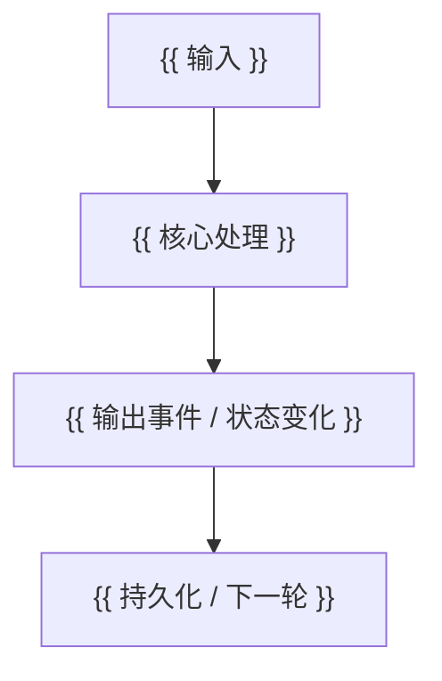

<!-- 写作说明（本模板始终保持 draft: true）：
1. 复制为新文章时设置文件名和 front matter；优化已有文章时保留原 title、date、slug，不为统一系列命名擅自改标题或 URL。
2. 保留下面八个主章节。只展开模块真实存在的分支，不机械补齐所有 ADK 能力。
3. 先选择一个能跑通的具体例子，再沿同一组输入、对象名和 ID 解释正常路径与分支。
4. 读取 v2.4.0 tag，不读取移动分支或工作区修改。先核对 tag 对应的 commit：
   git -C "$ADK_SOURCE_DIR" rev-parse 'v2.4.0^{commit}'
   git -C "$ADK_SOURCE_DIR" show 'v2.4.0:path/to/file.go'
   取得行号时对 git show 的输出执行 nl -ba；不要混用工作区行号。
5. 关键结论在正文就近链接到 blob/v2.4.0/path#Lx-Ly；文末索引不能代替正文证据。
6. 源码事实、设计解释、可复现实例分别表述。保留有帮助的原始注释，明确标注摘录、删节或伪代码。
7. 作者核验范围、运行命令、测试结果和未覆盖项只留在本注释或发布前检查中，不写进正文；正文只描述系统行为和读者可复现的方法。
8. 完成文末检查后才将新文章改为 draft: false；不要将本模板加入已发布文章的阅读导航。
9. 正文聚焦系统行为，不写“我已”“本文已核对”“接下来优化”等作者或助手行为，不写工作区 / Git 核验过程、编辑过程和文章迁移计划。
10. 必要的技术验证方法写成读者可以复现的实例：给出环境条件、最小配置、执行命令、输入和预期输出，不写成作者工作报告。
11. 多用 ASCII 展示对象层次/调用栈，用 Mermaid 展示时序/分支/状态变化；图后解释最关键的因果关系，避免只画符号。保持图宽度适合正文与移动端，全屏可概览。
12. 使用 ann 突出调用顺序、作用域、返回替代结果、跳过阶段与误区；只包短语，标签简短，不放进代码块，不用大量标注代替论证。每张图和每个标注都应增加新的理解价值。
13. 术语优先采用源码中的 API 名和准确的通用名词。先说明哪个条件触发、哪段代码执行或跳过；不要用抽象标签代替控制流解释。对 iterator 直接写调用方法、创建迭代函数和开始 range 的时间关系；对 callback 直接写返回值及其后续动作。
14. 先列出理解模块所必需的核心概念，再组织正文，不能因沿调用链写作而漏掉基础结构。例如 Workflow 必须解释 graph、Edge、Node、输入映射、路由与调度状态，不能只介绍 Node 接口和一个运行示例。对调度算法给出具体小图和逐步状态变化。
-->

# ADK-Go 源码阅读笔记 · {{ 模块名称 }}：{{ 一句话说明 }}

> **源码基准：[ADK-Go v2.4.0](https://github.com/google/adk-go/tree/v2.4.0)**，commit `4e57df40cbd35f055ba654b03ffb0e509fdd754a`。本文的“当前实现”均指这个版本。
>
> 本文范围：{{ 普通路径与重点分支 }}；{{ 未覆盖的相邻能力 }}另见配套文章。
>
> [返回 ADK 源码阅读合集](/blog/adk/) · 配套阅读：{{ 相关文章链接 }}。

本文回答三个问题：

1. {{ 从应用侧看，这个模块接收什么、产出什么？ }}
2. {{ 一个具体输入经过哪些对象和函数，怎样得到结果？ }}
3. {{ 什么情况会继续、停止或失败，谁负责后续处理？ }}

先用一句话给出答案：{{ 用输入、关键处理和输出说明模块职责，避免只把类型名串起来 }}。

### 阅读前先分清这些词

| 术语 | 本文中的准确含义 | 和哪个相近概念不同 |
| --- | --- | --- |
| `{{ 术语一 }}` | {{ 创建时机、有效范围或单位 }} | {{ 例如一次 invocation 可以包含多个模型 step }} |
| `{{ 术语二 }}` | {{ 在代码中对应哪个字段或类型 }} | {{ 例如 Event.Author 与 Content.Role 描述不同维度 }} |
| `{{ 术语三 }}` | {{ 后文会反复使用的核心概念 }} | {{ 只保留理解主线必需的术语 }} |

### 贯穿示例与阅读路线

本文用 `{{ 具体请求，例如“北京今天的天气如何？” }}` 作为贯穿示例。配置为 `{{ Agent、工具、存储或其他必要配置 }}`；正常情况下应得到 `{{ 可观察的结果 }}`。先假设 `{{ 没有 callback 替代结果、重试、并发等哪些干扰 }}`，第四节再逐项改变条件。

第一次阅读可先看第一至三节，理解一次正常运行，再读第五至七节。需要解释异常行为时，回到第四节按触发条件定位分支。

## 一、源码入口与阅读地图

| 阅读顺序 | 文件 / 符号 | 需要回答的问题 |
| --- | --- | --- |
| 1. 应用入口 | `{{ public/package.go: Symbol }}` | {{ 用户通过什么配置或调用进入？ }} |
| 2. 创建与装配 | `{{ constructor.go: Symbol }}` | {{ 谁创建对象，哪些依赖在这里注入？ }} |
| 3. 主执行函数 | `{{ implementation.go: Symbol }}` | {{ 正常路径经过什么阶段？ }} |
| 4. 上层消费方 | `{{ caller.go: Symbol }}` | {{ 返回值或事件被谁处理，是否立即持久化？ }} |
| 5. 关键测试 | `{{ implementation_test.go: TestName }}` | {{ 哪个测试固定了最容易误解的行为？ }} |

```text
{{ 公开入口 / 配置 }}
    ↓
{{ 创建者 }} → {{ 核心对象 }} → {{ 下层依赖 }}
    ↓
{{ 返回值或事件的消费方 }}
```

{{ 说明公开 API 与内部实现的关系；如果模块位于 internal，明确应用应从哪个公开入口使用。不要让读者误以为内部类型可以直接导入。 }}

## 二、核心接口与数据结构

### 1. 公共契约：调用方提供什么，实现方保证什么

源码：{{ 带固定 tag 和行号的接口定义链接 }}。以下为**源码摘录**，{{ 如有删节，说明省略了什么 }}。

```go
{{ 保留决定控制流的接口定义和关键原始注释 }}
```

{{ 紧接代码解释参数的来源、返回值的含义和错误契约。若返回 iterator，说明构造与实际执行的时机、yield 返回 false 的意义；若返回 channel，说明谁生产、谁关闭。 }}

### 2. 内部能力：接口是否真的在这条路径上被使用

源码：{{ 能力接口、类型断言和真实调用方的固定行号链接 }}。

```go
{{ 只摘录影响本模块行为的内部接口 / wrapper / 类型断言 }}
```

{{ 解释实现此接口后会多走哪条分支、未实现时如何处理。区分公开接口、内部 capability interface 与派生 Context，不能只凭方法名推断该方法会在当前路径被调用。 }}

### 3. 对象由谁创建、修改和消费

| 类型 / 关键字段 | 创建者与生命周期 | 修改者 | 消费者 | 示例中的值 |
| --- | --- | --- | --- | --- |
| `{{ Request / input }}` | {{ 每次调用新建或跨 step 复用 }} | {{ processor / callback }} | {{ 下层接口 }} | `{{ 具体值 }}` |
| `{{ Response / output }}` | {{ 返回者 }} | {{ callback / wrapper }} | {{ 事件转换或上层调用方 }} | `{{ 具体值 }}` |
| `{{ Event / Actions / State }}` | {{ 创建时机 }} | {{ 写入者 }} | {{ 保存与应用方 }} | `{{ 具体变化 }}` |

{{ 对最容易混淆的一对字段给出对照。例如发给模型的工具声明与本地执行表、Content.Role 与 Event.Author、内存 delta 与已经持久化的 State。说明同一对象被修改还是创建了新对象，是否存在复制或共享。 }}

只摘录后文实际使用的字段；完整结构体很长时，给源码链接即可。

## 三、主执行路径：调用栈、数据流与事件流

### 1. 从具体输入进入调用栈

输入：`{{ 与开篇相同的具体请求 }}`。初始状态：`{{ 最少必要历史、配置或状态 }}`。

```text
{{ public entry }}
  → {{ coordinator }}
    → {{ core implementation }}
      → {{ lower-level call }}
```

{{ 标明省略的中间层；不要把跨 goroutine、回调、iterator 的转交画成普通直接调用。 }}

### 2. 跟踪对象的前后变化

以下是**对象快照示意**，只保留本文需要的字段，不代表可直接发送的完整 API JSON。

```text
{{ 输入对象 }}
  {{ field }} = {{ 具体值 }}

{{ 核心函数处理后的对象 }}
  {{ field }} = {{ 新值；沿用同一个示例 ID }}

{{ 上层最终看到或保存的对象 }}
  {{ field }} = {{ 具体结果 }}
```

| 阶段 | 执行函数 | 读取什么 | 写入 / 返回什么 | 为什么需要这一步 |
| --- | --- | --- | --- | --- |
| 1. {{ 准备 }} | `{{ symbol }}` | {{ 具体输入 }} | {{ request / context }} | {{ 下游需要的条件 }} |
| 2. {{ 执行 }} | `{{ symbol }}` | {{ 上一步对象 }} | {{ response / action }} | {{ 实际发生的处理 }} |
| 3. {{ 反馈 }} | `{{ symbol }}` | {{ 结果 }} | {{ event / state }} | {{ 谁因此能继续 }} |

如果正常路径包含第二次模型调用或后续 step，必须列出第二次输入里**多了什么**，说明新信息如何由上一步进入这一步。

### 3. 关键源码与事件顺序

源码：{{ 核心函数的固定行号链接 }}。以下为**{{ 原样摘录 / 删除无关分支的摘录 / 控制流伪代码 }}**。

```go
{{ 只保留足以解释顺序和对象变化的代码；删节处写明省略内容 }}
```

按代码的实际执行顺序解释：

1. {{ 第一项条件检查什么，为什么先检查 }}。
2. {{ 关键调用使用上节哪个对象，会原地修改还是返回新对象 }}。
3. {{ 结果交给谁，交出控制权后何时恢复 }}。

| 时刻 | 调用方 / UI 可见内容 | 内存对象与历史的变化 | 控制权在谁手里 |
| --- | --- | --- | --- |
| T0 | {{ 输入 }} | {{ 初始状态 }} | {{ 调用方 }} |
| T1 | {{ 中间返回值 / 事件 }} | {{ 尚未保存或已经保存，给出依据 }} | {{ 核心模块或上层消费者 }} |
| T2 | {{ 下一事件 / 结果 }} | {{ 下一 step 可以读取哪些新信息 }} | {{ 消费方或下一模块 }} |

{{ 若涉及 yield，解释“生产者暂停 → 消费者处理 / 保存 → 返回生产者 → 后续执行”的真实闭环；说明消费者提前停止会跳过哪些操作。若不存在事件流，使用状态转换表，不要虚构事件。 }}

用 ASCII 表达静态层次，用 Mermaid 表达动态时序或条件分支；不同图各解释一个问题，避免反复画同一条主线：



### 4. 继续、停止与正常结果

| 源码判定（按实际检查顺序） | 对本示例的影响 | 后续动作 | 判定负责方 |
| --- | --- | --- | --- |
| `{{ continue condition }}` | {{ 结果尚不完整 }} | {{ 继续哪一层循环 }} | `{{ symbol }}` |
| `{{ stop condition }}` | {{ 本次执行完成 }} | {{ 返回或结束 iterator }} | `{{ symbol }}` |
| `{{ pause condition }}` | {{ 等待外部结果；若模块无暂停能力则删去 }} | {{ 保存恢复信息 }} | `{{ symbol }}` |

{{ 明确多个条件之间是 AND 还是 OR；区分“某个事件被标记 final”“当前 step 结束”“整个 invocation 完成”，以及特殊判定是否优先于普通判定。最后回到开篇例子，给出预期调用次数和最终可见结果。 }}

## 四、关键细节与分支

<!-- 按“读者在哪种实际情形下会遇到它”组织，先常见分支再特殊模式。
每个分支应改变贯穿示例中的一个条件；不必把每个私有函数独立写成小节。
仍是 TODO / no-op 的 processor 直接指出当前没有实现，不能按名字补全行为。 -->

### 4.1 `{{ 分支一 }}`

**触发条件与源码：** `{{ 真实条件表达式 }}`，见 {{ 固定行号链接 }}。

**改变示例中的一个条件：** {{ 例如 BeforeModel 返回缓存结果、工具请求确认或历史超过阈值 }}。

**实际执行顺序：**

```text
{{ step 1 }} → {{ step 2 }} → {{ step 3 }}
```

**与正常路径相比的对象变化：** {{ 哪个请求、响应、EventActions 或状态字段发生变化；哪些正常阶段被跳过、哪些外层阶段仍会继续 }}。

**为什么这样处理：** {{ 从调用关系和协议要求推导的解释；没有设计文档依据时使用“从实现看” }}。

**可观察结果与限制：** {{ 调用方看到什么、是否保存、是否可恢复；最后纠正一个具体误解 }}。

### 4.2 `{{ 分支二 }}`

{{ 沿用 4.1 的结构。如果跨 invocation 恢复，补全“首次执行 → 暂停信号 → 用户 / 外部系统返回 → 匹配原调用 → 重新执行”的链条，标明各 ID 的用途和谁保存恢复信息。 }}

### 4.3 错误、取消与恢复

| 发生位置 | 表现形式 | 谁处理 | 调用方最终看到什么 | 后续是否继续 |
| --- | --- | --- | --- | --- |
| `{{ symbol }}` | {{ Go error }} | {{ callback / 外层 iterator }} | {{ error 或替代 response }} | {{ 终止哪一层 }} |
| `{{ symbol }}` | {{ 结果内的 error 字段 / ErrorCode }} | {{ 下游如何解释 }} | {{ 正常事件中的错误内容 }} | {{ 具体条件 }} |
| `{{ symbol }}` | {{ context cancellation / 消费者停止 }} | {{ 哪层检查 }} | {{ 已产出事件是否保留 }} | {{ 未执行部分 }} |

{{ 只写源码中实际存在的恢复入口。重试、续接一次连接、重新执行工具和恢复 workflow 是不同动作；写清恢复单位、触发条件和是否可能重复副作用。没有覆盖的路径明确标为不在本文范围。 }}

### 4.4 并发与顺序

{{ 如果模块串行且没有并发语义，用一段话说明并删去此表。 }}

| 维度 | 当前实现保证什么 | 贯穿示例中的表现 |
| --- | --- | --- |
| 执行开始 / 完成顺序 | {{ 串行或并发；不能用结果排序推断执行顺序 }} | {{ 两个具体操作的次序 }} |
| 结果 / action 合并 | {{ 按输入排序、覆盖、递归合并等实际规则 }} | {{ 同名 key 最终值 }} |
| 外部副作用 | {{ 是否存在回滚、去重或版本保护 }} | {{ 哪个失败可能留下已完成操作 }} |

## 五、重新梳理：运行时架构与边界

| 边界 | 接收与产出 | 负责的动作 | 交给其他模块的动作 |
| --- | --- | --- | --- |
| `{{ 上层 }}` | {{ input → output }} | {{ 装配、消费、保存等 }} | {{ 下层执行 }} |
| `{{ 本模块 }}` | {{ input → output }} | {{ 核心职责 }} | {{ 模型调用、业务副作用等 }} |
| `{{ 下层 }}` | {{ input → output }} | {{ 专有职责 }} | {{ 状态管理等 }} |

{{ 用一段话解释第三节的完整例子如何跨过这些边界。只总结职责，不再逐行复述流程。 }}

**主线规则与例外：** {{ 例如“通常由 A 产事件、B 保存”，同时说明源码中的哪条旁路绕过 B；不能把普通路径推成所有运行模式的定律。 }}

## 六、这个模块解决了什么问题

### 1. 它解决的核心问题

{{ 回到贯穿示例：如果只有公开的下层接口，还缺少哪一步才能完成用户请求？指出这个模块具体补齐的协议或协调工作。 }}

### 2. 没有它，应用需要重复实现什么

{{ 列出两三项已在源码中看到的工作，解释为什么适合集中实现；避免“提高效率、增强可扩展性”这类无法从本文证据判断的结论。 }}

### 3. 设计代价和适用限制

| 当前选择 | 得到什么 | 需要承担什么 | 使用者需要做什么 |
| --- | --- | --- | --- |
| {{ 源码显示的设计选择 }} | {{ 可解释的收益 }} | {{ 真实限制或条件 }} | {{ 有针对性的使用建议 }} |
| {{ 第二个选择 }} | {{ 收益 }} | {{ 代价 }} | {{ 建议 }} |

{{ 本节是依据实现做出的架构解释；除非有源码注释或设计文档，不将推测写成作者当初的设计意图。 }}

## 七、重点结论与常见误解

### 必须记住

- **{{ 职责结论 }}**：{{ 一句话给出实际边界 }}。
- **{{ 执行结论 }}**：{{ 指出最关键的顺序或对象变化 }}。
- **{{ 使用结论 }}**：{{ 指出一个必须考虑的停止、错误或副作用条件 }}。

### 常见误解

| 容易产生的理解 | v2.4.0 中的实际行为 | 回看位置 |
| --- | --- | --- |
| {{ 能由本文示例反驳的具体误解 }} | {{ 准确行为与条件 }} | {{ 正文小节或源码链接 }} |
| {{ 第二个误解 }} | {{ 实际边界 }} | {{ 回看位置 }} |

### 用贯穿示例检查自己是否理解

1. {{ 让读者预测某个输入到达时哪个函数先执行 }}？
2. {{ 改变一个条件，让读者判断哪些阶段跳过、哪些仍运行 }}？
3. {{ 给出一次失败或停止，让读者判断已产生的结果与后续行为 }}？

{{ 紧接问题给出简短答案和对应小节；问题应能用本文证据回答，不变成新的未解课题。 }}

## 八、相关源码与进一步阅读

正文关键结论使用固定 tag 和**该 tag 下的真实行号**；本节保留便于继续阅读的文件与测试索引：

```text
https://github.com/google/adk-go/blob/v2.4.0/{{ path }}#L{{ start }}-L{{ end }}
```

| 主题 | 文件 / 符号 / 文章 | 建议关注的内容 |
| --- | --- | --- |
| 入口 | {{ 固定源码链接 }} | {{ 配置、接口或创建过程 }} |
| 核心实现 | {{ 固定源码链接 }} | {{ 本文主循环 }} |
| 调用方 | {{ 固定源码链接 }} | {{ 返回值处理与持久化 }} |
| 行为测试 | {{ 固定测试链接与测试名 }} | {{ 正常、分支或错误案例 }} |
| 前置阅读 | {{ 已发布文章链接 }} | {{ 本文不重复展开的知识 }} |
| 后续阅读 | {{ 已发布文章链接 }} | {{ 继续追踪哪个边界 }} |

<!-- 发布前检查（复制出的文章执行，本模板保留占位符与 draft: true）：
- 作者核验记录仅保留在本注释：正常调用链 {{ 实现与调用方 }}；关键分支 {{ 源码与测试依据 }}；运行命令和结果 {{ 实际执行项 }}；未覆盖项 {{ 缺少的条件或范围 }}。
- 删除所有写作提示和 {{ ... }} 占位符，完成标题、description、slug 与合集导航。
- 从 v2.4.0 tag 核对 API 签名、创建者、消费方、错误路径；检查固定链接与行号真实对应。把核验范围记录在本注释中，不搬进正文。
- 检查同一示例的输入、对象名和 ID 前后一致；区分摘录、删节、伪代码、对象示意和可运行示例。
- 检查 no-op、旁路与没有验证的模式；不将接口存在、测试存在或文章构建成功当成行为验证。
- 对可运行代码执行适合的验证；正文只提供读者可复现的命令、输入和预期输出，不写作者的执行报告。将“源码已有测试”“本次命令通过”“真实外部服务成功”三种证据的区别记录在本注释中。
- 执行 hugo --gc --minify --destination /tmp/elonnzhang-hugo-check。
- 检查新文章与至少一篇已有文章的生成页；若包含 Mermaid，检查实际渲染与全屏开关。
- 检查 annotation 不在代码块内；执行 git diff --check。
- 确认正文没有本地路径、凭据、无依据的版本结论或指向 draft 模板的发布链接。
- 文章完成后才将 draft 改为 false，并在合集登记实际校准范围；未核对文章不能随之改为已验证。
-->
